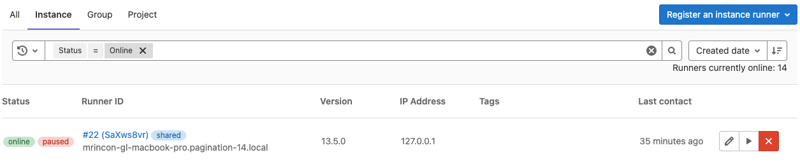



- Tier: 基础版，专业版，旗舰版
- Offering: 私有化部署



**管理**区域提供了一个 Web UI，用于管理和配置极狐GitLab 私有化部署实例的各项功能。如果您是管理员，要访问**管理**区域：

- 在极狐GitLab 18.5 及更高版本中：
  - 在右上角，选择**管理员**。
  - 在顶部栏中，选择**搜索或跳转到**，然后选择**管理区域**。
- 在极狐GitLab 17.3 及更高版本中：在左侧边栏的底部，选择**管理员**。
- 在极狐GitLab 16.7 及更高版本中：在左侧边栏的底部，选择**管理区域**。

如果极狐GitLab 实例使用管理员模式，您必须先
[为您的会话启用管理员模式](settings/sign_in_restrictions.md#turn-on-admin-mode-for-your-session)，
然后才能看到**管理员**。

> [!note]
> 只有极狐GitLab 私有化部署上的管理员才能访问**管理**区域。
> 在 JihuLab.com 上，**管理**区域功能不可用。

## 管理项目

要管理极狐GitLab 实例中的所有项目：

1. 在右上角，选择**管理员**。
1. 在左侧边栏中，选择**概览** > **项目**。该页面会显示每个项目的：

   - 名称
   - 描述
   - 可见性级别
   - 角色
   - 主题
   - 状态
   - 存储大小
   - 星标数
   - forks 数
   - 合并请求数
   - 议题数

1. 可选。选择一个标签页：

   - **活跃**显示所有活跃项目。
   - **非活跃**显示已归档或待删除的项目。

1. 可选。组合使用筛选条件以找到您想要的项目。可按以下条件筛选：

   - 名称。您必须输入至少三个字符。
   - 可见性，可以是公开、内部或私有。
   - 编程语言。
   - 群组或用户命名空间。
   - 您拥有所有者角色的项目。

1. 可选。要更改排序顺序，请选择排序下拉列表并选择所需的顺序。
   可用的排序选项包括：

   - 名称
   - 创建日期
   - 更新日期
   - 星标数
   - 存储大小

### 编辑项目

要从**管理**区域的“项目”页面编辑项目的名称或描述：

1. 在右上角，选择**管理员**。
1. 在左侧边栏中，选择**概览** > **项目**。
1. 找到您要编辑的项目，然后选择**操作** () > **编辑**。
1. 编辑**项目名称**或**项目描述**。
1. 选择**保存更改**。

### 删除项目

要删除项目：

1. 在右上角，选择**管理员**。
1. 在左侧边栏中，选择**概览** > **项目**。
1. 找到您要删除的项目，然后选择**操作** () > **删除**。
1. 在确认对话框中，选择**是，删除项目**。

## 管理用户

**管理**区域的“用户”页面会显示每个用户的以下信息：

- 用户名
- 电子邮件地址
- 项目成员身份数量
- 群组成员身份数量
- 账号创建日期
- 最后活动日期

要从**管理**区域的“用户”页面管理所有用户：

1. 在右上角，选择**管理员**。
1. 在左侧边栏中，选择**概览** > **用户**。
1. 可选。要更改排序顺序（默认为用户名）：

   1. 选择排序下拉列表。
   1. 选择所需的顺序。

1. 可选。使用用户搜索框按以下条件搜索和筛选用户：

   - 用户的**访问级别**。
   - **双重身份验证**是启用还是禁用。
   - 用户的**状态**。
   - 用户的**类型**是否为[占位符](../user/import/mapping/post_migration_mapping.md#placeholder-users)。

1. 可选。在用户搜索字段中输入文本，然后按 <kbd>Enter</kbd>。此文本搜索不区分大小写，
   并对名称、用户名和电子邮件应用部分匹配。

要编辑用户，请找到该用户所在的行，然后选择**编辑**。

### 删除用户

要从**管理**区域的“用户”页面删除用户，或删除用户及其贡献：

1. 在右上角，选择**管理员**。
1. 在左侧边栏中，选择**概览** > **用户**。
1. 找到您要删除的用户。在该行中，选择**用户管理**
   ()，然后选择所需的选项。

### 用户模拟

管理员可以模拟任何其他用户，包括其他管理员。这使您能够查看该用户在极狐GitLab 中看到的内容，并代表该用户执行操作。

要模拟用户：

- 通过 UI：
  1. 在右上角，选择**管理员**。
  1. 在左侧边栏中，选择**概览** > **用户**。
  1. 从用户列表中，选择一个用户。
  1. 在右上角，选择**模拟**。
  1. 要停止模拟，请在右上角选择**停止模拟** ()。
- 使用 API，通过[模拟令牌](../api/rest/authentication.md#impersonation-tokens)。

所有模拟活动都会[通过审计事件记录捕获](compliance/audit_event_reports.md#user-impersonation)。
默认情况下，模拟处于启用状态。极狐GitLab 可以配置为
[禁用模拟](../api/rest/authentication.md#disable-impersonation)。

### 用户身份



- Tier: 专业版，旗舰版



使用身份验证提供商时，管理员可以查看用户的身份。此页面会显示用户的身份，包括 SCIM 身份。使用此信息可排查 SCIM 相关问题，并确认账号正在使用的身份。

为此：

1. 在右上角，选择**管理员**。
1. 在左侧边栏中，选择**概览** > **用户**。
1. 从用户列表中，选择一个用户。
1. 选择**身份**。

### 用户权限导出



- Tier: 专业版，旗舰版
- Offering: 私有化部署



当您导出用户权限时，导出的信息会显示用户在群组和项目中拥有的直接成员身份。它包含以下数据，且仅限于前 100,000 名用户：

- 用户名
- 电子邮件
- 类型
- 路径
- 访问级别（[项目](../user/permissions.md#project-permissions)和
  [群组](../user/permissions.md#group-permissions)）
- 最后活动日期。有关填充此列的活动列表，请参阅
  [用户 API 文档](../api/users.md#list-a-users-activity)。

要导出极狐GitLab 实例中所有活跃用户的用户权限：

1. 在右上角，选择**管理员**。
1. 在左侧边栏中，选择**概览** > **用户**。
1. 在右上角，选择**将权限导出为 CSV** ()。

### 用户统计信息

**用户统计信息**页面按角色提供用户账号的概览。这些统计信息每天计算一次。上次更新之后所做的用户更改不会反映在其中。这些总计也包括在内：

- 计费用户
- 被阻止的用户
- 用户总数

极狐GitLab 计费基于[计费用户](../subscriptions/manage_seats.md#billable-users)的数量。

### 为用户添加电子邮件

要手动向用户账号添加电子邮件地址：

1. 在右上角，选择**管理员**。
1. 在左侧边栏中，选择**概览** > **用户**。
1. 找到该用户并选择该用户。
1. 选择**编辑**。
1. 在**电子邮件**中，输入新的电子邮件地址。这会将新的电子邮件地址添加到
   该用户，并将之前的电子邮件地址设为辅助地址。
1. 选择**保存更改**。

## 用户同期群

[同期群](user_cohorts.md)标签页显示新用户的月度同期群及其随时间推移的活动。

## 阻止用户创建顶级群组

管理员可以阻止特定用户创建顶级群组。这些用户仍然可以创建子群组，并在现有的组织结构中协作。

要阻止用户创建顶级群组：

1. 在右上角，选择**管理员**。
1. 在左侧边栏中，选择**概览** > **用户**。
1. 找到该用户并选择该用户。
1. 选择**编辑**。
1. 清除**可以创建顶级群组**复选框。
1. 选择**保存更改**。

关闭此设置后：

- 该用户无法创建顶级群组。
- 该用户可以在其拥有维护者或所有者角色的群组中创建子群组，
  具体取决于该群组的[子群组创建权限](../user/group/subgroups/_index.md#change-who-can-create-subgroups)。

## 管理群组

> [!flag]
> 此功能的可用性由功能标志控制。

要管理极狐GitLab 实例中的所有群组：

1. 在右上角，选择**管理员**。
1. 在左侧边栏中，选择**概览** > **群组**。该页面会显示每个群组的：

   - 名称
   - 描述
   - 可见性级别
   - 角色
   - 状态
   - 存储大小
   - 子群组数
   - 项目数
   - 成员数

1. 可选。选择一个标签页：

   - **活跃**显示所有活跃群组。
   - **非活跃**显示待删除的群组。

1. 可选。要更改排序顺序，请选择排序下拉列表并选择所需的顺序。
   可用的排序选项包括：

   - 名称
   - 创建日期
   - 更新日期
   - [存储大小](../user/storage_usage_quotas.md)

1. 可选。要按名称筛选群组，请在搜索栏中输入至少三个字符。
1. 可选。要[创建新群组](../user/group/_index.md#create-a-group)，请选择**新建群组**。

### 编辑群组

要从**管理**区域的“群组”页面编辑群组的名称或描述：

1. 在右上角，选择**管理员**。
1. 在左侧边栏中，选择**概览** > **群组**。
1. 找到您要编辑的群组，然后选择**操作** () > **编辑**。
1. 编辑**群组名称**或**群组描述**。
1. 选择**保存更改**。

### 删除群组

要删除群组：

1. 在右上角，选择**管理员**。
1. 在左侧边栏中，选择**概览** > **群组**。
1. 找到您要删除的群组，然后选择**操作** () > **删除**。
1. 在确认对话框中，选择**确认**。

## 管理主题



- Status: 测试版



使用[主题](../user/project/project_topics.md)对相似项目进行分类和查找。

### 查看所有主题

要查看极狐GitLab 实例中的所有主题：

1. 在右上角，选择**管理员**。
1. 在左侧边栏中，选择**概览** > **主题**。

对于每个主题，该页面会显示其名称以及使用该主题标记的项目数量。

### 搜索主题

1. 在右上角，选择**管理员**。
1. 在左侧边栏中，选择**概览** > **主题**。
1. 在搜索框中，输入您的搜索条件。
   主题搜索不区分大小写，并应用部分匹配。

### 创建主题

要创建主题：

1. 在右上角，选择**管理员**。
1. 在左侧边栏中，选择**概览** > **主题**。
1. 选择**新建主题**。
1. 输入**主题标识（名称）**和**主题标题**。
1. 可选。输入**描述**并添加**主题头像**。
1. 选择**保存更改**。

创建的主题会显示在**探索主题**页面上。

分配的主题仅对有权访问该项目的所有人可见，但所有人都可以看到极狐GitLab 实例上存在哪些主题。请勿在主题名称中包含敏感信息。

### 编辑主题

您可以随时编辑主题的名称、标题、描述和头像。要编辑主题：

1. 在右上角，选择**管理员**。
1. 在左侧边栏中，选择**概览** > **主题**。
1. 在该主题所在的行中，选择**编辑**。
1. 编辑主题标识（名称）、标题、描述或头像。
1. 选择**保存更改**。

### 移除主题

如果您不再需要某个主题，可以将其永久移除。要移除主题：

1. 在右上角，选择**管理员**。
1. 在左侧边栏中，选择**概览** > **主题**。
1. 要移除主题，请在该主题所在的行中选择**移除**。

### 合并主题

您可以将分配给某个主题的所有项目移动到另一个主题。源主题随后会被永久删除。合并后的主题被删除后，您将无法恢复它。

要合并主题：

1. 在右上角，选择**管理员**。
1. 在左侧边栏中，选择**概览** > **主题**。
1. 选择**合并主题**。
1. 从**源主题**下拉列表中，选择您要合并并移除的主题。
1. 从**目标主题**下拉列表中，选择您要将源主题合并到的主题。
1. 选择**合并**。

## 管理 Gitaly 服务器

您可以从**管理**区域的 **Gitaly 服务器**
页面列出极狐GitLab 实例中的所有 Gitaly 服务器。有关更多详细信息，请参阅 [Gitaly](gitaly/_index.md)。

要访问 **Gitaly 服务器**页面：

1. 在右上角，选择**管理员**。
1. 在左侧边栏中，选择**概览** > **Gitaly 服务器**。

该页面包含有关每个 Gitaly 服务器的以下信息：

| 字段          | 描述 |
|----------------|-------------|
| 存储        | 代码仓库存储 |
| 地址        | Gitaly 服务器正在监听的网络地址 |
| 服务器版本 | Gitaly 版本 |
| Git 版本    | Gitaly 服务器上安装的 Git 版本 |
| 最新     | 指示 Gitaly 服务器版本是否为可用的最新版本。绿点表示该服务器为最新版本。 |

## 管理组织

> [!flag]
> 在极狐GitLab 私有化部署上，默认情况下此功能不可用。要使其可用，管理员
> 可以[启用功能标志](feature_flags/_index.md)，名称为 `ui_for_organizations`。
> 在 JihuLab.com 上，此功能不可用。
> 此功能尚未准备好用于生产环境。

**管理**区域中的“组织”页面默认按项目最后更新时间的倒序列出所有项目。每个项目会显示：

- 名称
- 命名空间
- 描述
- 大小，最多每 15 分钟更新一次

要从此页面管理极狐GitLab 实例中的所有组织：

1. 在右上角，选择**管理员**。
1. 在左侧边栏中，选择**概览** > **组织**。

## CI/CD 部分

### 管理 Runner

要管理极狐GitLab 实例中的所有 Runner：

1. 在右上角，选择**管理员**。
1. 在左侧边栏中，选择 **CI/CD** > **Runner**。

每个 Runner 会显示以下信息：

| 属性    | 描述 |
|--------------|-------------|
| 状态       | Runner 的状态。对于旗舰版，可使用升级状态。 |
| Runner 详细信息 | 有关 Runner 的信息，包括部分令牌以及注册该 Runner 的计算机的详细信息。 |
| 版本      | 极狐GitLab Runner 版本。 |
| 作业         | 该 Runner 运行的作业总数。 |
| 标签         | 与该 Runner 关联的标签。 |
| 最后联系 | 指示该 Runner 最后一次联系极狐GitLab 实例的时间戳。 |

您还可以编辑、暂停或移除每个 Runner。

有关更多信息，请参阅[极狐GitLab Runner](https://gitlab.cn/docs/runner/)。

#### 搜索和筛选 Runner

要搜索 Runner 的描述：

1. 在**搜索或筛选结果**文本框中，输入您要查找的 Runner 的
   描述。
1. 按 <kbd>Enter</kbd>。

要按状态、类型和标签筛选 Runner：

1. 选择一个标签页或**搜索或筛选结果**文本框。
1. 选择任意**类型**，或按**状态**或**标签**筛选。
1. 选择或输入您的搜索条件。

#### 批量删除 Runner

要同时删除多个 Runner：

1. 在右上角，选择**管理员**。
1. 在左侧边栏中，选择 **CI/CD** > **Runner**。
1. 在您要删除的 Runner 左侧，选中复选框。
   要选择页面上的所有 Runner，请选中列表上方的
   复选框。
1. 选择**删除所选**。

### 管理作业

要管理极狐GitLab 实例中的所有作业：

1. 在右上角，选择**管理员**。
1. 在左侧边栏中，选择 **CI/CD** > **作业**。所有作业按作业 ID 降序列出。
1. 选择**全部**标签页可列出所有作业。选择**待处理**、**运行中**或**已完成**
   标签页可仅列出该状态的作业。

对于每个作业，会列出以下详细信息：

| 字段    | 描述 |
|----------|-------------|
| 状态   | 作业状态。为**已通过**、**已跳过**或**失败**之一。              |
| 作业      | 包含指向该作业、分支以及启动作业的提交的链接。 |
| 流水线 | 包含指向特定流水线的链接。                               |
| 项目  | 该作业所属的项目名称和组织。        |
| Runner   | 分配用于执行该作业的 CI Runner 的名称。                      |
| 阶段    | 在 `.gitlab-ci.yml` 文件中声明该作业的阶段。              |
| 名称     | 在 `.gitlab-ci.yml` 文件中指定的作业名称。                   |
| 计时   | 作业的持续时间，以及作业完成距现在多久。                |
| 覆盖率 | 测试覆盖率百分比。                                           |

## 监控部分

以下主题记录了**管理**区域的**监控**部分。

### 系统信息

**系统信息**页面提供以下统计信息：

| 字段          | 描述                                       |
|:---------------|:--------------------------------------------------|
| CPU            | 可用的 CPU 核心数                     |
| 内存使用量   | 正在使用的内存，以及可用的总内存         |
| 磁盘使用量     | 正在使用的磁盘空间，以及可用的总磁盘空间 |
| 系统启动时间 | 托管极狐GitLab 的系统启动的时间。 |

这些统计信息仅在您进入**系统信息**页面或在浏览器中刷新该页面时才会更新。

### 后台作业

**后台作业**页面显示 Sidekiq 仪表板。极狐GitLab 使用 Sidekiq
执行后台进程。

Sidekiq 仪表板包含：

- 每个[作业生命周期状态](https://github.com/sidekiq/sidekiq/wiki/Job-Lifecycle)对应一个标签页。
- 后台作业统计信息的明细。
- **已处理**和**失败**作业的实时图表，轮询间隔可选。
- **已处理**和**失败**作业的历史图表，时间跨度可选。
- Redis 统计信息，包括：
  - 版本号
  - 运行时间，以天为单位
  - 连接数
  - 当前内存使用量，以 MB 为单位
  - 峰值内存使用量，以 MB 为单位

### 数据管理

**数据管理**页面提供了一个全面的界面，用于查看和管理 Geo 主站点上所有组件的验证状态。
这些组件包括 Geo 支持的[所有数据类型](geo/replication/datatypes.md)。

使用此页面可以：

- 识别导致验证失败但无需访问 Rails 控制台的孤立文件或数据库记录。
- 查看详细的错误信息，并直接从 UI 采取纠正措施。
- 跟踪所有组件的验证状态，并识别失败中的模式。
- 一次性为所有对象触发校验和计算。

列表视图显示所选组件的验证状态。

1. 从下拉列表中选择一个组件，以在不同的验证模型（项目、上传等）之间切换。
   在列表视图中，您可以：

   - 按校验和状态（失败、待处理、成功）筛选对象。
   - 浏览大型结果集。
   - 查看每个对象的最后校验和时间、最后失败时间和失败原因。
   - 为单个对象触发校验和计算。

1. 从列表视图中选择单个模型，以查看特定对象验证状态的
   全面信息，例如：

   - 有关已验证对象的详细信息。
   - 当前校验和状态及历史记录。
   - 如果验证失败，则显示详细的失败原因。
   - 重新计算该对象校验和的选项。

### 数据库诊断

数据库诊断页面包含多项检查，用于尝试标记数据库的常见问题：

- 由 [PostgreSQL 排序规则变更](https://gitlab.com/groups/gitlab-org/-/work_items/8573)导致的索引损坏
- [架构差异](https://gitlab.com/groups/gitlab-org/-/work_items/3928)

要运行每项检查，请选择该检查的运行按钮。选择运行按钮会安排一个后台作业，将检查中的信息报告到页面上。

该页面还会显示随页面加载的 PostgreSQL 信息，包括正在运行的 vacuum 以及当前生效的 autovacuum 设置。有关更多信息，请参阅[监控 autovacuum](postgresql/vacuum.md#monitor-autovacuum)。

#### 排序规则健康检查

排序规则健康检查尝试检测导致索引损坏的 PostgreSQL 问题。如果运行 PostgreSQL 的先前操作系统使用的 `glibc` 版本早于 2.28 版，通常会发生这种情况。有关更多信息，请参阅
[升级 PostgreSQL 操作系统](postgresql/upgrading_os.md)的文档。

任何问题都会列在**损坏的索引**部分中。如果您遇到问题，可以
[修复损坏的索引](raketasks/maintenance.md#repair-corrupted-database-indexes)。

排序规则健康检查还会尝试标记常见受影响表上的重复项：

- `ci_refs`
- `ci_resource_groups`
- `environments`
- `merge_request_diff_commit_users`
- `sbom_components`
- `tags`
- `topics`

有关更多信息，请参阅[议题 505982](https://gitlab.com/gitlab-org/gitlab/-/issues/505982)。

该仪表板列出的信息与
[`gitlab:db:collation_checker` Rake 任务](raketasks/maintenance.md#detect-postgresql-collation-version-mismatches)中显示的信息相同。

#### 架构健康检查

架构健康检查会将数据库的状态与目标架构进行比较，并列出检测到的差异。没有可用的自动化架构修复工具。

如果您发现任何误报，或对检查结果有任何疑问，请参阅
[反馈议题](https://gitlab.com/gitlab-org/gitlab/-/issues/567561)。

### 日志

这些日志文件的内容有助于排查问题。每个日志文件的内容按时间顺序列出。为尽量减少性能问题，每个日志文件最多显示 2000 行。

| 日志文件                | 内容 |
|:------------------------|:---------|
| `application_json.log`  | 极狐GitLab 用户活动 |
| `git_json.log`          | 极狐GitLab 与代码仓库的失败交互 |
| `production.log`        | 从 Puma 收到的请求，以及为处理这些请求所采取的操作 |
| `sidekiq.log`           | 后台作业 |
| `repocheck.log`         | 代码仓库活动 |
| `integrations_json.log` | 极狐GitLab 与集成系统之间的活动 |
| `kubernetes.log`        | Kubernetes 活动 |

有关这些日志文件及其内容的详细信息，请参阅[日志系统](logs/_index.md)。

**日志**视图已从**管理**区域仪表板中移除，以避免多节点系统的管理员产生困惑。此视图呈现的是多节点设置的局部信息。对于多节点
系统，请将日志摄取到 Elasticsearch 和 Splunk 等服务中。

### 审计事件



- Tier: 专业版，旗舰版
- Offering: 私有化部署



**审计事件**页面列出对极狐GitLab 服务器所做的更改。使用此信息可以控制、分析并跟踪每一次更改。

### 统计信息

仪表板的**实例概览**部分列出极狐GitLab 实例的当前统计信息。可使用
[应用统计信息 API](../api/statistics.md#retrieve-application-statistics) 检索此信息。

对于小于 10,000 的值，这些统计信息显示精确计数。对于 10,000 及以上的值，当计算使用
[`TablesampleCountStrategy`](https://gitlab.com/gitlab-org/gitlab/-/blob/master/lib/gitlab/database/count/tablesample_count_strategy.rb?ref_type=heads#L16) 和
[`ReltuplesCountStrategy`](https://gitlab.com/gitlab-org/gitlab/-/blob/master/lib/gitlab/database/count/reltuples_count_strategy.rb?ref_type=heads)
策略时，这些统计信息显示近似数据。
