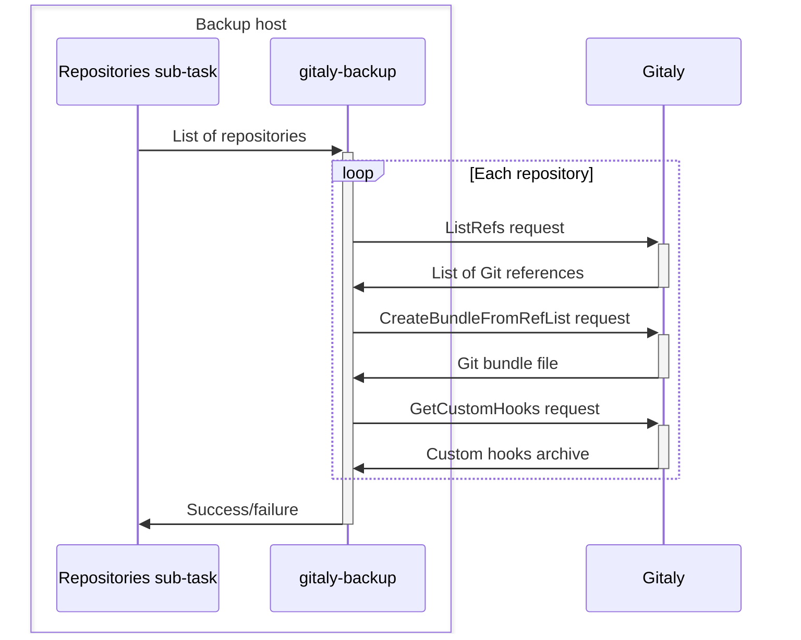
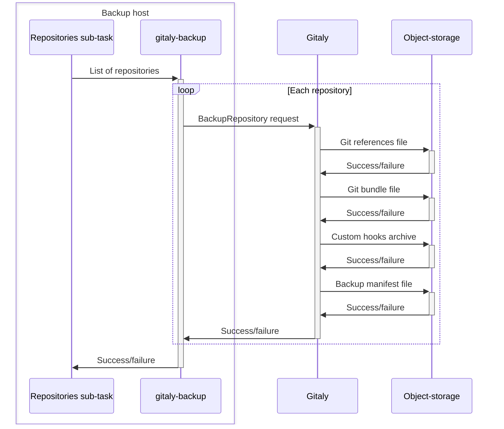

当您运行[备份命令](backup_gitlab.md#backup-command)时，备份脚本会创建一个备份归档文件，用于存储您的极狐GitLab 数据。

为创建归档文件，备份脚本会：

1. 在执行增量备份时，解压先前的备份归档文件。
1. 更新或生成备份归档文件。
1. 运行所有备份子任务，以：
   - [备份数据库](#back-up-the-database)。
   - [备份 Git 代码仓库](#back-up-git-repositories)。
   - [备份文件](#back-up-files)。
1. 将备份暂存区归档为一个 `tar` 文件。
1. 如果已[配置](backup_gitlab.md#upload-backups-to-a-remote-cloud-storage)，则将新的备份归档上传到对象存储。
1. 清理已归档的[备份暂存目录](#backup-staging-directory)文件。

<a id="back-up-the-database"></a>

## 备份数据库

为备份数据库，`db` 子任务会：

1. 使用 `pg_dump` 创建 [SQL 转储](https://www.postgresql.org/docs/16/backup-dump.html)。
1. 将 `pg_dump`的输出通过 `gzip` 管道处理，并创建一个压缩的 SQL 文件。
1. 将该文件保存到[备份暂存目录](#backup-staging-directory)。

<a id="back-up-git-repositories"></a>

## 备份 Git 代码仓库

为备份 Git 代码仓库，`repositories` 子任务会：

1. 告知 `gitaly-backup` 要备份哪些代码仓库。
1. 运行 `gitaly-backup` 以：

   - 在 Gitaly 上调用一系列远程过程调用（RPC）。
   - 收集每个代码仓库的备份数据。

1. 将收集到的数据以流式写入[备份暂存目录](#backup-staging-directory)中的目录结构。

下图说明了该流程：



Gitaly 集群（Praefect）配置的存储的备份方式与独立 Gitaly 实例相同。

- 当 Gitaly 集群（Praefect）收到来自 `gitaly-backup`的 RPC 调用时，它会重建自己的数据库。
  - 无需单独备份 Gitaly 集群（Praefect）数据库。
- 无论复制因子如何，每个代码仓库只备份一次，因为备份是通过 RPC 进行的。

<a id="server-side-backups"></a>

### 服务器端备份

服务器端代码仓库备份是备份 Git 代码仓库的一种高效方式。此方法的优势包括：

- 数据不会通过 RPC 从 Gitaly 传输。
- 服务器端备份需要的网络传输更少。
- 无需在运行备份 Rake 任务的机器上占用磁盘存储。

要在服务器端备份 Gitaly，`repositories` 子任务会：

1. 运行 `gitaly-backup`，为每个代码仓库发起一次 RPC 调用。
1. 触发存储物理代码仓库的 Gitaly 节点，将备份数据上传到对象存储。
1. 使用[备份 ID](#backup-id) 将存储在对象存储上的备份关联到所创建的备份归档。

下图说明了该流程：



<a id="back-up-files"></a>

## 备份文件

以下子任务用于备份文件：

- `uploads`：附件
- `builds`：CI/CD 作业输出日志
- `artifacts`：CI/CD 作业产物
- `pages`：Pages 内容
- `lfs`：LFS 对象
- `terraform_state`：Terraform 状态
- `registry`：容器镜像仓库镜像
- `packages`：软件包
- `ci_secure_files`：项目级安全文件
- `external_diffs`：合并请求差异（存储在外部时）

每个子任务会在特定于该任务的目录中识别一组文件，并：

1. 使用 `tar` 工具为识别出的文件创建归档。
1. 通过 `gzip` 压缩归档，而不保存到磁盘。
1. 将 `tar` 文件保存到[备份暂存目录](#backup-staging-directory)。

由于备份是从运行中的实例创建的，文件可能会在备份过程中被修改。在这种情况下，可以使用[替代策略](backup_gitlab.md#backup-strategy-option)来备份文件。`rsync` 工具会创建要备份文件的副本，并将其传递给 `tar` 进行归档。

> [!note]
> 如果您使用此策略，运行备份 Rake 任务的机器必须为复制的文件和压缩归档都提供足够的存储空间。

<a id="backup-id"></a>

## 备份 ID

备份 ID 是备份归档的唯一标识符。当您需要恢复极狐GitLab 且存在多个备份归档时，这些 ID 至关重要。

备份归档保存在由 `config/gitlab.yml` 文件中的 `backup_path` 设置指定的目录中。默认位置为 `/var/opt/gitlab/backups`。

备份 ID 由以下部分组成：

- 备份创建的时间戳
- 日期（`YYYY_MM_DD`）
- 极狐GitLab 版本
- 极狐GitLab 版本类型

以下是一个备份 ID 示例：`1493107454_2018_04_25_10.6.4-ce`

<a id="backup-filename"></a>

## 备份文件名

默认情况下，文件名遵循 `<backup-id>_gitlab_backup.tar` 结构。例如，`1493107454_2018_04_25_10.6.4-ce_gitlab_backup.tar`。

<a id="backup-information-file"></a>

## 备份信息文件

备份信息文件 `backup_information.yml` 会保存所有未包含在备份中的备份输入。该文件保存在[备份暂存目录](#backup-staging-directory)中。子任务使用此文件来确定如何恢复备份中的数据，以及如何将备份中的数据与[服务器端代码仓库备份](#server-side-backups)等外部服务关联。

备份信息文件包含以下内容：

- 备份创建的时间。
- 生成该备份的极狐GitLab 版本。
- 其他指定的选项。例如，跳过的子任务。

<a id="backup-staging-directory"></a>

## 备份暂存目录

备份暂存目录是备份和恢复过程中使用的临时存储位置。此目录：

- 在创建极狐GitLab 备份归档之前存储备份产物。
- 在恢复备份或创建增量备份之前解压备份归档。

备份暂存目录与创建完成的备份归档所在的目录相同。创建未打包的备份时，备份产物会保留在此目录中，且不会创建归档。

以下是一个包含未打包备份的备份暂存目录示例：

```plaintext
backups/
├── 1701728344_2023_12_04_16.7.0-pre_gitlab_backup.tar
├── 1701728447_2023_12_04_16.7.0-pre_gitlab_backup.tar
├── artifacts.tar.gz
├── backup_information.yml
├── builds.tar.gz
├── ci_secure_files.tar.gz
├── db
│   ├── ci_database.sql.gz
│   └── database.sql.gz
├── lfs.tar.gz
├── packages.tar.gz
├── pages.tar.gz
├── repositories
│   ├── manifests/
│   ├── @hashed/
│   └── @snippets/
├── terraform_state.tar.gz
└── uploads.tar.gz
```
