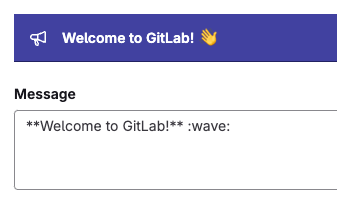
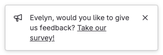



- Tier: 基础版，专业版，旗舰版
- Offering: 私有化部署



极狐GitLab 可以向极狐GitLab 实例的用户显示两种类型的广播消息：

- 横幅
- 通知

广播消息可以使用[广播消息 API](../api/broadcast_messages.md) 进行管理。

> [!warning]
> 无论定向设置如何，广播消息都可以通过 API 公开访问。请勿包含敏感或机密信息，也不要使用广播消息向特定群组或项目传达私密信息。

<a id="banners"></a>

## 横幅

横幅显示在页面顶部，也可以选择在命令行中作为 Git 远程响应显示。



```shell
$ git push
...
remote:
remote: **Welcome to GitLab** :wave:
remote:
...
```

如果同一时间有多个横幅处于活动状态，它们会按创建顺序显示在页面顶部。在命令行中，只显示最新的横幅。

只有当您将横幅配置为可关闭时，用户才能关闭横幅。

<a id="notifications"></a>

## 通知

极狐GitLab 会在页面右下角显示通知。通知中可以包含占位符，这些占位符会被替换为当前用户的属性：



```markdown
{{name}}, would you like to give us feedback?
<a href="example.com">Take our survey!</a>
```

如果同一时间有多个通知处于活动状态，只显示最新的一个。

通知支持以下占位符：

- `{{email}}`
- `{{name}}`
- `{{user_id}}`
- `{{username}}`
- `{{instance_id}}`

如果用户未登录，与用户相关的值将为空。

<a id="prerequisites"></a>

## 先决条件

您必须拥有管理员访问权限。

<a id="add-a-broadcast-message"></a>

## 添加广播消息

要向极狐GitLab 实例上的用户显示消息，请添加广播消息。

> [!warning]
> 无论定向设置如何，广播消息都可以通过 API 公开访问。请勿包含敏感或机密信息，也不要使用广播消息向特定群组或项目传达私密信息。

要添加广播消息：

1. 在右上角，选择**管理员**。
1. 在左侧边栏中，选择**消息**。
1. 在右侧，选择**添加新消息**。
1. 添加您的**消息**文本：
   - 消息内容可以包含 Markdown、表情符号以及 `a` 和 `br` HTML 标签。
   - `br` 标签会插入一个换行符。
   - `a` HTML 标签接受 `class` 和 `style` 属性，支持以下 CSS 属性：
     - `color`
     - `border`
     - `background`
     - `padding`
     - `margin`
     - `text-decoration`
1. 对于**类型**，选择 `banner` 或 `notification`。
1. 选择一个**主题**。默认主题为 `indigo`。
1. 要允许用户关闭广播消息，请选择**可关闭**。
1. 可选。要跳过在命令行中作为 Git 远程响应显示广播消息，请清除 **Git 远程响应**复选框。
1. 可选。要仅向部分用户显示消息，请选择**目标广播消息**：
   - 向所有页面上的所有用户显示。
   - 向特定匹配页面上的所有用户显示。
   - 仅向在群组或项目页面上具有特定角色的用户显示。此设置会在群组、子群组和项目页面上显示您的消息，但不会在 Git 远程响应中显示。
1. 如果需要，选择要向其显示广播消息的**目标角色**。
1. 如果需要，添加**目标路径**，以仅在匹配该路径的 URL 上显示广播消息。
   使用通配符 `*` 匹配多个 URL 并指定路径，例如：
   - `*/-/milestones` 用于任何群组或项目的**里程碑**索引页面。
   - `*/-/milestones/*` 仅用于单个里程碑页面。
   - `*/-/milestones*` 同时用于索引页面和单个里程碑页面。
1. 选择消息开始和结束的日期和时间（UTC）。
1. 选择**添加广播消息**。

当广播消息过期后，它不再显示在用户界面中，但仍会列在广播消息列表中。

<a id="edit-a-broadcast-message"></a>

## 编辑广播消息

如果您必须对广播消息进行更改，可以编辑它。

要编辑广播消息：

1. 在右上角，选择**管理员**。
1. 在左侧边栏中，选择**消息**。
1. 从广播消息列表中，选择该消息的编辑按钮。
1. 进行所需更改后，选择**更新广播消息**。

过期的消息可以通过更改其结束日期重新变为活动状态。

<a id="delete-a-broadcast-message"></a>

## 删除广播消息

如果您不再需要某条广播消息，可以删除它。您可以在广播消息处于活动状态时删除它。

要删除广播消息：

1. 在右上角，选择**管理员**。
1. 在左侧边栏中，选择**消息**。
1. 从广播消息列表中，选择该消息的删除按钮。

当广播消息被删除后，它会从广播消息列表中移除。
