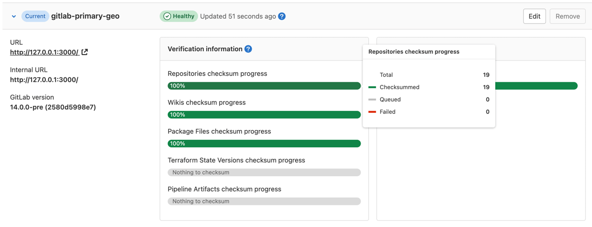
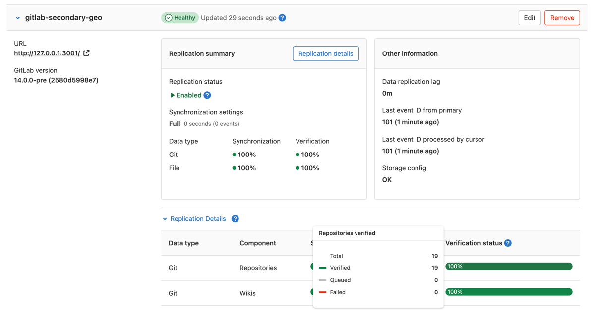



- Tier: 专业版，旗舰版
- Offering: 私有化部署



自动后台验证可确保传输的数据与计算出的校验和一致。如果主站点上的数据校验和与从站点上的数据校验和一致，则说明数据传输成功。在计划性故障转移之后，任何损坏的数据都可能会丢失，具体取决于损坏的程度。

如果主站点上的验证失败，则表明 Geo 正在复制一个已损坏的对象。您可以从备份中恢复该对象，或将其从主站点移除，以解决此问题。

如果主站点上的验证成功，但从站点上的验证失败，则表明该对象在复制过程中已损坏。Geo 会主动尝试纠正验证失败，将代码仓库标记为需要重新同步，并采用退避期。如果您想为这些失败重置验证，请按照[这些说明](#reset-verification-for-projects-where-verification-has-failed)操作。

如果验证明显滞后于复制，请考虑在安排计划性故障转移之前，给站点留出更多时间。

<a id="repository-verification"></a>

## 代码仓库验证

先决条件：

- 管理员访问权限。

在主站点上：

1. 在右上角，选择**管理员**。
1. 在左侧边栏中，选择 **Geo** > **站点**。
1. 展开该站点的**验证信息**选项卡，查看代码仓库和 Wiki 的自动校验和状态。成功显示为绿色，待处理显示为灰色，失败显示为红色。

   

在从站点上：

1. 在右上角，选择**管理员**。
1. 在左侧边栏中，选择 **Geo** > **站点**。
1. 展开该站点的**验证信息**选项卡，查看代码仓库和 Wiki 的自动校验和状态。成功显示为绿色，待处理显示为灰色，失败显示为红色。

   

<a id="using-checksums-to-compare-geo-sites"></a>

## 使用校验和比较 Geo 站点

为了检查 Geo 从站点的健康状况，我们对 Git 引用列表及其值计算校验和。该校验和包含 `HEAD`、`heads`、`tags`、`notes` 以及极狐GitLab 特有的引用，以确保真正的一致性。如果两个站点具有相同的校验和，那么它们肯定持有相同的引用。我们在每次更新后为每个站点计算校验和，以确保它们全部同步。

<a id="repository-re-verification"></a>

## 代码仓库重新验证

由于缺陷或暂时性的基础设施故障，Git 代码仓库可能会在未被标记为需要验证的情况下意外发生变化。Geo 会持续重新验证代码仓库，以确保数据的完整性。默认的重新验证间隔为 90 天，但也可以设置为短至 1 天。较短的间隔可以降低风险，但会增加负载，反之亦然。

在主站点上：

1. 在右上角，选择**管理员**。
1. 在左侧边栏中，选择 **Geo** > **站点**。
1. 为主站点选择**编辑**，以自定义最短重新验证间隔。

<a id="reset-verification-for-projects-where-verification-has-failed"></a>

## 为验证失败的项目重置验证

Geo 会主动尝试纠正验证失败，将代码仓库标记为在退避期后重新同步。您也可以通过 UI 或 Rails 控制台手动[重新同步并重新验证单个组件](../replication/resync_reverify.md#resync-and-reverify-individual-components)。

此前记录的用于重置验证的 Geo Rake 任务在极狐GitLab 16.5 及更高版本中已不再可用。请改用[重新同步并重新验证 Geo 数据](../replication/resync_reverify.md)中基于 UI 的批量操作或 Rails 控制台流程。

<a id="reconcile-differences-with-checksum-mismatches"></a>

## 处理校验和不匹配的差异

如果主站点和从站点存在校验和验证不匹配，原因可能并不明显。要查找校验和不匹配的原因：

1. 在主站点上：
   1. 在右上角，选择**管理员**。
   1. 在左侧边栏中，选择**概览** > **项目**。
   1. 找到您要检查校验和差异的项目，并选择其名称。
   1. 在项目管理页面上，获取**存储名称**和**相对路径**字段中的值。

1. 在**主站点的 Gitaly 节点**和**从站点的 Gitaly 节点**上，进入该项目的代码仓库目录。如果使用 Gitaly 集群 (Praefect)，请在运行这些命令之前[检查其是否处于健康状态](../../gitaly/praefect/troubleshooting.md#check-cluster-health)。

   默认路径为 `/var/opt/gitlab/git-data/repositories`。如果代码仓库存储已自定义，请检查服务器上的目录布局以确保无误：

   ```shell
   cd /var/opt/gitlab/git-data/repositories
   ```

   1. 在主站点上运行以下命令，并将输出重定向到文件：

      ```shell
      git show-ref --head | grep -E "HEAD|(refs/(heads|tags|keep-around|merge-requests|environments|notes)/)" > primary-site-refs
      ```

   1. 在从站点上运行以下命令，并将输出重定向到文件：

      ```shell
      git show-ref --head | grep -E "HEAD|(refs/(heads|tags|keep-around|merge-requests|environments|notes)/)" > secondary-site-refs
      ```

   1. 将前面步骤中生成的文件复制到同一系统上，并对内容进行差异比较：

      ```shell
      diff primary-site-refs secondary-site-refs
      ```

<a id="current-limitations"></a>

## 当前限制

有关支持哪些复制和验证方法的更多信息，请参阅[支持的 Geo 数据类型](../replication/datatypes.md)。
