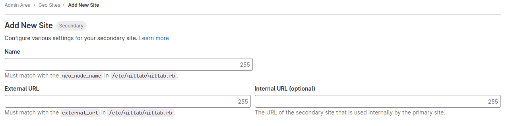
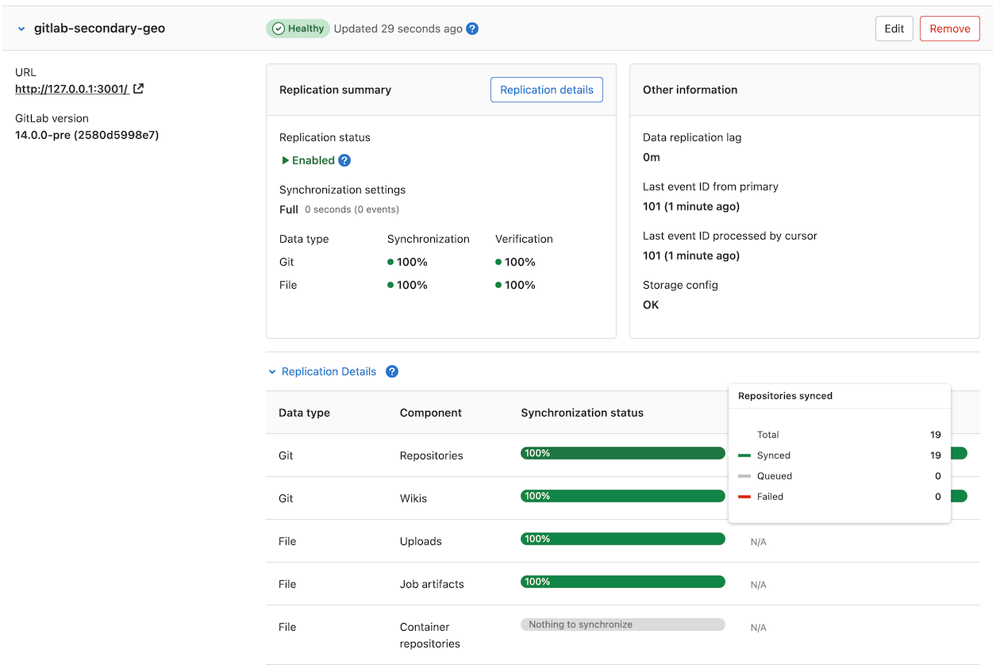



- Tier: 专业版，旗舰版
- Offering: 私有化部署



> [!note]
> 这是设置从 Geo 站点的最后一步。设置过程的各个阶段必须按照文档规定的顺序完成。
> 否则，请先[完成所有前置阶段](../setup/_index.md#using-linux-package-installations)，再继续操作。

配置从站点的基本步骤如下：

1. 在主站点和从站点之间复制必需的配置。
1. 在每个从站点上配置跟踪数据库。
1. 在每个从站点上启动极狐GitLab。

本文档重点介绍第一项。建议您先在测试/生产环境中通读所有步骤，然后再执行。

主站点和从站点的先决条件：

- [设置数据库复制](../setup/database.md)
- [配置已授权 SSH 密钥的快速查找](../../operations/fast_ssh_key_lookup.md)

> [!note]
> 不要为从站点设置任何自定义身份验证。这由主站点处理。
> 任何需要访问**管理**区域的更改都必须在主站点中完成，因为从站点是只读副本。

<a id="step-1-manually-replicate-secret-gitlab-values"></a>

## 步骤 1. 手动复制极狐GitLab 密钥值

极狐GitLab 在 `/etc/gitlab/gitlab-secrets.json` 文件中存储了许多密钥值，这些值在站点的所有节点上必须相同。在实现站点间自动复制这些值的方法之前（参见 [议题 3789](https://gitlab.com/gitlab-org/gitlab/-/issues/3789)），必须手动将它们复制到从站点的所有节点。

1. SSH 登录主站点上的 Rails 节点，并执行以下命令：

   ```shell
   sudo cat /etc/gitlab/gitlab-secrets.json
   ```

   这会以 JSON 格式显示需要复制的密钥。

1. SSH 登录从 Geo 站点上的每个节点，并以 `root` 用户身份登录：

   ```shell
   sudo -i
   ```

1. 备份所有现有密钥：

   ```shell
   mv /etc/gitlab/gitlab-secrets.json /etc/gitlab/gitlab-secrets.json.`date +%F`
   ```

1. 将 `/etc/gitlab/gitlab-secrets.json` 从主站点上的 Rails 节点复制到从站点上的每个节点，或在节点之间复制粘贴文件内容：

   ```shell
   sudo editor /etc/gitlab/gitlab-secrets.json

   # paste the output of the `cat` command you ran on the primary
   # save and exit
   ```

1. 确保文件权限正确：

   ```shell
   chown root:root /etc/gitlab/gitlab-secrets.json
   chmod 0600 /etc/gitlab/gitlab-secrets.json
   ```

1. 重新配置从站点上的每个 Rails、Sidekiq 和 Gitaly 节点，以使更改生效：

   ```shell
   gitlab-ctl reconfigure
   gitlab-ctl restart
   ```

<a id="step-2-manually-replicate-the-primary-sites-ssh-host-keys"></a>

## 步骤 2. 手动复制主站点的 SSH 主机密钥

极狐GitLab 与系统安装的 SSH 守护进程集成，指定一个用户（通常名为 `git`）来处理所有访问请求。

在[灾难恢复](../disaster_recovery/_index.md)场景中，极狐GitLab 系统管理员会将从站点提升为主站点。主域名的 DNS 记录也应更新为指向新的主站点（原从站点）。这样做可以避免更新 Git 远程和 API URL。

这会导致所有发往新提升的主站点的 SSH 请求由于 SSH 主机密钥不匹配而失败。为防止出现这种情况，必须手动将主 SSH 主机密钥复制到从站点。

SSH 主机密钥路径取决于所使用的软件：

- 如果您使用 OpenSSH，路径为 `/etc/ssh`。
- 如果您使用 [`gitlab-sshd`](../../operations/gitlab_sshd.md)，路径为 `/var/opt/gitlab/gitlab-sshd`。

在以下步骤中，请将 `<ssh_host_key_path>` 替换为您正在使用的路径：

1. SSH 登录从站点上的每个 Rails 节点，并以 `root` 用户身份登录：

   ```shell
   sudo -i
   ```

1. 备份所有现有 SSH 主机密钥：

   ```shell
   find <ssh_host_key_path> -iname 'ssh_host_*' -exec cp {} {}.backup.`date +%F` \;
   ```

1. 从主站点复制 SSH 主机密钥：

   如果您可以使用 root 用户访问主站点上处理 SSH 流量的某个节点（通常是主 GitLab Rails 应用节点）：

   ```shell
   # Run this from the secondary site, change `<primary_site_fqdn>` for the IP or FQDN of the server
   scp root@<primary_node_fqdn>:<ssh_host_key_path>/ssh_host_*_key* <ssh_host_key_path>
   ```

   如果您只能通过具有 `sudo` 权限的用户访问：

   ```shell
   # Run this from the node on your primary site:
   sudo tar --transform 's/.*\///g' -zcvf ~/geo-host-key.tar.gz <ssh_host_key_path>/ssh_host_*_key*

   # Run this on each node on your secondary site:
   scp <user_with_sudo>@<primary_site_fqdn>:geo-host-key.tar.gz .
   tar zxvf ~/geo-host-key.tar.gz -C <ssh_host_key_path>
   ```

1. 在从站点上的每个 Rails 节点上，确保文件权限正确：

   ```shell
   chown root:root <ssh_host_key_path>/ssh_host_*_key*
   chmod 0600 <ssh_host_key_path>/ssh_host_*_key
   ```

1. 要验证密钥指纹是否匹配，请在两个站点的主节点和从节点上执行以下命令：

   ```shell
   for file in <ssh_host_key_path>/ssh_host_*_key; do ssh-keygen -lf $file; done
   ```

   您应该会得到类似如下的输出，并且两个节点上的输出应完全相同：

   ```shell
   1024 SHA256:FEZX2jQa2bcsd/fn/uxBzxhKdx4Imc4raXrHwsbtP0M root@serverhostname (DSA)
   256 SHA256:uw98R35Uf+fYEQ/UnJD9Br4NXUFPv7JAUln5uHlgSeY root@serverhostname (ECDSA)
   256 SHA256:sqOUWcraZQKd89y/QQv/iynPTOGQxcOTIXU/LsoPmnM root@serverhostname (ED25519)
   2048 SHA256:qwa+rgir2Oy86QI+PZi/QVR+MSmrdrpsuH7YyKknC+s root@serverhostname (RSA)
   ```

1. 验证您是否拥有与现有私钥对应的正确公钥：

   ```shell
   # This will print the fingerprint for private keys:
   for file in <ssh_host_key_path>/ssh_host_*_key; do ssh-keygen -lf $file; done

   # This will print the fingerprint for public keys:
   for file in <ssh_host_key_path>/ssh_host_*_key.pub; do ssh-keygen -lf $file; done
   ```

   > [!note]
   > 私钥和公钥命令的输出应生成相同的指纹。

1. 在从站点上的每个 Rails 节点上，重启 OpenSSH 的 `sshd` 或 `gitlab-sshd` 服务：

   - 对于 OpenSSH：

     ```shell
     # Debian or Ubuntu installations
     sudo service ssh reload

     # CentOS installations
     sudo service sshd reload
     ```

   - 对于 `gitlab-sshd`：

     ```shell
     sudo gitlab-ctl restart gitlab-sshd
     ```

1. 验证 SSH 是否仍可正常使用。

   在新终端中 SSH 登录您的极狐GitLab 从服务器。如果无法连接，请根据前面的步骤验证权限是否正确。

<a id="step-3-add-the-secondary-site"></a>

## 步骤 3. 添加从站点

1. SSH 登录从站点上的每个 Rails 和 Sidekiq 节点，并以 root 身份登录：

   ```shell
   sudo -i
   ```

1. 编辑 `/etc/gitlab/gitlab.rb` 并为您的站点添加一个唯一名称。在接下来的步骤中您会用到它：

   ```ruby
   ##
   ## The unique identifier for the Geo site. See
   ## https://docs.gitlab.com/administration/geo_sites/#common-settings
   ##
   gitlab_rails['geo_node_name'] = '<site_name_here>'
   ```

1. 重新配置从站点上的每个 Rails 和 Sidekiq 节点，以使更改生效：

   ```shell
   gitlab-ctl reconfigure
   ```

1. 前往主节点极狐GitLab 实例：
   1. 在右上角，选择**管理员**。
   1. 在左侧边栏中，选择 **Geo** > **站点**。
   1. 选择**添加站点**。
      
   1. 在**名称**中，输入 `/etc/gitlab/gitlab.rb`中 `gitlab_rails['geo_node_name']` 的值。这些值必须始终完全一致，逐字符匹配。
   1. 在**外部 URL**中，输入 `/etc/gitlab/gitlab.rb`中 `external_url`的值。这些值必须始终匹配，但其中一个是否以 `/` 结尾而另一个不是并不重要。
   1. 可选。在**内部 URL（可选）**中，输入从站点的内部 URL。
   1. 可选。选择从站点应复制哪些群组或存储分片。留空表示复制全部。更多信息，请参阅[选择性同步](selective_synchronization.md)。
   1. 选择**保存更改**以添加从站点。
1. SSH 登录从站点上的每个 Rails 和 Sidekiq 节点，并重启服务：

   ```shell
   gitlab-ctl restart
   ```

   运行以下命令，检查您的 Geo 设置是否存在常见问题：

   ```shell
   gitlab-rake gitlab:geo:check
   ```

   如果任何检查失败，请查看[故障排除文档](troubleshooting/_index.md)。

1. SSH 登录主站点上的 Rails 或 Sidekiq 服务器，并以 root 身份登录，以验证从站点是否可达，或检查您的 Geo 设置是否存在常见问题：

   ```shell
   gitlab-rake gitlab:geo:check
   ```

   如果任何检查失败，请查看[故障排除文档](troubleshooting/_index.md)。

从站点添加到 Geo 管理页面并重启后，该站点会自动开始从主站点复制缺失的数据，这个过程称为**回填**。同时，主站点开始将任何更改通知给每个从站点，以便从站点可以立即对这些通知做出响应。

请确保从站点正在运行且可访问。您可以使用与主站点相同的凭据登录从站点。

<a id="add-primary-and-secondary-urls-as-allowed-actioncable-origins"></a>

### 将主站点和从站点 URL 添加为允许的 ActionCable 来源

此步骤允许 WebSocket 在主站点和从站点之间无缝工作。

1. 收集您的站点（主站点和从站点）的外部 URL。您可以在管理区域的站点页面中找到它们，如上一节所述。
1. SSH 登录主站点上的每个 Rails 和 Sidekiq 节点，并以 root 身份登录：

   ```shell
   sudo -i
   ```

1. 编辑 `/etc/gitlab/gitlab.rb`，将步骤 1 中收集的 URL 添加到 `action_cable_allowed_origins` 设置中：

   ```ruby
   gitlab_rails['action_cable_allowed_origins'] = ['https://secondary.example.com', 'https://primary.example.com']
   ```

1. 要应用更改，请重新配置每个 Rails 和 Sidekiq 节点并重启服务：

   ```shell
   gitlab-ctl reconfigure
   gitlab-ctl restart
   ```

<a id="step-4-optional-using-custom-certificates"></a>

## 步骤 4.（可选）使用自定义证书

如果满足以下条件，您可以安全地跳过此步骤：

- 您的主站点使用公共 CA 签发的 HTTPS 证书。
- 您的主站点仅使用 CA 签发（非自签名）的 HTTPS 证书连接外部服务。

<a id="custom-or-self-signed-certificate-for-inbound-connections"></a>

### 用于入站连接的自定义或自签名证书

如果您的极狐GitLab Geo 主站点使用自定义或[自签名证书来保护入站 HTTPS 连接](https://gitlab.cn/docs/omnibus/settings/ssl/#install-custom-public-certificates)，则可以是单域或多域证书。

根据您的证书类型安装正确的证书：

- **多域证书**，同时包含主站点和从站点域名：在从站点的所有 Rails、Sidekiq 和 Gitaly 节点上，将证书安装到 `/etc/gitlab/ssl`。
- **单域证书**，证书特定于每个 Geo 站点域名：为您的从站点域名生成有效证书，并按照[这些说明](https://gitlab.cn/docs/omnibus/settings/ssl/#install-custom-public-certificates)在从站点的所有 Rails、Sidekiq 和 Gitaly 节点上将其安装到 `/etc/gitlab/ssl`。

<a id="connecting-to-external-services-that-use-custom-certificates"></a>

### 连接到使用自定义证书的外部服务

需要将外部服务的自签名证书副本添加到主站点所有需要访问该服务的节点的信任存储中。

为了让从站点能够访问相同的外部服务，必须将这些证书添加到从站点的信任存储中。

如果您的主站点使用[用于入站 HTTPS 连接的自定义或自签名证书](#custom-or-self-signed-certificate-for-inbound-connections)，则需要将主站点的证书添加到从站点的信任存储中：

1. SSH 登录从站点上的每个 Rails、Sidekiq 和 Gitaly 节点，并以 root 身份登录：

   ```shell
   sudo -i
   ```

1. 从主站点复制受信任的证书：

   如果您可以使用 root 用户访问主站点上处理 SSH 流量的某个节点：

   ```shell
   scp root@<primary_site_node_fqdn>:/etc/gitlab/trusted-certs/* /etc/gitlab/trusted-certs
   ```

   如果您只能通过具有 sudo 权限的用户访问：

   ```shell
   # Run this from the node on your primary site:
   sudo tar --transform 's/.*\///g' -zcvf ~/geo-trusted-certs.tar.gz /etc/gitlab/trusted-certs/*

   # Run this on each node on your secondary site:
   scp <user_with_sudo>@<primary_site_node_fqdn>:geo-trusted-certs.tar.gz .
   tar zxvf ~/geo-trusted-certs.tar.gz -C /etc/gitlab/trusted-certs
   ```

1. 重新配置从站点中每个已更新的 Rails、Sidekiq 和 Gitaly 节点：

   ```shell
   sudo gitlab-ctl reconfigure
   ```

<a id="step-5-verify-proper-functioning-of-the-secondary-site"></a>

## 步骤 5. 验证从站点是否正常运行

您可以使用与主站点相同的凭据登录从站点。登录后：

1. 在右上角，选择**管理员**。
1. 在左侧边栏中，选择 **Geo** > **站点**。
1. 验证它是否被正确识别为从 Geo 站点，以及 Geo 是否已启用。

初始复制可能需要一些时间。站点状态或“回填”可能仍在进行中。您可以在浏览器中从主站点的**Geo 站点**仪表板监控每个 Geo 站点的同步过程。



如果您的安装无法正常工作，请查看[故障排除文档](troubleshooting/_index.md)。

仪表板中最明显的两个问题是：

1. 数据库复制工作不正常。
1. 实例间通知不工作。在这种情况下，可能是以下原因之一：
   - 您正在使用自定义证书或自定义 CA（请参阅[故障排除文档](troubleshooting/_index.md)）。
   - 实例被防火墙阻止（请检查您的防火墙规则）。

禁用从站点会停止同步过程。

如果主站点为多个代码仓库分片自定义了代码仓库存储，您必须在每个从站点上复制相同的配置。

请引导您的用户参阅[使用 Geo 站点指南](usage.md)。

目前，以下内容会同步：

- Git 代码仓库。
- Wiki。
- LFS 对象。
- 议题、合并请求、代码片段和评论附件。
- 用户、群组和项目头像。

<a id="troubleshooting"></a>

## 故障排除

请参阅[故障排除文档](troubleshooting/_index.md)。
