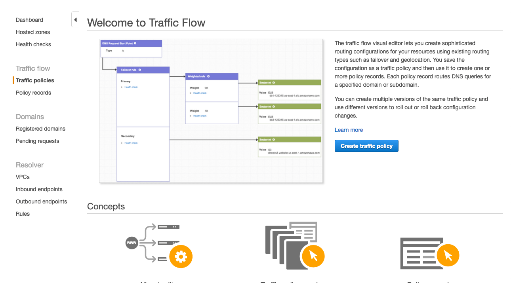
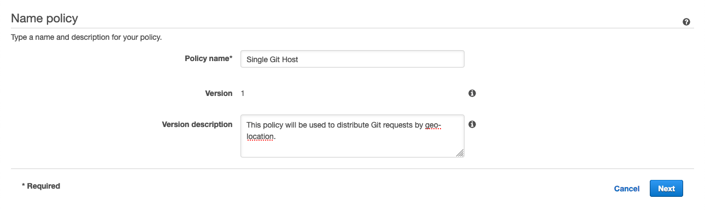
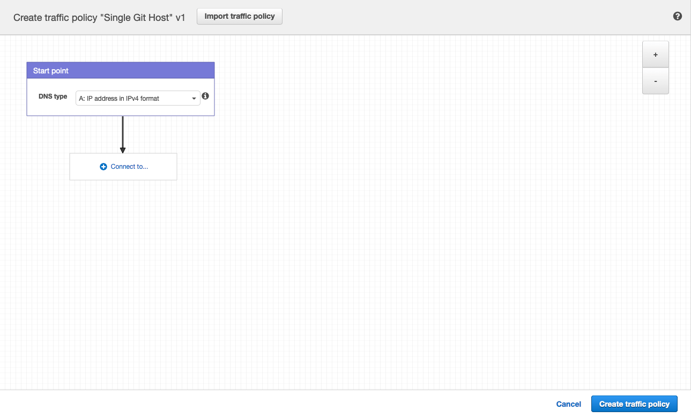
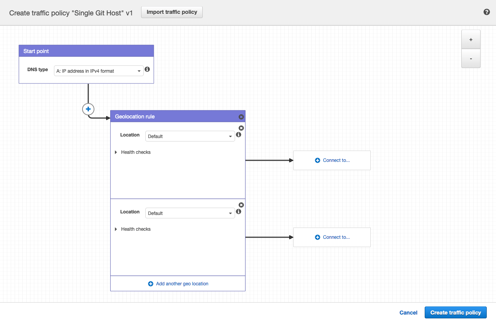
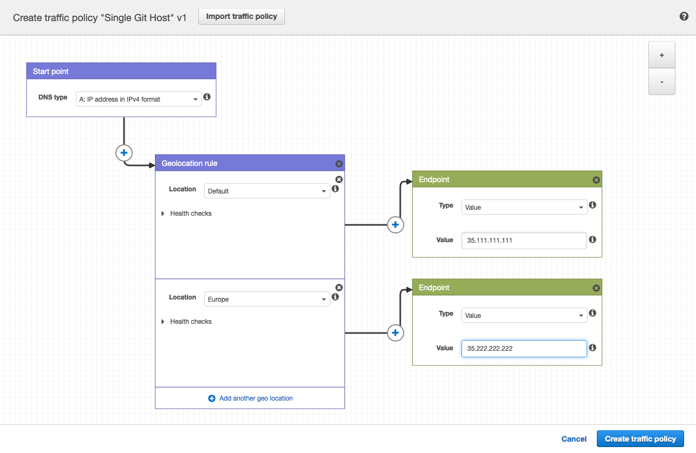
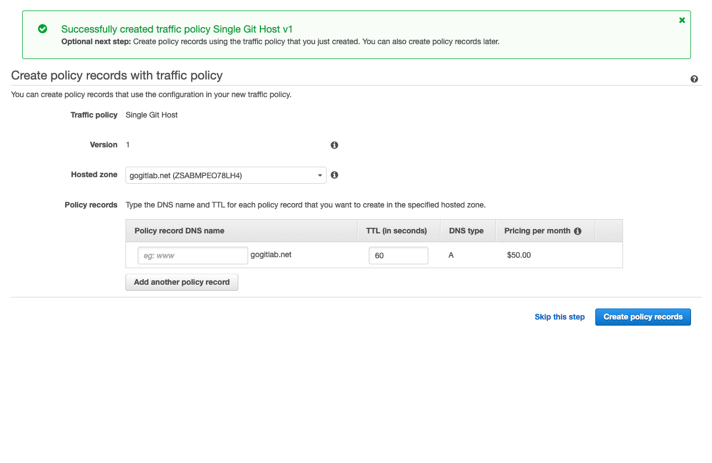
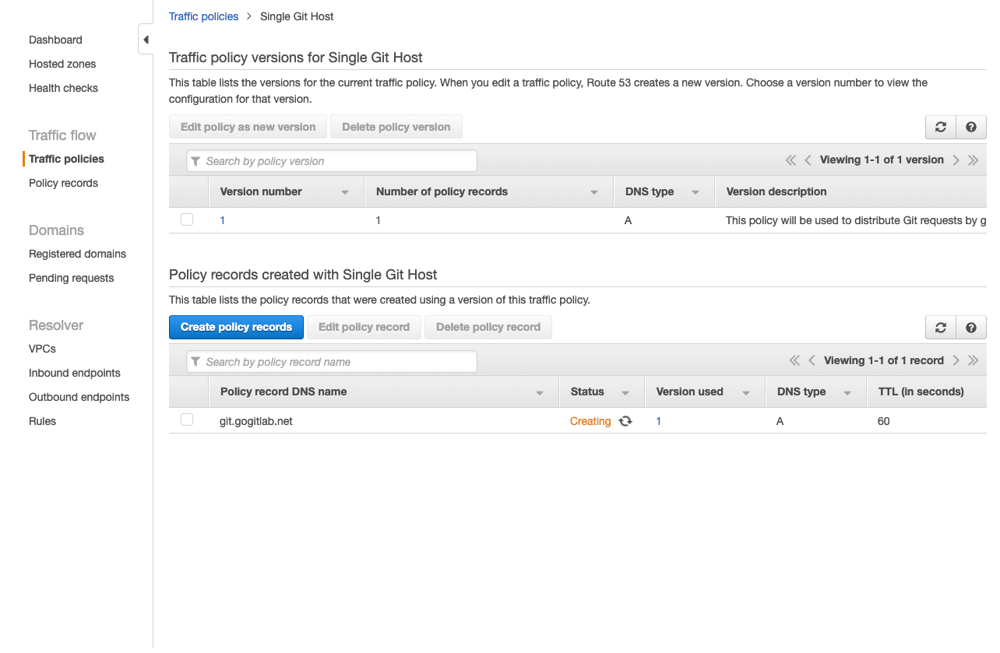
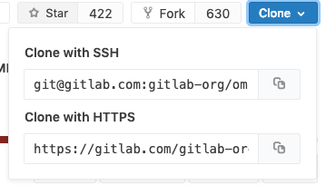



- Tier: 专业版，旗舰版
- Offering: 私有化部署



> [!note]
> [极狐GitLab Geo 支持位置感知 DNS，包括 Web UI 和 API 流量。](../secondary_proxy/_index.md#configure-location-aware-dns)
> 建议使用此配置，而不是本文档中介绍的位置感知 Git 远程 URL。

您可以为极狐GitLab 用户提供一个远程 URL，自动使用距离他们最近的 Geo 站点。这意味着用户无需更新 Git 配置，即可在移动时利用更近的 Geo 站点。

之所以能够做到这一点，是因为从站点发出的 Git push 请求可以自动重定向（HTTP）或代理（SSH）到主站点。

尽管这些说明使用 [AWS Route53](https://aws.amazon.com/route53/)，但也可以使用 [Cloudflare](https://www.cloudflare.com/) 等其他服务。

## 先决条件

在此示例中，我们已设置：

- `primary.example.com` 作为 Geo 主站点。
- `secondary.example.com` 作为 Geo 从站点。

我们创建一个 `git.example.com` 子域，按以下方式自动路由请求：

- 来自欧洲的请求定向到从站点。
- 来自所有其他位置的请求定向到主站点。

无论如何，您都需要：

- 一个可正常工作的极狐GitLab 主站点，可通过其自身地址访问。
- 一个可正常工作的极狐GitLab 从站点。
- 一个管理您域名的 Route53 托管区。

如果您尚未设置 Geo 主站点和从站点，请参阅 [Geo 设置说明](../setup/_index.md)。

## 创建流量策略

在 Route53 托管区中，可以使用流量策略来设置各种路由配置。

1. 转到
   [Route53 仪表板](https://console.aws.amazon.com/route53/home)并选择
   **流量策略**。

   

1. 选择**创建流量策略**。

   

1. 在**策略名称**字段中填入 `Single Git Host`，然后选择**下一步**。

   

1. 将 **DNS 类型**保留为 `A: IP Address in IPv4 format`。
1. 选择**连接到**，然后选择**地理位置规则**。

   

1. 对于第一个**位置**，保留为 `Default`。
1. 选择**连接到**，然后选择**新端点**。
1. 选择**类型** `value`，并填入 `<your primary IP address>`。
1. 对于第二个**位置**，选择 `Europe`。
1. 选择**连接到**，然后选择**新端点**。
1. 选择**类型** `value`，并填入 `<your secondary IP address>`。

   

1. 选择**创建流量策略**。

   

1. 在**策略记录 DNS 名称**中填入 `git`。
1. 选择**创建策略记录**。

   

您已成功设置单个主机，例如 `git.example.com`，它会按地理位置将流量分配到您的 Geo 站点！

## 配置 Git 克隆 URL 以使用特殊 Git URL

当用户首次克隆代码仓库时，通常会从项目页面复制 Git 远程 URL。默认情况下，这些 SSH 和 HTTP URL 基于当前主机的外部 URL。例如：

- `git@secondary.example.com:group1/project1.git`
- `https://secondary.example.com/group1/project1.git`

您可以自定义：

- SSH 远程 URL，以使用位置感知的 `git.example.com`。为此，请通过在 Web 节点的 `gitlab.rb`中设置 `gitlab_rails['gitlab_ssh_host']` 来更改 SSH 远程 URL 主机。
- HTTP 远程 URL，如
  [HTTP(S) 的自定义 Git 克隆 URL](../../settings/visibility_and_access_controls.md#customize-git-clone-url-for-https)中所示。

## Git 请求处理行为示例

按照前面记录的配置步骤操作后，Git 请求的处理现在具有位置感知能力。对于请求：

- 在欧洲以外，所有请求都定向到主站点。
- 在欧洲以内，通过：
  - HTTP：
    - `git clone http://git.example.com/foo/bar.git` 定向到从站点。
    - `git push` 最初定向到从站点，从站点会自动
      重定向到 `primary.example.com`。
  - SSH：
    - `git clone git@git.example.com:foo/bar.git` 定向到从站点。
    - `git push` 最初定向到从站点，从站点会自动
      将请求代理到 `primary.example.com`。
