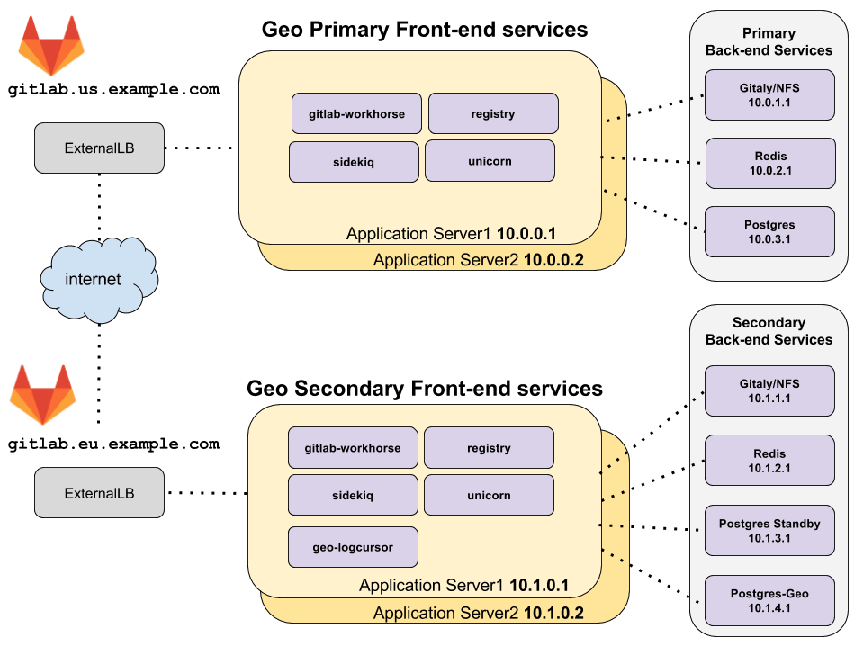



- Tier: 专业版，旗舰版
- Offering: 私有化部署



本文档介绍在多节点配置中运行 Geo 的最小参考架构。如果您的多节点设置与所述设置不同，可以根据需要调整这些说明。

本指南适用于具有多个应用节点（Sidekiq 或 GitLab Rails）的安装。对于使用外部 PostgreSQL 的单节点安装，请遵循[为两个单节点站点设置 Geo（使用外部 PostgreSQL 服务）](../setup/two_single_node_external_services.md)，如果您使用其他外部服务，请相应调整配置。

<a id="architecture-overview"></a>

## 架构概览



**[图表来源 - 仅限 GitLab 团队成员](https://docs.google.com/drawings/d/1z0VlizKiLNXVVVaERFwgsIOuEgjcUqDTWPdQYsE7Z4c/edit)**

该拓扑图假设主站点和从站点 Geo 站点位于两个独立的位置，各自拥有使用私有 IP 地址的虚拟网络。网络配置为同一地理位置中的所有机器都可以使用其私有 IP 地址相互通信。给出的 IP 地址仅为示例，可能因您部署的网络拓扑而有所不同。

访问这两个 Geo 站点的唯一外部方式是通过 HTTPS，即前面示例中的 `gitlab.us.example.com` 和 `gitlab.eu.example.com`。

> [!note]
> 主站点和从站点 Geo 站点必须能够通过 HTTPS 相互通信。

<a id="redis-and-postgresql-for-multiple-nodes"></a>

## 多节点的 Redis 和 PostgreSQL

由于为 PostgreSQL 和 Redis 设置此配置涉及额外的复杂性，因此本文档的 Geo 多节点部分不涵盖这些内容。

有关使用 Linux 软件包设置多节点 PostgreSQL 集群和 Redis 集群的更多信息，请参阅：

- [Geo 多节点数据库复制](../setup/database.md#multi-node-database-replication)
- [Redis 多节点文档](../../redis/replication_and_failover.md)

> [!note]
> 可以为 PostgreSQL 和 Redis 使用云托管服务，但这超出了本文档的范围。

<a id="prerequisites-two-independently-working-gitlab-multi-node-sites"></a>

## 先决条件：两个独立运行的极狐GitLab 多节点站点

一个极狐GitLab 站点用作 Geo 主站点。使用[极狐GitLab 参考架构文档](../../reference_architectures/_index.md)进行设置。您可以为每个 Geo 站点使用不同的参考架构规模。如果您已有一个正在使用的极狐GitLab 实例，可以将其用作主站点。

第二个极狐GitLab 站点用作 Geo 从站点。同样，使用[极狐GitLab 参考架构文档](../../reference_architectures/_index.md)进行设置。建议先登录并进行测试。但请注意，在从主站点复制的过程中，其数据会被清除。

<a id="configure-a-gitlab-site-to-be-the-geo-primary-site"></a>

## 将极狐GitLab 站点配置为 Geo 主站点

以下步骤使极狐GitLab 站点能够用作 Geo 主站点。

<a id="step-1-configure-the-primary-frontend-nodes"></a>

### 第 1 步：配置主站点前端节点

> [!note]
> 不要使用 [`geo_primary_role`](https://gitlab.cn/docs/omnibus/roles/#gitlab-geo-roles)，因为它适用于单节点站点。

1. 编辑 `/etc/gitlab/gitlab.rb` 并添加以下内容：

   ```ruby
   ##
   ## The unique identifier for the Geo site. See
   ## https://docs.gitlab.com/administration/geo_sites/#common-settings
   ##
   gitlab_rails['geo_node_name'] = '<site_name_here>'

   ##
   ## Disable automatic migrations
   ##
   gitlab_rails['auto_migrate'] = false
   ```

完成这些更改后，[重新配置极狐GitLab](../../restart_gitlab.md#reconfigure-a-linux-package-installation) 以使更改生效。

<a id="step-2-define-the-site-as-the-primary-site"></a>

### 第 2 步：将该站点定义为主站点

1. 在其中一个前端节点上执行以下命令：

   ```shell
   sudo gitlab-ctl set-geo-primary-node
   ```

> [!note]
> 在典型的极狐GitLab 多节点设置中，应用节点上的 PostgreSQL 和 Redis 应该已被禁用。应用节点到后端节点上服务的连接也应该已经配置好。请参阅多节点配置文档中关于
> [PostgreSQL](../../postgresql/replication_and_failover.md#configuring-the-application-nodes)
> 和 [Redis](../../redis/replication_and_failover.md#example-configuration-for-the-gitlab-application)的内容。

<a id="configure-the-other-gitlab-site-to-be-a-geo-secondary-site"></a>

## 将另一个极狐GitLab 站点配置为 Geo 从站点

从站点与任何其他极狐GitLab 多节点站点类似，但有三个主要区别：

- 主 PostgreSQL 数据库是 Geo 主站点 PostgreSQL 数据库的只读副本。
- 每个 Geo 从站点都有一个额外的 PostgreSQL 数据库，称为“Geo 跟踪数据库”，用于跟踪各种资源的复制和验证状态。
- 有一个额外的极狐GitLab 服务 [`geo-logcursor`](../_index.md#geo-log-cursor)

因此，我们逐个设置多节点组件，并包含与典型多节点设置的差异。但是，我们强烈建议先配置一个全新的极狐GitLab 站点，就像它不属于 Geo 设置一样。这样可以验证它是一个正常工作的极狐GitLab 站点。只有在此之后，才应将其修改为用作 Geo 从站点。这有助于将 Geo 设置问题与无关的多节点配置问题区分开来。

<a id="step-1-configure-the-redis-and-gitaly-services-on-the-geo-secondary-site"></a>

### 第 1 步：在 Geo 从站点上配置 Redis 和 Gitaly 服务

再次使用非 Geo 多节点文档配置以下服务：

- [为极狐GitLab 配置 Redis](../../redis/replication_and_failover.md#example-configuration-for-the-gitlab-application) 以支持多个节点。
- [Gitaly](../../gitaly/_index.md)，用于存储从 Geo 主站点同步的数据。

> [!note]
> 可以使用 [NFS](../../nfs.md) 代替 Gitaly，但不推荐这样做。

<a id="step-2-configure-the-geo-tracking-database-on-the-geo-secondary-site"></a>

### 第 2 步：在 Geo 从站点上配置 Geo 跟踪数据库

Geo 跟踪数据库无法在多节点 PostgreSQL 集群中运行，请参阅[为跟踪 PostgreSQL 数据库配置 Patroni 集群](../setup/database.md#configuring-patroni-cluster-for-the-tracking-postgresql-database)。

您可以按如下方式在单个节点上运行 Geo 跟踪数据库：

1. 为极狐GitLab 应用程序用于访问跟踪数据库的数据库用户生成所需密码的 MD5 哈希：

   用户名（默认为 `gitlab_geo`）会被纳入该哈希中。

   ```shell
   gitlab-ctl pg-password-md5 gitlab_geo
   # Enter password: <your_tracking_db_password_here>
   # Confirm password: <your_tracking_db_password_here>
   # fca0b89a972d69f00eb3ec98a5838484
   ```

   使用此哈希在下一步中填写 `<tracking_database_password_md5_hash>`。

1. 在计划运行 Geo 跟踪数据库的机器上，将以下内容添加到 `/etc/gitlab/gitlab.rb`：

   ```ruby
   ##
   ## Enable the Geo secondary tracking database
   ##
   geo_postgresql['enable'] = true
   geo_postgresql['listen_address'] = '<ip_address_of_this_host>'
   geo_postgresql['sql_user_password'] = '<tracking_database_password_md5_hash>'

   ##
   ## Configure PostgreSQL connection to the replica database
   ##
   geo_postgresql['md5_auth_cidr_addresses'] = ['<replica_database_ip>/32']
   gitlab_rails['db_host'] = '<replica_database_ip>'

   # Prevent reconfigure from attempting to run migrations on the replica database
   gitlab_rails['auto_migrate'] = false
   ```

1. [选择退出自动 PostgreSQL 升级](https://gitlab.cn/docs/omnibus/settings/database/#opt-out-of-automatic-postgresql-upgrades)，以避免在升级极狐GitLab 时出现意外停机。请注意使用 Geo 升级 PostgreSQL 时的已知[注意事项](https://gitlab.cn/docs/omnibus/settings/database/#caveats-when-upgrading-postgresql-with-geo)。尤其是对于较大的环境，必须谨慎规划并执行 PostgreSQL 升级。因此，今后请确保将 PostgreSQL 升级纳入常规维护活动。

完成这些更改后，[重新配置极狐GitLab](../../restart_gitlab.md#reconfigure-a-linux-package-installation) 以使更改生效。

如果使用外部 PostgreSQL 实例，另请参阅
[使用外部 PostgreSQL 实例的 Geo](../setup/external_database.md)。

<a id="step-3-configure-postgresql-streaming-replication"></a>

### 第 3 步：配置 PostgreSQL 流复制

遵循 [Geo 数据库复制说明](../setup/database.md)。

如果使用外部 PostgreSQL 实例，另请参阅
[使用外部 PostgreSQL 实例的 Geo](../setup/external_database.md)。

启用流复制后，`gitlab-rake db:migrate:status:geo` 会失败，直到[从站点配置完成](#step-7-copy-secrets-and-add-the-secondary-site-in-the-application)，具体来说是 [Geo 配置 - 第 3 步：添加从站点](configuration.md#step-3-add-the-secondary-site)。

<a id="step-4-configure-the-frontend-application-nodes-on-the-geo-secondary-site"></a>

### 第 4 步：在 Geo 从站点上配置前端应用节点

> [!note]
> 不要使用 [`geo_secondary_role`](https://gitlab.cn/docs/omnibus/roles/#gitlab-geo-roles)，因为它适用于单节点站点。

在最小[架构图](#architecture-overview)中，有两台机器运行极狐GitLab 应用服务。这些服务在配置中被选择性地启用。

按照[参考架构](../../reference_architectures/_index.md)中概述的相关步骤配置 GitLab Rails 应用节点，然后进行以下修改：

1. 在 Geo 从站点的每个应用节点上编辑 `/etc/gitlab/gitlab.rb`，并添加以下内容：

   ```ruby
   ##
   ## Enable GitLab application services. The application_role enables many services.
   ## Alternatively, you can choose to enable or disable specific services on
   ## different nodes to aid in horizontal scaling and separation of concerns.
   ##
   roles ['application_role']

   ## `application_role` already enables this. You only need this line if
   ## you selectively enable individual services that depend on Rails, like
   ## `puma`, `sidekiq`, `geo-logcursor`, and so on.
   gitlab_rails['enable'] = true

   ##
   ## Enable Geo Log Cursor service
   ##
   geo_logcursor['enable'] = true

   ##
   ## The unique identifier for the Geo site. See
   ## https://docs.gitlab.com/administration/geo_sites/#common-settings
   ##
   gitlab_rails['geo_node_name'] = '<site_name_here>'

   ##
   ## Disable automatic migrations
   ##
   gitlab_rails['auto_migrate'] = false

   ##
   ## Configure the connection to the tracking database
   ##
   geo_secondary['enable'] = true
   geo_secondary['db_host'] = '<geo_tracking_db_host>'
   geo_secondary['db_password'] = '<geo_tracking_db_password>'

   ##
   ## Configure connection to the streaming replica database, if you haven't
   ## already
   ##
   gitlab_rails['db_host'] = '<replica_database_host>'
   gitlab_rails['db_password'] = '<replica_database_password>'

   ##
   ## Configure connection to Redis, if you haven't already
   ##
   gitlab_rails['redis_host'] = '<redis_host>'
   gitlab_rails['redis_password'] = '<redis_password>'

   ##
   ## If you are using custom users not managed by Omnibus, you need to specify
   ## UIDs and GIDs like below, and ensure they match between nodes in a
   ## cluster to avoid permissions issues
   ##
   user['uid'] = 9000
   user['gid'] = 9000
   web_server['uid'] = 9001
   web_server['gid'] = 9001
   registry['uid'] = 9002
   registry['gid'] = 9002
   ```

> [!warning]
> 如果您使用 Linux 软件包设置了 PostgreSQL 集群，并设置了
> `postgresql['sql_user_password'] = 'md5 digest of secret'`，请记住
> `gitlab_rails['db_password']` 和 `geo_secondary['db_password']`
> 包含明文密码。这些配置用于让 Rails 节点连接到数据库。

确保当前节点的 IP 列在只读副本数据库的
`postgresql['md5_auth_cidr_addresses']` 设置中，以允许此节点上的 Rails 连接到 PostgreSQL。

完成这些更改后，[重新配置极狐GitLab](../../restart_gitlab.md#reconfigure-a-linux-package-installation) 以使更改生效。

在[架构概览](#architecture-overview)拓扑中，“前端”节点上启用了以下极狐GitLab 服务：

- `geo-logcursor`
- `gitlab-pages`
- `gitlab-workhorse`
- `logrotate`
- `nginx`
- `registry`
- `remote-syslog`
- `sidekiq`
- `puma`

在前端应用节点上运行 `sudo gitlab-ctl status` 以验证这些服务是否存在。

<a id="step-5-set-up-the-loadbalancer-for-the-geo-secondary-site"></a>

### 第 5 步：为 Geo 从站点设置负载均衡器

最小[架构图](#architecture-overview)显示了每个地理位置处的负载均衡器，用于将流量路由到应用节点。

更多信息，请参阅[多节点极狐GitLab 的负载均衡器](../../load_balancer.md)。

<a id="step-6-configure-the-backend-application-nodes-on-the-geo-secondary-site"></a>

### 第 6 步：在 Geo 从站点上配置后端应用节点

最小[架构图](#architecture-overview)显示所有应用服务在同一批机器上一起运行。但是，对于多个节点，我们[强烈建议单独运行所有服务](../../reference_architectures/_index.md)。

例如，可以参照前文的前端应用节点配置 Sidekiq 节点，只需少量更改即可仅运行 `sidekiq` 服务：

1. 在 Geo 从站点的每个 Sidekiq 节点上编辑 `/etc/gitlab/gitlab.rb`，并添加以下内容：

   ```ruby
   ##
   ## Enable the Sidekiq service
   ##
   sidekiq['enable'] = true
   gitlab_rails['enable'] = true

   ##
   ## The unique identifier for the Geo site. See
   ## https://docs.gitlab.com/administration/geo_sites/#common-settings
   ##
   gitlab_rails['geo_node_name'] = '<site_name_here>'

   ##
   ## Disable automatic migrations
   ##
   gitlab_rails['auto_migrate'] = false

   ##
   ## Configure the connection to the tracking database
   ##
   geo_secondary['enable'] = true
   geo_secondary['db_host'] = '<geo_tracking_db_host>'
   geo_secondary['db_password'] = '<geo_tracking_db_password>'

   ##
   ## Configure connection to the streaming replica database, if you haven't
   ## already
   ##
   gitlab_rails['db_host'] = '<replica_database_host>'
   gitlab_rails['db_password'] = '<replica_database_password>'

   ##
   ## Configure connection to Redis, if you haven't already
   ##
   gitlab_rails['redis_host'] = '<redis_host>'
   gitlab_rails['redis_password'] = '<redis_password>'

   ##
   ## If you are using custom users not managed by Omnibus, you need to specify
   ## UIDs and GIDs like below, and ensure they match between nodes in a
   ## cluster to avoid permissions issues
   ##
   user['uid'] = 9000
   user['gid'] = 9000
   web_server['uid'] = 9001
   web_server['gid'] = 9001
   registry['uid'] = 9002
   registry['gid'] = 9002
   ```

   您也可以类似地配置一个节点，通过 `geo_logcursor['enable'] = true` 仅运行 `geo-logcursor` 服务，并通过
   `sidekiq['enable'] = false` 禁用 Sidekiq。

   这些节点不需要连接到负载均衡器。

<a id="step-7-copy-secrets-and-add-the-secondary-site-in-the-application"></a>

### 第 7 步：复制密钥并在应用程序中添加从站点

1. [配置极狐GitLab](configuration.md) 以设置主站点和从站点。
