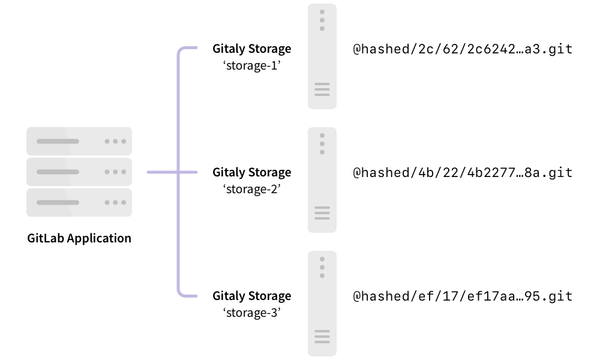
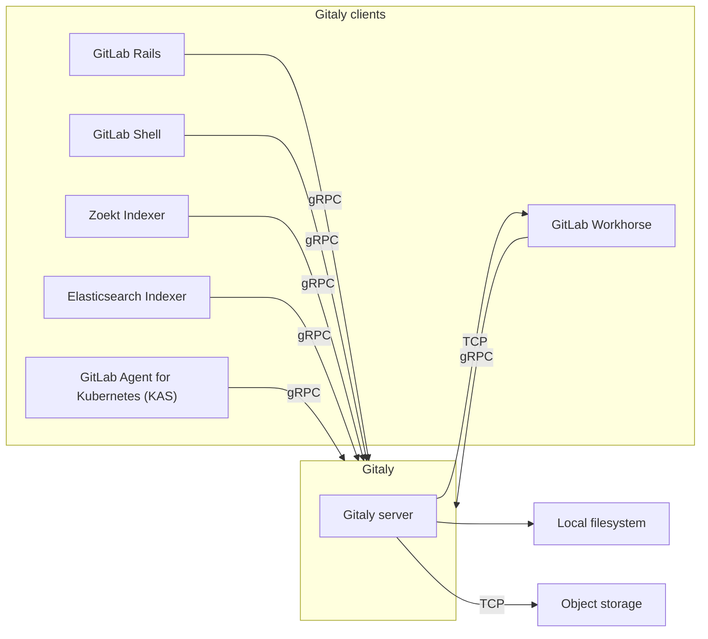



- Tier: 基础版，专业版，旗舰版
- Offering: 私有化部署



[Gitaly](https://gitlab.com/gitlab-org/gitaly) 提供对 Git 代码仓库的高层级远程过程调用（RPC）访问。极狐GitLab 使用它来读取和写入 Git 数据。

Gitaly 存在于每个极狐GitLab 安装中，负责协调 Git 代码仓库的存储和检索。Gitaly 可以是：

- 在单实例 Linux 软件包安装（所有极狐GitLab 组件都在一台机器上）上运行的后台服务。
- 根据扩展和可用性要求，分离到自己的实例上，并在完整集群配置中进行配置。

> [!note]
> Gitaly 仅管理极狐GitLab 的 Git 代码仓库访问。其他类型的极狐GitLab 数据不通过
> Gitaly 访问。

极狐GitLab 通过配置的[代码仓库存储](../repository_storage_paths.md)访问[代码仓库](../../user/project/repository/_index.md)。每个新代码仓库都会根据[配置的权重](../repository_storage_paths.md#configure-where-new-repositories-are-stored)存储在其中一个代码仓库存储上。每个代码仓库存储要么是：

- 使用[存储路径](../repository_storage_paths.md)直接访问代码仓库的 Gitaly 存储，
  其中每个代码仓库存储在单个 Gitaly 节点上。所有请求都路由到该节点。
- 由 [Gitaly 集群（Praefect）](praefect/_index.md)提供的[虚拟存储](praefect/_index.md#virtual-storage)，
  其中每个代码仓库可以存储在多个 Gitaly 节点上以实现容错。使用 Gitaly 集群（Praefect）时：
  - 读取请求分布在多个 Gitaly 节点之间，这可以提高性能。
  - 写入请求会广播到代码仓库副本。

下图展示了配置为直接访问 Gitaly 的极狐GitLab：

在此示例中：

- 每个代码仓库存储在三个 Gitaly 存储之一上：`storage-1`、`storage-2` 或
  `storage-3`。
- 每个存储由一个 Gitaly 节点提供服务。
- 三个 Gitaly 节点将数据存储在其文件系统上。

## 磁盘要求

Gitaly 和 Gitaly 集群（Praefect）需要快速的本地存储才能有效运行，因为它们是重度基于 I/O 的进程。因此，强烈建议所有 Gitaly 节点使用固态硬盘（SSD）。这些 SSD 应具有高读写吞吐量，因为 Gitaly 会并发操作许多小文件。

作为参考，以下图表显示了 JihuLab.com 上 Gitaly 生产节点集合的 P99 磁盘 IOPS，粒度为一分钟。数据查询自一个具有代表性的七天时段，从周一早上开始并结束。请注意 IOPS 的规律性峰值，因为流量在工作周期间变得更加密集。原始数据显示了更大的峰值，写入峰值达到 8000 IOPS。可用的磁盘吞吐量必须能够处理这些峰值，以避免
中断 Gitaly 请求。

- P99 磁盘 IOPS（读取）：

  

- P99 磁盘 IOPS（写入）：

  

我们通常会看到：

- 每秒 500 - 1000 次读取，峰值为每秒 3500 次读取。
- 每秒约 500 次写入，峰值超过每秒 3000 次写入。

截至撰写本文时，Gitaly 节点集合大多由 `t2d-standard-32` 实例组成，使用 `pd-ssd` 磁盘。[官方公布](https://cloud.google.com/compute/docs/disks/performance#t2d_instances)的最大写入和读取 IOPS 为 60,000。

JihuLab.com 还对开销高昂的 Git 操作采用了更严格的[并发限制](concurrency_limiting.md)，这些限制在极狐GitLab 私有化部署实例上默认未启用。放宽的并发限制、针对特别大型单体仓库的操作，或使用
[pack-objects 缓存](configure_gitaly.md#pack-objects-cache)，也可能显著增加
磁盘活动。

在您自己的环境中，您在 Gitaly 实例上观察到的磁盘活动可能与这些已发布的结果有很大差异。如果您在云环境中运行，选择更大的实例通常会增加可用的磁盘 IOPS。您也可以选择具有保证吞吐量的预配 IOPS 磁盘类型。有关如何正确配置 IOPS 的信息，请参阅您的云提供商的文档。

对于代码仓库数据，出于性能和一致性原因，Gitaly 和 Gitaly 集群（Praefect）仅支持本地存储。不支持 [NFS](../nfs.md) 或[基于云的文件系统](../nfs.md#avoid-using-cloud-based-file-systems)等替代方案。

每个 Gitaly 节点必须使用自己专用的存储磁盘。IOPS 要求独立适用于每个节点。如果多个 Gitaly 节点共享单个磁盘，该磁盘上的 I/O 负载会成倍增加，并可能导致严重的性能瓶颈。

## Gitaly 架构

Gitaly 实现了客户端-服务器架构：

- Gitaly 服务器是运行 Gitaly 本身的任何节点。
- Gitaly 客户端是运行向 Gitaly 服务器发出请求的进程的任何节点。Gitaly 客户端也
  称为 Gitaly 使用方，包括：
  - [GitLab Rails 应用](https://jihulab.com/gitlab-cn/gitlab)
  - [GitLab Shell](https://gitlab.com/gitlab-org/gitlab-shell)
  - [GitLab Workhorse](https://gitlab.com/gitlab-org/gitlab-workhorse)
  - [GitLab Elasticsearch Indexer](https://gitlab.com/gitlab-org/gitlab-elasticsearch-indexer)
  - [GitLab Zoekt Indexer](https://gitlab.com/gitlab-org/gitlab-zoekt-indexer)
  - [GitLab Agent for Kubernetes (KAS)](https://gitlab.com/gitlab-org/cluster-integration/gitlab-agent)

下图说明了 Gitaly 客户端-服务器架构：

## 配置 Gitaly

Gitaly 在 Linux 软件包安装中已预配置，这是一种[适用于最多 20 RPS / 1,000 用户](../reference_architectures/1k_users.md)的配置。对于：

- 最多 40 RPS / 2,000 用户的 Linux 软件包安装，请参阅[特定的 Gitaly 配置说明](../reference_architectures/2k_users.md#configure-gitaly)。
- 自行编译的安装或自定义 Gitaly 安装，请参阅[配置 Gitaly](configure_gitaly.md)。

对于每天执行 Git 写入操作且活跃用户超过 2000 的极狐GitLab 安装，可能
最适合使用 Gitaly 集群（Praefect）。

## Gitaly CLI

`gitaly` 命令是一个命令行界面，为 Gitaly 管理员提供额外的子命令。例如，
Gitaly CLI 用于：

- 为代码仓库[配置自定义 Git 钩子](../server_hooks.md)。
- 验证 Gitaly 配置文件。
- 验证内部 Gitaly API 可访问。
- 针对磁盘上的代码仓库[运行 Git 命令](troubleshooting.md#use-gitaly-git-when-git-is-required-for-troubleshooting)。

有关其他子命令的更多信息，请运行 `sudo -u git -- /opt/gitlab/embedded/bin/gitaly --help`。

## 备份代码仓库

使用极狐GitLab 以外的工具备份或同步代码仓库时，您必须在复制代码仓库数据时[阻止写入](../backup_restore/backup_gitlab.md#prevent-writes-and-copy-the-git-repository-data)。

## Bundle URI

您可以将 Git [bundle URI](https://git-scm.com/docs/bundle-uri) 与 Gitaly 一起使用。
有关更多信息，请参阅 [Bundle URI 文档](bundle_uris.md)。

## 直接访问代码仓库

极狐GitLab 不建议使用 Git 客户端或任何其他工具直接访问存储在磁盘上的 Gitaly 代码仓库，因为 Gitaly 正在不断改进和变化。这些改进可能会使您的假设失效，导致性能下降、不稳定，甚至数据丢失。例如：

- Gitaly 具有诸如 [`info/refs` 通告缓存](https://gitlab.com/gitlab-org/gitaly/blob/master/doc/design_diskcache.md)之类的优化，
  这些优化依赖 Gitaly 通过官方 gRPC
  接口来控制和监控对代码仓库的访问。
- [Gitaly 集群（Praefect）](praefect/_index.md)具有诸如容错和
  [分布式读取](praefect/_index.md#distributed-reads)之类的优化，这些优化依赖 gRPC 接口和数据库
  来确定代码仓库状态。

> [!warning]
> 直接访问 Git 代码仓库需自行承担风险，且不受支持。
