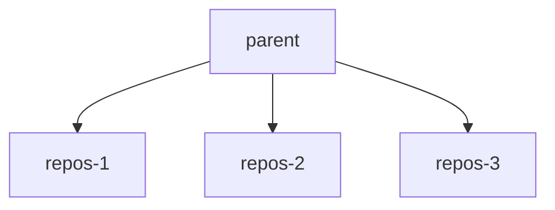

您可以在 Linux 中使用控制组（cgroups）来限制特定进程可以消耗的内存和 CPU 数量。Cgroups 可以帮助保护系统免于因内存和 CPU 过度消耗而出现意外的资源耗尽。Cgroups 广泛可用，通常用作容器化的基础机制。

Cgroups 通过一个伪文件系统进行配置，通常挂载在 `/sys/fs/cgroup`，并以层级方式分配资源。挂载点可在 Gitaly 中配置。其结构因所使用的 cgroups 版本而异：

- Cgroups v1 采用面向资源的层级结构。父目录是 `cpu` 和 `memory` 等资源。
- Cgroups v2 采用面向进程的方式。父目录是进程组，其中的文件代表所控制的每种资源。

如需更深入的介绍，请参阅 [cgroups Linux 手册页](https://man7.org/linux/man-pages/man7/cgroups.7.html)。

当 Gitaly 运行在：

- 虚拟机上时，同时支持 cgroups v1 和 cgroups v2。Gitaly 会根据挂载点自动检测使用哪个 cgroup 版本。
- Kubernetes 集群上时，仅支持 cgroups v2，因为使用 cgroups v1 时无法将 cgroup 层级的读写权限委派给容器。

当 Gitaly 使用 cgroups v2 运行时，可能提供额外的功能和改进，例如能够使用 [clone](https://man7.org/linux/man-pages/man2/clone.2.html) 系统调用直接在某个 cgroup 下启动进程。

<a id="before-you-begin"></a>

## 开始之前

在您的环境中启用限制时应谨慎行事，且仅在特定情况下启用，例如防范意外流量。达到限制时，确实会导致连接断开，从而对用户产生负面影响。为了获得一致且稳定的性能，您应首先探索其他方案，例如调整节点规格，以及[审查大型代码仓库](../../user/project/repository/monorepos/_index.md)或工作负载。

为内存启用 cgroups 时，您应确保 Gitaly 节点上未配置交换空间，因为进程可能会转而使用交换空间，而不是被终止。内核会将可用交换内存视为 cgroup 所施加限制之外的额外内存。这种情况可能导致性能显著下降。要在 Gitaly 中启用 cgroups，您必须为 `repositories` 字段配置一个大于 `0` 的 `count`。

<a id="how-gitaly-benefits-from-cgroups"></a>

## Gitaly 如何从 cgroups 中获益

某些 Git 操作可能会消耗过多资源，在以下情况下甚至达到耗尽的程度：

- 意外的高流量。
- 针对不遵循最佳实践的大型代码仓库运行的操作。

消耗这些资源的特定代码仓库上的活动被称为“吵闹的邻居”，可能导致 Gitaly 服务器上托管的其他代码仓库的 Git 性能下降。

作为一种硬性保护，Gitaly 可以使用 cgroups 告知内核在这些操作占用所有系统资源并导致不稳定之前终止它们。Gitaly 会根据 Git 命令所操作的代码仓库，将 Git 进程分配到某个 cgroup。这些 cgroups 称为代码仓库 cgroups。每个代码仓库 cgroup：

- 具有内存和 CPU 限制。
- 包含一个或多个代码仓库的 Git 进程。cgroup 的总数可配置。每个 cgroup 使用一致的循环哈希，以确保给定代码仓库的 Git 进程始终落在同一个 cgroup 中。

当某个代码仓库 cgroup 达到其：

- 内存限制时，内核会在进程中寻找一个候选进程将其终止，这可能导致客户端请求中止。
- CPU 限制时，进程不会被终止，但会阻止这些进程消耗超过允许量的 CPU，这意味着客户端请求可能会被限流，但不会被中止。

达到这些限制时，性能可能会降低，用户可能会断开连接。

下图说明了 cgroup 结构：

- 父 cgroup 管控所有 Git 进程的限制。
- 每个代码仓库 cgroup（名为 `repos-1` 到 `repos-3`）在代码仓库级别实施限制。

如果 Gitaly 存储服务于：

- 仅三个代码仓库，则每个代码仓库直接落入其中一个 cgroup。
- 超过代码仓库 cgroup 数量的代码仓库，则多个代码仓库会以一致的方式分配到同一个组。



<a id="configuring-oversubscription"></a>

## 配置超额订阅

代码仓库 cgroup 的数量应合理偏高，以便在服务于数千个代码仓库的存储上仍能实现隔离。代码仓库数量的一个良好起点是该存储上活跃代码仓库数量的两倍。

由于代码仓库 cgroup 会在父 cgroup 之上实施额外限制，如果我们通过将父限制除以组数来配置它们，最终会得到过于严格的限制。例如：

- 我们的父内存限制为 32 GiB。
- 我们大约有 100 个活跃代码仓库。
- 我们配置了 `cgroups.repositories.count = 100`。

如果将 32 GiB 除以 100，我们每个代码仓库 cgroup 仅分配 0.32 GiB。此设置会导致性能极差且利用率严重不足。

您可以使用超额订阅来在正常操作期间维持基线性能水平，同时允许少量高工作负载的代码仓库在必要时“突发”，而不影响无关请求。超额订阅指的是分配超过系统技术上可用量的资源。

沿用前面的示例，我们可以通过为每个代码仓库 cgroup 分配 10 GiB 内存来超额订阅，尽管系统并没有 10 GiB * 100 的系统内存。这些值假设 10 GiB 足以对任何一个代码仓库进行正常操作，允许两个代码仓库各自突发到 10 GiB，并留出第三份资源以维持基线性能。

类似的规则也适用于 CPU 时间。我们有意为代码仓库 cgroup 分配比整个系统可用量更多的 CPU 核心。例如，即使系统没有 400 个总核心，我们可能决定为每个代码仓库 cgroup 分配 4 个核心。

有两个主要值控制超额订阅：

-`cpu_quota_us`
-`memory_bytes`

父 cgroup 与代码仓库 cgroup 之间每个值的差异决定了超额订阅的程度。

<a id="measurement-and-tuning"></a>

## 测量与调优

要为超额订阅建立并调优正确的基线资源需求，您必须观察 Gitaly 服务器上的生产工作负载。默认暴露的 [Prometheus 指标](../monitoring/prometheus/_index.md)足以满足此需求。您可以使用以下查询作为指导，测量特定 Gitaly 服务器的 CPU 和内存使用情况：

| 查询                                                                                                                                                | 资源                                                          |
|------------------------------------------------------------------------------------------------------------------------------------------------------|-------------------------------------------------------------------|
| `quantile_over_time(0.99, instance:node_cpu_utilization:ratio{type="gitaly", fqdn="gitaly.internal"}[5m])`    | 具有指定 `fqdn`的 Gitaly 节点的 p99 CPU 利用率    |
| `quantile_over_time(0.99, instance:node_memory_utilization:ratio{type="gitaly", fqdn="gitaly.internal"}[5m])` | 具有指定 `fqdn`的 Gitaly 节点的 p99 内存利用率 |

根据您在一段具有代表性的时间内（例如一个典型工作周）观察到的利用率，您可以确定正常操作的基线资源需求。为了得出前面示例中的配置，我们会观察到整个工作周内内存使用量稳定在 10 GiB，CPU 负载为 4 核。

随着工作负载的变化，您应重新查看指标并调整 cgroups 配置。如果您在启用 cgroups 后注意到性能显著下降，也应调整配置，因为这可能表明限制过于严格。

<a id="available-configuration-settings"></a>

## 可用配置设置

要在 Gitaly 中配置代码仓库 cgroups，请在 `/etc/gitlab/gitlab.rb`中使用以下针对 `gitaly['configuration'][:cgroups]` 的设置：

- `mountpoint` 是父 cgroup 目录的挂载位置。默认为 `/sys/fs/cgroup`。
- `hierarchy_root` 是 Gitaly 在其下创建组的父 cgroup，
  预期由 Gitaly 运行所用的用户和组拥有。Linux 软件包安装
  会在 Gitaly 启动时创建一组目录 `mountpoint/<cpu|memory>/hierarchy_root`。
- `memory_bytes` 是对 Gitaly 生成的所有
  Git 进程统一施加的总内存限制。0 表示无限制。
- `cpu_shares` 是对 Gitaly 生成的所有 Git
  进程统一施加的 CPU 限制。0 表示无限制。最大值为 1024 份额，
  代表 100% 的 CPU。
- `cpu_quota_us` 是 [`cfs_quota_us`](https://docs.kernel.org/scheduler/sched-bwc.html#management)，
  用于在 cgroups 的进程超过此配额值时对其进行限流。我们将
  `cfs_period_us` 设置为 `100ms`，因此 1 个核心为 `100000`。0 表示无限制。
- `repositories.count` 是 cgroups 池中的 cgroup 数量。每次生成新的 Git
  命令时，Gitaly 会根据该命令所针对的代码仓库将其分配到
  这些 cgroup 之一。循环哈希算法会将
  Git 命令分配到这些 cgroup，因此某个代码仓库的 Git 命令
  始终会被分配到同一个 cgroup。
- `repositories.memory_bytes` 是对某个代码仓库 cgroup 中包含的所有 Git 进程施加的总内存限制。
  0 表示无限制。此值不能超过顶层 `memory_bytes`的值。
- `repositories.cpu_shares` 是对某个代码仓库 cgroup 中包含的所有 Git 进程施加的 CPU 限制。
  0 表示无限制。最大值为 1024 份额，代表 100% 的 CPU。
  此值不能超过顶层 `cpu_shares`的值。
- `repositories.cpu_quota_us` 是 [`cfs_quota_us`](https://docs.kernel.org/scheduler/sched-bwc.html#management)，
  施加于某个代码仓库 cgroup 中包含的所有 Git 进程。Git
  进程不能使用超过给定配额的量。我们将
  `cfs_period_us` 设置为 `100ms`，因此 1 个核心为 `100000`。0 表示无限制。
- `repositories.max_cgroups_per_repo` 是针对特定代码仓库的 Git 进程
  可以分布到的代码仓库 cgroup 数量。这样可以为代码仓库 cgroup 配置更保守的
  CPU 和内存限制，同时仍能应对突发工作负载。例如，当 `max_cgroups_per_repo` 为 `2` 且 `memory_bytes`
  限制为 10 GB 时，针对特定代码仓库的独立 Git 操作最多可消耗
  20 GB 内存。

例如（不一定是推荐的设置）：

```ruby
# in /etc/gitlab/gitlab.rb
gitaly['configuration'] = {
  # ...
  cgroups: {
    mountpoint: '/sys/fs/cgroup',
    hierarchy_root: 'gitaly',
    memory_bytes: 64424509440, # 60 GB
    cpu_shares: 1024,
    cpu_quota_us: 400000 # 4 cores
    repositories: {
      count: 1000,
      memory_bytes: 32212254720, # 20 GB
      cpu_shares: 512,
      cpu_quota_us: 200000, # 2 cores
      max_cgroups_per_repo: 2
    },
  },
}
```

<a id="monitoring-cgroups"></a>

## 监控 cgroups

有关监控 cgroups 的信息，请参阅[监控 Gitaly cgroups](monitoring.md#monitor-gitaly-cgroups)。
