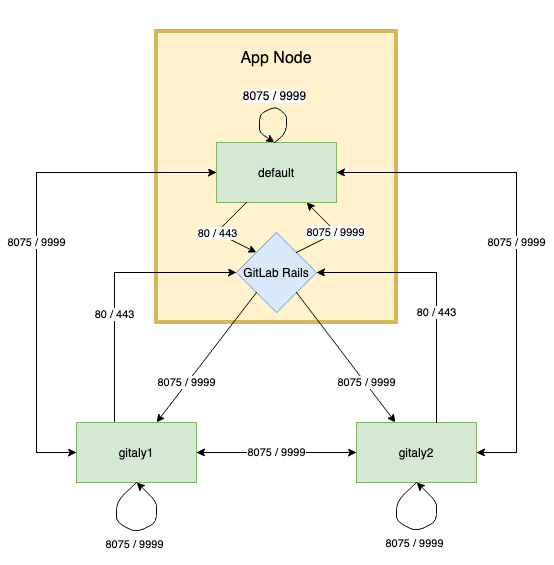



- Tier: 基础版，专业版，旗舰版
- Offering: 私有化部署



可通过以下两种方式之一配置 Gitaly：





1. 编辑 `/etc/gitlab/gitlab.rb` 并添加或更改 Gitaly 设置。请参阅
   [Gitaly 配置示例文件](https://gitlab.com/gitlab-org/gitaly/-/blob/master/config.toml.example)。示例文件中的
   设置必须转换为 Ruby。
1. 保存文件并[重新配置极狐GitLab](../restart_gitlab.md#reconfigure-a-linux-package-installation)。





1. 配置 [Gitaly chart](https://gitlab.cn/docs/charts/charts/gitlab/gitaly/)。
1. [升级您的 Helm release](https://gitlab.cn/docs/charts/installation/deployment/)。





1. 编辑 `/home/git/gitaly/config.toml` 并添加或更改 Gitaly 设置。请参阅
   [Gitaly 配置示例文件](https://gitlab.com/gitlab-org/gitaly/-/blob/master/config.toml.example)。
1. 保存文件并[重启极狐GitLab](../restart_gitlab.md#self-compiled-installations)。





以下配置选项也可用：

- 启用 [TLS 支持](tls_support.md)。
- 限制 [RPC 并发数](concurrency_limiting.md#limit-rpc-concurrency)。
- 限制 [pack-objects 并发数](concurrency_limiting.md#limit-pack-objects-concurrency)。

<a id="about-the-gitaly-token"></a>

## 关于 Gitaly 令牌

Gitaly 文档中通篇提到的令牌只是管理员选择的任意密码。它与为极狐GitLab API 创建的令牌或其他类似的 Web API 令牌无关。

<a id="run-gitaly-on-its-own-server"></a>

## 在独立服务器上运行 Gitaly

默认情况下，Gitaly 与 Gitaly 客户端运行在同一台服务器上，并按前文所述进行配置。单服务器安装最适合使用以下安装方式所用的这一默认配置：

- [Linux 软件包安装](../../install/package/_index.md)。
- [自行编译安装](../../install/self_compiled/_index.md)。

不过，Gitaly 也可以部署到独立服务器上，这对跨多台机器的极狐GitLab 安装会带来好处。

> [!note]
> 当配置为在独立服务器上运行时，Gitaly 服务器必须先于集群中的 Gitaly 客户端进行[升级](../../update/package/_index.md)。

在独立服务器上设置 Gitaly 的流程如下：

1. [安装 Gitaly](#install-gitaly)。
1. [配置身份验证](#configure-authentication)。
1. [配置 Gitaly 服务器](#configure-gitaly-servers)。
1. [配置 Gitaly 客户端](#configure-gitaly-clients)。
1. [在不需要的位置禁用 Gitaly](#disable-gitaly-where-not-required-optional)（可选）。

> [!note]
> [磁盘要求](_index.md#disk-requirements)适用于 Gitaly 节点。

<a id="network-architecture"></a>

### 网络架构

以下列表描述了 Gitaly 的网络架构：

- GitLab Rails 将代码仓库分片到[代码仓库存储](../repository_storage_paths.md)中。
- `/config/gitlab.yml` 包含从存储名称到 `(Gitaly address, Gitaly token)` 对的映射。
- `/config/gitlab.yml`中的 `storage name` -\> `(Gitaly address, Gitaly token)` 映射是
  Gitaly 网络拓扑的唯一事实来源。
- 一个 `(Gitaly address, Gitaly token)` 对应一台 Gitaly 服务器。
- 一台 Gitaly 服务器承载一个或多个存储。
- 一个 Gitaly 客户端可以使用一台或多台 Gitaly 服务器。
- Gitaly 地址的指定方式必须使其能对所有 Gitaly 客户端正确解析。
- Gitaly 客户端包括：
  - Puma。
  - Sidekiq。
  - GitLab Workhorse。
  - GitLab Shell。
  - Elasticsearch 索引器。
  - Gitaly 自身。
- Gitaly 服务器必须能够使用 `/config/gitlab.yml`中指定的自身
  `(Gitaly address, Gitaly token)` 对向自身发起 RPC 调用。
- 身份验证通过一个静态令牌完成，该令牌在 Gitaly 和 GitLab Rails
  节点之间共享。

下图展示了 Gitaly 服务器与 GitLab Rails 之间的通信，并显示了
HTTP 和 HTTPS 通信的默认端口。



> [!warning]
> Gitaly 服务器不得暴露到公共互联网，因为 Gitaly 网络流量默认未加密。
> 强烈建议使用防火墙限制对 Gitaly 服务器的访问。
> 另一种选择是[使用 TLS](tls_support.md)。

在以下各节中，我们将介绍如何使用密钥令牌 `abc123secret` 配置两台 Gitaly 服务器：

- `gitaly1.internal`。
- `gitaly2.internal`。

我们假设您的极狐GitLab 安装有三个代码仓库存储：

- `default`。
- `storage1`。
- `storage2`。

如果需要，您也可以只使用一台服务器和一个代码仓库存储。

<a id="install-gitaly"></a>

### 安装 Gitaly

使用以下任一方式在每台 Gitaly 服务器上安装 Gitaly：

- Linux 软件包安装。[下载并安装](https://gitlab.cn/install)您需要的 Linux 软件包，
  但不要提供 `EXTERNAL_URL=` 值。
- 自行编译安装。按照[安装 Gitaly](../../install/self_compiled/_index.md#install-gitaly)中的步骤操作。

<a id="configure-gitaly-servers"></a>

### 配置 Gitaly 服务器

要配置 Gitaly 服务器，您必须：

- 配置身份验证。
- 配置存储路径。
- 启用网络监听器。

`git` 用户必须能够读取、写入所配置的存储路径并设置其权限。

为避免轮换 Gitaly 令牌时出现停机，您可以使用 `gitaly['auth_transitioning']` 设置临时禁用身份验证。更多信息，请参阅[启用身份验证过渡模式](#enable-auth-transitioning-mode)。

<a id="configure-authentication"></a>

#### 配置身份验证

Gitaly 和极狐GitLab 使用两个共享密钥进行身份验证：

- *Gitaly 令牌*：用于对发往 Gitaly 的 gRPC 请求进行身份验证。您可以直接在极狐GitLab 配置中指定 Gitaly 令牌，
  也可以在令牌文件中指定。使用令牌文件更安全，也更适合容器化
  环境，因为它避免了在启动时将密钥渲染到配置中。令牌文件必须：
  - 仅包含令牌字符串。空白字符会被自动去除。
  - 具有 `0600` 或 `0400`的文件权限。
- *GitLab Shell 令牌*：用于从 GitLab Shell 到极狐GitLab 内部 API 的身份验证回调。





1. 要配置 *Gitaly 令牌*，请编辑 `/etc/gitlab/gitlab.rb`：

   - 使用令牌文件时：

     ```ruby
     gitaly['configuration'] = {
        # ...
        auth: {
          # ...
          token_file: '/etc/gitlab/gitaly_token',
        },
     }
     ```

   - 直接指定令牌时：

     ```ruby
     gitaly['configuration'] = {
        # ...
        auth: {
          # ...
          token: 'abc123secret',
        },
     }
     ```

   `token` 和 `token_file` 互斥。

1. 通过以下两种方式之一配置 *GitLab Shell 令牌*：

   - 方法 1（推荐）：将 `/etc/gitlab/gitlab-secrets.json` 从 Gitaly 客户端复制到 Gitaly
     服务器以及任何其他 Gitaly 客户端上的同一路径。

   - 方法 2：

     1. 在所有运行 GitLab Rails 的节点上，编辑 `/etc/gitlab/gitlab.rb`。
     1. 将 `GITLAB_SHELL_SECRET_TOKEN` 替换为真实密钥：

        - 极狐GitLab 17.5 及更高版本：

          ```ruby
          gitaly['gitlab_secret'] = 'GITLAB_SHELL_SECRET_TOKEN'
          ```

        - 极狐GitLab 17.4 及更早版本：

          ```ruby
          gitlab_shell['secret_token'] = 'GITLAB_SHELL_SECRET_TOKEN'
          ```

     1. 在所有运行 Gitaly 的节点上，编辑 `/etc/gitlab/gitlab.rb`。
     1. 将 `GITLAB_SHELL_SECRET_TOKEN` 替换为真实密钥：

        - 极狐GitLab 17.5 及更高版本：

          ```ruby
          gitaly['gitlab_secret'] = 'GITLAB_SHELL_SECRET_TOKEN'
          ```

        - 极狐GitLab 17.4 及更早版本：

          ```ruby
          gitlab_shell['secret_token'] = 'GITLAB_SHELL_SECRET_TOKEN'
          ```

     1. 完成这些更改后，重新配置极狐GitLab：

     ```shell
     sudo gitlab-ctl reconfigure
     ```





1. 将 `/home/git/gitlab/.gitlab_shell_secret` 从 Gitaly 客户端复制到
   Gitaly 服务器（以及任何其他 Gitaly 客户端）上的同一路径。
1. 在 Gitaly 客户端上，编辑 `/home/git/gitlab/config/gitlab.yml`：

   ```yaml
   gitlab:
     gitaly:
       token: 'abc123secret'
   ```

1. 保存文件并[重启极狐GitLab](../restart_gitlab.md#self-compiled-installations)。
1. 在 Gitaly 服务器上，编辑 `/home/git/gitaly/config.toml`：

   - 使用令牌文件时：

     ```toml
     [auth]
     token_file = '/etc/gitaly/token'
     ```

   - 直接指定令牌时：

     ```toml
     [auth]
     token = 'abc123secret'
     ```

   `token` 和 `token_file` 互斥。

1. 保存文件并[重启极狐GitLab](../restart_gitlab.md#self-compiled-installations)。





<a id="configure-gitaly-server"></a>

#### 配置 Gitaly 服务器

<!--
Updates to example must be made at:

- <https://gitlab.com/gitlab-org/charts/gitlab/blob/master/doc/advanced/external-gitaly/external-omnibus-gitaly.md#configure-linux-package-installation>
- <https://gitlab.com/gitlab-org/gitlab/-/blob/master/doc/administration/gitaly/praefect/configure.md#praefect>
- All reference architecture pages
-->

配置 Gitaly 服务器。

Gitaly 有一些 RPC 会使用客户端（例如 Rails 或 Sidekiq）提供的地址向自身发起网络调用。

如果由于您的网络配置，Gitaly 无法以这种方式访问自身（例如，Gitaly 位于不支持发夹连接的负载均衡器后面）：

1. 编辑 Gitaly 服务器的 `/etc/hosts` 文件。
1. 添加一条记录，将客户端使用的 Gitaly 地址重定向到 Gitaly 服务器自身的 IP 地址。例如，`127.0.0.1 gitaly.example.com`
   或 `<local-ip> gitaly.example.com`。





1. 编辑 `/etc/gitlab/gitlab.rb`：

   ```ruby
   # Avoid running unnecessary services on the Gitaly server
   postgresql['enable'] = false
   redis['enable'] = false
   nginx['enable'] = false
   puma['enable'] = false
   sidekiq['enable'] = false
   gitlab_workhorse['enable'] = false
   gitlab_exporter['enable'] = false
   gitlab_kas['enable'] = false

   # If you run a separate monitoring node you can disable these services
   prometheus['enable'] = false
   alertmanager['enable'] = false

   # If you don't run a separate monitoring node you can
   # enable Prometheus access & disable these extra services.
   # This makes Prometheus listen on all interfaces. You must use firewalls to restrict access to this address/port.
   # prometheus['listen_address'] = '0.0.0.0:9090'
   # prometheus['monitor_kubernetes'] = false

   # If you don't want to run monitoring services uncomment the following (not recommended)
   # node_exporter['enable'] = false

   # Prevent database connections during 'gitlab-ctl reconfigure'
   gitlab_rails['auto_migrate'] = false

   # Configure the gitlab-shell API callback URL. Without this, `git push` will
   # fail. This can be your 'front door' GitLab URL or an internal load
   # balancer.
   # Don't forget to copy `/etc/gitlab/gitlab-secrets.json` from Gitaly client to Gitaly server.
   gitlab_rails['internal_api_url'] = 'https://gitlab.example.com'

   gitaly['configuration'] = {
      # ...
      #
      # Make Gitaly accept connections on all network interfaces. You must use
      # firewalls to restrict access to this address/port.
      # Comment out following line if you only want to support TLS connections
      listen_addr: '0.0.0.0:8075',
      auth: {
        # ...
        #
        # Authentication token to ensure only authorized servers can communicate with
        # Gitaly server
        token: 'AUTH_TOKEN',
      },
   }
   ```

1. 为各台 Gitaly 服务器将以下内容追加到 `/etc/gitlab/gitlab.rb`：

   <!-- Updates to following example must also be made at <https://gitlab.com/gitlab-org/charts/gitlab/blob/master/doc/advanced/external-gitaly/external-omnibus-gitaly.md#configure-linux-package-installation> -->

   在 `gitaly1.internal` 上：

   ```ruby
   gitaly['configuration'] = {
      # ...
      storage: [
         {
            name: 'default',
            path: '/var/opt/gitlab/git-data/repositories',
         },
         {
            name: 'storage1',
            path: '/mnt/gitlab/git-data/repositories',
         },
      ],
   }
   ```

   在 `gitaly2.internal` 上：

   ```ruby
   gitaly['configuration'] = {
      # ...
      storage: [
         {
            name: 'storage2',
            path: '/srv/gitlab/git-data/repositories',
         },
      ],
   }
   ```

1. 保存文件并[重新配置极狐GitLab](../restart_gitlab.md#reconfigure-a-linux-package-installation)。
1. 确认 Gitaly 能够对极狐GitLab 内部 API 执行回调：

   ```shell
   sudo -u git -- /opt/gitlab/embedded/bin/gitaly check /var/opt/gitlab/gitaly/config.toml
   ```





1. 编辑 `/home/git/gitaly/config.toml`：

   ```toml
   listen_addr = '0.0.0.0:8075'

   runtime_dir = '/var/opt/gitlab/gitaly'

   [logging]
   format = 'json'
   level = 'info'
   dir = '/var/log/gitaly'
   ```

1. 为各台 Gitaly 服务器将以下内容追加到 `/home/git/gitaly/config.toml`：

   在 `gitaly1.internal` 上：

   ```toml
   [[storage]]
   name = 'default'
   path = '/var/opt/gitlab/git-data/repositories'

   [[storage]]
   name = 'storage1'
   path = '/mnt/gitlab/git-data/repositories'
   ```

   在 `gitaly2.internal` 上：

   ```toml
   [[storage]]
   name = 'storage2'
   path = '/srv/gitlab/git-data/repositories'
   ```

1. 编辑 `/home/git/gitlab-shell/config.yml`：

   ```yaml
   gitlab_url: https://gitlab.example.com
   ```

1. 保存文件并[重启极狐GitLab](../restart_gitlab.md#self-compiled-installations)。
1. 确认 Gitaly 能够对极狐GitLab 内部 API 执行回调：

   ```shell
   sudo -u git -- /opt/gitlab/embedded/bin/gitaly check /var/opt/gitlab/gitaly/config.toml
   ```





> [!warning]
> 如果直接将代码仓库数据从极狐GitLab 服务器复制到 Gitaly，请确保元数据文件
> （默认路径为 `/var/opt/gitlab/git-data/repositories/.gitaly-metadata`）不包含在传输中。
> 复制此文件会导致极狐GitLab 对 Gitaly 服务器上托管的代码仓库使用直接磁盘访问，
> 从而引发 `Error creating pipeline` 和 `Commit not found` 错误，或数据陈旧。

<a id="configure-gitaly-clients"></a>

### 配置 Gitaly 客户端

作为最后一步，您必须更新 Gitaly 客户端，使其从使用本地 Gitaly 服务切换为使用您刚刚配置的 Gitaly 服务器。

> [!note]
> 极狐GitLab 要求配置一个 `default` 代码仓库存储。
> [详细了解此限制](#gitlab-requires-a-default-repository-storage)。

这可能存在风险，因为任何阻止 Gitaly 客户端访问 Gitaly 服务器的问题都会导致所有 Gitaly 请求失败。例如，任何类型的网络、防火墙或名称解析问题。

Gitaly 做出以下假设：

- 您的 `gitaly1.internal` Gitaly 服务器可以从 Gitaly
  客户端通过 `gitaly1.internal:8075` 访问，并且该 Gitaly 服务器能够读取、写入 `/var/opt/gitlab/git-data` 和
  `/mnt/gitlab/git-data` 并设置其权限。
- 您的 `gitaly2.internal` Gitaly 服务器可以从 Gitaly
  客户端通过 `gitaly2.internal:8075` 访问，并且该 Gitaly 服务器能够读取、写入 `/srv/gitlab/git-data` 并设置其权限。
- 您的 `gitaly1.internal` 和 `gitaly2.internal` Gitaly 服务器可以相互访问。

您不能将部分 Gitaly 服务器定义为本地 Gitaly 服务器（不带 `gitaly_address`），部分定义为远程服务器（带 `gitaly_address`），除非使用[混合配置](#mixed-configuration)。

通过以下两种方式之一配置 Gitaly 客户端。这些说明针对未加密连接，但您也可以启用 [TLS 支持](tls_support.md)：





1. 编辑 `/etc/gitlab/gitlab.rb`：

   ```ruby
   # Use the same token value configured on all Gitaly servers
   gitlab_rails['gitaly_token'] = '<AUTH_TOKEN>'

   gitlab_rails['repositories_storages'] = {
     'default'  => { 'gitaly_address' => 'tcp://gitaly1.internal:8075' },
     'storage1' => { 'gitaly_address' => 'tcp://gitaly1.internal:8075' },
     'storage2' => { 'gitaly_address' => 'tcp://gitaly2.internal:8075' },
   }
   ```

   或者，如果每台 Gitaly 服务器都配置为使用不同的身份验证令牌：

   ```ruby
   gitlab_rails['repositories_storages'] = {
     'default'  => { 'gitaly_address' => 'tcp://gitaly1.internal:8075', 'gitaly_token' => '<AUTH_TOKEN_1>' },
     'storage1' => { 'gitaly_address' => 'tcp://gitaly1.internal:8075', 'gitaly_token' => '<AUTH_TOKEN_1>' },
     'storage2' => { 'gitaly_address' => 'tcp://gitaly2.internal:8075', 'gitaly_token' => '<AUTH_TOKEN_2>' },
   }
   ```

1. 保存文件并[重新配置极狐GitLab](../restart_gitlab.md#reconfigure-a-linux-package-installation)。
1. 在 Gitaly 客户端（例如
   Rails 应用）上运行 `sudo gitlab-rake gitlab:gitaly:check`，以确认其能够连接到 Gitaly 服务器。
1. 跟踪日志以查看请求：

   ```shell
   sudo gitlab-ctl tail gitaly
   ```





1. 编辑 `/home/git/gitlab/config/gitlab.yml`：

   ```yaml
   gitlab:
     repositories:
       storages:
         default:
           gitaly_address: tcp://gitaly1.internal:8075
           gitaly_token: AUTH_TOKEN_1
         storage1:
           gitaly_address: tcp://gitaly1.internal:8075
           gitaly_token: AUTH_TOKEN_1
         storage2:
           gitaly_address: tcp://gitaly2.internal:8075
           gitaly_token: AUTH_TOKEN_2
   ```

1. 保存文件并[重启极狐GitLab](../restart_gitlab.md#self-compiled-installations)。
1. 运行 `sudo -u git -H bundle exec rake gitlab:gitaly:check RAILS_ENV=production` 以确认
   Gitaly 客户端能够连接到 Gitaly 服务器。
1. 跟踪日志以查看请求：

   ```shell
   tail -f /home/git/gitlab/log/gitaly.log
   ```





当您在 Gitaly 服务器上跟踪 Gitaly 日志时，应该会看到有请求进来。触发 Gitaly 请求的一个可靠方法是通过 HTTP 或 HTTPS 从极狐GitLab 克隆代码仓库。

> [!warning]
> 如果您配置了[服务器钩子](../server_hooks.md)（无论是按代码仓库还是全局），
> 都必须将这些钩子迁移到 Gitaly 服务器上。如果您有多台 Gitaly 服务器，请将服务器钩子
> 复制到所有 Gitaly 服务器。

<a id="mixed-configuration"></a>

#### 混合配置

极狐GitLab 可以与多台 Gitaly 服务器中的某一台位于同一台服务器上，但不支持本地与远程混合的配置方式。以下设置是不正确的，因为：

- 所有地址都必须能从其他 Gitaly 服务器访问。
- `storage1` 被分配了一个 Unix 套接字作为 `gitaly_address`，这对
  某些 Gitaly 服务器来说是无效的。

```ruby
gitlab_rails['repositories_storages'] = {
  'default' => { 'gitaly_address' => 'tcp://gitaly1.internal:8075' },
  'storage1' => { 'gitaly_address' => 'unix:/var/opt/gitlab/gitaly/gitaly.socket' },
  'storage2' => { 'gitaly_address' => 'tcp://gitaly2.internal:8075' },
}
```

要组合本地和远程 Gitaly 服务器，请为本地 Gitaly 服务器使用外部地址。例如：

```ruby
gitlab_rails['repositories_storages'] = {
  'default' => { 'gitaly_address' => 'tcp://gitaly1.internal:8075' },
  # Address of the GitLab server that also has Gitaly running on it
  'storage1' => { 'gitaly_address' => 'tcp://gitlab.internal:8075' },
  'storage2' => { 'gitaly_address' => 'tcp://gitaly2.internal:8075' },
}

gitaly['configuration'] = {
  # ...
  #
  # Make Gitaly accept connections on all network interfaces
  listen_addr: '0.0.0.0:8075',
  # Or for TLS
  tls_listen_addr: '0.0.0.0:9999',
  tls: {
    certificate_path:  '/etc/gitlab/ssl/cert.pem',
    key_path: '/etc/gitlab/ssl/key.pem',
  },
  storage: [
    {
      name: 'storage1',
      path: '/mnt/gitlab/git-data/repositories',
    },
  ],
}
```

仅本地 Gitaly 服务器上的存储分片可以包含 `path`。如果排除该项，则该存储分片将使用默认的 Git 存储目录。

<a id="gitlab-requires-a-default-repository-storage"></a>

### 极狐GitLab 要求一个默认代码仓库存储

向环境添加 Gitaly 服务器时，您可能想替换原有的 `default` Gitaly 服务。但是，您不能重新配置极狐GitLab 应用服务器以移除 `default` 存储，因为极狐GitLab 要求有一个名为 `default`的存储。[详细了解](https://gitlab.com/gitlab-org/gitlab/-/issues/36175)此限制。

要绕过此限制：

1. 在新的 Gitaly 服务上定义一个额外的存储位置，并将该额外存储配置为 `default`。该存储位置必须
   有正在运行且可用的 Gitaly 服务，以避免依赖可用存储的数据库迁移出错。
1. 在[**管理员**区域](../repository_storage_paths.md#configure-where-new-repositories-are-stored)中，将 `default`的权重设置为零，
   以防止代码仓库存储在那里。

<a id="disable-gitaly-where-not-required-optional"></a>

### 在不需要的位置禁用 Gitaly（可选）

如果您将 Gitaly [作为远程服务](#run-gitaly-on-its-own-server)运行，请考虑禁用默认在极狐GitLab 服务器上运行的本地 Gitaly 服务，仅在需要的位置运行它。

仅在以自定义集群配置运行极狐GitLab（即 Gitaly 与极狐GitLab 实例运行在不同机器上）时，在极狐GitLab 实例上禁用 Gitaly 才有意义。在集群中的所有机器上禁用 Gitaly 不是有效配置（某些机器必须充当 Gitaly 服务器）。

通过以下两种方式之一在极狐GitLab 服务器上禁用 Gitaly：





1. 编辑 `/etc/gitlab/gitlab.rb`：

   ```ruby
   gitaly['enable'] = false
   ```

1. 保存文件并[重新配置极狐GitLab](../restart_gitlab.md#reconfigure-a-linux-package-installation)。





1. 编辑 `/etc/default/gitlab`：

   ```shell
   gitaly_enabled=false
   ```

1. 保存文件并[重启极狐GitLab](../restart_gitlab.md#self-compiled-installations)。





<a id="change-the-gitaly-listening-interface"></a>

## 更改 Gitaly 监听接口

您可以更改 Gitaly 监听的接口。当您有必须与 Gitaly 通信的外部服务时，可能需要更改监听接口。例如，[精确代码搜索](../../integration/zoekt/_index.md)在启用精确代码搜索时使用 Zoekt，但实际服务运行在另一台服务器上。

`gitaly_token` 必须是密钥字符串，因为 `gitaly_token` 用于与 Gitaly 服务进行身份验证。此密钥可以使用 `openssl rand -base64 24` 生成，以生成一个随机的 32 字符字符串。

例如，要将 Gitaly 监听接口更改为 `0.0.0.0:8075`：

```ruby
# /etc/gitlab/gitlab.rb
# Add a shared token for Gitaly authentication
gitlab_shell['secret_token'] = 'your_secure_token_here'
gitlab_rails['gitaly_token'] = 'your_secure_token_here'

# Gitaly configuration
gitaly['gitlab_secret'] = 'your_secure_token_here'
gitaly['configuration'] = {
  listen_addr: '0.0.0.0:8075',
  auth: {
    token: 'your_secure_token_here',
  },
  storage: [
    {
      name: 'default',
      path: '/var/opt/gitlab/git-data/repositories',
    },
  ]
}

# Tell Rails where to find Gitaly
gitlab_rails['repositories_storages'] = {
  'default' => { 'gitaly_address' => 'tcp://ip_address_here:8075' },
}

# Internal API URL (important for multi-server setups)
gitlab_rails['internal_api_url'] = 'http://ip_address_here'
```

<a id="control-groups"></a>

## 控制组

有关控制组的信息，请参阅 [Cgroups](cgroups.md)。

<a id="background-repository-optimization"></a>

## 后台代码仓库优化

Git 代码仓库的对象数据库中数据的存储方式可能会随时间推移变得低效，从而拖慢 Git 操作。您可以安排 Gitaly 运行一个每日后台任务，并设置最长持续时间，以清理这些条目并提升性能。

> [!warning]
> 后台代码仓库优化在运行期间可能会给主机带来显著负载。
> 请确保将其安排在非高峰时段，并保持较短的持续时间（例如 30-60 分钟）。

通过以下两种方式之一配置后台代码仓库优化：





编辑 `/etc/gitlab/gitlab.rb` 并添加：

```ruby
gitaly['configuration'] = {
  # ...
  daily_maintenance: {
    # ...
    start_hour: 4,
    start_minute: 30,
    duration: '30m',
    storages: ['default'],
  },
}
```





编辑 `/home/git/gitaly/config.toml` 并添加：

```toml
[daily_maintenance]
start_hour = 4
start_minute = 30
duration = '30m'
storages = ["default"]
```





<a id="rotate-gitaly-authentication-token"></a>

## 轮换 Gitaly 身份验证令牌

在生产环境中轮换凭据通常需要停机、导致服务中断，或两者兼有。

不过，您可以在不中断服务的情况下轮换 Gitaly 凭据。轮换 Gitaly 身份验证令牌涉及：

- [验证身份验证监控](#verify-authentication-monitoring)。
- [启用身份验证过渡模式](#enable-auth-transitioning-mode)。
- [更新 Gitaly 身份验证令牌](#update-gitaly-authentication-token)。
- [确保没有身份验证失败](#ensure-there-are-no-authentication-failures)。
- [禁用身份验证过渡模式](#disable-auth-transitioning-mode)。
- [验证身份验证已强制执行](#verify-authentication-is-enforced)。

如果您在单台服务器上运行极狐GitLab，此过程同样适用。在这种情况下，Gitaly 服务器和 Gitaly 客户端指的是同一台机器。

<a id="verify-authentication-monitoring"></a>

### 验证身份验证监控

在轮换 Gitaly 身份验证令牌之前，请确认您可以使用
Prometheus [监控极狐GitLab 安装的身份验证行为](monitoring.md#queries)。

然后您可以继续执行该过程的其余部分。

<a id="enable-auth-transitioning-mode"></a>

### 启用身份验证过渡模式

通过将 Gitaly 服务器置于身份验证过渡模式，临时禁用其上的 Gitaly 身份验证，如下所示：

```ruby
# in /etc/gitlab/gitlab.rb
gitaly['configuration'] = {
  # ...
  auth: {
    # ...
    transitioning: true,
  },
}
```

完成此更改后，您的 [Prometheus 查询](#verify-authentication-monitoring)应返回类似如下内容：

```promql
{enforced="false",status="would be ok"}  4424.985419441742
```

由于 `enforced="false"`，可以安全地开始推出新令牌。

<a id="update-gitaly-authentication-token"></a>

### 更新 Gitaly 身份验证令牌

要更新为新的 Gitaly 身份验证令牌，请在每台 Gitaly 客户端和 Gitaly 服务器上：

1. 更新配置：

   ```ruby
   # in /etc/gitlab/gitlab.rb
   gitaly['configuration'] = {
      # ...
      auth: {
         # ...
         token: '<new secret token>',
      },
   }
   ```

   如果您使用 `token_file`，请用新令牌更新所引用文件的内容。
   无需更改配置。令牌文件在启动时读取。

1. 重启 Gitaly：

   ```shell
   gitlab-ctl restart gitaly
   ```

如果在此更改推出期间运行 [Prometheus 查询](#verify-authentication-monitoring)，您会看到 `enforced="false",status="denied"` 计数器出现非零值。

<a id="ensure-there-are-no-authentication-failures"></a>

### 确保没有身份验证失败

设置新令牌并重启所有相关服务后，您会[暂时看到](#verify-authentication-monitoring)以下情况的混合：

- `status="would be ok"`。
- `status="denied"`。

在所有 Gitaly 客户端和 Gitaly 服务器都采用新令牌后，唯一非零的速率应该是 `enforced="false",status="would be ok"`。

<a id="disable-auth-transitioning-mode"></a>

### 禁用身份验证过渡模式

要重新启用 Gitaly 身份验证，请禁用身份验证过渡模式。按如下方式更新 Gitaly 服务器上的配置：

```ruby
# in /etc/gitlab/gitlab.rb
gitaly['configuration'] = {
  # ...
  auth: {
    # ...
    transitioning: false,
  },
}
```

> [!warning]
> 如果不完成此步骤，您将没有 Gitaly 身份验证。

<a id="verify-authentication-is-enforced"></a>

### 验证身份验证已强制执行

刷新您的 [Prometheus 查询](#verify-authentication-monitoring)。您现在应该会看到与开始时类似的结果。例如：

```promql
{enforced="true",status="ok"}  4424.985419441742
```

`enforced="true"` 表示身份验证正在强制执行。

<a id="pack-objects-cache"></a>

## Pack-objects 缓存



- Tier: 基础版，专业版，旗舰版
- Offering: 私有化部署



[Gitaly](_index.md) 是为 Git
代码仓库提供存储的服务，可以配置为缓存一个短滚动窗口的 Git fetch 响应。当您的服务器收到大量 CI fetch 流量时，这可以减轻服务器负载。

Pack-objects 缓存封装了 `git pack-objects`，这是
Git 的内部组件，通过使用 PostUploadPack 和
SSHUploadPack Gitaly RPC 间接调用。当用户通过 HTTP 执行 Git fetch 时，Gitaly 运行 PostUploadPack；
当用户通过 SSH 执行 Git fetch 时，Gitaly 运行 SSHUploadPack。
启用缓存后，任何使用 PostUploadPack 或 SSHUploadPack 的操作都能
从中受益。它独立于以下因素，且不受其影响：

- 传输方式（HTTP 或 SSH）。
- Git 协议版本（v0 或 v2）。
- fetch 类型，例如完整克隆、增量 fetch、浅克隆
  或部分克隆。

此缓存的优势在于它能够对并发的相同 fetch 进行去重。它：

- 可以让用户运行包含大量并发作业的 CI/CD 流水线的极狐GitLab 实例受益。
  服务器 CPU 利用率应有明显降低。
- 对唯一的 fetch 完全没有好处。例如，如果您通过将
  代码仓库克隆到本地计算机来进行抽查，您不太可能从该缓存中看到好处，因为
  您的 fetch 很可能是唯一的。

Pack-objects 缓存是本地缓存。它：

- 将元数据存储在启用它的 Gitaly 进程的内存中。
- 将它正在缓存的实际 Git 数据存储在本地存储的文件中。

使用本地文件的好处是操作系统可能会自动将 pack-objects 缓存文件的一部分保留在 RAM 中，从而使其更快。

由于 pack-objects 缓存可能导致
磁盘写入 IO 显著增加，因此默认关闭。

<a id="configure-the-cache"></a>

### 配置缓存

以下配置设置可用于 pack-objects 缓存。下面将更详细地讨论每项设置。

| 设置   | 默认值                                            | 描述                                                                                        |
|:----------|:---------------------------------------------------|:---------------------------------------------------------------------------------------------------|
| `enabled` | `false`                                            | 开启缓存。关闭时，Gitaly 会为每个请求运行一个专用的 `git pack-objects` 进程。 |
| `dir`     | `<PATH TO FIRST STORAGE>/+gitaly/PackObjectsCache` | 存储缓存文件的本地目录。                                                      |
| `max_age` | `5m`（5 分钟）                                   | 早于此时间的缓存条目会被逐出并从磁盘删除。                                   |
| `min_occurrences` | 1 | 创建缓存条目之前某个键必须出现的最小次数。 |

在 `/etc/gitlab/gitlab.rb`中，设置：

```ruby
gitaly['configuration'] = {
  # ...
  pack_objects_cache: {
    enabled: true,
    # The default settings for "dir", "max_age" and "min_occurences" should be fine.
    # If you want to customize these, see details below.
  },
}
```

<a id="enabled-defaults-to-false"></a>

#### `enabled` 默认为 `false`

缓存默认禁用，因为在某些情况下，它可能导致写入磁盘的字节数[急剧增加](https://gitlab.com/gitlab-com/gl-infra/production/-/issues/4010#note_534564684)。
在 JihuLab.com 上，我们已经验证
我们的代码仓库存储磁盘可以处理这一额外工作负载，但我们认为不能假设这在所有地方都成立。

<a id="cache-storage-directory-dir"></a>

#### 缓存存储目录 `dir`

缓存需要一个目录来存储其文件。此目录应该：

- 位于空间充足的文件系统中。如果缓存文件系统空间耗尽，所有
  fetch 都会开始失败。
- 位于 IO 带宽充足的磁盘上。如果缓存磁盘 IO 带宽耗尽，所有
  fetch，甚至可能整个服务器，都会变慢。

> [!warning]
> 指定目录中的所有现有数据都将被删除。
> 请注意不要使用包含现有数据的目录。

默认情况下，缓存存储目录设置为配置文件中定义的第一个 Gitaly 存储的子目录。

多个 Gitaly 进程可以使用同一目录进行缓存存储。每个 Gitaly 进程使用一个唯一的随机字符串作为其创建的缓存文件名的一部分。这意味着：

- 它们不会冲突。
- 它们不会重用另一个进程的文件。

虽然默认目录将缓存文件放在与您的代码仓库数据相同的文件系统中，但这并非硬性要求。如果对您的基础设施更有利，您可以将缓存文件放在不同的文件系统上。

磁盘所需的 IO 带宽量取决于：

- Gitaly 服务器上代码仓库的大小和形态。
- 用户产生的流量类型。

您可以使用 `gitaly_pack_objects_generated_bytes_total` 指标作为悲观估计，假设您的缓存命中率为 0%。

所需空间量取决于：

- 用户每秒从缓存中拉取的字节数。
- `max_age` 缓存逐出窗口的大小。

如果您的用户以 100 MB/s 的速度拉取，并且您使用 5 分钟的窗口，那么平均而言您的缓存目录中有 `5*60*100 MB = 30 GB`的数据。此平均值是预期平均值，而非保证值。峰值大小可能超过此平均值。

<a id="cache-eviction-window-max_age"></a>

#### 缓存逐出窗口 `max_age`

`max_age` 配置设置让您可以控制缓存命中的概率以及缓存文件使用的平均存储量。早于 `max_age`的条目会从磁盘删除。

逐出不会干扰正在进行的请求。`max_age` 小于在慢速连接上完成一次 fetch 所需的时间也没问题，因为 Unix 文件系统在所有正在读取已删除文件的进程关闭它之前不会真正删除该文件。

<a id="minimum-key-occurrences-min_occurrences"></a>

#### 最小键出现次数 `min_occurrences`

`min_occurrences` 设置控制在我们创建新缓存条目之前，一个相同的请求必须出现多少次。默认值为 `1`，这意味着唯一的请求不会被写入缓存。

如果您：

- 增大此数值，缓存命中率会下降，
  缓存使用的磁盘空间会减少。
- 减小此数值，缓存命中
  率会上升，缓存使用的磁盘空间会增加。

您应该将 `min_occurrences` 设置为 `1`。在 JihuLab.com 上，从 0 改为 1 为我们节省了 50% 的缓存磁盘空间，而对缓存命中率几乎没有影响。

<a id="observe-the-cache"></a>

### 观察缓存

您可以使用 Prometheus 指标和日志字段来观察缓存。

<a id="prometheus-metrics"></a>

#### Prometheus 指标

Gitaly 导出以下 Prometheus 指标以监控 pack-objects 缓存：

| 指标 | 类型 | 描述 |
|:-------|:-----|:------------|
| `gitaly_pack_objects_served_bytes_total` | Counter | 提供给客户端的 `git-pack-objects` 数据总字节数 |
| `gitaly_pack_objects_cache_lookups_total` | Counter | 缓存查找次数，带有 `result` 标签，指示 `hit` 或 `miss` |
| `gitaly_pack_objects_generated_bytes_total` | Counter | 运行 `git-pack-objects` 生成的总字节数 |

**Prometheus 查询示例：**

缓存命中率：

```promql
sum(rate(gitaly_pack_objects_cache_lookups_total{result="hit"}[5m])) /
sum(rate(gitaly_pack_objects_cache_lookups_total[5m]))
```

每秒从缓存提供的字节数：

```promql
rate(gitaly_pack_objects_served_bytes_total[5m])
```

每秒生成的字节数（缓存未命中）：

```promql
rate(gitaly_pack_objects_generated_bytes_total[5m])
```

缓存效率（提供的字节数与生成的字节数之比）：

```promql
rate(gitaly_pack_objects_served_bytes_total[5m]) /
rate(gitaly_pack_objects_generated_bytes_total[5m])
```

<a id="log-fields"></a>

#### 日志字段

这些日志是 gRPC 日志的一部分，可以在执行调用时发现。

| 字段 | 描述 |
|:---|:---|
| `pack_objects_cache.hit` | 指示当前 pack-objects 缓存是否命中（`true` 或 `false`） |
| `pack_objects_cache.key` | 用于 pack-objects 缓存的缓存键 |
| `pack_objects_cache.generated_bytes` | 正在写入的新缓存的大小（以字节为单位） |
| `pack_objects_cache.served_bytes` | 正在提供的缓存的大小（以字节为单位） |
| `pack_objects.compression_statistics` | 有关 pack-objects 生成的统计信息 |
| `pack_objects.enumerate_objects_ms` | 枚举客户端发送的对象所花费的总时间（以毫秒为单位） |
| `pack_objects.prepare_pack_ms` | 在将 packfile 发送回客户端之前准备它所花费的总时间（以毫秒为单位） |
| `pack_objects.write_pack_file_ms` | 将 packfile 发送回客户端所花费的总时间（以毫秒为单位）。高度依赖客户端的互联网连接 |
| `pack_objects.written_object_count` | Gitaly 发送回客户端的对象总数 |

在以下情况下：

- 缓存未命中，Gitaly 会同时记录 `pack_objects_cache.generated_bytes` 和 `pack_objects_cache.served_bytes` 消息。Gitaly 还会记录一些更详细的
  pack-object 生成统计信息。
- 缓存命中，Gitaly 只记录 `pack_objects_cache.served_bytes` 消息。

示例：

```json
{
  "bytes":26186490,
  "correlation_id":"01F1MY8JXC3FZN14JBG1H42G9F",
  "grpc.meta.deadline_type":"none",
  "grpc.method":"PackObjectsHook",
  "grpc.request.fullMethod":"/gitaly.HookService/PackObjectsHook",
  "grpc.request.glProjectPath":"root/gitlab-workhorse",
  "grpc.request.glRepository":"project-2",
  "grpc.request.repoPath":"@hashed/d4/73/d4735e3a265e16eee03f59718b9b5d03019c07d8b6c51f90da3a666eec13ab35.git",
  "grpc.request.repoStorage":"default",
  "grpc.request.topLevelGroup":"@hashed",
  "grpc.service":"gitaly.HookService",
  "grpc.start_time":"2021-03-25T14:57:52.747Z",
  "level":"info",
  "msg":"finished unary call with code OK",
  "peer.address":"@",
  "pid":20961,
  "span.kind":"server",
  "system":"grpc",
  "time":"2021-03-25T14:57:53.543Z",
  "pack_objects.compression_statistics": "Total 145991 (delta 68), reused 6 (delta 2), pack-reused 145911",
  "pack_objects.enumerate_objects_ms": 170,
  "pack_objects.prepare_pack_ms": 7,
  "pack_objects.write_pack_file_ms": 786,
  "pack_objects.written_object_count": 145991,
  "pack_objects_cache.generated_bytes": 49533030,
  "pack_objects_cache.hit": "false",
  "pack_objects_cache.key": "123456789",
  "pack_objects_cache.served_bytes": 49533030,
  "peer.address": "127.0.0.1",
  "pid": 8813,
}
```

<a id="cat-file-cache"></a>

## `cat-file` 缓存

许多 Gitaly RPC 需要从代码仓库中查找 Git 对象。大多数情况下，我们使用 `git cat-file --batch` 进程来完成此操作。为了获得更好的性能，Gitaly 可以跨 RPC 调用重用这些 `git cat-file` 进程。之前使用过的进程会保留在 [`git cat-file` 缓存](https://about.gitlab.com/blog/git-performance-on-nfs/#enter-cat-file-cache)中。为了控制其占用的系统资源量，我们设置了可以进入缓存的 cat-file 进程的最大数量。

默认限制为 100 个 `cat-file`，它们构成一对 `git cat-file --batch` 和 `git cat-file --batch-check` 进程。如果
您看到有关“too many open files”的错误，或
无法创建新进程，您可能需要降低此限制。

理想情况下，该数量应足够大以处理标准流量。如果您提高限制，应该测量提高前后的缓存命中率。如果命中率没有改善，那么更高的限制可能不会带来有意义的差异。以下是一个查看命中率的 Prometheus 查询示例：

```plaintext
sum(rate(gitaly_catfile_cache_total{type="hit"}[5m])) / sum(rate(gitaly_catfile_cache_total{type=~"(hit)|(miss)"}[5m]))
```

在 Gitaly 配置文件中配置 `cat-file` 缓存。

<a id="configure-commit-signing-for-gitlab-ui-commits"></a>

## 配置极狐GitLab UI 提交的签名

> [!flag]
> 在极狐GitLab 私有化部署上，此功能默认可用。要隐藏该功能，
> 管理员可以[禁用功能标志](../feature_flags/_index.md) `gitaly_gpg_signing`。
> 在 JihuLab.com 上，此功能不可用。

默认情况下，Gitaly 不会对使用极狐GitLab UI 创建的提交进行签名。例如，使用以下方式创建的提交：

- Web 编辑器。
- Web IDE。
- 合并请求。

当您在 Gitaly 中启用提交签名时：

- 极狐GitLab 会对通过 UI 创建的所有提交进行签名。
- 签名验证的是提交者的身份，而不是作者的身份。
- 您可以通过设置 `committer_email` 和 `committer_name`，将 Gitaly 配置为反映提交是由您的实例提交的。例如，在 JihuLab.com 上，这些配置选项设置为 `noreply@gitlab.com` 和 `GitLab`。

`rotated_signing_keys` 是仅用于验证的密钥列表。Gitaly 会尝试使用配置的 `signing_key` 验证 Web 提交，然后逐一使用轮换密钥，直到成功。在以下任一情况下设置 `rotated_signing_keys` 选项：

- 签名密钥被轮换。
- 您想指定多个密钥以从其他实例迁移项目，并希望将其 Web 提交显示为 **已验证**。

通过以下两种方式之一配置 Gitaly 对使用极狐GitLab UI 创建的提交进行签名：





1. [创建 GPG 密钥](../../user/project/repository/signed_commits/gpg.md#create-a-gpg-key)
   并导出它，或[创建 SSH 密钥](../../user/ssh.md#generate-an-ssh-key-pair)。为获得最佳性能，请使用 EdDSA 密钥。

   导出 GPG 密钥：

   ```shell
   gpg --export-secret-keys <ID> > signing_key.gpg
   ```

   或创建 SSH 密钥（无密码短语）：

   ```shell
   ssh-keygen -t ed25519 -f signing_key.ssh
   ```

1. 在 Gitaly 节点上，将密钥复制到 `/etc/gitlab/gitaly/`，并确保 `git` 用户有读取该文件的权限。
1. 编辑 `/etc/gitlab/gitlab.rb` 并配置 `gitaly['git']['signing_key']`：

   ```ruby
   gitaly['configuration'] = {
      # ...
      git: {
        # ...
        committer_name: 'Your Instance',
        committer_email: 'noreply@yourinstance.com',
        signing_key: '/etc/gitlab/gitaly/signing_key.gpg',
        rotated_signing_keys: ['/etc/gitlab/gitaly/previous_signing_key.gpg'],
        # ...
      },
   }
   ```

1. 保存文件并[重新配置极狐GitLab](../restart_gitlab.md#reconfigure-a-linux-package-installation)。





1. [创建 GPG 密钥](../../user/project/repository/signed_commits/gpg.md#create-a-gpg-key)
   并导出它，或[创建 SSH 密钥](../../user/ssh.md#generate-an-ssh-key-pair)。为获得最佳性能，请使用 EdDSA 密钥。

   导出 GPG 密钥：

   ```shell
   gpg --export-secret-keys <ID> > signing_key.gpg
   ```

   或创建 SSH 密钥（无密码短语）：

   ```shell
   ssh-keygen -t ed25519 -f signing_key.ssh
   ```

1. 在 Gitaly 节点上，将密钥复制到 `/etc/gitlab`。
1. 编辑 `/home/git/gitaly/config.toml` 并配置 `signing_key`：

   ```toml
   [git]
   committer_name = "Your Instance"
   committer_email = "noreply@yourinstance.com"
   signing_key = "/etc/gitlab/gitaly/signing_key.gpg"
   rotated_signing_keys = ["/etc/gitlab/gitaly/previous_signing_key.gpg"]
   ```

1. 保存文件并[重启极狐GitLab](../restart_gitlab.md#self-compiled-installations)。





<a id="configure-custom-git-configuration"></a>

## 配置自定义 Git 配置

Gitaly 不读取系统级或用户级 Git 配置文件。要在 Gitaly 服务器上提供自定义 Git 配置，请使用 `git.config` 设置。





编辑 `/etc/gitlab/gitlab.rb`：

```ruby
gitaly['configuration'] = {
  # ...
  git: {
    # ...
    config: [
      { key: "fsck.badDate", value: "ignore" },
      ...
    ],
  },
}
```





编辑 `/home/git/gitaly/config.toml`：

```toml
[[git.config]]
key = "fsck.badDate"
value = "ignore"
```





<a id="git-configuration-set-by-gitaly"></a>

### 由 Gitaly 设置的 Git 配置

Gitaly 会设置以下 Git 配置值，这些值无法使用 `git.config` 设置覆盖：

- `advice.fetchShowForcedUpdates`
- `attr.tree`
- `bundle.heuristic`
- `bundle.mode`
- `bundle.version`
- `core.alternateRefsCommand`
- `core.autocrlf`
- `core.bigFileThreshold`
- `core.filesRefLockTimeout`
- `core.fsync`
- `core.fsyncMethod`
- `core.hooksPath`
- `core.packedRefsTimeout`
- `core.useReplaceRefs`
- `diff.noprefix`
- `fetch.fsck.badTimezone`
- `fetch.fsck.missingSpaceBeforeDate`
- `fetch.fsck.zeroPaddedFilemode`
- `fetch.fsckObjects`
- `fetch.negotiationAlgorithm`
- `fetch.recurseSubmodules`
- `fetch.writeCommitGraph`
- `fsck.badTimezone`
- `fsck.missingSpaceBeforeDate`
- `fsck.zeroPaddedFilemode`
- `gc.auto`
- `grep.threads`
- `http.<url>.extraHeader`
- `http.curloptResolve`
- `http.extraHeader`
- `http.followRedirects`
- `init.defaultBranch`
- `init.templateDir`
- `maintenance.auto`
- `pack.allowPackReuse`
- `pack.island`
- `pack.islandCore`
- `pack.threads`
- `pack.windowMemory`
- `pack.writeBitmapLookupTable`
- `pack.writeReverseIndex`
- `receive.advertisePushOptions`
- `receive.autogc`
- `receive.fsck.badTimezone`
- `receive.fsck.missingSpaceBeforeDate`
- `receive.fsck.zeroPaddedFilemode`
- `receive.hideRefs`
- `receive.procReceiveRefs`
- `remote.inmemory.fetch`
- `remote.inmemory.url`
- `remote.origin.fetch`
- `remote.origin.url`
- `repack.updateServerInfo`
- `repack.writeBitmaps`
- `transfer.bundleURI`
- `transfer.fsckObjects`
- `uploadpack.advertiseBundleURIs`
- `uploadpack.allowAnySHA1InWant`
- `uploadpack.allowFilter`
- `uploadpack.hideRefs`

<a id="generate-configuration-using-an-external-command"></a>

## 使用外部命令生成配置

您可以使用外部命令生成部分 Gitaly 配置。您可能会这样做：

- 为了配置节点，而无需将完整配置分发到每个节点。
- 为了使用节点设置的自动发现进行配置。例如，使用 DNS 记录。
- 为了在节点启动时配置密钥，使其无需以明文形式可见。

要使用外部命令生成配置，您必须提供一个脚本，该脚本以 JSON 格式将 Gitaly 节点的所需配置转储到其标准输出。

例如，以下命令使用 AWS 密钥配置用于连接
极狐GitLab 内部 API 的 HTTP 密码：

```ruby
#!/usr/bin/env ruby
require 'json'
JSON.generate({"gitlab": {"http_settings": {"password": `aws get-secret-value --secret-id ...`}}})
```

然后，您必须通过以下两种方式之一让 Gitaly 知道脚本路径：





编辑 `/etc/gitlab/gitlab.rb` 并配置 `config_command`：

```ruby
gitaly['configuration'] = {
    config_command: '/path/to/config_command',
}
```





编辑 `/home/git/gitaly/config.toml` 并配置 `config_command`：

```toml
config_command = "/path/to/config_command"
```





配置后，Gitaly 会在启动时执行该命令，并将其标准输出解析为 JSON。生成的配置随后会合并回
其他 Gitaly 配置中。

如果出现以下任一情况，Gitaly 将无法启动：

- 配置命令失败。
- 命令产生的输出无法解析为有效的 JSON。

<a id="configure-server-side-backups"></a>

## 配置服务器端备份

可以配置代码仓库备份，使托管每个代码仓库的 Gitaly 节点负责创建备份并将其流式传输到对象存储。这有助于减少创建和恢复备份所需的网络资源。

每个 Gitaly 节点都必须配置为连接到对象存储以进行备份。

配置服务器端备份后，您可以[创建服务器端代码仓库备份](../backup_restore/backup_gitlab.md#create-server-side-repository-backups)。

<a id="configure-azure-blob-storage"></a>

### 配置 Azure Blob 存储

如何为备份配置 Azure Blob 存储取决于您的安装类型。对于自行编译安装，您必须在极狐GitLab 之外设置 `AZURE_STORAGE_ACCOUNT` 和 `AZURE_STORAGE_KEY` 环境变量。





编辑 `/etc/gitlab/gitlab.rb` 并配置 `go_cloud_url`：

```ruby
gitaly['env'] = {
    'AZURE_STORAGE_ACCOUNT' => 'azure_storage_account',
    'AZURE_STORAGE_KEY' => 'azure_storage_key' # or 'AZURE_STORAGE_SAS_TOKEN'
}
gitaly['configuration'] = {
    backup: {
        go_cloud_url: 'azblob://<bucket>'
    }
}
```





对于基于 Helm 的部署，请参阅
[Gitaly chart 的服务器端备份文档](https://gitlab.cn/docs/charts/charts/gitlab/gitaly/#server-side-backups)。





编辑 `/home/git/gitaly/config.toml` 并配置 `go_cloud_url`：

```toml
[backup]
go_cloud_url = "azblob://<bucket>"
```





<a id="use-an-azure-managed-identity"></a>

#### 使用 Azure 托管标识

Gitaly 可以使用附加到 Gitaly 节点的托管标识向 Azure Blob 存储进行身份验证，而无需使用共享访问密钥或 SAS 令牌。该标识必须对备份容器具有 `Storage Blob Data Contributor` 角色。

在 `go_cloud_url`的 `storage_account` 查询参数中指定存储账户。将 `AZURE_STORAGE_KEY`、`AZURE_STORAGE_SAS_TOKEN` 和 `AZURE_STORAGE_CONNECTION_STRING` 保持未设置。当 Gitaly 找不到这些凭据中的任何一个时，它会使用附加到节点的托管标识进行身份验证。





编辑 `/etc/gitlab/gitlab.rb` 并配置 `go_cloud_url`：

```ruby
gitaly['configuration'] = {
    backup: {
        go_cloud_url: 'azblob://<bucket>?storage_account=<azure_storage_account>'
    }
}
```





对于基于 Helm 的部署，请参阅
[Gitaly chart 的服务器端备份文档](https://gitlab.cn/docs/charts/charts/gitlab/gitaly/#server-side-backups)。





编辑 `/home/git/gitaly/config.toml` 并配置 `go_cloud_url`：

```toml
[backup]
go_cloud_url = "azblob://<bucket>?storage_account=<azure_storage_account>"
```





要使用用户分配的托管标识，还需在 Gitaly 进程的环境中，将 `AZURE_CLIENT_ID` 设置为该标识的客户端 ID：

```ruby
gitaly['env'] = {
    'AZURE_CLIENT_ID' => '<user_assigned_identity_client_id>'
}
```

> [!note]
> Gitaly 通过 Azure 标识链解析托管标识凭据，
> 该链仅从环境中读取 `AZURE_CLIENT_ID` 和 `AZURE_TOKEN_CREDENTIALS`。
> 您无法在 `go_cloud_url`中设置这些内容。

<a id="configure-google-cloud-storage"></a>

### 配置 Google Cloud 存储

Google Cloud 存储（GCP）使用应用默认凭据进行身份验证。使用以下任一方式在每台 Gitaly 服务器上设置应用默认凭据：

- [`gcloud auth application-default login`](https://docs.cloud.google.com/sdk/gcloud/reference/auth/application-default/login) 命令。
- `GOOGLE_APPLICATION_CREDENTIALS` 环境变量。对于自行编译安装，请在极狐GitLab 之外设置该环境
  变量。

更多信息，请参阅[应用默认凭据](https://docs.cloud.google.com/docs/authentication/provide-credentials-adc)。

目标存储桶使用 `go_cloud_url` 选项配置。





编辑 `/etc/gitlab/gitlab.rb` 并配置 `go_cloud_url`：

```ruby
gitaly['env'] = {
    'GOOGLE_APPLICATION_CREDENTIALS' => '/path/to/service.json'
}
gitaly['configuration'] = {
    backup: {
        go_cloud_url: 'gs://<bucket>'
    }
}
```





对于基于 Helm 的部署，请参阅
[Gitaly chart 的服务器端备份文档](https://gitlab.cn/docs/charts/charts/gitlab/gitaly/#server-side-backups)。





编辑 `/home/git/gitaly/config.toml` 并配置 `go_cloud_url`：

```toml
[backup]
go_cloud_url = "gs://<bucket>"
```





<a id="configure-s3-storage"></a>

### 配置 S3 存储

要配置 S3 存储身份验证：

- 如果您使用 AWS CLI 进行身份验证，可以使用默认的 AWS 会话。
- 否则，您可以使用 `AWS_ACCESS_KEY_ID` 和 `AWS_SECRET_ACCESS_KEY` 环境变量。对于自行编译安装，请在极狐GitLab 之外设置这些环境
  变量。

更多信息，请参阅 [AWS 会话文档](https://docs.aws.amazon.com/sdk-for-go/api/aws/session/)。

目标存储桶和区域使用 `go_cloud_url` 选项配置。





编辑 `/etc/gitlab/gitlab.rb` 并配置 `go_cloud_url`：

```ruby
gitaly['env'] = {
    'AWS_ACCESS_KEY_ID' => 'aws_access_key_id',
    'AWS_SECRET_ACCESS_KEY' => 'aws_secret_access_key'
}
gitaly['configuration'] = {
    backup: {
        go_cloud_url: 's3://<bucket>?region=us-west-1'
    }
}
```





对于基于 Helm 的部署，请参阅
[Gitaly chart 的服务器端备份文档](https://gitlab.cn/docs/charts/charts/gitlab/gitaly/#server-side-backups)。





编辑 `/home/git/gitaly/config.toml` 并配置 `go_cloud_url`：

```toml
[backup]
go_cloud_url = "s3://<bucket>?region=us-west-1"
```





<a id="configure-s3-compatible-servers"></a>

#### 配置兼容 S3 的服务器

兼容 S3 的服务器配置方式与 S3 类似，只是增加了 `endpoint` 参数。

支持以下参数：

- `region`：AWS 区域。
- `endpoint`：端点 URL。
- `disabledSSL`：值为 `true` 时禁用 SSL。
- `s3ForcePathStyle`：值为 `true` 时强制使用路径式寻址。





对于基于 Helm 的部署，请参阅
[Gitaly chart 的服务器端备份文档](https://gitlab.cn/docs/charts/charts/gitlab/gitaly/#server-side-backups)。





编辑 `/etc/gitlab/gitlab.rb` 并配置 `go_cloud_url`：

```ruby
gitaly['env'] = {
    'AWS_ACCESS_KEY_ID' => '<your_access_key_id>',
    'AWS_SECRET_ACCESS_KEY' => '<your_secret_access_key>'
}
gitaly['configuration'] = {
    backup: {
        go_cloud_url: 's3://<bucket>?region=us-east-1&endpoint=s3.example.com:9000&disableSSL=true&s3ForcePathStyle=true'
    }
}
```





编辑 `/home/git/gitaly/config.toml` 并配置 `go_cloud_url`：

```toml
[backup]
go_cloud_url = "s3://<bucket>?region=us-east-1&endpoint=s3.example.com:9000&disableSSL=true&s3ForcePathStyle=true"
```




