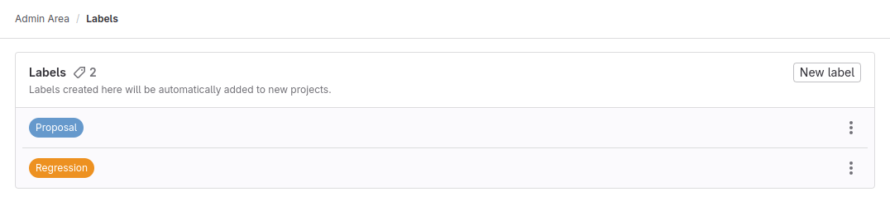



- Tier: 基础版，专业版，旗舰版
- Offering: 私有化部署



先决条件：

- 管理员访问权限。

要管理极狐GitLab 实例的标记：

1. 在右上角，选择**管理员**。
1. 在左侧边栏中，选择**标记**。

更多信息，请参阅[管理标记](../user/project/labels.md)。

在**管理员**区域创建的标记会自动添加到新项目。它们不适用于新群组。在**管理员**区域更新或添加标记不会修改现有项目中的标记。

