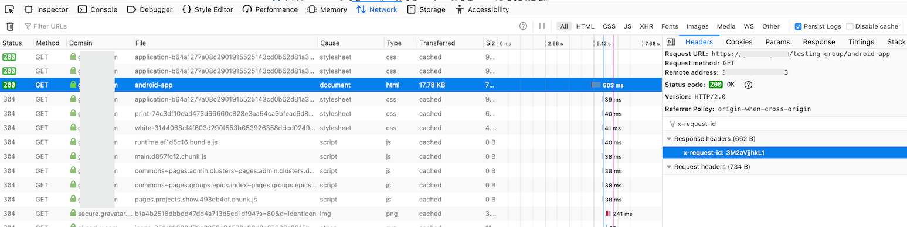
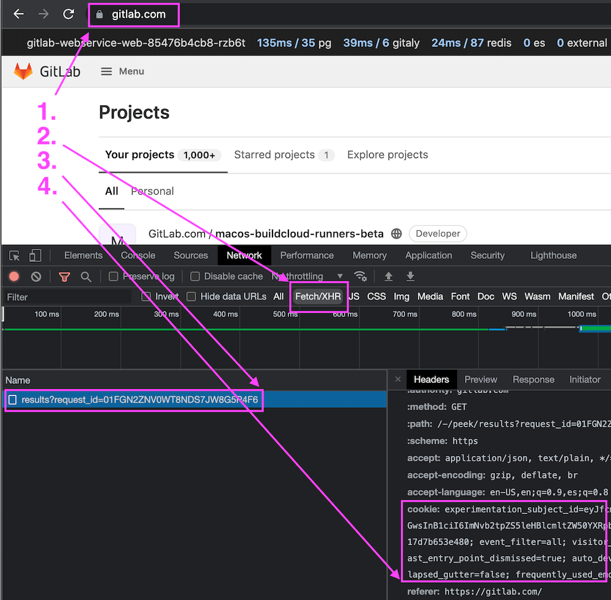
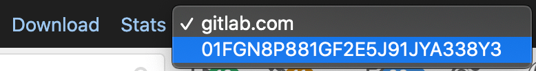
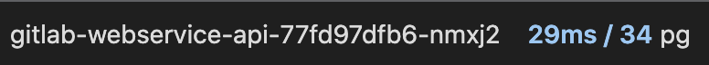
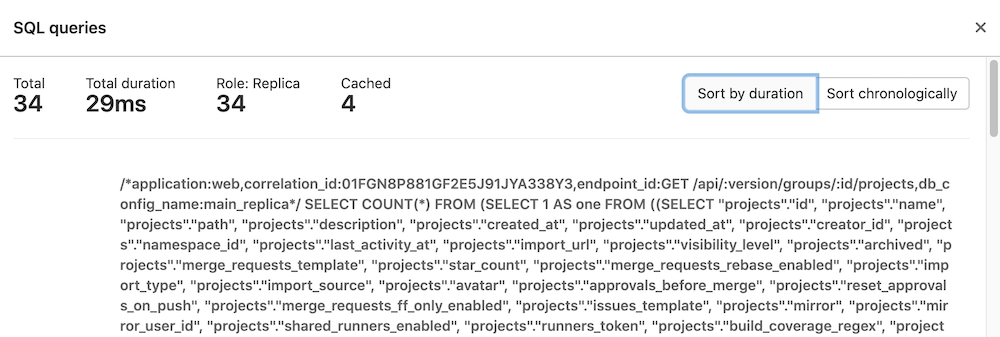



- Tier: 基础版，专业版，旗舰版
- Offering: 私有化部署



极狐GitLab 实例会为大多数请求记录一个唯一的请求跟踪 ID（称为“关联 ID”）。每个发送到极狐GitLab 的独立请求都会获得自己的关联 ID，该 ID 随后会记录在该请求涉及的每个极狐GitLab 组件的日志中。这样可以更轻松地追踪分布式系统中的行为。如果没有此 ID，可能很难甚至无法匹配相关联的日志条目。

<a id="identify-the-correlation-id-for-a-request"></a>

## 识别请求的关联 ID

关联 ID 会记录在结构化日志中，键为 `correlation_id`；同时也会记录在极狐GitLab 发送的所有响应头中，头名为 `x-request-id`。您可以通过搜索这两处中的任意一处来找到关联 ID。

<a id="getting-the-correlation-id-in-your-browser"></a>

### 在浏览器中获取关联 ID

您可以使用浏览器的开发者工具来监控和检查您所访问站点的网络活动。有关一些常用浏览器的网络监控文档，请参见以下链接。

- [网络监视器 - Firefox 开发者工具](https://firefox-source-docs.mozilla.org/devtools-user/network_monitor/index.html)
- [在 Chrome DevTools 中检查网络活动](https://developer.chrome.com/docs/devtools/network/)
- [Safari Web 开发工具](https://developer.apple.com/safari/tools/)
- [Microsoft Edge 网络面板](https://learn.microsoft.com/en-us/microsoft-edge/devtools/network/)

要定位相关请求并查看其关联 ID：

1. 在网络监视器中启用持久日志记录。极狐GitLab 中的某些操作会在您提交表单后迅速重定向，因此这有助于捕获所有相关活动。
1. 为了帮助筛选出您要查找的请求，您可以筛选 `document` 请求。
1. 选择感兴趣的请求以查看更详细的信息。
1. 转到 **头信息** 部分并查找 **响应头信息**。您应该会在那里找到一个 `x-request-id` 头，其值是极狐GitLab 为该请求随机生成的。

请参见以下示例：



<a id="getting-the-correlation-id-from-your-logs"></a>

### 从日志中获取关联 ID

查找正确关联 ID 的另一种方法是搜索或监视您的日志，找到您正在关注的日志条目的 `correlation_id` 值。

例如，如果您想了解在极狐GitLab 中重现某个操作时发生了什么或哪里出错，您可以跟踪极狐GitLab 日志，按您的用户筛选请求，然后监视这些请求，直到看到您感兴趣的内容。

<a id="getting-the-correlation-id-from-curl"></a>

### 从 curl 获取关联 ID

如果您使用 `curl`，则可以使用详细模式选项来显示请求和响应头，以及其他调试信息。

```shell
➜  ~ curl --verbose "https://gitlab.example.com/api/v4/projects"
# look for a line that looks like this
< x-request-id: 4rAMkV3gof4
```

<a id="using-jq"></a>

#### 使用 jq

此示例使用 [jq](https://stedolan.github.io/jq/) 来筛选结果并显示我们最可能关心的值。

```shell
sudo gitlab-ctl tail gitlab-rails/production_json.log | jq 'select(.username == "bob") | "User: \(.username), \(.method) \(.path), \(.controller)#\(.action), ID: \(.correlation_id)"'
```

```plaintext
"User: bob, GET /root/linux, ProjectsController#show, ID: U7k7fh6NpW3"
"User: bob, GET /root/linux/commits/master/signatures, Projects::CommitsController#signatures, ID: XPIHpctzEg1"
"User: bob, GET /root/linux/blob/master/README, Projects::BlobController#show, ID: LOt9hgi1TV4"
```

<a id="using-grep"></a>

#### 使用 grep

此示例仅使用 `grep` 和 `tr`，它们比 `jq` 更有可能已经安装。

```shell
sudo gitlab-ctl tail gitlab-rails/production_json.log | grep '"username":"bob"' | tr ',' '\n' | egrep 'method|path|correlation_id'
```

```plaintext
{"method":"GET"
"path":"/root/linux"
"username":"bob"
"correlation_id":"U7k7fh6NpW3"}
{"method":"GET"
"path":"/root/linux/commits/master/signatures"
"username":"bob"
"correlation_id":"XPIHpctzEg1"}
{"method":"GET"
"path":"/root/linux/blob/master/README"
"username":"bob"
"correlation_id":"LOt9hgi1TV4"}
```

<a id="searching-your-logs-for-the-correlation-id"></a>

## 在日志中搜索关联 ID

当您获得关联 ID 后，就可以开始搜索相关的日志条目了。您可以按关联 ID 本身来筛选行。结合使用 `find` 和 `grep` 应该足以找到您要查找的条目。

```shell
# find <gitlab log directory> -type f -mtime -0 exec grep '<correlation ID>' '{}' '+'
find /var/log/gitlab -type f -mtime 0 -exec grep 'LOt9hgi1TV4' '{}' '+'
```

```plaintext
/var/log/gitlab/gitlab-workhorse/current:{"correlation_id":"LOt9hgi1TV4","duration_ms":2478,"host":"gitlab.domain.tld","level":"info","method":"GET","msg":"access","proto":"HTTP/1.1","referrer":"https://gitlab.domain.tld/root/linux","remote_addr":"68.0.116.160:0","remote_ip":"[filtered]","status":200,"system":"http","time":"2019-09-17T22:17:19Z","uri":"/root/linux/blob/master/README?format=json\u0026viewer=rich","user_agent":"Mozilla/5.0 (Mac) Gecko Firefox/69.0","written_bytes":1743}
/var/log/gitlab/gitaly/current:{"correlation_id":"LOt9hgi1TV4","grpc.code":"OK","grpc.meta.auth_version":"v2","grpc.meta.client_name":"gitlab-web","grpc.method":"FindCommits","grpc.request.deadline":"2019-09-17T22:17:47Z","grpc.request.fullMethod":"/gitaly.CommitService/FindCommits","grpc.request.glProjectPath":"root/linux","grpc.request.glRepository":"project-1","grpc.request.repoPath":"@hashed/6b/86/6b86b273ff34fce19d6b804eff5a3f5747ada4eaa22f1d49c01e52ddb7875b4b.git","grpc.request.repoStorage":"default","grpc.request.topLevelGroup":"@hashed","grpc.service":"gitaly.CommitService","grpc.start_time":"2019-09-17T22:17:17Z","grpc.time_ms":2319.161,"level":"info","msg":"finished streaming call with code OK","peer.address":"@","span.kind":"server","system":"grpc","time":"2019-09-17T22:17:19Z"}
/var/log/gitlab/gitlab-rails/production_json.log:{"method":"GET","path":"/root/linux/blob/master/README","format":"json","controller":"Projects::BlobController","action":"show","status":200,"duration":2448.77,"view":0.49,"db":21.63,"time":"2019-09-17T22:17:19.800Z","params":[{"key":"viewer","value":"rich"},{"key":"namespace_id","value":"root"},{"key":"project_id","value":"linux"},{"key":"id","value":"master/README"}],"remote_ip":"[filtered]","user_id":2,"username":"bob","ua":"Mozilla/5.0 (Mac) Gecko Firefox/69.0","queue_duration":3.38,"gitaly_calls":1,"gitaly_duration":0.77,"rugged_calls":4,"rugged_duration_ms":28.74,"correlation_id":"LOt9hgi1TV4"}
```

<a id="searching-in-distributed-architectures"></a>

### 在分布式架构中搜索

如果您在极狐GitLab 基础设施中进行了横向扩展，则必须搜索所有极狐GitLab 节点。您可以使用某种日志聚合软件来完成，例如 Loki、ELK、Splunk 等。

您可以使用 Ansible 或 PSSH（并行 SSH）之类的工具，在您的服务器上并行执行相同的命令，也可以自行设计解决方案。

<a id="viewing-the-request-in-the-performance-bar"></a>

### 在性能栏中查看请求

您可以使用[性能栏](../monitoring/performance/performance_bar.md)查看有趣的数据，包括对 SQL 和 Gitaly 的调用。

要查看数据，请求的关联 ID 必须与查看性能栏的用户属于同一会话。对于 API 请求，这意味着您必须使用已认证用户的会话 cookie 来执行请求。

例如，如果您想查看针对以下 API 端点执行的数据库查询：

```shell
https://gitlab.com/api/v4/groups/2564205/projects?with_security_reports=true&page=1&per_page=1
```

首先，启用 **开发者工具** 面板。有关如何操作的详细信息，请参见[在浏览器中获取关联 ID](#getting-the-correlation-id-in-your-browser)。

启用开发者工具后，按如下方式获取会话 cookie：

1. 在登录状态下访问 <https://gitlab.com>。
1. 可选。在 **开发者工具** 面板中选择 **Fetch/XHR** 请求筛选器。此步骤是针对 Google Chrome 开发者工具描述的，并非严格必需。它只是让您更容易找到正确的请求。
1. 在左侧选择 `results?request_id=<some-request-id>` 请求。
1. 会话 cookie 显示在 `Headers` 面板的 `Request Headers` 部分下。右键点击 cookie 值并选择 `Copy value`。



会话 cookie 的值已复制到您的剪贴板，例如：

```shell
experimentation_subject_id=<subject-id>; _gitlab_session=<session-id>; event_filter=all; visitor_id=<visitor-id>; perf_bar_enabled=true; sidebar_collapsed=true; diff_view=inline; sast_entry_point_dismissed=true; auto_devops_settings_dismissed=true; cf_clearance=<cf-clearance>; collapsed_gutter=false
```

使用会话 cookie 的值，将其粘贴到 `curl` 请求的自定义头中，以构造 API 请求：

```shell
$ curl --include "https://gitlab.com/api/v4/groups/2564205/projects?with_security_reports=true&page=1&per_page=1" \
--header 'cookie: experimentation_subject_id=<subject-id>; _gitlab_session=<session-id>; event_filter=all; visitor_id=<visitor-id>; perf_bar_enabled=true; sidebar_collapsed=true; diff_view=inline; sast_entry_point_dismissed=true; auto_devops_settings_dismissed=true; cf_clearance=<cf-clearance>; collapsed_gutter=false'

  date: Tue, 28 Sep 2021 03:55:33 GMT
  content-type: application/json
  ...
  x-request-id: 01FGN8P881GF2E5J91JYA338Y3
  ...
  [
    {
      "id":27497069,
      "description":"Analyzer for images used on live K8S containers based on Starboard"
    },
    "container_registry_image_prefix":"registry.gitlab.com/gitlab-org/security-products/analyzers/cluster-image-scanning",
    "..."
  ]
```

响应包含来自 API 端点的数据，以及一个 `correlation_id` 值，该值在 `x-request-id` 头中返回，如[识别请求的关联 ID](#identify-the-correlation-id-for-a-request) 部分所述。

然后，您可以查看此请求的数据库详细信息：

1. 将 `x-request-id` 值粘贴到[性能栏](../monitoring/performance/performance_bar.md)的 `request details` 字段中，然后按 <kbd>Enter/Return</kbd>。此示例使用上一个响应返回的 `x-request-id` 值 `01FGN8P881GF2E5J91JYA338Y3`：

   

1. 一个新请求会插入到性能栏右侧的 `Request Selector` 下拉列表中。选择该新请求以查看 API 请求的指标：

   

1. 在进度栏中选择 `pg` 链接，以查看 API 请求执行的数据库查询：

   

   此时会显示数据库查询对话框：

   
