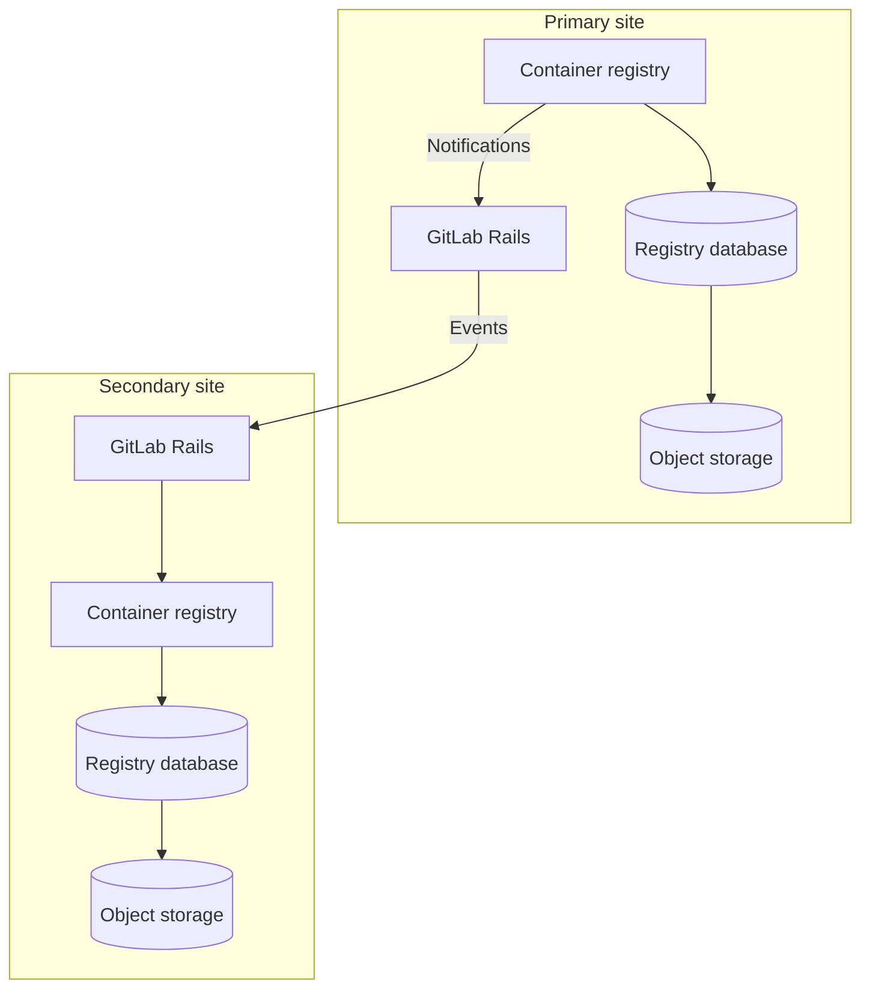



- Tier: 基础版，专业版，旗舰版
- Offering: 私有化部署



元数据数据库为容器镜像仓库提供了多项[增强功能](#enhancements)，可提升性能并增加新功能。

默认情况下，容器镜像仓库使用对象存储或本地文件系统来持久化与容器镜像相关的元数据。这种存储元数据的方式限制了数据访问的效率，尤其是跨多个镜像的数据，例如列出标签时。通过使用数据库存储这些数据，可以实现许多新功能，包括[在线垃圾回收](https://gitlab.com/gitlab-org/container-registry/-/blob/master/docs/spec/gitlab/online-garbage-collection.md)，它可以在零停机的情况下自动删除旧数据。

该数据库与镜像仓库已使用的存储协同工作，但不会取代对象存储或文件系统。即使已将元数据导入元数据数据库，您仍必须继续维护存储解决方案。

对于 Helm Charts 安装，请参阅 Helm Charts 文档中的[管理容器镜像仓库元数据数据库](https://gitlab.cn/docs/charts/charts/registry/metadata_database/#create-the-database)。

<a id="enhancements"></a>

## 增强功能

元数据数据库架构支持旧版元数据存储所不具备的性能改进、缺陷修复和新功能。这些增强功能包括：

- 自动[在线垃圾回收](../../user/packages/container_registry/delete_container_registry_images.md#garbage-collection)
- 容器仓库、项目和群组的[存储用量可见性](../../user/packages/container_registry/reduce_container_registry_storage.md#view-container-registry-usage)
- [镜像签名](../../user/packages/container_registry/_index.md#container-image-signatures)
- [移动和重命名容器仓库](../../user/packages/container_registry/_index.md#move-or-rename-container-registry-repositories)
- [受保护的标签](../../user/packages/container_registry/protected_container_tags.md)
- [清理策略](../../user/packages/container_registry/reduce_container_registry_storage.md#cleanup-policy)的性能改进，可成功清理大型容器仓库
- 列出容器仓库标签的性能改进
- 跟踪并显示标签的发布时间戳（请参阅[议题 290949](https://gitlab.com/gitlab-org/gitlab/-/issues/290949)）
- 按名称之外的更多属性对容器仓库标签排序

由于旧版元数据存储的技术限制，新功能仅在元数据数据库版本中实现。非安全性缺陷修复可能仅限于元数据数据库版本。

<a id="known-limitations"></a>

## 已知限制

- 对现有镜像仓库进行元数据导入需要一段只读时间。
- 在 18.3 之前，升级版本时必须手动运行镜像仓库的常规架构迁移和部署后数据库迁移。
- 在多节点 Linux 软件包环境中，不保证镜像仓库在[升级期间零停机](../../update/zero_downtime.md)。
- 在对现有镜像仓库进行元数据导入期间，镜像标签的 `createdAt` 和 `publishedAt` 时间戳值会被设置为导入日期。这是有意为之，以确保一致性，因为旧版镜像仓库不会为所有镜像收集标签发布日期。虽然部分镜像的元数据中包含构建日期，但许多镜像没有。更多信息，请参阅[议题 1384](https://gitlab.com/gitlab-org/container-registry/-/issues/1384)。

<a id="metadata-database-feature-support"></a>

## 元数据数据库功能支持

您可以将现有镜像仓库的元数据导入元数据数据库，并使用在线垃圾回收。

部分启用数据库的功能仅在 JihuLab.com 上启用，并且镜像仓库数据库的自动预配不可用。请查看[反馈议题](https://gitlab.com/gitlab-org/gitlab/-/issues/423459#supported-feature-status)中的功能支持表，了解与容器镜像仓库数据库相关的功能状态。

<a id="database-requirements"></a>

## 数据库要求

容器镜像仓库直接连接到其元数据数据库，并对其执行读写事务。

默认情况下，极狐GitLab 18.3 及更高版本会在主极狐GitLab 数据库中为镜像仓库元数据预配一个逻辑数据库。该数据库已满足以下要求，因此大多数安装无需额外设置数据库。仅当您为镜像仓库使用[外部数据库](#using-an-external-database)时，才需要自行满足这些要求：

- 运行受支持的 PostgreSQL 版本。镜像仓库会在启动时检查版本，在不受支持的版本上不会启动。有关受支持的版本，请参阅
  [PostgreSQL 要求](../../install/requirements.md#postgresql)。
- 为镜像仓库使用专用数据库。要创建数据库及其用户，请参阅
  [配置容器镜像仓库元数据数据库](../postgresql/external.md#container-registry-metadata-database)。
- 不要添加 PostgreSQL 扩展。元数据数据库不需要任何扩展，因此不要
  复制主极狐GitLab 数据库的扩展列表。
- 允许读写访问。镜像仓库无法针对只读副本启动。
- 保持 `bytea_output` 设置为 PostgreSQL 默认值 `hex`。镜像仓库会将
  某些二进制列读取为十六进制文本，因此将服务器或角色设置为
  `bytea_output = escape` 会导致导入失败并报错 `invalid hex format`。请参阅
  [错误：`convert field 8 failed: invalid hex format`](container_registry_metadata_database_troubleshooting.md#error-convert-field-8-failed-invalid-hex-format)。

镜像仓库用户必须拥有该数据库，否则迁移会因权限错误而失败。请参阅[错误：`permission denied for schema public`](container_registry_metadata_database_troubleshooting.md#error-permission-denied-for-schema-public-sqlstate-42501)。

使用 TLS 加密连接是可选的。要加密连接，请将 `sslmode` 设置为 `require`，如示例配置所示。若要同时验证服务器证书，请使用 `verify-full`，并在 `sslrootcert`中提供 CA 证书。

<a id="enable-the-metadata-database-for-linux-package-installations"></a>

## 为 Linux 软件包安装启用元数据数据库

先决条件：

- 最低要求版本为极狐GitLab 17.5，但建议使用极狐GitLab 18.3 或更高版本，
  因为其增加了改进并简化了配置。
- 一个满足[数据库要求](#database-requirements)的 PostgreSQL 数据库。它必须可从镜像仓库节点访问。
- 如果您使用外部数据库，必须先设置外部数据库连接。更多信息，请参阅[使用外部数据库](#using-an-external-database)。

<a id="before-you-start"></a>

### 开始之前

- 启用数据库后，您必须继续使用它。该数据库现在是镜像仓库元数据的来源。
  在此之后禁用它会导致镜像仓库无法看到在数据库启用期间写入的所有镜像。
- 不再需要[离线垃圾回收](container_registry.md#container-registry-garbage-collection)。
  极狐GitLab 附带的垃圾回收命令在数据库启用时会安全退出，但第三方
  命令（例如上游镜像仓库提供的命令）会删除与带标签镜像关联的数据。
- 确认您没有自动化离线垃圾回收，尤其是使用第三方命令。
- 您可以先[减少镜像仓库的存储](../../user/packages/container_registry/reduce_container_registry_storage.md)
  以加快该过程。
- 如果可能，备份[您的容器镜像仓库数据](../backup_restore/backup_gitlab.md#container-registry)。
- 配置容器镜像仓库[通知](container_registry.md#configure-container-registry-notifications)。
- 要在**用量配额**页面上显示容器镜像仓库用量统计信息，您必须配置通知。

<a id="enable-the-database-for-new-installations"></a>

### 为新安装启用数据库

对于从未向容器镜像仓库写入数据的安装，无需导入。您只需在向镜像仓库写入数据之前启用数据库。

更多信息，请参阅[新安装](container_registry_metadata_database_new_install.md)的说明。

<a id="enable-the-database-for-existing-registries"></a>

### 为现有镜像仓库启用数据库

您可以使用一步导入法或三步导入法导入现有的容器镜像仓库元数据。有几个因素会影响导入的时长：

- 镜像仓库中带标签镜像的数量。
- 现有镜像仓库数据的大小。
- PostgreSQL 实例的规格。
- 正在运行的镜像仓库实例数量。
- 镜像仓库、PostgreSQL 与您配置的存储之间的网络延迟。

导入前无需进行以下准备工作：

- 分配额外的对象存储或文件系统空间：导入不会对此存储进行大量写入。
- 运行离线垃圾回收：虽然无害，但离线垃圾回收缩短导入时间的程度
  不足以弥补运行此命令所花费的时间。

> [!note]
> 元数据导入仅针对带标签镜像。未打标签和未被引用的清单，以及
> 仅被它们引用的层，会被遗留并变得无法访问。未打标签的镜像
> 从未通过极狐GitLab UI 或 API 可见，但它们可能变成“悬空”状态并
> 遗留在后端。导入到新镜像仓库后，所有镜像都会
> 受到持续的在线垃圾回收，默认会删除任何未打标签和未被引用的清单
> 和层，只要它们存在超过 24 小时。

<a id="choose-the-right-import-method"></a>

### 选择合适的导入方法

如果您定期运行[离线垃圾回收](container_registry.md#container-registry-garbage-collection)，请使用[一步导入](container_registry_metadata_database_one_step_import.md)方法。该方法所需时间相近，且与三步导入法相比操作更简单。

如果您的镜像仓库太大，无法定期运行离线垃圾回收，请使用[三步导入](container_registry_metadata_database_three_step_import.md)方法，以显著减少只读时间。

如果您使用外部数据库，请确保在进行迁移路径之前设置好外部数据库连接。

更多信息，请参阅[使用外部数据库](#using-an-external-database)。

<a id="restore-interrupted-imports"></a>

### 恢复中断的导入

要恢复中断的导入，请跳过容器仓库中您在过去 72 小时内预导入的那些。容器仓库的预导入方式为：

- 完成三步导入流程的第一步
- 完成一步导入流程

要恢复中断的导入，请配置`--pre-import-skip-recent` 标志。默认值为 72 小时。

例如：

```shell
# Skip repositories imported within 6 hours from the start of the import command
--pre-import-skip-recent 6h

# Disable skipping behavior
--pre-import-skip-recent 0
```

有关有效时长单位的更多信息，请参阅 [Go duration strings](https://pkg.go.dev/time#ParseDuration)。

<a id="post-import"></a>

### 导入后

完成大型导入后，可能有数十万甚至数百万个 blob 排队等待垃圾回收审查。这是正常的。

由于带标签镜像在悬空 blob 被清点之前导入，垃圾回收器最初会审查仍被带标签镜像引用的 blob。垃圾回收会将这些 blob 从队列中移除，但不会从存储中删除它们。

只有在垃圾回收器处理到悬空 blob 后，存储才会减少。导入后，镜像仓库存储可能需要 48 小时或更长时间才会减少，因为垃圾回收器会延迟审查以避免干扰镜像 blob。

要监控和管理导入后的垃圾回收积压：

- [检查在线垃圾回收的健康状况](#check-the-health-of-online-garbage-collection)
  以查看审查队列的大小和状态。
- [调整垃圾回收器工作进程间隔](#adjust-the-garbage-collector-worker-interval)
  以临时加快处理大型积压。

<a id="prefer-mode"></a>

## 偏好模式

偏好模式是元数据数据库的一个配置选项，当现有镜像仓库尚未导入数据库时，允许镜像仓库回退到旧版元数据存储。

<a id="enable-prefer-mode"></a>

### 启用偏好模式

要启用偏好模式：

1. 在`/etc/gitlab/gitlab.rb`中，将 `database.enabled` 设置为`'prefer'`，
   而不是 `true` 或 `false`：

   ```ruby
   registry['database'] = {
     'enabled' => 'prefer',
     'host' => '<your_database_host>',
     'port' => 5432,
     'user' => '<your_database_user>',
     'password' => '<your_database_password>',
     'dbname' => '<your_database_name>',
   }
   ```

1. 保存文件并[重新配置极狐GitLab](../restart_gitlab.md)。

重新配置极狐GitLab后，镜像仓库会在启动时根据跟踪先前对文件系统或数据库写入的锁文件，评估使用哪个元数据后端。

<a id="prefer-mode-lockfile-workflow"></a>

#### 偏好模式锁文件工作流程

镜像仓库在启动时写入锁文件，元数据导入在完成时写入一个锁文件，但推送永远不会写入锁文件。

使用旧版元数据的镜像仓库在针对已包含元数据的存储启动时，会写入 `filesystem-in-use`。使用元数据数据库的镜像仓库在启动时会写入 `database-in-use`，无论存储中有什么。[元数据导入](#enable-the-database-for-existing-registries)在完成时也会写入 `database-in-use`。

下表显示了在 `enabled: false` 和 `enabled: 'prefer'`下每种锁文件状态的结果。它假设存储中包含完整的目录，且配置的数据库可访问、包含镜像仓库架构，并且不包含任何容器仓库行。

| 存储中的锁文件 | `enabled` | 镜像仓库启动 | 提供的目录 |
|---------------------|-----------|-----------------|----------------|
| 无 | `false` | 是，使用旧版元数据并写入 `filesystem-in-use` | 完整 |
| `filesystem-in-use` | `'prefer'` | 是，回退到旧版元数据 | 完整 |
| 无 | `'prefer'` | 是，采用数据库并写入 `database-in-use` | 空，返回 `200 OK` |
| `database-in-use` | `false` | 否，`registry metadata database in use` | 无 |
| 两者 | `'prefer'` | 否，`database-in-use and filesystem-in-use lockfiles present` | 无 |
| `filesystem-in-use` | `false` | 是，使用旧版元数据 | 完整 |

表格的最后一行适用于尚未从数据库提供过推送的站点。在已提供过推送的站点上，镜像仓库会启动并提供缺少导入运行后所有推送内容的目录。更多信息，请参阅[还原为对象存储元数据](#revert-to-object-storage-metadata)。

只有第三行会在不报告错误的情况下失败。其他行要么提供完整目录，要么拒绝启动并说明原因。

锁文件缺失并不总是意味着存储为空。任何在存储首次填充后未重启过的镜像仓库都没有锁文件。这包括通过复制经由其镜像仓库 API 填充的 Geo 从站点。它还包括从快照恢复或从其他站点镜像的存储，除非副本包含锁文件。

如果数据库不可用（例如，服务器接受连接但拒绝配置的凭据），镜像仓库不会启动，且 `gitlab-ctl reconfigure` 也会在镜像仓库数据库迁移时失败。有关如何同时避免空目录和启动失败的更多信息，请参阅[现有安装](#existing-installations)。

清空或重新创建存储不会清除锁文件。`lockfiles` 目录是 `v2/`的同级目录，而不是位于其中。删除 `v2/blobs` 和 `v2/repositories` 以回收空间会保留 `filesystem-in-use`。镜像仓库随后会在下次针对现已为空的存储启动时再次回退到旧版元数据。在该状态下，推送会成功且标签会出现，而元数据数据库保持为空，这可能被解读为未完成的导入。如果您打算迁移到元数据数据库，且在存储清空后没有推送任何内容，请删除该锁文件。停止镜像仓库，从[检查磁盘上的锁文件](#check-lockfiles-on-disk)中描述的目录删除 `filesystem-in-use`，然后启动镜像仓库。如果在存储清空后推送了任何内容，请改为运行[元数据导入](#enable-the-database-for-existing-registries)，因为删除锁文件会使这些镜像不在目录中。如果您想继续使用旧版元数据，请保留该锁文件。

回退决策在启动时发生一次，在镜像仓库运行期间不会改变。回退后不会自动重试或重新连接到数据库。要在回退后从文件系统模式迁移到数据库模式，请完成标准的[元数据导入](#enable-the-database-for-existing-registries)并重启镜像仓库。

<a id="default-configuration"></a>

### 默认配置

在极狐GitLab 19.0 及更高版本中，新安装默认以偏好模式启用元数据数据库：

- Linux 软件包（Omnibus）安装：当`/etc/gitlab/gitlab.rb`中未指定该设置时，`registry['database']['enabled']`默认为`'prefer'`。更多信息，请参阅[议题 9396](https://gitlab.com/gitlab-org/omnibus-gitlab/-/issues/9396)。
- 自行编译安装：当镜像仓库配置文件中未指定该设置时，`database.enabled` 默认为`'prefer'`。

升级后，请检查镜像仓库使用哪个后端。有关操作步骤，请参阅[验证哪个元数据后端处于活动状态](#verify-which-metadata-backend-is-active)。

<a id="new-installations"></a>

#### 新安装

在新的极狐GitLab 19.0 或更高版本安装中，镜像仓库以偏好模式启动。如果配置了可访问的元数据数据库，镜像仓库会使用它。如果没有可访问的数据库，镜像仓库将无法启动。

要使新安装继续使用文件系统元数据，请在首次启动镜像仓库之前将数据库模式设置为 `false`：

- 对于 Linux 软件包（Omnibus）安装，在`/etc/gitlab/gitlab.rb`中：

  ```ruby
  registry['database']['enabled'] = false
  ```

- 对于自行编译安装，在`/home/git/gitlab/config/gitlab.yml`中：

  ```yaml
  registry:
    database:
      enabled: false
  ```

<a id="existing-installations"></a>

#### 现有安装

将现有安装升级到极狐GitLab 19.0 或更高版本会保留当前的 `registry['database']['enabled']`设置。升级不会迁移元数据或切换活动后端。

使用文件系统元数据的现有偏好模式安装在升级后继续使用文件系统元数据。要切换到数据库，请完成[元数据导入](#enable-the-database-for-existing-registries)。

如果`/etc/gitlab/gitlab.rb`中未设置 `registry['database']['enabled']`，升级会将该设置保持为未指定，镜像仓库会以偏好模式启动。在升级此类站点之前，请确认锁文件存在。有关操作步骤，请参阅[检查磁盘上的锁文件](#check-lockfiles-on-disk)。

如果镜像仓库使用旧版元数据且 `filesystem-in-use` 不存在，请在升级前重启镜像仓库一次：

```shell
sudo gitlab-ctl restart registry
```

重启会写入锁文件，因此偏好模式会正确回退到旧版元数据。如果不重启，镜像仓库将找不到锁文件，并走[偏好模式](#prefer-mode)中描述的无锁文件路径。

<a id="metadata-database-backups"></a>

#### 元数据数据库备份

当镜像仓库使用元数据数据库时，请将镜像仓库数据库纳入备份。有关操作步骤，请参阅[使用元数据数据库备份](#backup-with-metadata-database)。

使用现有文件系统元数据的偏好模式安装在多次重启之间保持回退状态。在回退期间，镜像仓库不会读取或写入元数据数据库。在回退结束之前，您无需备份元数据数据库。

要结束回退，请完成[元数据导入](#enable-the-database-for-existing-registries)并重启镜像仓库。重启后，镜像仓库会使用元数据数据库。请将其纳入您的备份例程。

<a id="verify-which-metadata-backend-is-active"></a>

### 验证哪个元数据后端处于活动状态

要验证您的镜像仓库正在使用哪个元数据后端，请使用以下方法之一。

<a id="check-the-registry-api-response-header"></a>

#### 检查镜像仓库 API 响应头

镜像仓库要求对`/v2/`端点进行身份验证。该端点对未认证请求会返回 `401 Unauthorized`，且不包含任何 `gitlab-container-registry-*`响应头，因此该检查不会产生输出，而不是给出答案。

要检查镜像仓库 API 响应头：

1. 获取镜像仓库的令牌。镜像仓库只接受由极狐GitLab 签发的 JWT。
   请从
   [镜像仓库令牌端点](../../api/container_registry.md#obtain-token-from-gitlab)请求一个。
   使用至少具有 `read_registry` 范围的个人访问令牌进行身份验证。
   您无需是管理员。此请求不需要 `scope` 参数，
   因为`/v2/`需要的是有效令牌，而不是对容器仓库的访问权限：

   ```shell
   token=$(curl --silent --user "<username>:<personal-access-token>" \
     "https://gitlab.example.com/jwt/auth?service=container_registry" \
     | grep --only-matching '"token":"[^"]*"' | cut --delimiter='"' --fields=4)
   ```

   如果个人访问令牌没有镜像仓库范围，该端点会返回 `403 Forbidden`
   状态码和一个空令牌。

1. 向镜像仓库`/v2/`端点发送请求：

   ```shell
   curl --silent --head --header "Authorization: Bearer ${token}" "https://registry.example.com/v2/" | grep --ignore-case gitlab-container-registry-database-enabled
   ```

1. 检查
`gitlab-container-registry-database-enabled` 响应头：

   - 值为 `true` 表示镜像仓库正在使用元数据数据库。
   - 值为 `false` 表示它正在使用旧版文件系统存储。
   - 无输出表示该响应头不存在，因此命令没有给出任何答案，而不是 `false`。
     响应头不存在并不意味着元数据数据库已禁用。
     在根据结果采取行动之前，请确认响应状态：

     ```shell
     curl --silent --output /dev/null --write-out '%{http_code}\n' --header "Authorization: Bearer ${token}" "https://registry.example.com/v2/"
     ```

     `401` 表示请求未通过身份验证，原因可能是 `token` 为空，
     也可能是令牌被拒绝。如果您无法通过身份验证，请改用
     [检查磁盘上的锁文件](#check-lockfiles-on-disk)或
     [检查镜像仓库日志](#check-registry-logs)。

<a id="check-lockfiles-on-disk"></a>

#### 检查磁盘上的锁文件

要检查磁盘上的锁文件，请在配置的存储后端中查找以下文件，位于
`<rootdirectory>/docker/registry/lockfiles/`：

- `database-in-use`：镜像仓库正在使用元数据数据库。
- `filesystem-in-use`：镜像仓库正在使用旧版文件系统存储。

如果两个锁文件都存在，镜像仓库处于无效状态且不会启动。

<a id="check-registry-logs"></a>

#### 检查镜像仓库日志

镜像仓库会记录它在启动时选择哪个元数据后端。

要检查镜像仓库日志，请查找以下消息之一：

- 如果镜像仓库回退到旧版存储（仅偏好模式）：

  ```plaintext
  database prefer mode enabled, but found filesystem metadata: falling back to legacy metadata
  ```

- 如果镜像仓库连接到数据库：

  ```plaintext
  using the metadata database
  ```

<a id="database-migrations"></a>

## 数据库迁移

容器镜像仓库支持两种类型的迁移：

- 常规架构迁移：对数据库结构的更改，必须在部署新应用代码之前运行，也称为部署前迁移。这些迁移应快速完成（不超过几分钟），以避免部署延迟。
- 部署后迁移：对数据库结构的更改，可以在应用运行时运行。用于较长的操作，例如在大型表上创建索引，从而避免启动延迟和延长升级停机时间。

默认情况下，镜像仓库会同时应用常规架构迁移和部署后迁移。为减少升级期间的停机时间，您可以跳过部署后迁移，并在应用启动后手动应用它们。

<a id="apply-database-migrations"></a>

### 应用数据库迁移





要在应用启动前同时应用常规架构迁移和部署后迁移：

1. 运行数据库迁移：

   ```shell
   sudo gitlab-ctl registry-database migrate up
   ```

要跳过部署后迁移：

1. 仅运行常规架构迁移：

   ```shell
   sudo gitlab-ctl registry-database migrate up --skip-post-deployment
   ```

   作为`--skip-post-deployment` 标志的替代方案，您也可以将 `SKIP_POST_DEPLOYMENT_MIGRATIONS` 环境变量设置为 `true`：

   ```shell
   SKIP_POST_DEPLOYMENT_MIGRATIONS=true sudo gitlab-ctl registry-database migrate up
   ```

1. 启动应用后，应用任何待处理的部署后迁移：

   ```shell
   sudo gitlab-ctl registry-database migrate up
   ```





要在应用启动前同时应用常规架构迁移和部署后迁移：

1. 运行数据库迁移：

   ```shell
   sudo -u registry gitlab-ctl registry-database migrate up
   ```

要跳过部署后迁移：

1. 仅运行常规架构迁移：

   ```shell
   sudo -u registry gitlab-ctl registry-database migrate up --skip-post-deployment
   ```

   作为`--skip-post-deployment` 标志的替代方案，您也可以将 `SKIP_POST_DEPLOYMENT_MIGRATIONS` 环境变量设置为 `true`：

   ```shell
   SKIP_POST_DEPLOYMENT_MIGRATIONS=true sudo -u registry gitlab-ctl registry-database migrate up
   ```

1. 启动应用后，应用任何待处理的部署后迁移：

   ```shell
   sudo -u registry gitlab-ctl registry-database migrate up
   ```





> [!note]
> `migrate up` 命令提供了一些额外的标志，可用于控制迁移的应用方式。
> 运行 `sudo gitlab-ctl registry-database migrate up --help`了解详情。

<a id="online-garbage-collection-monitoring"></a>

## 在线垃圾回收监控

导入过程之后的在线垃圾回收初始运行时长会因导入镜像的数量而异。在此期间，您应监控在线垃圾回收的效率和健康状况。

<a id="monitor-database-performance"></a>

### 监控数据库性能

完成导入后，随着垃圾回收队列清空，数据库预计会经历一段高负载期。这种高负载是由在线垃圾回收器处理排队任务时产生的大量单独数据库调用引起的。

请定期检查 PostgreSQL 和镜像仓库日志，查看是否有任何错误或警告。在镜像仓库日志中，请特别注意按 `component=registry.gc.*`过滤的日志。

<a id="track-metrics"></a>

### 跟踪指标

使用 Prometheus 和 Grafana 等监控工具来可视化和跟踪垃圾回收指标，重点关注以 `registry_gc_*`为前缀的指标。这些指标包括标记为删除的对象数、成功删除的对象数、运行间隔和持续时间。有关如何启用 Prometheus，请参阅[启用镜像仓库调试服务器](container_registry_troubleshooting.md#enable-the-registry-debug-server)。

<a id="monitor-task-queues"></a>

### 监控任务队列

监控 blob 和清单的垃圾回收任务队列的健康状况和状态。

<a id="check-the-health-of-online-garbage-collection"></a>

#### 检查在线垃圾回收的健康状况





以下命令显示与在线垃圾回收相关的信息。

```shell
sudo gitlab-ctl registry-database gc-stats
```

示例输出：

```shell
=== Blob Review Queue ===

Tasks Pending Removal: 42
Tasks ready for GC review (review_after has passed).

┌───────────────────────────────────────────────────────────────────┬─────────────────────┬─────────────────┐
│                              DIGEST                               │    REVIEW AFTER     │      EVENT      │
├───────────────────────────────────────────────────────────────────┼─────────────────────┼─────────────────┤
│ sha256:a3ed95caeb02ffe68cdd9fd84406680ae93d633cb16422d00e8a7c22e  │ 2026-01-16 21:56:13 │ blob_upload     │
│ sha256:b4f5e6d7c8a9b0c1d2e3f4a5b6c7d8e9f0a1b2c3d4e5f6a7b8c9d0e1f2 │ 2026-01-16 19:56:13 │ manifest_delete │
│ sha256:c5d6e7f8a9b0c1d2e3f4a5b6c7d8e9f0a1b2c3d4e5f6a7b8c9d0e1f2a3 │ 2026-01-16 17:56:13 │ layer_delete    │
└───────────────────────────────────────────────────────────────────┴─────────────────────┴─────────────────┘

Long Overdue Tasks: 5
Tasks pending longer than configured delay - may need attention.

┌───────────────────────────────────────────────────────────────────┬─────────────────────┬──────────────┬─────────┐
│                              DIGEST                               │    REVIEW AFTER     │    EVENT     │ OVERDUE │
├───────────────────────────────────────────────────────────────────┼─────────────────────┼──────────────┼─────────┤
│ sha256:d6e7f8a9b0c1d2e3f4a5b6c7d8e9f0a1b2c3d4e5f6a7b8c9d0e1f2a3b4 │ 2026-01-11 23:56:13 │ blob_upload  │ 4d 0h   │
│ sha256:e7f8a9b0c1d2e3f4a5b6c7d8e9f0a1b2c3d4e5f6a7b8c9d0e1f2a3b4c5 │ 2026-01-13 23:56:13 │ layer_delete │ 2d 0h   │
└───────────────────────────────────────────────────────────────────┴─────────────────────┴──────────────┴─────────┘

High Retry Tasks: 2
Tasks with >10 review attempts - may indicate persistent issues.

┌───────────────────────────────────────────────────────────────────┬─────────────────────┬─────────────────┬─────────┐
│                              DIGEST                               │    REVIEW AFTER     │      EVENT      │ RETRIES │
├───────────────────────────────────────────────────────────────────┼─────────────────────┼─────────────────┼─────────┤
│ sha256:f8a9b0c1d2e3f4a5b6c7d8e9f0a1b2c3d4e5f6a7b8c9d0e1f2a3b4c5d6 │ 2026-01-17 00:56:13 │ blob_upload     │ 15      │
│ sha256:a9b0c1d2e3f4a5b6c7d8e9f0a1b2c3d4e5f6a7b8c9d0e1f2a3b4c5d6e7 │ 2026-01-17 01:56:13 │ manifest_delete │ 12      │
└───────────────────────────────────────────────────────────────────┴─────────────────────┴─────────────────┴─────────┘

=== Manifest Review Queue ===

Tasks Pending Removal: 128
Tasks ready for GC review (review_after has passed).

┌───────────────┬─────────────┬─────────────────────┬──────────────────────┐
│ REPOSITORY ID │ MANIFEST ID │    REVIEW AFTER     │        EVENT         │
├───────────────┼─────────────┼─────────────────────┼──────────────────────┤
│ 1001          │ 12345       │ 2026-01-16 22:56:13 │ tag_delete           │
│ 1002          │ 67890       │ 2026-01-16 20:56:13 │ manifest_upload      │
│ 1003          │ 11111       │ 2026-01-16 18:56:13 │ tag_switch           │
│ 2001          │ 22222       │ 2026-01-16 16:56:13 │ manifest_list_delete │
└───────────────┴─────────────┴─────────────────────┴──────────────────────┘

Long Overdue Tasks: 8
Tasks pending longer than configured delay - may need attention.

┌───────────────┬─────────────┬─────────────────────┬─────────────────┬─────────┐
│ REPOSITORY ID │ MANIFEST ID │    REVIEW AFTER     │      EVENT      │ OVERDUE │
├───────────────┼─────────────┼─────────────────────┼─────────────────┼─────────┤
│ 3001          │ 33333       │ 2026-01-12 23:56:13 │ tag_delete      │ 3d 0h   │
│ 3002          │ 44444       │ 2026-01-14 23:56:13 │ manifest_delete │ 1d 0h   │
└───────────────┴─────────────┴─────────────────────┴─────────────────┴─────────┘

High Retry Tasks: 3
Tasks with >10 review attempts - may indicate persistent issues.

┌───────────────┬─────────────┬─────────────────────┬─────────────────┬─────────┐
│ REPOSITORY ID │ MANIFEST ID │    REVIEW AFTER     │      EVENT      │ RETRIES │
├───────────────┼─────────────┼─────────────────────┼─────────────────┼─────────┤
│ 4001          │ 55555       │ 2026-01-17 00:26:13 │ tag_delete      │ 18      │
│ 4002          │ 66666       │ 2026-01-17 00:41:13 │ manifest_upload │ 11      │
└───────────────┴─────────────┴─────────────────────┴─────────────────┴─────────┘
```





使用以下命令连接到镜像仓库元数据数据库：

```shell
gitlab-psql -d registry
```

以下查询返回重试超过 10 次，或符合审查条件超过 24 小时的任务。
在线垃圾回收器应在 24 小时内以少量失败尝试拾取一个条目进行审查。
如果返回任何行，请调查在线垃圾回收器的健康状况。

对于清单：

```sql
SELECT
  repository_id,
  manifest_id,
  ROUND(
    EXTRACT(
      EPOCH
      FROM
        AGE(NOW(), review_after)
    ) / 3600
  ) AS hours_eligible_for_review,
  review_count as failed_review_attempts,
  event
FROM
  gc_manifest_review_queue
WHERE
  review_after < NOW() - INTERVAL '24 hours'
  OR review_count > 10
LIMIT
  20;
```

对于 blob：

```sql
SELECT
  substring(encode(digest, 'hex'), 3) AS digest,
  ROUND(
    EXTRACT(
      EPOCH
      FROM
        AGE(NOW(), review_after)
    ) / 3600
  ) AS hours_eligible_for_review,
  review_count as failed_review_attempts,
  event
FROM
  gc_blob_review_queue
WHERE
  review_after < NOW() - INTERVAL '24 hours'
  OR review_count > 10
LIMIT
  20;
```

通过运行以下查询检查符合审查条件的任务数量：

```sql
SELECT COUNT(*) FROM gc_blob_review_queue WHERE review_after < NOW();
SELECT COUNT(*) FROM gc_manifest_review_queue WHERE review_after < NOW();
```





通常，准备审查的条目数量应相对较低，往往接近零。但是，在以下情况下可能会更多：

- 导入在 24 到 48 小时前启动。
- 大量标签被删除或某个容器仓库被移除。
- 在线垃圾回收被长时间禁用。

如果有任务存在重试或严重逾期，请检查镜像仓库日志中与垃圾回收相关的消息。按 `component="registry.gc.*`过滤条目，并调查任何错误消息。

<a id="check-before-troubleshooting"></a>

#### 故障排除前检查

<a id="gc-queue-sizes"></a>

##### GC 队列大小

`gc_manifest_review_queue` 和 `gc_blob_review_queue`的未过滤大小不是在线垃圾回收器健康状况的良好指标。这些队列会不断添加新条目；因此，对于活跃的镜像仓库，这些队列永远不会完全清空。

此外，这些队列中的并非所有条目都会从存储中移除。请查阅[在线垃圾回收](https://gitlab.com/gitlab-org/container-registry/-/blob/master/docs/spec/gitlab/online-garbage-collection.md)规范，以获取有关这些队列的完整说明和更多背景信息。

<a id="lots-of-tasks-ready-to-review"></a>

##### 大量任务准备审查

大量符合审查条件的任务也不一定值得担忧。垃圾回收器可能正在处理由活动激增引起的条目。

<a id="some-tasks-are-old"></a>

##### 部分任务较旧

同样，仅凭这些任务的 `created_at` 日期并不是良好的健康指标。当某个事件将相同的 blob 或清单添加到队列时，现有任务的 `review_after` 会被更新，从而推迟审查。不会创建重复任务。

这可能发生任意多次，因此几个月前创建的任务并不值得担忧。

<a id="adjust-the-garbage-collector-worker-interval"></a>

### 调整垃圾回收器工作进程间隔

如果符合审查条件的任务数量仍然很高，并且您想增加垃圾回收 blob 或清单工作进程运行之间的频率，请将您的间隔配置从默认值（`5s`）更新为 `1s`：

```ruby
registry['gc'] = {
  'blobs' => {
    'interval' => '1s'
  },
  'manifests' => {
    'interval' => '1s'
  }
}
```

在导入负载清除后，您应长期微调这些设置，以避免对数据库和镜像仓库实例造成不必要的 CPU 负载。您可以逐步增加间隔，以达到性能和资源使用之间的平衡。

<a id="validate-data-consistency"></a>

### 验证数据一致性

为确保导入后的数据一致性，请使用 [`crane validate`](https://github.com/google/go-containerregistry/blob/main/cmd/crane/doc/crane_validate.md) 工具。该工具会检查容器镜像仓库中的所有镜像层和清单是否可访问且正确链接。通过运行 `crane validate`，您可以确认镜像仓库中的镜像完整且可访问，从而确保导入成功。

<a id="review-cleanup-policies"></a>

### 审查清理策略

如果您的大部分镜像都是带标签的，垃圾回收不会显著减少存储空间，因为它只删除未打标签的镜像。

实施清理策略以移除不需要的标签，这最终会使镜像通过垃圾回收被移除，并回收存储空间。

<a id="using-an-external-database"></a>

## 使用外部数据库

默认情况下，极狐GitLab 18.3 及更高版本会在主极狐GitLab 数据库中为容器镜像仓库元数据预配一个逻辑数据库。但是，如果您想[扩展镜像仓库](container_registry.md#scaling-by-component)，您可能希望为容器镜像仓库使用专用的外部数据库。

<a id="steps"></a>

### 步骤

- 创建一个[外部数据库](../postgresql/external.md#container-registry-metadata-database)。

之后，按照默认数据库的相同步骤操作，替换为您自己的数据库值。从禁用数据库开始，注意按照说明启用和禁用数据库：

```ruby
registry['database'] = {
  'enabled' => false,
  'host' => '<registry_database_host_placeholder_change_me>',
  'port' => 5432, # Default, but set to the port of your database instance if it differs.
  'user' => '<registry_database_username_placeholder_change_me>',
  'password' => '<registry_database_placeholder_change_me>',
  'dbname' => '<registry_database_name_placeholder_change_me>',
  'sslmode' => 'require', # See the PostgreSQL documentation for additional information https://www.postgresql.org/docs/16/libpq-ssl.html.
  'sslcert' => '</path/to/cert.pem>',
  'sslkey' => '</path/to/private.key>',
  'sslrootcert' => '</path/to/ca.pem>'
}
```

<a id="backup-with-metadata-database"></a>

## 使用元数据数据库备份

当元数据数据库开启时，备份必须同时包含镜像仓库存储后端和数据库。

备份方法取决于您的存储类型：

- 本地文件系统存储：`gitlab-backup` 会自动包含镜像仓库。
- 对象存储：您必须单独备份对象存储。

请尽可能在时间上接近地备份存储和数据库，以确保镜像仓库状态一致。要恢复镜像仓库，您必须同时应用两个备份。

<a id="automatic-backup"></a>

### 自动备份

在极狐GitLab 18.10 及更高版本中，当配置了元数据数据库时，`gitlab-backup create` 和 `gitlab-backup restore` 会自动包含镜像仓库元数据数据库。在 Helm chart
（Kubernetes）安装中，`backup-utility`的行为相同。

必须在 `gitlab.rb` 或您的 Helm values 文件中配置元数据数据库。

无需额外配置。备份工具会从现有配置中读取镜像仓库数据库连接设置。

如果您直接调用备份 Rake 任务，则必须在运行备份的节点上设置以下环境变量：

| 变量 | 必需 | 描述 |
|---|---|---|
| `REGISTRY_DATABASE_HOST` | 是 | 数据库主机。 |
| `REGISTRY_DATABASE_NAME` | 是 | 数据库名称。 |
| `REGISTRY_DATABASE_USER` | 是 | 数据库用户。 |
| `REGISTRY_DATABASE_PORT` | 否 | 数据库端口。默认为 `5432`。 |
| `REGISTRY_DATABASE_PASSWORD` | 否 | 数据库密码。 |
| `REGISTRY_DATABASE_SSLMODE` | 否 | 是否需要 SSL 模式。设置为 `require` 或省略。 |
| `REGISTRY_DATABASE_SSLCERT` | 否 | 客户端证书的路径。 |
| `REGISTRY_DATABASE_SSLKEY` | 否 | 客户端私钥的路径。 |
| `REGISTRY_DATABASE_SSLROOTCERT` | 否 | CA 证书的路径。 |
| `REGISTRY_DATABASE_CONNECT_TIMEOUT` | 否 | 连接超时时间（秒）。 |

当备份 Rake 任务检测到以下任一凭据时，会激活镜像仓库数据库备份：

- `REGISTRY_DATABASE_PASSWORD`
- `REGISTRY_DATABASE_SSLCERT`
- `REGISTRY_DATABASE_SSLKEY`
- `REGISTRY_DATABASE_SSLROOTCERT`

如果没有凭据，镜像仓库数据库不会包含在备份中。恢复时必须设置相同的环境变量。

<a id="manual-backup"></a>

### 手动备份

如果您使用极狐GitLab 18.9 或更早版本，或者您希望单独管理镜像仓库数据库备份，请使用标准 PostgreSQL 工具（如 `pg_dump` 和 `pg_restore`）独立备份和恢复镜像仓库数据库。

<a id="helm-chart-kubernetes-backup-and-restore"></a>

### Helm chart（Kubernetes）备份和恢复

对于 Helm chart（Kubernetes）部署，请为 toolbox pod 配置
用于备份和恢复操作的专用数据库凭据。
需要两个单独的 PostgreSQL 用户：

- 备份用户必须具有只读权限。
- 恢复用户必须具有写入权限。

根据您需要的操作，配置其中一个或两个用户。

在开始之前，通过设置 `registry.database.enabled: true` 启用容器镜像仓库元数据数据库。

<a id="create-the-kubernetes-secret"></a>

#### 创建 Kubernetes 密钥

您必须在部署前手动创建 Kubernetes 密钥。chart 不会自动生成此密钥。

例如，要创建一个同时包含备份和恢复密码的密钥：

```shell
kubectl create secret generic my-registry-db-password-secret \
  --from-literal=backupPassword="BACKUP_USER_PASSWORD" \
  --from-literal=restorePassword="RESTORE_USER_PASSWORD"
```

<a id="configure-registry-database-credentials"></a>

#### 配置镜像仓库数据库凭据

将所需的 YAML 添加到您的 Helm `values.yaml`中，以配置备份和恢复用户。有关配置设置的定义，请参阅下表。

| 设置 | 默认值 | 描述 |
|---|---|---|
| `backupUser` | | 用于备份操作的 PostgreSQL 用户名。启用镜像仓库数据库备份所必需。 |
| `restoreUser` | | 用于恢复操作的 PostgreSQL 用户名。启用镜像仓库数据库恢复所必需。 |
| `password.secret` | `<release-name>-toolbox-registry-database-password` | 包含密码的 Kubernetes 密钥名称。 |
| `password.backupPasswordKey` | `backupPassword` | Kubernetes 密钥中备份用户密码的键。 |
| `password.restorePasswordKey` | `restorePassword` | Kubernetes 密钥中恢复用户密码的键。 |

以下示例同时配置备份和恢复用户：

```yaml
gitlab:
  toolbox:
    backups:
      registry:
        database:
          # PostgreSQL username for backing up the registry database
          backupUser: "registry_backup"
          # PostgreSQL username for restoring the registry database
          restoreUser: "registry_restore"
          password:
            # Name of the Kubernetes Secret containing the passwords
            secret: "my-registry-db-password-secret"
            # Key in the Secret for the backup user's password
            backupPasswordKey: "backupPassword"
            # Key in the Secret for the restore user's password
            restorePasswordKey: "restorePassword"
```

如果未配置 `backupUser` 或 `restoreUser`，镜像仓库数据库备份会被静默跳过，toolbox pod 会正常运行。

<a id="postgresql-user-permissions"></a>

#### PostgreSQL 用户权限

备份用户需要只读访问权限来转储镜像仓库数据库。恢复用户需要超级用户权限来恢复它。

对于 Linux 软件包安装，当配置了 `database_backup_username`、`database_backup_password`、`database_restore_username` 和 `database_restore_password` 时，这些用户和权限会自动创建。

对于自行编译或外部数据库安装，请手动创建用户并授予权限：

```sql
-- Create the backup user with minimal privileges for pg_dump.
-- The registry database uses both the 'public' and 'partitions' schemas.
CREATE ROLE registry_backup WITH LOGIN PASSWORD 'password'
  NOINHERIT NOCREATEDB NOSUPERUSER NOREPLICATION;

GRANT CONNECT ON DATABASE registry TO registry_backup;

-- Grant read-only access on both schemas
GRANT USAGE ON SCHEMA public TO registry_backup;
GRANT SELECT ON ALL TABLES IN SCHEMA public TO registry_backup;
GRANT SELECT ON ALL SEQUENCES IN SCHEMA public TO registry_backup;
ALTER DEFAULT PRIVILEGES FOR ROLE registry IN SCHEMA public
  GRANT SELECT ON TABLES TO registry_backup;
ALTER DEFAULT PRIVILEGES FOR ROLE registry IN SCHEMA public
  GRANT SELECT ON SEQUENCES TO registry_backup;

GRANT USAGE ON SCHEMA partitions TO registry_backup;
GRANT SELECT ON ALL TABLES IN SCHEMA partitions TO registry_backup;
GRANT SELECT ON ALL SEQUENCES IN SCHEMA partitions TO registry_backup;
ALTER DEFAULT PRIVILEGES FOR ROLE registry IN SCHEMA partitions
  GRANT SELECT ON TABLES TO registry_backup;
ALTER DEFAULT PRIVILEGES FOR ROLE registry IN SCHEMA partitions
  GRANT SELECT ON SEQUENCES TO registry_backup;

-- Create the restore user with superuser privileges.
-- SUPERUSER is required for database restore operations because the
-- restore process must SET ROLE to the registry owner and
-- CREATE TRIGGER on all tables.
CREATE ROLE registry_restore WITH LOGIN PASSWORD 'password' SUPERUSER;
```

<a id="credential-volume-workflow"></a>

#### 凭据卷工作流程

配置后，chart 会创建一个挂载在`/etc/gitlab/registry-db/`的卷，同时用于
toolbox Deployment 和备份 CronJob。该卷为只读，包含
以下内容：

- 连接参数：由镜像仓库 chart 创建的 ConfigMap，包含
  数据库主机、端口、名称、SSL 模式和连接超时。
- 备份和恢复用户名：由 toolbox chart 创建的 ConfigMap，
  包含配置的 `backupUser` 和 `restoreUser`。
- 密码：用户提供的 Kubernetes 密钥，包含备份
  和恢复密码。

toolbox pod 中的 `backup-utility` 会读取这些文件，并在备份和恢复操作中包含镜像仓库元数据数据库。

如果缺少任何必需的凭据文件，`backup-utility` 会记录警告并继续备份其他资源。

<a id="mutual-tls-limitation"></a>

#### 双向 TLS 限制

用于与 PostgreSQL 进行双向 TLS 身份验证的 SSL 证书路径仅在全局配置 SSL（`global.psql.ssl`）时才会包含。如果仅在镜像仓库子 chart 级别配置 SSL（`registry.database.ssl`），这些设置不会传递给 toolbox。

<a id="geo-considerations"></a>

### Geo 注意事项

使用 [Geo](#database-architecture-with-geo) 时，每个站点维护自己的镜像仓库数据库和对象存储。请在每个站点独立备份镜像仓库数据库和对象存储。Geo 不会在站点之间复制镜像仓库数据库。

<a id="downgrade-a-registry"></a>

## 降级镜像仓库

要在导入完成后将镜像仓库降级到先前版本，您必须恢复到所需版本的备份才能降级。

<a id="database-architecture-with-geo"></a>

## 使用 Geo 的数据库架构

在容器镜像仓库中使用极狐GitLab Geo 时，您必须在每个站点为镜像仓库配置单独的数据库和对象存储堆栈。到容器镜像仓库的 Geo 复制使用由镜像仓库通知生成的事件，而不是通过数据库复制。

<a id="prerequisites"></a>

### 先决条件

每个 Geo 站点都需要一个单独的、特定于站点的：

1. 用于容器镜像仓库数据库的 PostgreSQL 实例。
1. 用于容器镜像仓库的对象存储实例。
1. 配置为使用这些站点特定资源的容器镜像仓库。

此图说明了数据流和基本架构：



在每个站点使用单独的数据库实例，因为：

1. 主极狐GitLab 数据库会以只读方式复制到从站点。
1. 这种复制无法针对镜像仓库数据库选择性地禁用。
1. 容器镜像仓库需要在两个站点都对其数据库具有写入访问权限。
1. 同构设置可确保 Geo 站点之间最大程度的一致性。

<a id="revert-to-object-storage-metadata"></a>

## 还原为对象存储元数据

您可以在完成元数据导入后将镜像仓库还原为使用对象存储元数据。

> [!warning]
> 当您还原为对象存储元数据时，在导入完成与此还原操作之间
> 添加或删除的任何容器镜像、标签或容器仓库都将不可用。

要还原为对象存储元数据：

1. 恢复迁移前获取的[备份](../backup_restore/backup_gitlab.md#container-registry)。
1. 如果镜像仓库使用对象存储，请从
   [检查磁盘上的锁文件](#check-lockfiles-on-disk)中描述的位置删除 `database-in-use`。
   恢复备份不会从对象存储中移除此锁文件。
   当锁文件存在时，使用`'enabled' => false`的镜像仓库不会启动，并记录
   `registry metadata database in use, please enable the database`。
1. 将以下配置添加到您的`/etc/gitlab/gitlab.rb` 文件中：

   ```ruby
   registry['database'] = {
     'enabled' => false,
   }
   ```

1. 保存文件并[重新配置极狐GitLab](../restart_gitlab.md#reconfigure-a-linux-package-installation)。

<a id="troubleshooting"></a>

## 故障排除

要查看错误以及故障排除解决方案和变通方法，请参阅[故障排除容器镜像仓库元数据数据库](container_registry_metadata_database_troubleshooting.md)。
