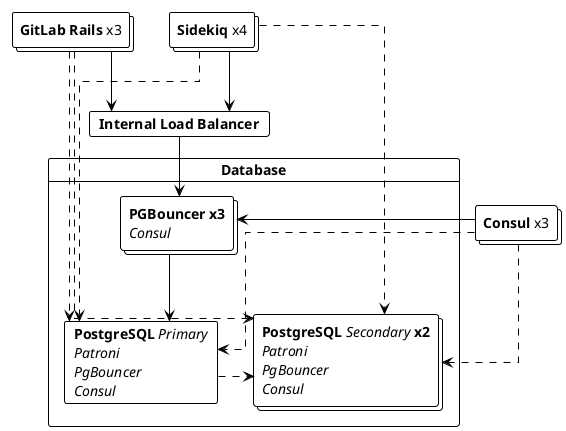



- Tier: 基础版，专业版，旗舰版
- Offering: 私有化部署



通过数据库负载均衡，读查询会分布到多个 PostgreSQL 节点上，以提升性能并减轻主数据库的负载。写操作始终在主数据库上执行。极狐GitLab 会自动处理查询路由，无需外部负载均衡器。

<a id="requirements"></a>

## 先决条件

要启用数据库负载均衡：

- PostgreSQL 必须有一个或多个从节点复制主节点。
- 每个节点必须能通过相同的端口和相同的凭据访问。

对于外部数据库服务，只需配置 `db_load_balancing`。连接池有助于在规模化场景下管理连接数，但合适的方案取决于您的服务提供商，不在本指南的讨论范围内。有关连接管理的指导，请参阅[连接池](../../install/cloud-services.md#connection-pooling)。

> [!note]
> [AWS RDS Proxy](https://aws.amazon.com/rds/proxy/) 尚未经过验证可用于极狐GitLab。

对于 Linux 软件包安装，必须先配置多节点高可用 PostgreSQL，然后才能启用数据库负载均衡。有关更多信息，请参阅[配置多节点环境](replication_and_failover.md)。

<a id="replica-count"></a>

### 副本数量

支持任意数量的副本。在实践中，三个副本是常见的起点，尤其是对于分布在三个可用区中的环境。极狐GitLab 的多个组件（包括 Consul 和 Redis Sentinel）依赖法定人数，需要奇数个节点。让数据库副本数量与这一模式保持一致，可以构建更统一的架构、提升灾难恢复覆盖范围，并限制单个可用区故障的影响。较小的环境可以从两个副本开始，随着负载增加再添加更多副本。

有关针对规模的指导，请参阅[参考架构文档](../reference_architectures/_index.md)。

<a id="configure-database-load-balancing"></a>

## 配置数据库负载均衡

数据库负载均衡可以通过以下两种方式之一进行配置：

- [主机](#hosts)：PostgreSQL 主机的静态列表。配置更简单，适用于大多数环境。
- [服务发现](#service-discovery)：返回 PostgreSQL 主机列表的 DNS 记录。当副本列表动态变化时使用，例如使用 Consul 的 Linux 软件包高可用部署。

<a id="hosts"></a>

### 主机

主机列表中是否包含主节点是可选的。包含时，主节点将与副本一起参与读查询，从而减轻从节点的整体负载。如果主节点已经处于持续高负载状态，将其排除在外可以为写操作保留容量。无论主节点是否出现在此列表中，写查询始终由主节点处理。

要配置主机列表，请在您想要均衡的每个环境的全部 GitLab Rails 和 Sidekiq 节点上执行以下步骤：

1. 编辑 `/etc/gitlab/gitlab.rb` 文件。
1. 在 `gitlab_rails['db_load_balancing']` 中，创建要均衡的数据库主机数组。例如，在 PostgreSQL 运行于 `primary.example.com`、`secondary1.example.com` 和 `secondary2.example.com`的环境中：

   ```ruby
   gitlab_rails['db_load_balancing'] = { 'hosts' => ['primary.example.com', 'secondary1.example.com', 'secondary2.example.com'] }
   ```

   这些主机必须能通过 `gitlab_rails['db_port']` 配置的相同端口访问。

1. 保存文件并[重新配置极狐GitLab](../restart_gitlab.md#reconfigure-a-linux-package-installation)。

<a id="service-discovery"></a>

### 服务发现

服务发现允许极狐GitLab 自动获取 PostgreSQL 主机列表。它会定期检查 DNS `A` 记录，并将返回的 IP 地址用作副本地址。要使用服务发现，您需要一台 DNS 服务器，以及一条包含从节点 IP 地址的 `A` 记录。

使用 Linux 软件包安装时，随附的 [Consul](../consul.md) 服务可充当 DNS 服务器，并通过 `postgresql-ha.service.consul` 记录返回 PostgreSQL 地址。下图展示了这种部署模式：



要使用 Consul 配置服务发现：

1. 在每个 GitLab Rails / Sidekiq 节点上，编辑 `/etc/gitlab/gitlab.rb` 并添加以下内容：

   ```ruby
   gitlab_rails['db_load_balancing'] = { 'discover' => {
       'nameserver' => 'localhost'
       'record' => 'postgresql-ha.service.consul'
       'record_type' => 'A'
       'port' => '8600'
       'interval' => '60'
       'disconnect_timeout' => '120'
     }
   }
   ```

1. 保存文件并[重新配置极狐GitLab](../restart_gitlab.md#reconfigure-a-linux-package-installation)
   以使更改生效。

| 选项               | 描述                                                                                       | 默认值   |
|----------------------|---------------------------------------------------------------------------------------------------|-----------|
| `nameserver`         | 用于查找 DNS 记录的名称服务器。                                              | localhost |
| `record`             | 要查找的记录。此选项是服务发现正常工作所必需的。                     |           |
| `record_type`        | 可选，要查找的记录类型。可以是 `A` 或 `SRV`。                                      | `A`       |
| `port`               | 名称服务器的端口。                                                                       | 8600      |
| `interval`           | 检查 DNS 记录之间的最短时间（秒）。                                      | 60        |
| `disconnect_timeout` | 主机列表更新后，旧连接关闭所需的时间（秒）。   | 120       |
| `use_tcp`            | 使用 TCP 而非 UDP 查找 DNS 资源。                                                   | false     |
| `max_replica_pools`  | 每个极狐GitLab 进程连接的最大副本数。仅在使用服务发现时适用。如果没有此限制，每个进程都会连接到每个副本。在运行大量副本和大量极狐GitLab 节点时使用。 | nil |

如果 `record_type` 设置为 `SRV`，极狐GitLab 会使用轮询，并忽略记录中的 `weight` 和 `priority`。由于 `SRV` 记录通常返回主机名而非 IP，极狐GitLab 会在 `SRV` 响应的附加段中查找 IP 地址。如果某个主机名找不到 IP，极狐GitLab 会向配置的 `nameserver` 查询该主机名的 `ANY` 记录，以查找 `A` 或 `AAAA` 记录。如果无法解析主机名的 IP，极狐GitLab 会将该主机名从轮询中移除。

`interval` 值指定检查之间的最短时间。如果 `A` 记录的 TTL 大于此值，服务发现会遵循该 TTL。例如，如果 TTL 为 90 秒，服务发现会至少等待 90 秒后再进行检查。

主机列表更新后，旧连接可能需要一段时间才能终止。使用 `disconnect_timeout` 设置此过程所需时间的上限。

<a id="stale-reads"></a>

## 过期读取

极狐GitLab 在将读取路由到某个从节点之前，会检查该从节点的复制状态。如果某个从节点落后主节点太多，则会被跳过，直到它赶上为止。

| 选项                       | 描述                                                                                                   | 默认值    |
|------------------------------|---------------------------------------------------------------------------------------------------------------|------------|
| `max_replication_difference` | 从节点在最近未复制数据时允许落后的数据量（字节）。  | 8 MB       |
| `max_replication_lag_time`   | 从节点在被跳过之前允许落后的最长时间（秒）。                      | 60 秒 |
| `replica_check_interval`     | 从节点状态检查之间的最短时间（秒）。                                                | 60 秒 |

默认值对大多数环境来说已经足够。

要使用主机列表配置这些选项：

```ruby
gitlab_rails['db_load_balancing'] = {
  'hosts' => ['primary.example.com', 'secondary1.example.com', 'secondary2.example.com'],
  'max_replication_difference' => 16777216, # 16 MB
  'max_replication_lag_time' => 30,
  'replica_check_interval' => 30
}
```

<a id="logging"></a>

## 日志记录

负载均衡器会在 [`database_load_balancing.log`](../logs/_index.md#database_load_balancinglog)中记录各种事件，例如：

- 主机被标记为离线时。
- 主机恢复在线时。
- 所有从节点都离线时。
- 由于查询冲突而在其他主机上重试读取时。

日志采用结构化格式，每个条目都是一个 JSON 对象，至少包含：

- 一个便于筛选的 `event` 字段。
- 一个人类可读的 `message` 字段。
- 特定于事件的元数据，例如 `db_host`。
- 始终记录的上下文信息，例如 `severity` 和 `time`。

例如：

```json
{"severity":"INFO","time":"2019-09-02T12:12:01.728Z","correlation_id":"abcdefg","event":"host_online","message":"Host came back online","db_host":"111.222.333.444","db_port":null,"tag":"rails.database_load_balancing","environment":"production","hostname":"web-example-1","fqdn":"gitlab.example.com","path":null,"params":null}
```

<a id="how-database-load-balancing-works"></a>

## 数据库负载均衡的工作原理

<a id="balancing-queries"></a>

### 均衡查询

读查询会分布到所有已配置的数据库主机上。无论配置了多少副本，写操作始终在主节点上执行。

<a id="primary-sticking"></a>

### 主节点粘滞

写入之后，极狐GitLab 会在最多 30 秒内将该用户的读取临时路由到主节点。一旦副本赶上，极狐GitLab 就会恢复使用副本，而不是始终等待完整的 30 秒。后台作业在写入后也会等待副本赶上再进行读取，以避免数据过期。

<a id="failover-handling"></a>

### 故障转移处理

如果某个从节点不可用，负载均衡器会路由到下一个可用的主机。如果没有可用的从节点，读取会回退到主节点。

如果写入失败，该操作最多重试 3 次。重启数据库服务器不会立即导致用户遇到错误。
