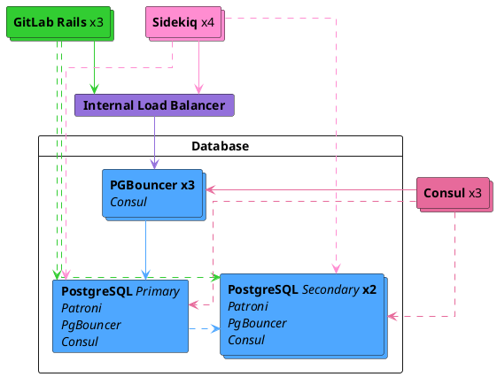



- Tier: 专业版，旗舰版
- Offering: 私有化部署



如果您是极狐GitLab 私有化部署的基础版用户，请考虑使用云端托管方案。本文档不涵盖自行编译的安装方式。

如果带复制和故障转移的配置不是您想要的，请参阅 Linux 软件包的[数据库配置文档](https://gitlab.cn/docs/omnibus/settings/database/)。

建议在尝试为极狐GitLab 配置带复制和故障转移的 PostgreSQL 之前，先完整阅读本文档。

<a id="operating-system-upgrades"></a>

## 操作系统升级

如果您要故障转移到使用不同操作系统的系统，请阅读[升级 PostgreSQL 操作系统的文档](upgrading_os.md)。如果未考虑操作系统升级带来的本地变更，可能会导致数据损坏。

<a id="architecture"></a>

## 架构

Linux 软件包推荐的带复制故障转移的 PostgreSQL 集群配置需要：

- 至少三个 PostgreSQL 节点。
- 至少三个 Consul 服务器节点。
- 至少三个 PgBouncer 节点，用于跟踪和处理主数据库的读写。
  - 一个内部负载均衡器（TCP），用于在 PgBouncer 节点之间均衡请求。
- 启用[数据库负载均衡](database_load_balancing.md)。
  - 在每个 PostgreSQL 节点上配置一个本地 PgBouncer 服务。这与跟踪主节点的主 PgBouncer 集群是分开的。



您还需要考虑底层网络拓扑，确保所有数据库和极狐GitLab 实例之间具有冗余连接，以避免网络成为单点故障。

<a id="database-node"></a>

### 数据库节点

每个数据库节点运行四个服务：

- `PostgreSQL`：数据库本身。
- `Patroni`：与集群中的其他 Patroni 服务通信，并在主服务器出现问题时处理故障转移。故障转移过程包括：
  - 为集群选择新的主节点。
  - 将新节点提升为主节点。
  - 指示其余服务器跟随新的主节点。
- `PgBouncer`：该节点的本地连接池。作为[数据库负载均衡](database_load_balancing.md)的一部分，用于*读*查询。
- `Consul` agent：用于与存储当前 Patroni 状态的 Consul 集群通信。该 agent 监控数据库集群中每个节点的状态，并在 Consul 集群的服务定义中跟踪其健康状况。

<a id="consul-server-node"></a>

### Consul 服务器节点

Consul 服务器节点运行 Consul 服务器服务。这些节点必须在 Patroni 集群引导之前达到法定人数并选举出领导者；否则，数据库节点会等待直到选举出这样的 Consul 领导者。

<a id="pgbouncer-node"></a>

### PgBouncer 节点

每个 PgBouncer 节点运行两个服务：

- `PgBouncer`：数据库连接池本身。
- `Consul` agent：监视 Consul 集群上 PostgreSQL 服务定义的状态。如果该状态发生变化，Consul 会运行一个脚本，更新 PgBouncer 配置以指向新的 PostgreSQL 主节点，并重新加载 PgBouncer 服务。

<a id="connection-flow"></a>

### 连接流

软件包中的每个服务都带有一组[默认端口](../package_information/defaults.md#ports)。您可能需要为下面列出的连接制定特定的防火墙规则：

此设置中有几种连接流：

- [主连接](#primary)
- [数据库负载均衡](#database-load-balancing)
- [复制](#replication)

<a id="primary"></a>

#### 主连接

- 应用服务器通过 PgBouncer 的[默认端口](../package_information/defaults.md)直接连接到 PgBouncer，或经由已配置的内部负载均衡器（TCP）连接，该负载均衡器为多个 PgBouncer 提供服务。
- PgBouncer 连接到主数据库服务器的 [PostgreSQL 默认端口](../package_information/defaults.md)。

<a id="database-load-balancing"></a>

#### 数据库负载均衡

针对近期未更改且在所有数据库节点上均为最新的数据的读查询：

- 应用服务器以轮询方式通过每个数据库节点上本地 PgBouncer 服务的[默认端口](../package_information/defaults.md)连接到该服务。
- 本地 PgBouncer 连接到本地数据库服务器的 [PostgreSQL 默认端口](../package_information/defaults.md)。

<a id="replication"></a>

#### 复制

- Patroni 主动管理正在运行的 PostgreSQL 进程和配置。
- PostgreSQL 从节点连接到主数据库服务器的 [PostgreSQL 默认端口](../package_information/defaults.md)
- Consul 服务器和 agent 相互连接到彼此的 [Consul 默认端口](../package_information/defaults.md)

<a id="setting-it-up"></a>

## 设置

<a id="required-information"></a>

### 所需信息

在继续配置之前，您需要收集所有必要的信息。

<a id="network-information"></a>

#### 网络信息

PostgreSQL 默认不监听任何网络接口。它需要知道要监听哪个 IP 地址，才能被其他服务访问。同样，PostgreSQL 的访问是基于网络来源进行控制的。

这就是为什么您需要：

- 每个节点网络接口的 IP 地址。可以将其设置为 `0.0.0.0` 以
  监听所有接口。不能将其设置为回环地址 `127.0.0.1`。
- 网络地址。可以是子网（即 `192.168.0.0/255.255.255.0`）
  或无类别域间路由（CIDR）（`192.168.0.0/24`）形式。

<a id="consul-information"></a>

#### Consul 信息

使用默认设置时，最低配置需要：

- `CONSUL_USERNAME`。Linux 软件包安装的默认用户是 `gitlab-consul`
- `CONSUL_DATABASE_PASSWORD`。数据库用户的密码。
- `CONSUL_PASSWORD_HASH`。这是根据 Consul 用户名/密码对生成的哈希。可以使用以下命令生成：

  ```shell
  sudo gitlab-ctl pg-password-md5 CONSUL_USERNAME
  ```

- `CONSUL_SERVER_NODES`。Consul 服务器节点的 IP 地址或 DNS 记录。

关于该服务本身的几点说明：

- 该服务在系统账号下运行，默认是 `gitlab-consul`。
- 如果您使用不同的用户名，必须通过 `CONSUL_USERNAME` 变量指定它。
- 密码存储在以下位置：
  - `/etc/gitlab/gitlab.rb`：哈希形式
  - `/var/opt/gitlab/pgbouncer/pg_auth`：哈希形式
  - `/var/opt/gitlab/consul/.pgpass`：明文

<a id="postgresql-information"></a>

#### PostgreSQL 信息

配置 PostgreSQL 时，我们会执行以下操作：

- 将 `max_replication_slots` 设置为数据库节点数量的两倍。Patroni 在启动复制时每个节点会使用一个额外的槽位。
- 将 `max_wal_senders` 设置为集群中分配的复制槽位数量加一。这可以防止复制用尽所有可用的数据库连接。

在本文档中，我们假设有 3 个数据库节点，因此该配置为：

```ruby
patroni['postgresql']['max_replication_slots'] = 6
patroni['postgresql']['max_wal_senders'] = 7
```

如前所述，请准备需要获得数据库认证权限的网络子网。您还需要手头有 Consul 服务器节点的 IP 地址或 DNS 记录。

您需要以下应用程序数据库用户的密码信息：

- `POSTGRESQL_USERNAME`。Linux 软件包安装的默认用户是 `gitlab`
- `POSTGRESQL_USER_PASSWORD`。数据库用户的密码
- `POSTGRESQL_PASSWORD_HASH`。这是根据用户名/密码对生成的哈希。
  可以使用以下命令生成：

  ```shell
  sudo gitlab-ctl pg-password-md5 POSTGRESQL_USERNAME
  ```

<a id="patroni-information"></a>

#### Patroni 信息

您需要以下 Patroni API 的密码信息：

- `PATRONI_API_USERNAME`。用于 API 基本认证的用户名
- `PATRONI_API_PASSWORD`。用于 API 基本认证的密码

<a id="pgbouncer-information"></a>

#### PgBouncer 信息

使用默认设置时，最低配置需要：

- `PGBOUNCER_USERNAME`。Linux 软件包安装的默认用户是 `pgbouncer`
- `PGBOUNCER_PASSWORD`。这是 PgBouncer 服务的密码。
- `PGBOUNCER_PASSWORD_HASH`。这是根据 PgBouncer 用户名/密码对生成的哈希。可以使用以下命令生成：

  ```shell
  sudo gitlab-ctl pg-password-md5 PGBOUNCER_USERNAME
  ```

- `PGBOUNCER_NODE`，是运行 PgBouncer 的节点的 IP 地址或 FQDN。

关于该服务本身需要记住的几点：

- 该服务以与数据库相同的系统账号运行。在软件包中，默认是 `gitlab-psql`
- 如果您为 PgBouncer 服务使用非默认用户账号（默认是 `pgbouncer`），则需要指定该用户名。
- 密码存储在以下位置：
  - `/etc/gitlab/gitlab.rb`：哈希形式，以及明文形式
  - `/var/opt/gitlab/pgbouncer/pg_auth`：哈希形式

<a id="installing-the-linux-package"></a>

### 安装 Linux 软件包

首先，请确保在每个节点上[下载并安装](https://gitlab.cn/install) Linux 软件包。

请确保安装第 1 步中必要的依赖项，并从第 2 步添加极狐GitLab 软件包仓库。安装极狐GitLab 软件包时，不要提供 `EXTERNAL_URL` 值。

<a id="configuring-the-database-nodes"></a>

### 配置数据库节点

1. 请确保[配置 Consul 节点](../consul.md)。
1. 在执行下一步之前，请确保收集 [`CONSUL_SERVER_NODES`](#consul-information)、[`PGBOUNCER_PASSWORD_HASH`](#pgbouncer-information)、[`POSTGRESQL_PASSWORD_HASH`](#postgresql-information)、[数据库节点数量](#postgresql-information)以及[网络地址](#network-information)。

<a id="configuring-patroni-cluster"></a>

#### 配置 Patroni 集群

您必须显式启用 Patroni 才能使用它（使用 `patroni['enable'] = true`）。

任何控制复制的 PostgreSQL 配置项，例如 `wal_level`、`max_wal_senders` 或其他项，都严格由 Patroni 控制。这些配置会覆盖您使用 `postgresql[...]` 配置键所做的原始设置。因此，它们都被分离出来并放在 `patroni['postgresql'][...]` 下。此行为仅限于复制。Patroni 会遵循使用 `postgresql[...]` 配置键所做的任何其他 PostgreSQL 配置。例如，`max_wal_senders` 默认设置为 `5`。如果您希望更改它，必须使用 `patroni['postgresql']['max_wal_senders']` 配置键进行设置。

以下是一个示例：

```ruby
# Disable all components except Patroni, PgBouncer and Consul
roles(['patroni_role', 'pgbouncer_role'])

# PostgreSQL configuration
postgresql['listen_address'] = '0.0.0.0'

# Disable automatic database migrations
gitlab_rails['auto_migrate'] = false

# Configure the Consul agent
consul['services'] = %w(postgresql)

# START user configuration
#  Set the real values as explained in Required Information section
#
# Replace PGBOUNCER_PASSWORD_HASH with a generated md5 value
postgresql['pgbouncer_user_password'] = 'PGBOUNCER_PASSWORD_HASH'
# Replace POSTGRESQL_REPLICATION_PASSWORD_HASH with a generated md5 value
postgresql['sql_replication_password'] = 'POSTGRESQL_REPLICATION_PASSWORD_HASH'
# Replace POSTGRESQL_PASSWORD_HASH with a generated md5 value
postgresql['sql_user_password'] = 'POSTGRESQL_PASSWORD_HASH'

# Replace PATRONI_API_USERNAME with a username for Patroni Rest API calls (use the same username in all nodes)
patroni['username'] = 'PATRONI_API_USERNAME'
# Replace PATRONI_API_PASSWORD with a password for Patroni Rest API calls (use the same password in all nodes)
patroni['password'] = 'PATRONI_API_PASSWORD'

# Sets `max_replication_slots` to double the number of database nodes.
# Patroni uses one extra slot per node when initiating the replication.
patroni['postgresql']['max_replication_slots'] = X

# Set `max_wal_senders` to one more than the number of replication slots in the cluster.
# This is used to prevent replication from using up all of the
# available database connections.
patroni['postgresql']['max_wal_senders'] = X+1

# Replace XXX.XXX.XXX.XXX/YY with Network Addresses for your other patroni nodes
patroni['allowlist'] = %w(XXX.XXX.XXX.XXX/YY 127.0.0.1/32)

# Replace XXX.XXX.XXX.XXX/YY with Network Address
postgresql['trust_auth_cidr_addresses'] = %w(XXX.XXX.XXX.XXX/YY 127.0.0.1/32)

# Local PgBouncer service for Database Load Balancing
pgbouncer['databases'] = {
  gitlabhq_production: {
    host: "127.0.0.1",
    user: "PGBOUNCER_USERNAME",
    password: 'PGBOUNCER_PASSWORD_HASH'
  }
}

# Replace placeholders:
#
# Y.Y.Y.Y consul1.gitlab.example.com Z.Z.Z.Z
# with the addresses gathered for CONSUL_SERVER_NODES
consul['configuration'] = {
  retry_join: %w(Y.Y.Y.Y consul1.gitlab.example.com Z.Z.Z.Z)
}
#
# END user configuration
```

所有数据库节点使用相同的配置。主节点不是在配置中确定的，并且主节点和副本节点都没有额外或不同的配置。

节点配置完成后，您必须在每个节点上[重新配置极狐GitLab](../restart_gitlab.md#reconfigure-a-linux-package-installation) 以使更改生效。

通常，当 Consul 集群就绪后，第一个[重新配置](../restart_gitlab.md#reconfigure-a-linux-package-installation)的节点会成为主节点。您不需要对节点重新配置进行排序。您可以并行或以任意顺序运行它们。如果您选择任意顺序，则没有任何预定的主节点。

<a id="enable-monitoring"></a>

#### 启用监控

如果您启用监控，则必须在所有数据库服务器上启用它。

1. 创建/编辑 `/etc/gitlab/gitlab.rb` 并添加以下配置：

   ```ruby
   # Enable service discovery for Prometheus
   consul['monitoring_service_discovery'] = true

   # Set the network addresses that the exporters must listen on
   node_exporter['listen_address'] = '0.0.0.0:9100'
   postgres_exporter['listen_address'] = '0.0.0.0:9187'
   ```

1. 运行 `sudo gitlab-ctl reconfigure` 以编译配置。

<a id="enable-tls-support-for-the-patroni-api"></a>

#### 为 Patroni API 启用 TLS 支持

默认情况下，Patroni [REST API](https://patroni.readthedocs.io/en/latest/rest_api.html#rest-api) 通过 HTTP 提供服务。
您可以选择启用 TLS，并在同一[端口](../package_information/defaults.md)上使用 HTTPS。

要启用 TLS，您需要 PEM 格式的证书和私钥文件。这两个文件必须可由 PostgreSQL 用户读取（默认是 `gitlab-psql`，或由 `postgresql['username']` 设置的用户）：

```ruby
patroni['tls_certificate_file'] = '/path/to/server/certificate.pem'
patroni['tls_key_file'] = '/path/to/server/key.pem'
```

如果服务器的私钥已加密，请指定用于解密它的密码：

```ruby
patroni['tls_key_password'] = 'private-key-password' # This is the plain-text password.
```

如果您使用自签名证书或内部 CA，则需要禁用 TLS 验证或传入内部 CA 的证书，否则在使用 `gitlab-ctl patroni ....` 命令时可能会遇到意外错误。Linux 软件包确保 Patroni API 客户端遵循此配置。

TLS 证书验证默认启用。要禁用它：

```ruby
patroni['tls_verify'] = false
```

或者，您可以传入内部 CA 的 PEM 格式证书。同样，该文件必须可由 PostgreSQL 用户读取：

```ruby
patroni['tls_ca_file'] = '/path/to/ca.pem'
```

启用 TLS 后，所有端点都可以进行 API 服务器和客户端的双向认证，其程度取决于 `patroni['tls_client_mode']` 属性：

- `none`（默认）：API 不检查任何客户端证书。
- `optional`：所有[不安全](https://patroni.readthedocs.io/en/latest/security.html#protecting-the-rest-api)的 API 调用都需要客户端证书。
- `required`：所有 API 调用都需要客户端证书。

客户端证书会根据 `patroni['tls_ca_file']` 属性指定的 CA 证书进行验证。因此，双向 TLS 认证需要此属性。您还需要指定 PEM 格式的客户端证书和私钥文件。这两个文件必须可由 PostgreSQL 用户读取：

```ruby
patroni['tls_client_mode'] = 'required'
patroni['tls_ca_file'] = '/path/to/ca.pem'

patroni['tls_client_certificate_file'] = '/path/to/client/certificate.pem'
patroni['tls_client_key_file'] = '/path/to/client/key.pem'
```

只要能够验证，您可以在不同的 Patroni 节点上为 API 服务器和客户端使用不同的证书和密钥。但是，CA 证书（`patroni['tls_ca_file']`）、TLS 证书验证（`patroni['tls_verify']`）和客户端 TLS 认证模式（`patroni['tls_client_mode']`）在所有节点上必须各自具有相同的值。

<a id="configure-pgbouncer-nodes"></a>

### 配置 PgBouncer 节点

1. 在执行下一步之前，请确保收集 [`CONSUL_SERVER_NODES`](#consul-information)、[`CONSUL_PASSWORD_HASH`](#consul-information) 和 [`PGBOUNCER_PASSWORD_HASH`](#pgbouncer-information)。
1. 在每个节点上，编辑 `/etc/gitlab/gitlab.rb` 配置文件，并替换 `# START user configuration` 部分中标注的值，如下所示：

   ```ruby
   # Disable all components except PgBouncer and Consul agent
   roles(['pgbouncer_role'])

   # Configure PgBouncer
   pgbouncer['admin_users'] = %w(pgbouncer gitlab-consul)

   # Configure Consul agent
   consul['watchers'] = %w(postgresql)

   # START user configuration
   # Set the real values as explained in Required Information section
   # Replace CONSUL_PASSWORD_HASH with a generated md5 value
   # Replace PGBOUNCER_PASSWORD_HASH with a generated md5 value
   pgbouncer['users'] = {
     'gitlab-consul': {
       password: 'CONSUL_PASSWORD_HASH'
     },
     'pgbouncer': {
       password: 'PGBOUNCER_PASSWORD_HASH'
     }
   }
   # Replace placeholders:
   #
   # Y.Y.Y.Y consul1.gitlab.example.com Z.Z.Z.Z
   # with the addresses gathered for CONSUL_SERVER_NODES
   consul['configuration'] = {
     retry_join: %w(Y.Y.Y.Y consul1.gitlab.example.com Z.Z.Z.Z)
   }
   #
   # END user configuration
   ```

1. 运行 `gitlab-ctl reconfigure`
1. 创建一个 `.pgpass` 文件，以便 Consul 能够
   重新加载 PgBouncer。在提示时输入两次 `PGBOUNCER_PASSWORD`：

   ```shell
   gitlab-ctl write-pgpass --host 127.0.0.1 --database pgbouncer --user pgbouncer --hostuser gitlab-consul
   ```

1. [启用监控](pgbouncer.md#enable-monitoring)

<a id="pgbouncer-checkpoint"></a>

#### PgBouncer 检查点

1. 确保每个节点都与当前主节点通信：

   ```shell
   gitlab-ctl pgb-console # Supply PGBOUNCER_PASSWORD when prompted
   ```

   如果在输入密码后出现错误 `psql: ERROR:  Auth failed`，
   请确保您之前使用正确的格式生成了 MD5 密码哈希。
   正确的格式是将密码和用户名连接起来：
   `PASSWORDUSERNAME`。例如，`Sup3rS3cr3tpgbouncer` 就是
   为 `pgbouncer` 用户生成 MD5 密码哈希所需的文本。

1. 控制台提示符可用后，运行以下查询：

   ```shell
   show databases ; show clients ;
   ```

   输出应类似于以下内容：

   ```plaintext
           name         |  host       | port |      database       | force_user | pool_size | reserve_pool | pool_mode | max_connections | current_connections
   ---------------------+-------------+------+---------------------+------------+-----------+--------------+-----------+-----------------+---------------------
    gitlabhq_production | MASTER_HOST | 5432 | gitlabhq_production |            |        20 |            0 |           |               0 |                   0
    pgbouncer           |             | 6432 | pgbouncer           | pgbouncer  |         2 |            0 | statement |               0 |                   0
   (2 rows)

    type |   user    |      database       |  state  |   addr         | port  | local_addr | local_port |    connect_time     |    request_time     |    ptr    | link | remote_pid | tls
   ------+-----------+---------------------+---------+----------------+-------+------------+------------+---------------------+---------------------+-----------+------+------------+-----
    C    | pgbouncer | pgbouncer           | active  | 127.0.0.1      | 56846 | 127.0.0.1  |       6432 | 2017-08-21 18:09:59 | 2017-08-21 18:10:48 | 0x22b3880 |      |          0 |
   (2 rows)
   ```

<a id="configure-the-internal-load-balancer"></a>

#### 配置内部负载均衡器

如果您按照建议运行多个 PgBouncer 节点，则必须设置一个 TCP 内部负载均衡器来正确地为每个节点提供服务。这可以使用任何知名的 TCP 负载均衡器来实现。

例如，以下是使用 [HAProxy](https://www.haproxy.org/) 实现的方法：

```plaintext
global
    log /dev/log local0
    log localhost local1 notice
    log stdout format raw local0

defaults
    log global
    default-server inter 10s fall 3 rise 2
    balance leastconn

frontend internal-pgbouncer-tcp-in
    bind *:6432
    mode tcp
    option tcplog

    default_backend pgbouncer

backend pgbouncer
    mode tcp
    option tcp-check

    server pgbouncer1 <ip>:6432 check
    server pgbouncer2 <ip>:6432 check
    server pgbouncer3 <ip>:6432 check
```

请参阅您首选负载均衡器的文档以获取进一步指导。

<a id="configuring-the-application-nodes"></a>

### 配置应用节点

应用节点运行 `gitlab-rails` 服务。您可能设置了其他属性，但以下属性需要设置。

1. 编辑 `/etc/gitlab/gitlab.rb`：

   ```ruby
   # Disable PostgreSQL on the application node
   postgresql['enable'] = false

   gitlab_rails['db_host'] = 'PGBOUNCER_NODE' or 'INTERNAL_LOAD_BALANCER'
   gitlab_rails['db_port'] = 6432
   gitlab_rails['db_password'] = 'POSTGRESQL_USER_PASSWORD'
   gitlab_rails['auto_migrate'] = false
   gitlab_rails['db_load_balancing'] = { 'hosts' => ['POSTGRESQL_NODE_1', 'POSTGRESQL_NODE_2', 'POSTGRESQL_NODE_3'] }
   ```

1. [重新配置极狐GitLab](../restart_gitlab.md#reconfigure-a-linux-package-installation) 以使更改生效。

<a id="application-node-post-configuration"></a>

#### 应用节点配置后

确保所有迁移都已运行：

```shell
gitlab-rake gitlab:db:configure
```

> [!note]
> 如果您遇到 `rake aborted!` 错误，指出 PgBouncer 无法连接到 PostgreSQL，可能是您的 PgBouncer 节点 IP 地址未出现在
> 数据库节点上 `gitlab.rb`中的 PostgreSQL `trust_auth_cidr_addresses`中。在继续之前，请参阅
> [PgBouncer 错误 `ERROR:  pgbouncer cannot connect to server`](replication_and_failover_troubleshooting.md#pgbouncer-error-error-pgbouncer-cannot-connect-to-server)。

<a id="backups"></a>

### 备份

不要通过 PgBouncer 连接备份或恢复极狐GitLab：这会导致极狐GitLab 中断。

[详细了解此问题以及如何重新配置备份](../backup_restore/backup_gitlab.md#back-up-and-restore-for-installations-using-pgbouncer)。

<a id="ensure-gitlab-is-running"></a>

### 确保极狐GitLab 正在运行

此时，您的极狐GitLab 实例应该已启动并运行。验证您是否能够登录，并创建议题和合并请求。有关更多信息，请参阅[故障排除复制和故障转移](replication_and_failover_troubleshooting.md)。

<a id="example-configuration"></a>

## 示例配置

本节介绍几个完整展开的示例配置。

<a id="example-recommended-setup"></a>

### 示例推荐设置

此示例使用三个 Consul 服务器、三个 PgBouncer 服务器（带有一个关联的内部负载均衡器）、三个 PostgreSQL 服务器和一个应用节点。

在此设置中，所有服务器共享相同的 `10.6.0.0/16` 专用网络范围。服务器通过这些地址自由通信。

虽然您可以使用不同的网络设置，但建议确保它允许在整个集群中进行同步复制。作为一般规则，低于 2 毫秒的延迟可确保复制操作具有良好性能。

极狐GitLab [参考架构](../reference_architectures/_index.md)的规模设定假设应用数据库查询由所有三个节点分担。高于 2 毫秒的通信延迟可能导致数据库锁，并影响副本及时提供只读查询的能力。

- `10.6.0.22`：PgBouncer 2
- `10.6.0.23`：PgBouncer 3
- `10.6.0.31`：PostgreSQL 1
- `10.6.0.32`：PostgreSQL 2
- `10.6.0.33`：PostgreSQL 3
- `10.6.0.41`：极狐GitLab 应用

所有密码都设置为 `toomanysecrets`。不要使用此密码或派生哈希，极狐GitLab 的 `external_url` 为 `http://gitlab.example.com`。

初始配置后，如果发生故障转移，PostgreSQL 主节点会变为其中一个可用的从节点，直到它被故障恢复。

<a id="example-recommended-setup-for-consul-servers"></a>

#### Consul 服务器的示例推荐设置

在每个服务器上编辑 `/etc/gitlab/gitlab.rb`：

```ruby
# Disable all components except Consul
roles(['consul_role'])

consul['configuration'] = {
  server: true,
  retry_join: %w(10.6.0.11 10.6.0.12 10.6.0.13)
}
consul['monitoring_service_discovery'] =  true
```

[重新配置极狐GitLab](../restart_gitlab.md#reconfigure-a-linux-package-installation) 以使更改生效。

<a id="example-recommended-setup-for-pgbouncer-servers"></a>

#### PgBouncer 服务器的示例推荐设置

在每个服务器上编辑 `/etc/gitlab/gitlab.rb`：

```ruby
# Disable all components except Pgbouncer and Consul agent
roles(['pgbouncer_role'])

# Configure PgBouncer
pgbouncer['admin_users'] = %w(pgbouncer gitlab-consul)

pgbouncer['users'] = {
  'gitlab-consul': {
    password: '5e0e3263571e3704ad655076301d6ebe'
  },
  'pgbouncer': {
    password: '771a8625958a529132abe6f1a4acb19c'
  }
}

consul['watchers'] = %w(postgresql)
consul['configuration'] = {
  retry_join: %w(10.6.0.11 10.6.0.12 10.6.0.13)
}
consul['monitoring_service_discovery'] =  true
```

[重新配置极狐GitLab](../restart_gitlab.md#reconfigure-a-linux-package-installation) 以使更改生效。

<a id="internal-load-balancer-setup"></a>

#### 内部负载均衡器设置

然后需要设置一个内部负载均衡器（TCP）来为每个 PgBouncer 节点提供服务（在此示例中位于 `10.6.0.20`的 IP 上）。如何执行此操作的示例可在 [PgBouncer 配置内部负载均衡器](#configure-the-internal-load-balancer)部分找到。

<a id="example-recommended-setup-for-postgresql-servers"></a>

#### PostgreSQL 服务器的示例推荐设置

在数据库节点上编辑 `/etc/gitlab/gitlab.rb`：

```ruby
# Disable all components except Patroni, PgBouncer and Consul
roles(['patroni_role', 'pgbouncer_role'])

# PostgreSQL configuration
postgresql['listen_address'] = '0.0.0.0'
postgresql['hot_standby'] = 'on'
postgresql['wal_level'] = 'replica'

# Disable automatic database migrations
gitlab_rails['auto_migrate'] = false

postgresql['pgbouncer_user_password'] = '771a8625958a529132abe6f1a4acb19c'
postgresql['sql_user_password'] = '450409b85a0223a214b5fb1484f34d0f'
patroni['username'] = 'PATRONI_API_USERNAME'
patroni['password'] = 'PATRONI_API_PASSWORD'
patroni['postgresql']['max_replication_slots'] = 6
patroni['postgresql']['max_wal_senders'] = 7

patroni['allowlist'] = = %w(10.6.0.0/16 127.0.0.1/32)
postgresql['trust_auth_cidr_addresses'] = %w(10.6.0.0/16 127.0.0.1/32)

# Local PgBouncer service for Database Load Balancing
pgbouncer['databases'] = {
  gitlabhq_production: {
    host: "127.0.0.1",
    user: "pgbouncer",
    password: '771a8625958a529132abe6f1a4acb19c'
  }
}

# Configure the Consul agent
consul['services'] = %w(postgresql)
consul['configuration'] = {
  retry_join: %w(10.6.0.11 10.6.0.12 10.6.0.13)
}
consul['monitoring_service_discovery'] =  true
```

[重新配置极狐GitLab](../restart_gitlab.md#reconfigure-a-linux-package-installation) 以使更改生效。

<a id="example-recommended-setup-manual-steps"></a>

#### 示例推荐设置的手动步骤

部署配置后，请按照以下步骤操作：

1. 找到主数据库节点：

   ```shell
   gitlab-ctl get-postgresql-primary
   ```

1. 在 `10.6.0.41`（我们的应用服务器）上：

   将 `gitlab-consul` 用户的 PgBouncer 密码设置为 `toomanysecrets`：

   ```shell
   gitlab-ctl write-pgpass --host 127.0.0.1 --database pgbouncer --user pgbouncer --hostuser gitlab-consul
   ```

   运行数据库迁移：

   ```shell
   gitlab-rake gitlab:db:configure
   ```

<a id="patroni"></a>

## Patroni

Patroni 是一款约定优先的 PostgreSQL 高可用性解决方案。它接管 PostgreSQL，覆盖其配置，并管理其生命周期（启动、停止、重启）。Patroni 是 PostgreSQL 12+ 集群以及 Geo 部署级联复制的唯一选项。

基本[架构](#example-recommended-setup-manual-steps)对于 Patroni 不会改变。在预配数据库节点时，您不需要为 Patroni 做任何特殊考虑。Patroni 严重依赖 Consul 来存储集群状态并选举领导者。Consul 集群及其领导者选举中的任何故障也会传播到 Patroni 集群。

Patroni 监控集群并处理任何故障转移。当主节点发生故障时，它会与 Consul 协作通知 PgBouncer。发生故障时，Patroni 会处理将旧主节点转换为副本，并自动将其重新加入集群。

使用 Patroni 时，连接流略有不同。每个节点上的 Patroni 连接到 Consul agent 以加入集群。只有在此之后，它才决定该节点是主节点还是副本。基于此决定，它配置并启动 PostgreSQL，并通过 Unix 套接字直接与其通信。这意味着如果 Consul 集群无法正常工作或没有领导者，Patroni 以及 PostgreSQL 都不会启动。Patroni 还公开了一个 REST API，可以通过每个节点上的[默认端口](../package_information/defaults.md)访问。

<a id="check-replication-status"></a>

### 检查复制状态

运行 `gitlab-ctl patroni members` 向 Patroni 查询集群状态摘要：

```plaintext
+ Cluster: postgresql-ha (6970678148837286213) ------+---------+---------+----+-----------+
| Member                              | Host         | Role    | State   | TL | Lag in MB |
+-------------------------------------+--------------+---------+---------+----+-----------+
| gitlab-database-1.example.com       | 172.18.0.111 | Replica | running |  5 |         0 |
| gitlab-database-2.example.com       | 172.18.0.112 | Replica | running |  5 |       100 |
| gitlab-database-3.example.com       | 172.18.0.113 | Leader  | running |  5 |           |
+-------------------------------------+--------------+---------+---------+----+-----------+
```

要验证复制状态：

```shell
echo -e 'select * from pg_stat_wal_receiver\x\g\x \n select * from pg_stat_replication\x\g\x' | gitlab-psql
```

可以在所有三个数据库服务器上运行相同的命令。它会根据服务器所扮演的角色返回任何可用的复制信息。

主节点应为每个副本返回一条记录：

```sql
-[ RECORD 1 ]----+------------------------------
pid              | 371
usesysid         | 16384
usename          | gitlab_replicator
application_name | gitlab-database-1.example.com
client_addr      | 172.18.0.111
client_hostname  |
client_port      | 42900
backend_start    | 2021-06-14 08:01:59.580341+00
backend_xmin     |
state            | streaming
sent_lsn         | 0/EA13220
write_lsn        | 0/EA13220
flush_lsn        | 0/EA13220
replay_lsn       | 0/EA13220
write_lag        |
flush_lag        |
replay_lag       |
sync_priority    | 0
sync_state       | async
reply_time       | 2021-06-18 19:17:14.915419+00
```

如果出现以下情况，请进一步调查：

- 存在缺失或多余的记录。
- `reply_time` 不是最新的。

`lsn` 字段与已复制哪些预写日志段有关。在主节点上运行以下命令以找出当前日志序列号（LSN）：

```shell
echo 'SELECT pg_current_wal_lsn();' | gitlab-psql
```

如果副本未同步，`gitlab-ctl patroni members` 会指示缺失数据的量，而 `lag` 字段指示经过的时间。

在 [PostgreSQL 文档中](https://www.postgresql.org/docs/16/monitoring-stats.html#PG-STAT-REPLICATION-VIEW)详细了解主节点返回的数据，包括 `state` 字段的其他值。

副本应返回：

```sql
-[ RECORD 1 ]---------+-------------------------------------------------------------------------------------------------
pid                   | 391
status                | streaming
receive_start_lsn     | 0/D000000
receive_start_tli     | 5
received_lsn          | 0/EA13220
received_tli          | 5
last_msg_send_time    | 2021-06-18 19:16:54.807375+00
last_msg_receipt_time | 2021-06-18 19:16:54.807512+00
latest_end_lsn        | 0/EA13220
latest_end_time       | 2021-06-18 19:07:23.844879+00
slot_name             | gitlab-database-1.example.com
sender_host           | 172.18.0.113
sender_port           | 5432
conninfo              | user=gitlab_replicator host=172.18.0.113 port=5432 application_name=gitlab-database-1.example.com
```

在 [PostgreSQL 文档中](https://www.postgresql.org/docs/16/monitoring-stats.html#PG-STAT-WAL-RECEIVER-VIEW)详细了解副本返回的数据。

<a id="selecting-the-appropriate-patroni-replication-method"></a>

### 选择合适的 Patroni 复制方法

在进行更改之前，请[仔细审阅 Patroni 文档](https://patroni.readthedocs.io/en/latest/yaml_configuration.html#postgresql)，因为如果未完全理解，其中一些选项会带来潜在数据丢失的风险。所配置的[复制模式](https://patroni.readthedocs.io/en/latest/replication_modes.html)决定了可容忍的数据丢失量。

> [!warning]
> 复制不是备份策略！经过深思熟虑并测试过的备份解决方案无可替代。

Linux 软件包安装默认将 [`synchronous_commit`](https://www.postgresql.org/docs/16/runtime-config-wal.html#GUC-SYNCHRONOUS-COMMIT) 设置为 `on`。

```ruby
postgresql['synchronous_commit'] = 'on'
gitlab['geo-postgresql']['synchronous_commit'] = 'on'
```

<a id="customizing-patroni-failover-behavior"></a>

#### 自定义 Patroni 故障转移行为

Linux 软件包安装公开了几个选项，允许对 [Patroni 恢复过程](#recovering-the-patroni-cluster)进行更多控制。

下面显示了每个选项及其在 `/etc/gitlab/gitlab.rb`中的默认值。

```ruby
patroni['use_pg_rewind'] = true
patroni['remove_data_directory_on_rewind_failure'] = false
patroni['remove_data_directory_on_diverged_timelines'] = false
```

[上游文档始终是最新的](https://patroni.readthedocs.io/en/latest/patroni_configuration.html)，但下表应提供功能的最小概述。

| 设置                                       | 概述 |
|-----------------------------------------------|----------|
| `use_pg_rewind`                               | 在旧集群主节点重新加入数据库集群之前，尝试在其上运行 `pg_rewind`。 |
| `remove_data_directory_on_rewind_failure`     | 如果 `pg_rewind` 失败，则删除本地 PostgreSQL 数据目录，并从当前集群主节点重新复制。 |
| `remove_data_directory_on_diverged_timelines` | 如果无法使用 `pg_rewind` 且旧主节点的时间线与当前时间线已分叉，则删除本地数据目录，并从当前集群主节点重新复制。 |

<a id="database-authorization-for-patroni"></a>

### Patroni 的数据库授权

Patroni 使用 Unix 套接字来管理 PostgreSQL 实例。因此，来自 `local` 套接字的连接必须被信任。

副本使用复制用户（默认是 `gitlab_replicator`）与主节点通信。对于此用户，您可以在 `trust` 和 `md5` 认证之间选择。如果您设置 `postgresql['sql_replication_password']`，Patroni 会使用 `md5` 认证，否则回退到 `trust`。

根据您选择的认证方式，您必须在 `postgresql['md5_auth_cidr_addresses']` 或 `postgresql['trust_auth_cidr_addresses']` 设置中指定集群 CIDR。

<a id="interacting-with-patroni-cluster"></a>

### 与 Patroni 集群交互

您可以使用 `gitlab-ctl patroni members` 检查集群成员的状态。要检查每个节点的状态，`gitlab-ctl patroni` 提供了两个额外的子命令：`check-leader` 和 `check-replica`，它们指示节点是主节点还是副本。

启用 Patroni 后，它专门控制 PostgreSQL 的启动、
关闭和重启。这意味着，要关闭某个节点上的 PostgreSQL，您必须使用以下命令关闭同一节点上的 Patroni：

```shell
sudo gitlab-ctl stop patroni
```

在主节点上停止或重启 Patroni 服务会触发自动故障转移。如果您需要 Patroni 重新加载其配置或重启 PostgreSQL 进程而不触发故障转移，则必须改用 `gitlab-ctl patroni`的 `reload` 或 `restart` 子命令。这两个子命令是相同 `patronictl` 命令的包装器。

<a id="manual-failover-procedure-for-patroni"></a>

### Patroni 的手动故障转移过程

虽然 Patroni 支持自动故障转移，但您也可以执行手动故障转移，其中有两个略有不同的选项：

- 故障转移：允许您在没有健康节点时执行手动故障转移。
  您可以在任何 PostgreSQL 节点上执行此操作：

  ```shell
  sudo gitlab-ctl patroni failover
  ```

- 切换：仅在集群健康时有效，允许您安排切换（可以立即发生）。
  您可以在任何 PostgreSQL 节点上执行此操作：

  ```shell
  sudo gitlab-ctl patroni switchover
  ```

有关此主题的更多详细信息，请参阅
[Patroni 文档](https://patroni.readthedocs.io/en/latest/rest_api.html#switchover-and-failover-endpoints)。

<a id="geo-secondary-site-considerations"></a>

#### Geo 从站点注意事项

当 Geo 从站点从使用 `Patroni` 和 `PgBouncer`的主站点复制时，不支持通过 PgBouncer 进行复制。有一个添加支持的功能请求，请参阅[议题 #8832](https://gitlab.com/gitlab-org/omnibus-gitlab/-/issues/8832)。

推荐。在主站点中引入负载均衡器，以自动处理 `Patroni` 集群中的故障转移。有关更多信息，请参阅[第 2 步：在主站点上配置内部负载均衡器](../geo/setup/database.md#step-2-configure-the-internal-load-balancer-on-the-primary-site)。

<a id="handling-patroni-failover-when-replicating-directly-from-the-leader-node"></a>

##### 直接从主节点复制时处理 Patroni 故障转移

如果您的从站点配置为直接从 `Patroni` 集群中的主节点复制，那么 `Patroni` 集群中的故障转移将停止向从站点的复制，即使原始节点被重新添加为跟随节点。

在这种情况下，您必须在 `Patroni` 集群发生故障转移后，手动将您的从站点指向新的主节点进行复制：

```shell
sudo gitlab-ctl replicate-geo-database --host=<new_leader_ip> --replication-slot=<slot_name>
```

这会重新同步您的从站点数据库，并且根据要同步的数据量，可能需要很长时间。如果重新同步后复制仍然无法工作，您可能还需要运行 `gitlab-ctl reconfigure`。

<a id="recovering-the-patroni-cluster"></a>

### 恢复 Patroni 集群

要恢复旧主节点并将其作为副本重新加入集群，您可以使用以下命令启动 Patroni：

```shell
sudo gitlab-ctl start patroni
```

不需要进一步的配置或干预。

<a id="maintenance-procedure-for-patroni"></a>

### Patroni 的维护过程

启用 Patroni 后，您可以在节点上运行计划维护。要在不使用 Patroni 的情况下对一个节点执行维护，您可以使用以下命令将其置于维护模式：

```shell
sudo gitlab-ctl patroni pause
```

当 Patroni 以暂停模式运行时，它不会更改 PostgreSQL 的状态。完成后，您可以恢复 Patroni：

```shell
sudo gitlab-ctl patroni resume
```

有关更多详细信息，请参阅[关于此主题的 Patroni 文档](https://patroni.readthedocs.io/en/latest/pause.html)。

<a id="upgrading-postgresql-major-version-in-a-patroni-cluster"></a>

### 在 Patroni 集群中升级 PostgreSQL 主版本

有关捆绑的 PostgreSQL 版本列表以及每个版本的默认版本，请参阅 [Linux 软件包的 PostgreSQL 版本](../package_information/postgresql_versions.md)。

以下是升级 PostgreSQL 之前必须考虑的几个关键事实：

- 重点是您必须关闭 Patroni 集群。这意味着您的
  极狐GitLab 部署在数据库升级期间会停机，或者至少在主节点
  升级期间会停机。根据数据库的大小，这可能是显著的停机时间。
- 升级 PostgreSQL 会创建一个带有新控制数据的新数据目录。从 Patroni 的角度来看，这是一个需要再次引导的新集群。因此，作为升级过程的一部分，集群状态（存储在 Consul 中）会被清除。升级完成后，Patroni 会引导一个新集群。这会更改您的集群 ID。
- 升级主节点和副本的过程不同。这就是为什么在每个节点上使用正确的过程很重要。
- 升级副本节点会删除数据目录，并使用配置的复制方法从主节点重新同步（`pg_basebackup` 是唯一可用的选项）。根据数据库的大小，
  副本可能需要一些时间才能赶上主节点。
- 升级过程的概述在 [Patroni 文档](https://patroni.readthedocs.io/en/latest/existing_data.html#major-upgrade-of-postgresql-version)中列出。
  您仍然可以使用 `gitlab-ctl pg-upgrade`，它通过一些调整实现了此过程。

考虑到这些，您应该仔细规划 PostgreSQL 升级：

1. 找出哪个节点是主节点，哪个节点是副本：

   ```shell
   gitlab-ctl patroni members
   ```

   > [!note]
   > 在 Geo 从站点上，Patroni 主节点称为 `standby leader`。

1. 仅在副本上停止 Patroni。

   ```shell
   sudo gitlab-ctl stop patroni
   ```

1. 在应用节点上启用维护模式：

   ```shell
   sudo gitlab-ctl deploy-page up
   ```

1. 在主节点上升级 PostgreSQL，并确保升级成功完成：

   ```shell
   # Default command timeout is 600s, configurable with '--timeout'
   sudo gitlab-ctl pg-upgrade
   ```

   > [!note]
   > `gitlab-ctl pg-upgrade` 会尝试检测节点的角色。如果由于任何原因自动检测
   > 无法工作，或者您认为它没有正确检测到角色，您可以使用 `--leader` 或
   > `--replica` 参数手动覆盖它。使用 `gitlab-ctl pg-upgrade --help`了解可用选项的更多详细信息。

1. 检查主节点和集群的状态。只有在主节点健康时才能继续：

   ```shell
   gitlab-ctl patroni check-leader

   # OR

   gitlab-ctl patroni members
   ```

1. 现在您可以禁用应用节点上的维护模式：

   ```shell
   sudo gitlab-ctl deploy-page down
   ```

1. 在副本上升级 PostgreSQL（您可以在所有副本上并行执行此操作）：

   ```shell
   sudo gitlab-ctl pg-upgrade
   ```

1. 确保在 GitLab Rails 实例上使用兼容版本的 `pg_dump` 和 `pg_restore`，
   以避免在执行备份或恢复时出现版本不匹配错误。您可以通过在 Rails 实例上的 `/etc/gitlab/gitlab.rb`中
   指定 PostgreSQL 版本来做到这一点：

   ```shell
   postgresql['version'] = 16
   ```

如果在升级副本时遇到问题，[有一个故障排除部分](replication_and_failover_troubleshooting.md#postgresql-major-version-upgrade-fails-on-a-patroni-replica)可能是解决方案。

> [!note]
> 使用 `gitlab-ctl revert-pg-upgrade` 还原 PostgreSQL 升级与
> `gitlab-ctl pg-upgrade` 具有相同的注意事项。您应该遵循相同的过程，首先停止副本，
> 然后还原主节点，最后还原副本。

<a id="near-zero-downtime-upgrade-of-postgresql-in-a-patroni-cluster"></a>

### 在 Patroni 集群中近乎零停机地升级 PostgreSQL



- Status: 实验



Patroni 使您能够在不关闭集群的情况下运行 PostgreSQL 主版本升级。但是，这需要额外的资源来托管带有升级后 PostgreSQL 的新 Patroni 节点。实际上，通过此过程，您将：

- 创建一个带有新版本 PostgreSQL 的新 Patroni 集群。
- 从现有集群迁移数据。

此过程是非侵入性的，在关闭现有集群之前不会影响它。但是，它可能既耗时又耗资源。请考虑它们与可用性之间的权衡。

按顺序执行的步骤：

1. [为新集群预配资源](#provision-resources-for-the-new-cluster)。
1. [预检检查](#preflight-check)。
1. [配置新集群的主节点](#configure-the-leader-of-the-new-cluster)。
1. [在现有主节点上启动发布者](#start-publisher-on-the-existing-leader)。
1. [复制现有集群的数据](#copy-the-data-from-the-existing-cluster)。
1. [持续同步现有集群的数据](#replicate-data-from-the-existing-cluster)。
1. [扩展新集群](#grow-the-new-cluster)。
1. [将应用切换为使用新集群](#switch-the-application-to-use-the-new-cluster)。
1. [清理](#clean-up)。

<a id="provision-resources-for-the-new-cluster"></a>

#### 为新集群预配资源

您需要一组新的 Patroni 节点资源。新 Patroni 集群不需要与现有集群完全相同数量的节点。您可以根据需求选择不同数量的节点。新集群使用现有的 Consul 集群（使用不同的 `patroni['scope']`）和 PgBouncer 节点。

确保至少现有集群的主节点可以从新集群的节点访问。

<a id="preflight-check"></a>

#### 预检检查

我们依赖 PostgreSQL [逻辑复制](https://www.postgresql.org/docs/16/logical-replication.html)
来支持 Patroni 集群的近乎零停机升级。必须满足[逻辑复制要求](https://www.postgresql.org/docs/16/logical-replication-restrictions.html)。特别是，`wal_level` 必须为 `logical`。要检查 `wal_level`，请在现有集群的任何节点上使用 `gitlab-psql` 运行以下命令：

```sql
SHOW wal_level;
```

默认情况下，Patroni 将 `wal_level` 设置为 `replica`。您必须将其提高到 `logical`。更改 `wal_level` 需要重启 PostgreSQL，因此此步骤会导致短暂停机（因此是近乎零停机）。要在 Patroni 主节点上执行此操作：

1. 通过设置以下内容编辑 `gitlab.rb`：

   ```ruby
   patroni['postgresql']['wal_level'] = 'logical'
   ```

1. 运行 `gitlab-ctl reconfigure`。这会写入配置，但不会重启 PostgreSQL 服务。
1. 运行 `gitlab-ctl patroni restart` 以重启 PostgreSQL 并应用新的 `wal_level`，而不触发
   故障转移。在重启周期期间，集群主节点不可用。
1. 使用 `gitlab-psql` 运行 `SHOW wal_level` 来验证更改。

<a id="configure-the-leader-of-the-new-cluster"></a>

#### 配置新集群的主节点

配置新集群的第一个节点。它成为新集群的主节点。如果现有集群的配置与新 PostgreSQL 版本兼容，您可以使用它。请参阅[配置 Patroni 集群](#configuring-patroni-cluster)的文档。

除了通用配置之外，您还必须在 `gitlab.rb`中应用以下内容，以：

1. 确保新 Patroni 集群使用不同的 scope。scope 用于在 Consul 中为 Patroni 设置
   命名空间，从而可以为现有集群和新集群使用同一个 Consul 集群。

   ```ruby
   patroni['scope'] = 'postgresql_new-ha'
   ```

1. 确保 Consul agent 不会混淆现有 Patroni 集群和新 Patroni
   集群提供的 PostgreSQL 服务。为此，您必须使用内部属性：

   ```ruby
   consul['internal']['postgresql_service_name'] = 'postgresql_new'
   ```

<a id="start-publisher-on-the-existing-leader"></a>

#### 在现有主节点上启动发布者

在现有主节点上，使用 `gitlab-psql` 运行此 SQL 语句以启动逻辑复制发布者：

```sql
CREATE PUBLICATION patroni_upgrade FOR ALL TABLES;
```

<a id="copy-the-data-from-the-existing-cluster"></a>

#### 复制现有集群的数据

要从现有集群转储当前数据库，请在新集群的主节点上运行以下命令：

1. 可选。复制全局数据库对象：

   ```shell
   pg_dumpall -h ${EXISTING_CLUSTER_LEADER} -U gitlab-psql -g | gitlab-psql
   ```

   您可以忽略有关现有数据库对象（例如角色）的错误。它们是在
   节点首次配置时创建的。

1. 复制当前数据库：

   ```shell
   pg_dump -h ${EXISTING_CLUSTER_LEADER} -U gitlab-psql -d gitlabhq_production -s | gitlab-psql
   ```

   根据数据库的大小，此命令可能需要一段时间才能完成。

`pg_dump` 和 `pg_dumpall` 命令位于 `/opt/gitlab/embedded/bin`。在这些命令中，`EXISTING_CLUSTER_LEADER` 是现有集群主节点的主机地址。

> [!note]
> `gitlab-psql` 用户必须能够从新主节点认证现有主节点。

<a id="replicate-data-from-the-existing-cluster"></a>

#### 持续同步现有集群的数据

在获取初始数据转储后，您必须使新主节点与现有集群的最新更改保持同步。在新主节点上，使用 `gitlab-psql` 运行此 SQL 语句以订阅现有主节点的发布：

```sql
CREATE SUBSCRIPTION patroni_upgrade
  CONNECTION 'host=EXISTING_CLUSTER_LEADER dbname=gitlabhq_production user=gitlab-psql'
  PUBLICATION patroni_upgrade;
```

在此语句中，`EXISTING_CLUSTER_LEADER` 是现有集群主节点的主机地址。您还可以使用[其他参数](https://www.postgresql.org/docs/16/libpq-connect.html#LIBPQ-PARAMKEYWORDS)来更改连接字符串。例如，您可以传入认证密码。

要检查复制状态，请运行以下查询：

- 在现有主节点（发布者）上运行 `SELECT * FROM pg_replication_slots WHERE slot_name = 'patroni_upgrade'`。
- 在新主节点（订阅者）上运行 `SELECT * FROM pg_stat_subscription`。

<a id="grow-the-new-cluster"></a>

#### 扩展新集群

按照[配置主节点](#configure-the-leader-of-the-new-cluster)的方式配置新集群的其他节点。确保使用相同的 `patroni['scope']` 和
`consul['internal']['postgresql_service_name']`。

这里会发生什么：

- 应用仍使用现有主节点作为其数据库后端。
- 逻辑复制确保新主节点保持同步。
- 当其他节点添加到新集群时，Patroni 会处理
  到这些节点的复制。

最好等到新集群的副本节点初始化并赶上复制延迟。

<a id="switch-the-application-to-use-the-new-cluster"></a>

#### 将应用切换为使用新集群

到目前为止，您可以在不丢失现有集群数据的情况下停止升级过程。当您切换应用的数据库后端并将其指向新集群时，旧集群不会收到新的更新。它会落后于新集群。在此之后，任何恢复都必须从新集群的节点进行。

要在所有 PgBouncer 节点上执行切换：

1. 通过设置以下内容编辑 `gitlab.rb`：

   ```ruby
   consul['watchers'] = %w(postgresql_new)
   consul['internal']['postgresql_service_name'] = 'postgresql_new'
   ```

1. 运行 `gitlab-ctl reconfigure`。

<a id="clean-up"></a>

#### 清理

完成这些步骤后，您可以清理旧 Patroni 集群的资源。它们不再需要。但是，在移除资源之前，请使用 `gitlab-psql` 运行 `DROP SUBSCRIPTION patroni_upgrade` 来移除新主节点上的逻辑复制订阅。
