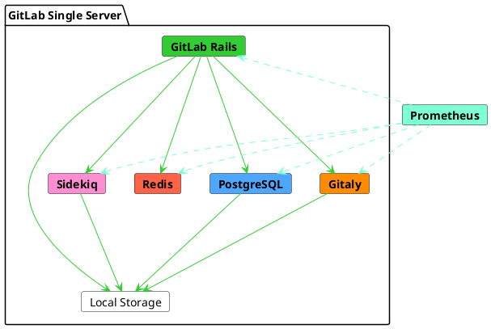



- Tier: 基础版，专业版，旗舰版
- Offering: 私有化部署



此参考架构的目标峰值负载为每秒 20 个请求（RPS）。根据真实数据，此负载通常对应最多 1,000 名用户，其中既包括手动交互，也包括自动交互。

有关参考架构的完整列表，请参阅[可用的参考架构](_index.md#available-reference-architectures)。

- **目标负载**：API：20 RPS，Web：2 RPS，Git（拉取）：2 RPS，Git（推送）：1 RPS
- **高可用性**：否。如需高可用环境，
  请遵循修改后的 [3K 参考架构](3k_users.md#supported-modifications-for-lower-user-counts-ha)。
- **Cloud Native Hybrid**：否。如需云原生混合环境，
  您可以遵循[修改后的混合参考架构](#cloud-native-hybrid-reference-architecture-with-helm-charts)。
- **不确定该使用哪个参考架构**？有关更多信息，请参阅[决定从哪个架构开始](_index.md#deciding-which-architecture-to-start-with)。

| 用户数        | 配置        | GCP 示例[^machine-types] | AWS 示例[^machine-types] | Azure 示例[^machine-types] |
|--------------|----------------------|----------------|--------------|----------|
| 最多 1,000 名用户或 20 RPS | 8 vCPU，16 GB 内存 | `n1-standard-8`[^custom-machine-type] | `c5.2xlarge` | `F8s v2` |

[^machine-types]: 机器类型示例仅用于说明。这些类型用于[验证和测试](_index.md#how-specifications-are-derived)，但并非规定性的默认值。支持改用满足所列要求的其他机器类型，包括可用的 ARM 变体。有关更多信息，请参阅[支持的机器类型](_index.md#how-specifications-are-derived)。
[^custom-machine-type]: 对于 GCP，已选择最接近且等效的标准机器类型，以匹配推荐的 8 vCPU 和 16 GB 内存要求。如有需要，也可以使用[自定义机器类型](https://docs.cloud.google.com/compute/docs/instances/creating-instance-with-custom-machine-type)。

下图表明，虽然极狐GitLab 可以安装在单台服务器上，但它在内部由多个服务组成。当实例扩容时，这些服务会被分离，并根据各自的特定需求独立扩缩。

在某些情况下，您可以对部分服务使用 PaaS。例如，您可以对某些文件系统使用云对象存储。为了实现冗余，某些服务会变成节点集群并存储相同的数据。

在横向扩缩的极狐GitLab 配置中，需要各种辅助服务来协调集群或发现资源。例如，用于 PostgreSQL 连接管理的 PgBouncer，或用于 Prometheus 端点发现的 Consul。

## 要求

在继续之前，请查看参考架构的[要求](_index.md#requirements)。

> [!warning]
> 节点的规格基于使用模式和代码仓库规模在良好状态下的高百分位数。
> 但是，如果您有[大型单体仓库](../../install/sizing.md#large-monorepos)（大于数 GB）或[额外工作负载](_index.md#additional-workloads)，它们可能会显著影响环境的性能。
> 如果这适用于您，[可能需要进一步调整](_index.md#scaling-an-environment)。请参阅链接的文档，如有需要请联系我们以获取进一步指导。

## 测试方法

20 RPS / 1k 用户参考架构旨在满足大多数常见工作流。极狐GitLab 会定期针对以下端点吞吐量目标进行冒烟测试和性能测试：

| 端点类型 | 目标吞吐量 |
| ------------- | ----------------- |
| API           | 20 RPS            |
| Web           | 2 RPS             |
| Git（拉取）    | 2 RPS             |
| Git（推送）    | 1 RPS             |

这些目标基于实际客户数据，反映了指定用户数下的环境总负载，包括 CI 流水线和其他工作负载。这代表了典型的工作负载构成。有关非典型工作负载模式的指导，请参阅[了解 RPS 构成](../../install/sizing.md#understanding-rps-composition-and-workload-patterns)。

有关测试方法的更多信息，请参阅[验证和测试结果](_index.md#how-specifications-are-derived)部分。

### 性能注意事项

如果您的环境存在以下情况，您可能需要额外调整：

- 吞吐量持续高于所列目标
- [大型单体仓库](../../install/sizing.md#large-monorepos)
- 大量[额外工作负载](_index.md#additional-workloads)

在这些情况下，请参阅[扩展环境](_index.md#scaling-an-environment)以获取更多信息。如果您认为这些注意事项可能适用于您，请根据需要联系我们以获取额外指导。

## 设置说明

要为此默认参考架构安装极狐GitLab，请使用标准的[安装说明](../../install/_index.md)。

您也可以选择将极狐GitLab 配置为使用[外部 PostgreSQL 服务](../postgresql/external.md)或[外部对象存储服务](../object_storage.md)。这可以提高性能和可靠性，但会增加复杂性成本。

## 配置高级搜索



- Tier: 专业版，旗舰版
- Offering: 私有化部署



您可以利用 Elasticsearch 并[启用高级搜索](../../integration/advanced_search/elasticsearch.md)，
以便在整个极狐GitLab 实例中实现更快、更高级的代码搜索。

Elasticsearch 集群的设计和要求取决于您的
数据。有关如何将 Elasticsearch
集群与您的实例一起设置的建议最佳实践，请参阅[选择最优集群配置](../../integration/advanced_search/elasticsearch.md#guidance-on-choosing-optimal-cluster-configuration)。

## 使用 Helm Charts 的 Cloud Native Hybrid 参考架构

在 Cloud Native Hybrid 参考架构设置中，选定的无状态
组件通过我们的官方 [Helm Charts](https://gitlab.cn/docs/charts/) 部署在 Kubernetes 中。
有状态组件则使用 Linux 软件包部署在计算虚拟机上。

可在 Kubernetes 中使用的最小参考架构是 [2k 或 40 RPS 极狐GitLab Cloud Native Hybrid](2k_users.md#cloud-native-hybrid-reference-architecture-with-helm-charts-alternative)（非高可用）和 [3k 或 60 RPS 极狐GitLab Cloud Native Hybrid](3k_users.md#cloud-native-hybrid-reference-architecture-with-helm-charts-alternative)（高可用）。

对于服务较少用户或较低 RPS 的环境，您可以降低节点规格。根据您的用户数，您可以按需降低所有建议的节点规格。但是，不应低于[一般要求](../../install/requirements.md)。

## 后续步骤

现在您已拥有一个全新的极狐GitLab 环境，并已相应配置了核心功能。您可能希望根据自身需求配置其他可选的极狐GitLab 功能。有关更多信息，请参阅[安装极狐GitLab 后的步骤](../../install/next_steps.md)。

> [!note]
> 根据您的环境和需求，设置其他功能可能需要额外的硬件要求或调整。有关更多信息，请参阅各个页面。
