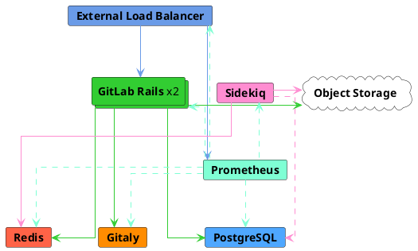
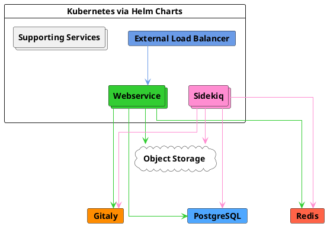



- Tier: 基础版，专业版，旗舰版
- Offering: 私有化部署



本页介绍极狐GitLab 参考架构，其设计目标为峰值负载 40 请求/秒（RPS），即基于真实数据得出的最多 2,000 名用户（包括手动和自动操作）的典型峰值负载。

有关参考架构的完整列表，请参阅[可用参考架构](_index.md#available-reference-architectures)。

- **目标负载**：API：40 RPS，Web：4 RPS，Git（拉取）：4 RPS，Git（推送）：1 RPS
- **高可用性**：否。如需高可用环境，您可以
  遵循经过修改的 [3K 或 60 RPS 参考架构](3k_users.md#supported-modifications-for-lower-user-counts-ha)。
- **Cloud Native Hybrid**：[是](#cloud-native-hybrid-reference-architecture-with-helm-charts-alternative)
- **不确定该使用哪个参考架构**？[请参阅本指南了解更多信息](_index.md#deciding-which-architecture-to-start-with)。

| 服务                                         | 节点 | 配置          | GCP 示例[^machine-types] | AWS 示例[^machine-types] | Azure 示例[^machine-types] |
|-------------------------------------------------|-------|------------------------|-----------------------------|-----------------------------|-------------------------------|
| 外部负载均衡器[^external-load-balancer] | 1     | 4 vCPU，3.6 GB 内存  | `n1-highcpu-4`              | `c5n.xlarge`                | `F4s v2`                      |
| PostgreSQL[^external-database]                  | 1     | 2 vCPU，7.5 GB 内存  | `n1-standard-2`             | `m5.large`                  | `D2s v3`                      |
| Redis[^external-cache]                          | 1     | 1 vCPU，3.75 GB 内存 | `n1-standard-1`             | `m5.large`                  | `D2s v3`                      |
| Gitaly[^storage-specs-normal-repos]             | 1     | 4 vCPU，15 GB 内存   | `n1-standard-4`             | `m5.xlarge`                 | `D4s v3`                      |
| Sidekiq[^auto-scaling-groups]                   | 1     | 4 vCPU，15 GB 内存   | `n1-standard-4`             | `m5.xlarge`                 | `D4s v3`                      |
| GitLab Rails[^auto-scaling-groups]              | 2     | 8 vCPU，7.2 GB 内存  | `n1-highcpu-8`              | `c5.2xlarge`                | `F8s v2`                      |
| 监控节点                                 | 1     | 2 vCPU，1.8 GB 内存  | `n1-highcpu-2`              | `c5.large`                  | `F2s v2`                      |
| 对象存储[^external-object-storage]        | -     | -                      | -                           | -                           | -                             |

[^machine-types]: 机器类型示例仅供参考。这些类型用于[验证和测试](_index.md#how-specifications-are-derived)，但并非规定性的默认值。支持改用满足所列要求的其他机器类型，包括可用的 ARM 变体。更多信息，请参阅[支持的机器类型](_index.md#how-specifications-are-derived)。
[^external-database]: 可选择在信誉良好的第三方外部 PaaS PostgreSQL 解决方案上运行。更多信息，请参阅[提供您自己的 PostgreSQL 实例](#provide-your-own-postgresql-instance)和[基础设施与服务](_index.md#infrastructure-and-services)。
[^external-cache]: 可选择在信誉良好的第三方外部 PaaS Redis 解决方案上运行。更多信息，请参阅[提供您自己的 Redis 实例](#provide-your-own-redis-instance)和[基础设施与服务](_index.md#infrastructure-and-services)。
[^external-load-balancer]: 建议使用信誉良好的第三方负载均衡器或服务（LB PaaS）运行。
    规格取决于所选的负载均衡器以及网络带宽等其他因素。
[^external-object-storage]: 应在信誉良好的云服务商或自管理解决方案上运行。更多信息，请参阅[配置对象存储](#configure-the-object-storage)。
[^storage-specs-normal-repos]: Gitaly 规格基于使用状况良好、大小正常的代码仓库。
    但是，如果您有大型单体仓库（大于数 GB），这可能会显著影响 Git 和 Gitaly 性能，很可能需要提高规格。
    更多信息，请参阅[大型单体仓库](../../install/sizing.md#large-monorepos)。
[^auto-scaling-groups]: 可以放置在自动扩缩组（ASG）中，因为该组件不存储任何[有状态数据](../../install/sizing.md#autoscaling)。
    不过，通常更推荐 [Cloud Native Hybrid 部署](#cloud-native-hybrid-reference-architecture-with-helm-charts-alternative)，因为某些组件
    如[迁移](#gitlab-rails-post-configuration)和 [Mailroom](../incoming_email.md) 只能在一个节点上运行，而在 Kubernetes 中处理得更好。

> [!note]
> 对于所有涉及配置实例的 PaaS 解决方案，如有需要，建议将其部署在多个可用区上以提高韧性。



<a id="requirements"></a>

## 要求

在继续之前，请查看参考架构的[要求](_index.md#requirements)。

<a id="testing-methodology"></a>

## 测试方法

40 RPS / 2k 用户参考架构旨在满足大多数常见工作流。极狐GitLab 会定期针对以下端点吞吐量目标进行冒烟测试和性能测试：

| 端点类型 | 目标吞吐量 |
|---------------|-------------------|
| API           | 40 RPS            |
| Web           | 4 RPS             |
| Git（拉取）    | 4 RPS             |
| Git（推送）    | 1 RPS             |

这些目标基于实际客户数据，反映了指定用户数量下的环境总负载，包括 CI 流水线和其他工作负载。这代表了典型的工作负载构成。有关非典型工作负载模式的指导，请参阅[了解 RPS 构成](../../install/sizing.md#understanding-rps-composition-and-workload-patterns)。

有关测试方法的更多信息，请参阅[验证和测试结果](_index.md#how-specifications-are-derived)部分。

<a id="performance-considerations"></a>

### 性能注意事项

如果您的环境存在以下情况，可能需要额外调整：

- 吞吐量持续高于所列目标
- [大型单体仓库](../../install/sizing.md#large-monorepos)
- 大量[额外工作负载](_index.md#additional-workloads)

在这些情况下，请参阅[扩展环境](_index.md#scaling-an-environment)了解更多信息。如果您认为这些注意事项可能适用于您，请根据需要联系我们获取更多指导。

<a id="load-balancer-configuration"></a>

### 负载均衡器配置

我们的测试环境使用：

- Linux 软件包环境使用 HAProxy
- Cloud Native Hybrid 使用云服务商提供的等效方案，并采用 Gateway API 或 Ingress 实现

<a id="set-up-components"></a>

## 设置组件

要将极狐GitLab 及其组件设置为支持最多 40 RPS 或 2,000 名用户：

1. [配置外部负载均衡节点](#configure-the-external-load-balancer)
   以处理极狐GitLab 应用服务节点的负载均衡。
1. [配置 PostgreSQL](#configure-postgresql)，即极狐GitLab 的数据库。
1. [配置 Redis](#configure-redis)，用于存储会话数据、临时
   缓存信息和后台作业队列。
1. [配置 Gitaly](#configure-gitaly)，用于提供对 Git
   代码仓库的访问。
1. [配置 Sidekiq](#configure-sidekiq) 以进行后台作业处理。
1. [配置主 GitLab Rails 应用](#configure-gitlab-rails)
   以运行 Puma、Workhorse、GitLab Shell，并处理所有前端
   请求（包括 UI、API 和通过 HTTP/SSH 的 Git）。
1. [配置 Prometheus](#configure-prometheus) 以监控您的极狐GitLab
   环境。
1. [配置对象存储](#configure-the-object-storage)，用于
   共享数据对象。
1. [配置高级搜索](#configure-advanced-search)（可选），以便在整个极狐GitLab 实例中实现更快、
   更高级的代码搜索。

<a id="configure-the-external-load-balancer"></a>

## 配置外部负载均衡器

在多节点极狐GitLab 配置中，您需要一个外部负载均衡器将流量路由到应用服务器。

关于使用哪个负载均衡器或其确切配置的具体细节超出了极狐GitLab 文档的范围，但有关一般要求，请参阅[负载均衡器](_index.md)。本节将重点介绍针对您所选负载均衡器需要配置的具体内容。

<a id="readiness-checks"></a>

### 就绪检查

确保外部负载均衡器仅路由到具有内置监控端点的正常服务。[就绪检查](../monitoring/health_check.md)都需要在被检查的节点上进行[额外配置](../monitoring/ip_allowlist.md)，否则外部负载均衡器将无法连接。

<a id="ports"></a>

### 端口

要使用的基本端口如下表所示。

| LB 端口 | 后端端口 | 协议 |
|---------|--------------|----------|
| 80      | 80           | HTTP[^web-terminal-support] |
| 443     | 443          | TCP 或 HTTPS[^web-terminal-support]，[^ssl-certificate] |
| 22      | 22           | TCP      |

[^web-terminal-support]: [Web 终端](../../ci/environments/_index.md#web-terminals-deprecated)支持要求
    您的负载均衡器正确处理 WebSocket 连接。

    使用 HTTP 或 HTTPS 代理时，这意味着您的负载均衡器必须配置为
    透传 `Connection` 和 `Upgrade` 逐跳请求头。更多详情，请参阅
    [Web 终端](../integration/terminal.md)集成指南。
[^ssl-certificate]: 对端口 443 使用 HTTPS 协议时，必须向负载均衡器添加 SSL
    证书。如果您希望在
    极狐GitLab 应用服务器上终止 SSL，请改用 TCP 协议。

如果您使用支持自定义域名的 GitLab Pages，则需要一些额外的端口配置。
GitLab Pages 需要单独的虚拟 IP 地址。配置 DNS，将
`/etc/gitlab/gitlab.rb`中的 `pages_external_url` 指向新的虚拟 IP 地址。更多信息，请参阅
[GitLab Pages 文档](../pages/_index.md)。

| LB 端口 | 后端端口          | 协议 |
|---------|-----------------------|----------|
| 80      | 视情况而定[^backend-port] | HTTP     |
| 443     | 视情况而定[^backend-port] | TCP[^tcp-protocol] |

[^backend-port]: GitLab Pages 的后端端口取决于
    `gitlab_pages['external_http']` 和 `gitlab_pages['external_https']`
    设置。更多详情，请参阅 [GitLab Pages 文档](../pages/_index.md)。
[^tcp-protocol]: GitLab Pages 的端口 443 应始终使用 TCP 协议。用户可以
    使用自定义 SSL 配置自定义域名，如果
    在负载均衡器上终止 SSL，则无法实现这一点。

<a id="alternate-ssh-port"></a>

#### 备用 SSH 端口

某些组织的策略禁止打开 SSH 端口 22。在这种情况下，配置一个备用 SSH 主机名可能会有所帮助，它允许用户在端口 443 上使用 SSH。与其他已记录的极狐GitLab HTTP 配置相比，备用 SSH 主机名需要一个新的虚拟 IP 地址。

为备用 SSH 主机名（如 `altssh.gitlab.example.com`）配置 DNS。

| LB 端口 | 后端端口 | 协议 |
| ------- | ------------ | -------- |
| 443     | 22           | TCP      |

<a id="ssl"></a>

### SSL

接下来的问题是如何在您的环境中处理 SSL。有几种不同的选项：

- [应用节点终止 SSL](#application-node-terminates-ssl)。
- [负载均衡器终止 SSL，不使用后端 SSL](#load-balancer-terminates-ssl-without-backend-ssl)，
  负载均衡器与应用节点之间的通信不安全。
- [负载均衡器终止 SSL，使用后端 SSL](#load-balancer-terminates-ssl-with-backend-ssl)，
  负载均衡器与应用节点之间的通信安全。

<a id="application-node-terminates-ssl"></a>

#### 应用节点终止 SSL

将您的负载均衡器配置为以 `TCP` 而非 `HTTP(S)` 协议传递端口 443 上的连接。这样会将连接原样传递到应用节点的
NGINX 服务。NGINX 将持有 SSL 证书并监听端口 443。

有关管理 SSL 证书和配置 NGINX 的详细信息，请参阅 [HTTPS 文档](https://gitlab.cn/docs/omnibus/settings/ssl/)。

<a id="load-balancer-terminates-ssl-without-backend-ssl"></a>

#### 负载均衡器终止 SSL，不使用后端 SSL

将您的负载均衡器配置为使用 `HTTP(S)` 协议而非 `TCP`。负载均衡器将负责管理 SSL 证书并
终止 SSL。

由于负载均衡器与极狐GitLab 之间的通信不安全，需要进行一些额外配置。详情请参阅[代理 SSL 文档](https://gitlab.cn/docs/omnibus/settings/ssl/#configure-a-reverse-proxy-or-load-balancer-ssl-termination)。

<a id="load-balancer-terminates-ssl-with-backend-ssl"></a>

#### 负载均衡器终止 SSL，使用后端 SSL

将您的负载均衡器配置为使用 'HTTP(S)' 协议而非 'TCP'。负载均衡器将负责管理最终用户将看到的 SSL 证书。

在这种情况下，负载均衡器与 NGINX 之间的流量也是安全的。无需为代理 SSL 添加配置，因为连接全程都是安全的。但是，必须在极狐GitLab 中添加配置以配置 SSL 证书。有关管理 SSL 证书和配置 NGINX 的详细信息，请参阅
[HTTPS 文档](https://gitlab.cn/docs/omnibus/settings/ssl/)。

<div align="right">
  <a type="button" class="btn btn-default" href="#set-up-components">
    返回设置组件 <i class="fa fa-angle-double-up" aria-hidden="true"></i>
  </a>
</div>

<a id="configure-postgresql"></a>

## 配置 PostgreSQL

本节将指导您配置与极狐GitLab 一起使用的外部 PostgreSQL 数据库。

<a id="provide-your-own-postgresql-instance"></a>

### 提供您自己的 PostgreSQL 实例

您可以使用[第三方外部 PostgreSQL 服务](../postgresql/external.md)，而不使用 Linux 软件包内置的 PostgreSQL、PgBouncer 和 Consul 服务发现组件。

请使用运行[受支持的 PostgreSQL 版本](../../install/requirements.md#postgresql)的信誉良好的提供商。以下服务已知可正常工作：

- [Google Cloud SQL](https://cloud.google.com/sql/docs/postgres/high-availability#normal)。
- [Amazon RDS](https://aws.amazon.com/rds/)。

有关更多信息，包括高可用性和数据库负载均衡的指导，请参阅：

- [基础设施与服务](_index.md#infrastructure-and-services)。
- [数据库服务最佳实践](../../install/cloud-services.md#use-managed-cloud-postgresql)。

如果您使用第三方外部服务：

1. 根据[数据库要求文档](../../install/requirements.md#postgresql)设置 PostgreSQL。
1. 配置所需的[用户和数据库](../postgresql/external.md)。
1. 按照[配置 GitLab Rails](#configure-gitlab-rails)，使用适当的连接详细信息配置极狐GitLab 应用服务器。

<a id="standalone-postgresql-using-the-linux-package"></a>

### 使用 Linux 软件包的独立 PostgreSQL

1. 通过 SSH 登录到 PostgreSQL 服务器。
1. [下载并安装](../../install/package/_index.md#supported-platforms)您选择的 Linux
   软件包。请确保仅添加极狐GitLab 软件包仓库，并为您选择的操作系统安装极狐GitLab。
1. 为 PostgreSQL 生成密码哈希。这里假设您将使用默认
   用户名 `gitlab`（推荐）。该命令将要求输入密码
   并确认。在下一步中，将本命令输出的值用作
   `POSTGRESQL_PASSWORD_HASH`的值。

   ```shell
   sudo gitlab-ctl pg-password-md5 gitlab
   ```

1. 编辑 `/etc/gitlab/gitlab.rb` 并添加以下内容，适当更新占位符
   值。

   - `POSTGRESQL_PASSWORD_HASH` - 上一步输出的值
   - `APPLICATION_SERVER_IP_BLOCKS` - 以空格分隔的 IP 子网或 IP
     地址列表，这些是连接到
     数据库的 GitLab Rails 和 Sidekiq 服务器。示例：`%w(123.123.123.123/32 123.123.123.234/32)`

   ```ruby
   # Disable all components except PostgreSQL related ones
   roles(['postgres_role'])

   # Set the network addresses that the exporters used for monitoring will listen on
   node_exporter['listen_address'] = '0.0.0.0:9100'
   postgres_exporter['listen_address'] = '0.0.0.0:9187'
   postgres_exporter['dbname'] = 'gitlabhq_production'
   postgres_exporter['password'] = 'POSTGRESQL_PASSWORD_HASH'

   # Set the PostgreSQL address and port
   postgresql['listen_address'] = '0.0.0.0'
   postgresql['port'] = 5432

   # Replace POSTGRESQL_PASSWORD_HASH with a generated md5 value
   postgresql['sql_user_password'] = 'POSTGRESQL_PASSWORD_HASH'

   # Replace APPLICATION_SERVER_IP_BLOCK with the CIDR address of the application node
   postgresql['trust_auth_cidr_addresses'] = %w(127.0.0.1/32 APPLICATION_SERVER_IP_BLOCK)

   # Prevent database migrations from running on upgrade automatically
   gitlab_rails['auto_migrate'] = false
   ```

1. 从您配置的第一个 Linux 软件包节点复制 `/etc/gitlab/gitlab-secrets.json` 文件，并在此服务器上添加或替换
   同名文件。如果这是您配置的第一个 Linux 软件包，则可以跳过此步骤。
1. [重新配置极狐GitLab](../restart_gitlab.md#reconfigure-a-linux-package-installation) 以使更改生效。
1. 记下 PostgreSQL 节点的 IP 地址或主机名、端口和
   明文密码。稍后配置
   [极狐GitLab 应用服务器](#configure-gitlab-rails)时需要这些详细信息。

支持高级[配置选项](https://gitlab.cn/docs/omnibus/settings/database/)，如有需要可以添加。

<div align="right">
  <a type="button" class="btn btn-default" href="#set-up-components">
    返回设置组件 <i class="fa fa-angle-double-up" aria-hidden="true"></i>
  </a>
</div>

<a id="configure-redis"></a>

## 配置 Redis

本节将指导您配置与极狐GitLab 一起使用的外部 Redis 实例。

> [!note]
> Redis 主要是单线程的，增加 CPU 核心数不会带来显著收益。
> 更多信息，请参阅[扩展文档](_index.md#scaling-an-environment)。

<a id="provide-your-own-redis-instance"></a>

### 提供您自己的 Redis 实例

您可以选择使用[第三方外部 Redis 实例服务](../redis/replication_and_failover_external.md#redis-as-a-managed-service-in-a-cloud-provider)，并遵循以下指导：

- 应为此使用信誉良好的提供商或解决方案。[Google Memorystore](https://docs.cloud.google.com/memorystore/docs/redis/memorystore-for-redis-overview) 和 [AWS ElastiCache](https://docs.aws.amazon.com/AmazonElastiCache/latest/dg/WhatIs.html) 已知可正常工作。
- 特别不支持 Redis Cluster 模式，但支持带 HA 的 Redis Standalone。
- 您必须根据您的设置设置 [Redis 逐出模式](../redis/replication_and_failover_external.md#setting-the-eviction-policy)。

更多信息，请参阅[基础设施与服务](_index.md#infrastructure-and-services)。

<a id="standalone-redis-using-the-linux-package"></a>

### 使用 Linux 软件包的独立 Redis

可以使用 Linux 软件包配置独立的 Redis 服务器。以下步骤是使用 Linux 软件包配置 Redis 服务器所需的最少步骤：

1. 通过 SSH 登录到 Redis 服务器。
1. [下载并安装](../../install/package/_index.md#supported-platforms)您选择的 Linux
   软件包。请确保仅添加极狐GitLab 软件包仓库，并为您选择的操作系统安装极狐GitLab。
1. 编辑 `/etc/gitlab/gitlab.rb` 并添加以下内容：

   ```ruby
   ## Enable Redis
   roles(["redis_master_role"])

   redis['bind'] = '0.0.0.0'
   redis['port'] = 6379
   redis['password'] = 'SECRET_PASSWORD_HERE'

   # Set the network addresses that the exporters used for monitoring will listen on
   node_exporter['listen_address'] = '0.0.0.0:9100'
   redis_exporter['listen_address'] = '0.0.0.0:9121'

   # Prevent database migrations from running on upgrade automatically
   gitlab_rails['auto_migrate'] = false
   ```

1. 从您配置的第一个 Linux 软件包节点复制 `/etc/gitlab/gitlab-secrets.json` 文件，并在此服务器上添加或替换
   同名文件。如果这是您配置的第一个 Linux 软件包节点，则可以跳过此步骤。
1. [重新配置极狐GitLab](../restart_gitlab.md#reconfigure-a-linux-package-installation) 以使更改生效。
1. 记下 Redis 节点的 IP 地址或主机名、端口和
   Redis 密码。稍后
   [配置极狐GitLab 应用服务器](#configure-gitlab-rails)时需要这些信息。

支持高级[配置选项](https://gitlab.cn/docs/omnibus/settings/redis/)，如有需要可以添加。

<div align="right">
  <a type="button" class="btn btn-default" href="#set-up-components">
    返回设置组件 <i class="fa fa-angle-double-up" aria-hidden="true"></i>
  </a>
</div>

<a id="configure-gitaly"></a>

## 配置 Gitaly

[Gitaly](../gitaly/_index.md) 服务器节点的要求取决于数据大小，具体来说是项目数量及这些项目的大小。

> [!warning]
> Gitaly 规格基于使用模式和代码仓库大小在状况良好时的高百分位数。
> 但是，如果您有[大型单体仓库](../../install/sizing.md#large-monorepos)（大于数 GB）或[额外工作负载](_index.md#additional-workloads)，这些可能会显著影响环境性能，可能需要进一步调整。
> 如果您认为这适用于您，请根据需要联系我们获取更多指导。

Gitaly 对 Gitaly 存储有特定的[磁盘要求](../gitaly/_index.md#disk-requirements)。

请务必注意以下事项：

- GitLab Rails 应用将代码仓库分片到
  [代码仓库存储路径](../repository_storage_paths.md)。
- 一个 Gitaly 服务器可以托管一个或多个存储路径。
- 一个极狐GitLab 服务器可以使用一个或多个 Gitaly 服务器节点。
- 必须指定 Gitaly 地址，以便所有
  Gitaly 客户端都能正确解析。
- Gitaly 服务器不得暴露到公共互联网，因为 Gitaly 上的网络流量
  默认未加密。强烈建议使用防火墙
  限制对 Gitaly 服务器的访问。另一种选择是
  [使用 TLS](#gitaly-tls-support)。

> [!note]
> Gitaly 文档中通篇提到的令牌是管理员
> 选择的任意密码。此令牌与为极狐GitLab API 或其他类似 Web API 令牌
> 创建的令牌无关。

以下过程介绍如何配置一个名为 `gitaly1.internal`的 Gitaly 服务器，其密钥令牌为 `gitalysecret`。我们假设您的极狐GitLab 安装有两个代码仓库存储：`default` 和 `storage1`。

要配置 Gitaly 服务器，请在您想用于 Gitaly 的服务器节点上：

1. [下载并安装](../../install/package/_index.md#supported-platforms)您选择的 Linux 软件包。
   请确保仅添加极狐GitLab
   软件包仓库，并为您选择的操作系统安装极狐GitLab，
   但不要提供 `EXTERNAL_URL` 值。
1. 编辑 Gitaly 服务器节点的 `/etc/gitlab/gitlab.rb` 文件，以配置
   存储路径、启用网络监听器并配置令牌：

   > [!note]
   > 您不能从 `gitaly['configuration'][:storage]` 中移除 `default` 条目，因为[极狐GitLab 需要它](../gitaly/configure_gitaly.md#gitlab-requires-a-default-repository-storage)。

   <!--
   Updates to example must be made at:

   - <https://gitlab.com/gitlab-org/charts/gitlab/blob/master/doc/advanced/external-gitaly/external-omnibus-gitaly.md#configure-linux-package-installation>
   - <https://gitlab.com/gitlab-org/gitlab/-/blob/master/doc/administration/gitaly/configure_gitaly.md#configure-gitaly-server>
   - All reference architecture pages
   -->

   ```ruby
   # https://docs.gitlab.com/omnibus/roles/#gitaly-roles
   roles(["gitaly_role"])

   # Prevent database migrations from running on upgrade automatically
   gitlab_rails['auto_migrate'] = false

   # Configure the gitlab-shell API callback URL. Without this, `git push` will
   # fail. This can be your 'front door' GitLab URL or an internal load
   # balancer.
   gitlab_rails['internal_api_url'] = 'https://gitlab.example.com'

   # Set the network addresses that the exporters used for monitoring will listen on
   node_exporter['listen_address'] = '0.0.0.0:9100'

   gitaly['configuration'] = {
      # ...
      #
      # Make Gitaly accept connections on all network interfaces. You must use
      # firewalls to restrict access to this address/port.
      # Comment out following line if you only want to support TLS connections
      listen_addr: '0.0.0.0:8075',
      prometheus_listen_addr: '0.0.0.0:9236',
      # Gitaly Auth Token
      # Should be the same as praefect_internal_token
      auth: {
         # ...
         #
         # Gitaly's authentication token is used to authenticate gRPC requests to Gitaly. This must match
         # the respective value in GitLab Rails application setup.
         token: 'gitalysecret',
      },
      # Gitaly Pack-objects cache
      # Recommended to be enabled for improved performance but can notably increase disk I/O
      # Refer to https://docs.gitlab.com/administration/gitaly/configure_gitaly/#pack-objects-cache for more info
      pack_objects_cache: {
         # ...
         enabled: true,
      },
      storage: [
         {
            name: 'default',
            path: '/var/opt/gitlab/git-data/repositories',
         },
         {
            name: 'storage1',
            path: '/mnt/gitlab/git-data',
         },
      ],
   }
   ```

1. 从您配置的第一个 Linux 软件包节点复制 `/etc/gitlab/gitlab-secrets.json` 文件，并在此服务器上添加或替换
   同名文件。如果这是您配置的第一个 Linux 软件包节点，则可以跳过此步骤。
1. [重新配置极狐GitLab](../restart_gitlab.md#reconfigure-a-linux-package-installation) 以使更改生效。
1. 通过运行以下命令确认 Gitaly 可以对内部 API 执行回调：
   `sudo -u git -- /opt/gitlab/embedded/bin/gitaly check /var/opt/gitlab/gitaly/config.toml`。

<a id="gitaly-tls-support"></a>

### Gitaly TLS 支持

Gitaly 支持 TLS 加密。要与
监听安全连接的 Gitaly 实例通信，您必须在极狐GitLab 配置中相应存储条目的 `gitaly_address`中使用 `tls://` URL 方案。

您必须自备证书，因为不会自动提供。证书或其证书颁发机构必须按照[极狐GitLab 自定义证书配置](https://gitlab.cn/docs/omnibus/settings/ssl/#install-custom-public-certificates)中描述的过程，安装到所有 Gitaly 节点（包括使用该证书的 Gitaly 节点）以及所有与其通信的客户端节点上。

> [!note]
> 自签名证书必须指定您用于访问
> Gitaly 服务器的地址。如果您通过主机名访问 Gitaly 服务器，请将其添加为主题备用
> 名称。如果您通过 IP 地址访问 Gitaly 服务器，则必须将其
> 作为主题备用名称添加到证书中。

可以同时为 Gitaly 服务器配置未加密的监听地址（`listen_addr`）和加密的监听地址（`tls_listen_addr`）。如有必要，这允许您从未加密流量逐步过渡到加密流量。

要使用 TLS 配置 Gitaly：

1. 创建 `/etc/gitlab/ssl` 目录并将您的密钥和证书复制到那里：

   ```shell
   sudo mkdir -p /etc/gitlab/ssl
   sudo chmod 755 /etc/gitlab/ssl
   sudo cp key.pem cert.pem /etc/gitlab/ssl/
   sudo chmod 644 key.pem cert.pem
   ```

1. 将证书复制到 `/etc/gitlab/trusted-certs`，以便 Gitaly 在
   调用自身时信任该证书：

   ```shell
   sudo cp /etc/gitlab/ssl/cert.pem /etc/gitlab/trusted-certs/
   ```

1. 编辑 `/etc/gitlab/gitlab.rb` 并添加：

   <!-- Updates to following example must also be made at <https://gitlab.com/gitlab-org/charts/gitlab/blob/master/doc/advanced/external-gitaly/external-omnibus-gitaly.md#configure-omnibus-gitlab> -->

   ```ruby
   gitaly['configuration'] = {
      # ...
      tls_listen_addr: '0.0.0.0:9999',
      tls: {
         certificate_path: '/etc/gitlab/ssl/cert.pem',
         key_path: '/etc/gitlab/ssl/key.pem',
      },
   }
   ```

1. 删除 `gitaly['listen_addr']` 以仅允许加密连接。
1. 保存文件并[重新配置极狐GitLab](../restart_gitlab.md#reconfigure-a-linux-package-installation)。

<div align="right">
  <a type="button" class="btn btn-default" href="#set-up-components">
    返回设置组件 <i class="fa fa-angle-double-up" aria-hidden="true"></i>
  </a>
</div>

<a id="configure-sidekiq"></a>

## 配置 Sidekiq

Sidekiq 需要连接到 [Redis](#configure-redis)、
[PostgreSQL](#configure-postgresql) 和 [Gitaly](#configure-gitaly) 实例。
按照建议，它还需要连接到[对象存储](#configure-the-object-storage)。

如果您发现环境的 Sidekiq 作业处理缓慢且队列很长，可以相应地进行扩展。更多信息，请参阅[扩展文档](_index.md#scaling-an-environment)。

在配置容器镜像仓库、SAML 或 LDAP 等其他极狐GitLab 功能时，
除 Rails 配置外，还要更新 Sidekiq 配置。
更多信息，请参阅[外部 Sidekiq 文档](../sidekiq/_index.md)。

要配置 Sidekiq 服务器，请在您想用于 Sidekiq 的服务器节点上：

1. 通过 SSH 登录到 Sidekiq 服务器。
1. 确认您可以访问 PostgreSQL、Gitaly 和 Redis 端口：

   ```shell
   telnet <GitLab host> 5432 # PostgreSQL
   telnet <GitLab host> 8075 # Gitaly
   telnet <GitLab host> 6379 # Redis
   ```

1. [下载并安装](../../install/package/_index.md#supported-platforms)您选择的 Linux
   软件包。请确保仅添加极狐GitLab 软件包仓库，并为您选择的操作系统安装极狐GitLab。
1. 创建或编辑 `/etc/gitlab/gitlab.rb` 并使用以下配置：

   ```ruby
   # https://docs.gitlab.com/omnibus/roles/#sidekiq-roles
   roles(["sidekiq_role"])

   # External URL
   external_url 'https://gitlab.example.com'

   ## Redis connection details
   gitlab_rails['redis_port'] = '6379'
   gitlab_rails['redis_host'] = '10.1.0.6' # IP/hostname of Redis server
   gitlab_rails['redis_password'] = 'Redis Password'

   # Gitaly and GitLab use two shared secrets for authentication, one to authenticate gRPC requests
   # to Gitaly, and a second stored in /etc/gitlab/gitlab-secrets.json for authentication callbacks from GitLab-Shell to the GitLab internal API.
   # The following must be the same as their respective values
   # of the Gitaly setup
   gitlab_rails['gitaly_token'] = 'gitalysecret'

   gitlab_rails['repositories_storages'] = {
     'default' => { 'gitaly_address' => 'tcp://gitaly1.internal:8075' },
     'storage1' => { 'gitaly_address' => 'tcp://gitaly1.internal:8075' },
     'storage2' => { 'gitaly_address' => 'tcp://gitaly2.internal:8075' },
   }

   ## PostgreSQL connection details
   gitlab_rails['db_adapter'] = 'postgresql'
   gitlab_rails['db_encoding'] = 'unicode'
   gitlab_rails['db_host'] = '10.1.0.5' # IP/hostname of database server
   gitlab_rails['db_password'] = 'DB password'

   ## Prevent database migrations from running on upgrade automatically
   gitlab_rails['auto_migrate'] = false

   # Sidekiq
   sidekiq['listen_address'] = "0.0.0.0"

   ## Set number of Sidekiq queue processes to the same number as available CPUs
   sidekiq['queue_groups'] = ['*'] * 4

   ## Set the network addresses that the exporters will listen on
   node_exporter['listen_address'] = '0.0.0.0:9100'

   # Object Storage
   ## This is an example for configuring Object Storage on GCP
   ## Replace this config with your chosen Object Storage provider as desired
   gitlab_rails['object_store']['enabled'] = true
   gitlab_rails['object_store']['connection'] = {
     'provider' => 'Google',
     'google_project' => '<gcp-project-name>',
     'google_json_key_location' => '<path-to-gcp-service-account-key>'
   }
   gitlab_rails['object_store']['objects']['artifacts']['bucket'] = "<gcp-artifacts-bucket-name>"
   gitlab_rails['object_store']['objects']['external_diffs']['bucket'] = "<gcp-external-diffs-bucket-name>"
   gitlab_rails['object_store']['objects']['lfs']['bucket'] = "<gcp-lfs-bucket-name>"
   gitlab_rails['object_store']['objects']['uploads']['bucket'] = "<gcp-uploads-bucket-name>"
   gitlab_rails['object_store']['objects']['packages']['bucket'] = "<gcp-packages-bucket-name>"
   gitlab_rails['object_store']['objects']['dependency_proxy']['bucket'] = "<gcp-dependency-proxy-bucket-name>"
   gitlab_rails['object_store']['objects']['terraform_state']['bucket'] = "<gcp-terraform-state-bucket-name>"

   gitlab_rails['backup_upload_connection'] = {
     'provider' => 'Google',
     'google_project' => '<gcp-project-name>',
     'google_json_key_location' => '<path-to-gcp-service-account-key>'
   }
   gitlab_rails['backup_upload_remote_directory'] = "<gcp-backups-state-bucket-name>"
   gitlab_rails['ci_secure_files_object_store_enabled'] = true
   gitlab_rails['ci_secure_files_object_store_remote_directory'] = "<gcp-ci_secure_files-bucket-name>"

   gitlab_rails['ci_secure_files_object_store_connection'] = {
      'provider' => 'Google',
      'google_project' => '<gcp-project-name>',
      'google_json_key_location' => '<path-to-gcp-service-account-key>'
   }
   ```

1. 从您配置的第一个 Linux 软件包节点复制 `/etc/gitlab/gitlab-secrets.json` 文件，并在此服务器上添加或替换
   同名文件。如果这是您配置的第一个 Linux 软件包节点，则可以跳过此步骤。
1. 为确保数据库迁移仅在重新配置期间运行，而不会在升级时自动运行，请运行：

   ```shell
   sudo touch /etc/gitlab/skip-auto-reconfigure
   ```

   如
   [GitLab Rails 配置后](#gitlab-rails-post-configuration)部分所述，只有单个指定节点应处理迁移。
1. 保存文件并[重新配置极狐GitLab](../restart_gitlab.md#reconfigure-a-linux-package-installation)。
1. 验证极狐GitLab 服务正在运行：

   ```shell
   sudo gitlab-ctl status
   ```

   输出应类似于以下内容：

   ```plaintext
   run: logrotate: (pid 192292) 2990s; run: log: (pid 26374) 93048s
   run: node-exporter: (pid 26864) 92997s; run: log: (pid 26446) 93036s
   run: sidekiq: (pid 26870) 92996s; run: log: (pid 26391) 93042s
   ```

<div align="right">
  <a type="button" class="btn btn-default" href="#set-up-components">
    返回设置组件 <i class="fa fa-angle-double-up" aria-hidden="true"></i>
  </a>
</div>

<a id="configure-gitlab-rails"></a>

## 配置 GitLab Rails

本节介绍如何配置极狐GitLab 应用（Rails）组件。

在我们的架构中，我们使用 Puma Web 服务器运行每个 GitLab Rails 节点，并将其工作进程数设置为可用 CPU 的 90%，使用四个线程。对于同时运行 Rails 和其他组件的节点，工作进程值应相应减少。我们已确定工作进程值为 50% 可达到良好的平衡，但这取决于工作负载。

在每个节点上执行以下操作：

1. [下载并安装](../../install/package/_index.md#supported-platforms)您选择的 Linux
   软件包。请确保仅添加极狐GitLab 软件包仓库，并为您选择的操作系统安装极狐GitLab。
1. 创建或编辑 `/etc/gitlab/gitlab.rb` 并使用以下配置。
   为保持各节点间链接的一致性，应用服务器上的 `external_url`
   应指向用户用于访问极狐GitLab 的外部 URL。这将是
   [负载均衡器](#configure-the-external-load-balancer)的 URL，
   它将流量路由到极狐GitLab 应用服务器：

   ```ruby
   external_url 'https://gitlab.example.com'

   # Gitaly and GitLab use two shared secrets for authentication, one to authenticate gRPC requests
   # to Gitaly, and a second stored in /etc/gitlab/gitlab-secrets.json for authentication callbacks from GitLab-Shell to the GitLab internal API.
   # The following must be the same as their respective values
   # of the Gitaly setup
   gitlab_rails['gitaly_token'] = 'gitalysecret'

   gitlab_rails['repositories_storages'] = {
     'default' => { 'gitaly_address' => 'tcp://gitaly1.internal:8075' },
     'storage1' => { 'gitaly_address' => 'tcp://gitaly1.internal:8075' },
     'storage2' => { 'gitaly_address' => 'tcp://gitaly2.internal:8075' },
   }

   ## Disable components that will not be on the GitLab application server
   roles(['application_role'])
   gitaly['enable'] = false
   sidekiq['enable'] = false

   ## PostgreSQL connection details
   gitlab_rails['db_adapter'] = 'postgresql'
   gitlab_rails['db_encoding'] = 'unicode'
   gitlab_rails['db_host'] = '10.1.0.5' # IP/hostname of database server
   gitlab_rails['db_password'] = 'DB password'

   ## Redis connection details
   gitlab_rails['redis_port'] = '6379'
   gitlab_rails['redis_host'] = '10.1.0.6' # IP/hostname of Redis server
   gitlab_rails['redis_password'] = 'Redis Password'

   # Set the network addresses that the exporters used for monitoring will listen on
   node_exporter['listen_address'] = '0.0.0.0:9100'
   gitlab_workhorse['prometheus_listen_addr'] = '0.0.0.0:9229'
   puma['listen'] = '0.0.0.0'

   # Add the monitoring node's IP address to the monitoring whitelist and allow it to
   # scrape the NGINX metrics. Replace placeholder `monitoring.gitlab.example.com` with
   # the address and/or subnets gathered from the monitoring node
   gitlab_rails['monitoring_whitelist'] = ['<MONITOR NODE IP>/32', '127.0.0.0/8']
   nginx['status']['options']['allow'] = ['<MONITOR NODE IP>/32', '127.0.0.0/8']

   # Object Storage
   # This is an example for configuring Object Storage on GCP
   # Replace this config with your chosen Object Storage provider as desired
   gitlab_rails['object_store']['enabled'] = true
   gitlab_rails['object_store']['connection'] = {
     'provider' => 'Google',
     'google_project' => '<gcp-project-name>',
     'google_json_key_location' => '<path-to-gcp-service-account-key>'
   }
   gitlab_rails['object_store']['objects']['artifacts']['bucket'] = "<gcp-artifacts-bucket-name>"
   gitlab_rails['object_store']['objects']['external_diffs']['bucket'] = "<gcp-external-diffs-bucket-name>"
   gitlab_rails['object_store']['objects']['lfs']['bucket'] = "<gcp-lfs-bucket-name>"
   gitlab_rails['object_store']['objects']['uploads']['bucket'] = "<gcp-uploads-bucket-name>"
   gitlab_rails['object_store']['objects']['packages']['bucket'] = "<gcp-packages-bucket-name>"
   gitlab_rails['object_store']['objects']['dependency_proxy']['bucket'] = "<gcp-dependency-proxy-bucket-name>"
   gitlab_rails['object_store']['objects']['terraform_state']['bucket'] = "<gcp-terraform-state-bucket-name>"

   gitlab_rails['backup_upload_connection'] = {
     'provider' => 'Google',
     'google_project' => '<gcp-project-name>',
     'google_json_key_location' => '<path-to-gcp-service-account-key>'
   }
   gitlab_rails['backup_upload_remote_directory'] = "<gcp-backups-state-bucket-name>"

   gitlab_rails['ci_secure_files_object_store_enabled'] = true
   gitlab_rails['ci_secure_files_object_store_remote_directory'] = "<gcp-ci_secure_files-bucket-name>"

   gitlab_rails['ci_secure_files_object_store_connection'] = {
      'provider' => 'Google',
      'google_project' => '<gcp-project-name>',
      'google_json_key_location' => '<path-to-gcp-service-account-key>'
   }

   ## Uncomment and edit the following options if you have set up NFS
   ##
   ## Prevent GitLab from starting if NFS data mounts are not available
   ##
   #high_availability['mountpoint'] = '/var/opt/gitlab/git-data'
   ##
   ## Ensure UIDs and GIDs match between servers for permissions via NFS
   ##
   #user['uid'] = 9000
   #user['gid'] = 9000
   #web_server['uid'] = 9001
   #web_server['gid'] = 9001
   #registry['uid'] = 9002
   #registry['gid'] = 9002
   ```

1. 如果您使用[支持 TLS 的 Gitaly](#gitaly-tls-support)，请确保
   `gitlab_rails['repositories_storages']` 条目配置为 `tls` 而非 `tcp`：

   ```ruby
   gitlab_rails['repositories_storages'] = {
     'default' => { 'gitaly_address' => 'tls://gitaly1.internal:9999' },
     'storage1' => { 'gitaly_address' => 'tls://gitaly1.internal:9999' },
     'storage2' => { 'gitaly_address' => 'tls://gitaly2.internal:9999' },
   }
   ```

   1. 将证书复制到 `/etc/gitlab/trusted-certs`：

      ```shell
      sudo cp cert.pem /etc/gitlab/trusted-certs/
      ```

1. 从您配置的第一个 Linux 软件包节点复制 `/etc/gitlab/gitlab-secrets.json` 文件，并在此服务器上添加或替换
   同名文件。如果这是您配置的第一个 Linux 软件包节点，则可以跳过此步骤。
1. 从您配置的第一个 Rails 节点复制 SSH 主机密钥（均为 `/etc/ssh/ssh_host_*_key*` 名称格式），并
   在此服务器上添加或替换同名文件。这可确保当用户访问负载均衡的 Rails 节点时，
   不会抛出主机不匹配错误。如果这是您配置的第一个 Linux 软件包节点，
   则可以跳过此步骤。
1. 为确保数据库迁移仅在重新配置期间运行，而不会在升级时自动运行，请运行：

   ```shell
   sudo touch /etc/gitlab/skip-auto-reconfigure
   ```

   如
   [GitLab Rails 配置后](#gitlab-rails-post-configuration)部分所述，只有单个指定节点应处理迁移。
1. [重新配置极狐GitLab](../restart_gitlab.md#reconfigure-a-linux-package-installation) 以使更改生效。
1. [启用增量日志记录](#enable-incremental-logging)。
1. 运行 `sudo gitlab-rake gitlab:gitaly:check` 以确认该节点可以连接到 Gitaly。
1. 跟踪日志以查看请求：

   ```shell
   sudo gitlab-ctl tail gitaly
   ```

当您像前面的示例那样在 `external_url`中指定 `https` 时，极狐GitLab 期望 SSL 证书位于 `/etc/gitlab/ssl/`。如果证书不存在，NGINX 将无法启动。更多信息，请参阅
[HTTPS 文档](https://gitlab.cn/docs/omnibus/settings/ssl/)。

<a id="gitlab-rails-post-configuration"></a>

### GitLab Rails 配置后

1. 指定一个应用节点用于在
   安装和更新期间运行数据库迁移。初始化极狐GitLab 数据库并确保所有
   迁移都已运行：

   ```shell
   sudo gitlab-rake gitlab:db:configure
   ```

   此操作需要将 Rails 节点配置为直接连接到主数据库，
   [绕过 PgBouncer](../postgresql/pgbouncer.md#procedure-for-bypassing-pgbouncer)。
   迁移完成后，您必须将该节点重新配置为通过 PgBouncer。
1. [配置数据库中授权 SSH 密钥的快速查找](../operations/fast_ssh_key_lookup.md)。

<div align="right">
  <a type="button" class="btn btn-default" href="#set-up-components">
    返回设置组件 <i class="fa fa-angle-double-up" aria-hidden="true"></i>
  </a>
</div>

<a id="configure-prometheus"></a>

## 配置 Prometheus

可以使用 Linux 软件包配置一个运行 [Prometheus](../monitoring/prometheus/_index.md)的独立监控节点：

1. 通过 SSH 登录到监控节点。
1. [下载并安装](../../install/package/_index.md#supported-platforms)您选择的 Linux
   软件包。请确保仅添加极狐GitLab 软件包仓库，并为您选择的操作系统安装极狐GitLab。
1. 编辑 `/etc/gitlab/gitlab.rb` 并添加以下内容：

   ```ruby
   roles(['monitoring_role'])
   nginx['enable'] = false

   external_url 'http://gitlab.example.com'

   # Prometheus
   prometheus['listen_address'] = '0.0.0.0:9090'
   prometheus['monitor_kubernetes'] = false
   ```

1. Prometheus 还需要一些抓取配置，以从我们配置了导出器的各个
   节点拉取所有数据。假设您节点的 IP 为：

   ```plaintext
   1.1.1.1: postgres
   1.1.1.2: redis
   1.1.1.3: gitaly1
   1.1.1.4: rails1
   1.1.1.5: rails2
   1.1.1.6: sidekiq
   ```

   将以下内容添加到 `/etc/gitlab/gitlab.rb`：

   ```ruby
   prometheus['scrape_configs'] = [
     {
        'job_name': 'postgres',
        'static_configs' => [
        'targets' => ['1.1.1.1:9187'],
        ],
     },
     {
        'job_name': 'redis',
        'static_configs' => [
        'targets' => ['1.1.1.2:9121'],
        ],
     },
     {
        'job_name': 'gitaly',
        'static_configs' => [
        'targets' => ['1.1.1.3:9236'],
        ],
     },
     {
        'job_name': 'gitlab-nginx',
        'static_configs' => [
        'targets' => ['1.1.1.4:8060', '1.1.1.5:8060'],
        ],
     },
     {
        'job_name': 'gitlab-workhorse',
        'static_configs' => [
        'targets' => ['1.1.1.4:9229', '1.1.1.5:9229'],
        ],
     },
     {
        'job_name': 'gitlab-rails',
        'metrics_path': '/-/metrics',
        'static_configs' => [
        'targets' => ['1.1.1.4:8080', '1.1.1.5:8080'],
        ],
     },
     {
        'job_name': 'gitlab-sidekiq',
        'static_configs' => [
        'targets' => ['1.1.1.6:8082'],
        ],
     },
     {
        'job_name': 'static-node',
        'static_configs' => [
        'targets' => ['1.1.1.1:9100', '1.1.1.2:9100', '1.1.1.3:9100', '1.1.1.4:9100', '1.1.1.5:9100', '1.1.1.6:9100'],
        ],
     },
   ]
   ```

1. 保存文件并[重新配置极狐GitLab](../restart_gitlab.md#reconfigure-a-linux-package-installation)。

<div align="right">
  <a type="button" class="btn btn-default" href="#set-up-components">
    返回设置组件 <i class="fa fa-angle-double-up" aria-hidden="true"></i>
  </a>
</div>

<a id="configure-the-object-storage"></a>

## 配置对象存储

极狐GitLab 支持使用[对象存储](../object_storage.md)服务来保存多种类型的数据。对于数据对象，它比 [NFS](../nfs.md) 更受推荐，并且总体而言在较大规模的部署中更好，因为对象存储通常性能更高、更可靠、更具可扩展性。更多信息，请参阅[基础设施与服务](_index.md#infrastructure-and-services)。

在极狐GitLab 中指定对象存储配置有两种方式：

- [合并形式](../object_storage.md#configure-a-single-storage-connection-for-all-object-types-consolidated-form)：所有支持的对象类型
  共享单个凭据。
- [按存储指定形式](../object_storage.md#configure-each-object-type-to-define-its-own-storage-connection-storage-specific-form)：每个对象定义其
  自己的对象存储[连接和配置](../object_storage.md#configure-the-connection-settings)。

在可用的情况下，以下示例使用合并形式。

为每种数据类型使用单独的存储桶是极狐GitLab 推荐的做法。这可确保极狐GitLab 存储的各种数据类型之间不会发生冲突。未来有计划[启用单个存储桶](https://gitlab.com/gitlab-org/gitlab/-/issues/292958)。

<div align="right">
  <a type="button" class="btn btn-default" href="#set-up-components">
    返回设置组件 <i class="fa fa-angle-double-up" aria-hidden="true"></i>
  </a>
</div>

<a id="enable-incremental-logging"></a>

### 启用增量日志记录

极狐GitLab Runner 以块的形式返回作业日志，Linux 软件包默认会将这些日志临时缓存在磁盘上的 `/var/opt/gitlab/gitlab-ci/builds`中，即使使用合并对象存储也是如此。在默认配置下，此目录需要在任何 GitLab Rails 和 Sidekiq 节点上通过 NFS 共享。

虽然支持通过 NFS 共享作业日志，但可以通过启用[增量日志记录](../cicd/job_logs.md#incremental-logging)来避免使用 NFS 的要求（在未部署 NFS 节点时这是必需的）。增量日志记录使用 Redis 而非磁盘空间来临时缓存作业日志。

<a id="configure-advanced-search"></a>

## 配置高级搜索



- Tier: 专业版，旗舰版
- Offering: 私有化部署



您可以利用 Elasticsearch 并[启用高级搜索](../../integration/advanced_search/elasticsearch.md)，
以便在整个极狐GitLab 实例中实现更快、更高级的代码搜索。

Elasticsearch 集群的设计和要求取决于您的具体
数据。有关如何在实例旁设置 Elasticsearch
集群的推荐最佳实践，请阅读如何[选择最佳集群配置](../../integration/advanced_search/elasticsearch.md#guidance-on-choosing-optimal-cluster-configuration)。

<div align="right">
  <a type="button" class="btn btn-default" href="#set-up-components">
    返回设置组件 <i class="fa fa-angle-double-up" aria-hidden="true"></i>
  </a>
</div>

<a id="cloud-native-hybrid-reference-architecture-with-helm-charts-alternative"></a>

## 使用 Helm Charts 的 Cloud Native Hybrid 参考架构（替代方案）

另一种方法是在 Kubernetes 中运行特定的极狐GitLab 组件。支持以下服务：

- GitLab Rails
- Sidekiq
- NGINX
- Toolbox
- 迁移
- Prometheus

混合安装兼具云原生和传统计算部署的优势。这样，无状态组件可以从云原生工作负载管理优势中受益，而有状态组件则通过 Linux 软件包安装部署在计算 VM 中，以获得更高的持久性。

有关设置说明，包括在 Kubernetes 与后端组件之间同步哪些极狐GitLab 密钥的指导，请参阅 Helm charts [高级配置](https://gitlab.cn/docs/charts/advanced/)文档。

> [!note]
>
> - 这是高级设置。在 Kubernetes 中运行服务众所周知
>   很复杂。仅当您具备扎实的 Kubernetes 工作
>   知识和经验时才建议使用此设置。本节其余部分
>   均假设如此。
> - 2,000 参考架构不是高可用设置。要实现 HA，
>   您可以遵循经过修改的 [3K 或 60 RPS 参考架构](3k_users.md#cloud-native-hybrid-reference-architecture-with-helm-charts-alternative)。

有关 Kubernetes 上 Gitaly 的可用性、限制和部署注意事项的信息，请参阅 [Kubernetes 上的 Gitaly](../gitaly/kubernetes.md)。

<a id="cluster-topology"></a>

### 集群拓扑

以下表格和图表使用与前面记录的典型环境相同的格式，详细说明了混合环境。

首先是在 Kubernetes 中运行的组件。它们跨多个节点组运行，不过只要满足最低 CPU 和内存要求，您可以根据需要更改整体构成。

| 组件节点组 | 目标节点池总计 | GCP 示例     | AWS 示例  |
|----------------------|-------------------------|-----------------|--------------|
| Webservice           | 12 vCPU<br/>15 GB 内存（请求）<br/>21 GB 内存（限制） | 3 x `n1-standard-8` | 3 x `c5.2xlarge` |
| Sidekiq              | 3.6 vCPU<br/>8 GB 内存（请求）<br/>16 GB 内存（限制） | 2 x `n1-standard-4` | 2 x `m5.xlarge`  |
| 支持服务  | 4 vCPU<br/>15 GB 内存 | 2 x `n1-standard-2` | 2 x `m5.large`   |

- 对于此设置，我们会定期[测试](_index.md#how-specifications-are-derived)并推荐 [Google Kubernetes Engine (GKE)](https://cloud.google.com/kubernetes-engine) 和 [Amazon Elastic Kubernetes Service (EKS)](https://aws.amazon.com/eks/)。其他 Kubernetes 服务也可能可用，但效果可能有所不同。
- 机器类型示例仅供参考。这些类型用于[验证和测试](_index.md#how-specifications-are-derived)，但并非规定性的默认值。支持改用满足所列要求的其他机器类型。更多信息，请参阅[支持的机器类型](_index.md#how-specifications-are-derived)。
- [Webservice](#webservice) 和 [Sidekiq](#sidekiq)的目标节点池总计仅针对极狐GitLab 组件给出。所选 Kubernetes 提供商的系统进程需要额外资源。给出的示例已考虑到这一点。
- [支持](#supporting)目标节点池总计是笼统给出的，以容纳支持极狐GitLab 部署的若干资源，以及您可能根据需求希望进行的任何额外部署。与其他节点池类似，所选 Kubernetes 提供商的系统进程也需要资源。给出的示例已考虑到这一点。
- 在生产部署中，不需要将 Pod 分配到特定节点。但是，建议每个池中有多个节点分布在不同的可用区，以符合有韧性的云架构实践。
- 出于效率考虑，鼓励启用自动扩缩（如 Cluster Autoscaler），但通常建议将 Webservice 和 Sidekiq Pod 的下限目标设为 75%，以确保持续的性能。

接下来是使用 Linux 软件包（或在适用情况下使用外部 PaaS 服务）在静态计算 VM 上运行的后端组件：

| 服务                     | 节点 | 配置          | GCP 示例[^cluster-topology-machine-types] | AWS 示例[^cluster-topology-machine-types] |
|-----------------------------|-------|------------------------|-----------------|-------------|
| PostgreSQL[^cluster-topology-external-database]      | 1     | 2 vCPU，7.5 GB 内存  | `n1-standard-2` | `m5.large`  |
| Redis[^cluster-topology-external-cache]           | 1     | 1 vCPU，3.75 GB 内存 | `n1-standard-1` | `m5.large`  |
| Gitaly[^cluster-topology-storage-specs-normal-repos]          | 1     | 4 vCPU，15 GB 内存   | `n1-standard-4` | `m5.xlarge` |
| 对象存储[^cluster-topology-external-object-storage]  | -     | -                      | -               | -           |

[^cluster-topology-machine-types]: 机器类型示例仅供参考。这些类型用于[验证和测试](_index.md#how-specifications-are-derived)，但并非规定性的默认值。支持改用满足所列要求的其他机器类型，包括可用的 ARM 变体。更多信息，请参阅[支持的机器类型](_index.md#how-specifications-are-derived)。
[^cluster-topology-external-database]: 可选择在信誉良好的第三方外部 PaaS PostgreSQL 解决方案上运行。更多信息，请参阅[提供您自己的 PostgreSQL 实例](#provide-your-own-postgresql-instance)和[基础设施与服务](_index.md#infrastructure-and-services)。
[^cluster-topology-external-cache]: 可选择在信誉良好的第三方外部 PaaS Redis 解决方案上运行。更多信息，请参阅[提供您自己的 Redis 实例](#provide-your-own-redis-instance)和[基础设施与服务](_index.md#infrastructure-and-services)。
[^cluster-topology-external-object-storage]: 应在信誉良好的云服务商或自管理解决方案上运行。更多信息，请参阅[配置对象存储](#configure-the-object-storage)。
[^cluster-topology-storage-specs-normal-repos]: Gitaly 规格基于使用状况良好、大小正常的代码仓库。
    但是，如果您有大型单体仓库（大于数 GB），这可能会显著影响 Git 和 Gitaly 性能，很可能需要提高规格。
    更多信息，请参阅[大型单体仓库](../../install/sizing.md#large-monorepos)。

> [!note]
> 对于所有涉及配置实例的 PaaS 解决方案，建议在三个不同的可用区中至少实现三个节点，以符合有韧性的云架构实践。



<a id="kubernetes-component-targets"></a>

### Kubernetes 组件目标

以下部分详细说明了部署在 Kubernetes 中的极狐GitLab 组件所使用的目标。

<a id="webservice"></a>

#### Webservice

建议每个 Webservice Pod（Puma 和 Workhorse）使用以下配置运行：

- 4 个 Puma 工作进程
- 4 vCPU
- 5 GB 内存（请求）
- 7 GB 内存（限制）

对于 40 RPS 或 2,000 名用户，我们建议 Puma 工作进程总数约为 12，因此建议至少运行
3 个 Webservice Pod。

有关 Webservice 资源使用的更多信息，请参阅 Charts 文档中的 [Webservice 资源](https://gitlab.cn/docs/charts/charts/gitlab/webservice/#resources)。

<a id="gateway-api--ingress"></a>

##### Gateway API / Ingress

还建议将 Gateway API 或 Ingress 控制器 Pod 作为 DaemonSet 部署到 Webservice 节点上。这允许控制器随其服务的 Webservice Pod 动态扩缩，并利用较大机器类型通常具有的更高网络带宽。

这不是严格要求。只要 Gateway API 或 Ingress 控制器 Pod 有足够的资源来处理 Web 流量，就可以根据需要部署它们。

<a id="sidekiq"></a>

#### Sidekiq

建议每个 Sidekiq Pod 使用以下配置运行：

- 1 个 Sidekiq 工作进程
- 900m vCPU
- 2 GB 内存（请求）
- 4 GB 内存（限制）

与前面记录的标准部署类似，这里使用了 4 个 Sidekiq 工作进程的初始目标。根据您的具体工作流，可能需要更多工作进程。

有关 Sidekiq 资源使用的更多信息，请参阅 Charts 文档中的 [Sidekiq 资源](https://gitlab.cn/docs/charts/charts/gitlab/sidekiq/#resources)。

<a id="supporting"></a>

### 支持

支持节点池旨在容纳 Webservice 和 Sidekiq 池中不需要的所有支持性部署。

这包括与云服务商实现相关的各种部署，以及支持
极狐GitLab 的部署，例如 [GitLab Shell](https://gitlab.cn/docs/charts/charts/gitlab/gitlab-shell/)。

要进行容器镜像仓库、Pages 或监控等任何额外部署，请尽可能将这些部署在支持节点池中，而不是 Webservice 或 Sidekiq 池中。支持节点池的设计旨在容纳若干额外部署。但是，如果您的部署不适合所给出的池，您可以相应地增加节点池。反之，如果您的用例中该池过度预配，您可以相应减少。

<a id="example-config-file"></a>

### 示例配置文件

40 RPS 或 2,000 名用户参考架构配置的 GitLab Helm Charts 示例[可在 Charts 项目中找到](https://jihulab.com/gitlab-cn/charts/gitlab/-/blob/master/examples/ref/2k.yaml)。

<div align="right">
  <a type="button" class="btn btn-default" href="#set-up-components">
    返回设置组件 <i class="fa fa-angle-double-up" aria-hidden="true"></i>
  </a>
</div>

<a id="next-steps"></a>

## 后续步骤

按照本指南操作后，您现在应该拥有一个全新的极狐GitLab 环境，并已相应配置了核心功能。

您可能希望根据需求配置极狐GitLab 的其他可选功能。更多信息，请参阅[安装极狐GitLab 后的步骤](../../install/next_steps.md)。

> [!note]
> 根据您的环境和需求，可能需要额外的硬件要求或调整，以根据需要设置其他功能。更多信息，请参阅各个页面。
