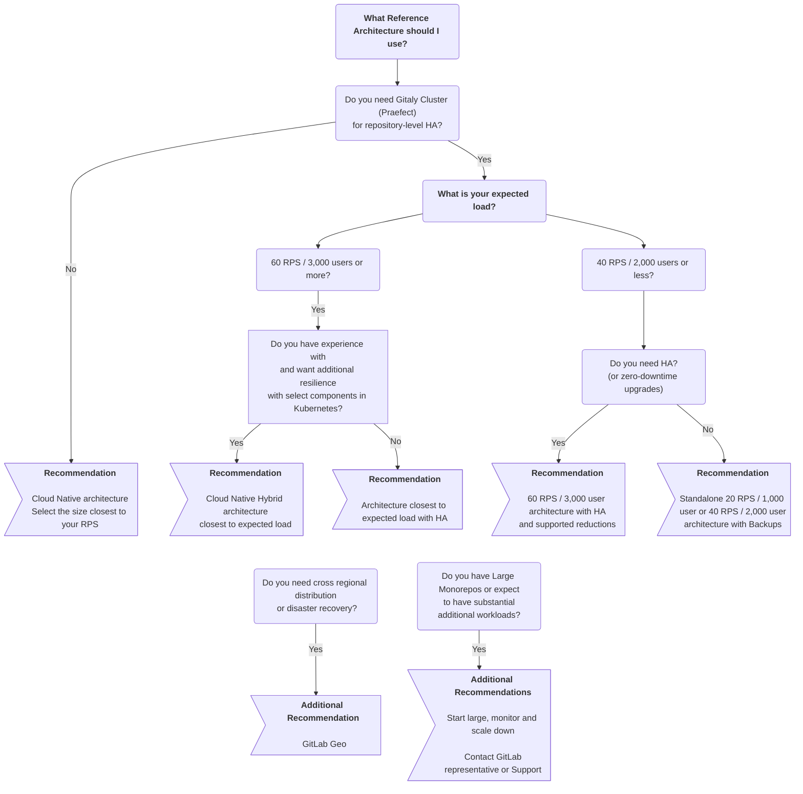



- Tier: 基础版，专业版，旗舰版
- Offering: 私有化部署



极狐GitLab 参考架构是用于大规模部署极狐GitLab 的推荐、可投入生产的环境设计方案。每个架构都提供了详细的规格，您可以根据自身需求直接使用或进行调整。

<a id="before-you-start"></a>

## 开始之前

首先，请考虑极狐GitLab 私有化部署是否适合您和您的需求。

在生产环境中运行任何应用都很复杂，极狐GitLab 也不例外。虽然我们力求尽可能简化这一过程，但根据您的设计，仍然存在一些普遍的复杂性。通常，您必须管理硬件、操作系统、网络、存储、安全、极狐GitLab 本身等各个方面。这既包括环境的初始搭建，也包括长期维护。

如果您决定采用这种方式，就必须具备在生产环境中运行和维护应用的实践知识。如果您不具备这方面的条件，我们的[专业服务](https://about.gitlab.com/services/#implementation-services)团队可提供实施服务。希望长期获得更托管式解决方案的用户，可以了解我们的其他产品，例如 [JihuLab.com](../../subscriptions/manage_seats.md#gitlabcom-billing-and-usage)。

如果您正在考虑使用极狐GitLab 私有化部署方式，我们建议您完整阅读本页面，尤其是以下章节：

- [决定从哪个架构开始](#deciding-which-architecture-to-start-with)
- [大型单体仓库](../../install/sizing.md#large-monorepos)
- [额外工作负载](#additional-workloads)
- [监控和调整您的环境](#monitoring)

<a id="deciding-which-architecture-to-start-with"></a>

## 决定从哪个架构开始

参考架构在性能、韧性和成本之间取得平衡。它们是基于典型工作负载模式的推荐起点。不过，大多数部署都需要通过[监控](#monitoring)根据实际使用情况进行调优。

一般来说，您希望环境性能越强或韧性越高，其复杂度也就越高。

<a id="expected-load"></a>

### 预期负载

合适的架构规模主要取决于您环境的预期峰值负载。每秒请求数（RPS）是确定极狐GitLab 基础设施规模的主要指标，但其他因素也可能适用。

有关全面的 RPS 分析和数据驱动的规模决策，请参阅[参考架构规模确定](../../install/sizing.md)，其中提供：

- 用于提取峰值和持续 RPS 指标的详细 PromQL 查询
- 工作负载模式分析和 RPS 构成指导，用于确定特定组件的调整
- 针对单体仓库、网络使用和增长规划的评估方法

如需快速估算 RPS，一些可选方法包括：

- [Prometheus](../monitoring/prometheus/_index.md#sample-prometheus-queries) 查询，例如：

  ```prometheus
  sum(irate(gitlab_transaction_duration_seconds_count{controller!~'HealthController|MetricsController'}[1m])) by (controller, action)
  ```

- [GitLab RPS Analyzer](https://gitlab.com/gitlab-org/professional-services-automation/tools/utilities/gitlab-rps-analyzer#gitlab-rps-analyzer)。
- 其他监控解决方案。
- 负载均衡器统计信息。

如果您无法确定 RPS，Linux 软件包和 Cloud Native Hybrid 架构提供了等效用户数作为替代的规模确定方法。该用户数会映射到典型的 RPS 值，同时考虑手动和自动化使用情况。

<a id="available-reference-architectures"></a>

## 可用的参考架构

以下参考架构可作为您环境的推荐起点。

> [!note]
> 每个架构都设计为[可扩展](#scaling-an-environment)。它们可以根据您的工作负载向上或向下调整。例如，一些已知的高负载场景，如使用[大型单体仓库](../../install/sizing.md#large-monorepos)或明显的[额外工作负载](#additional-workloads)。

<a id="linux-package-omnibus"></a>

### Linux 软件包（Omnibus）

基于 Linux 软件包的参考架构使用该软件包将所有极狐GitLab 组件部署在虚拟机上。部分组件（PostgreSQL、Redis、对象存储）可以选择使用云提供商服务。

以下 RPS 目标反映典型的工作负载构成。对于非典型工作负载，请参阅[了解 RPS 构成](../../install/sizing.md#understanding-rps-composition-and-workload-patterns)。

| 规模                         | API RPS | Web RPS | Git（拉取）RPS | Git（推送）RPS |
|------------------------------|---------|---------|----------------|----------------|
| [1,000 用户](1k_users.md)   | 20      | 2       | 2              | 1              |
| [2,000 用户](2k_users.md)   | 40      | 4       | 4              | 1              |
| [3,000 用户](3k_users.md)   | 60      | 6       | 6              | 1              |
| [5,000 用户](5k_users.md)   | 100     | 10      | 10             | 2              |
| [10,000 用户](10k_users.md) | 200     | 20      | 20             | 4              |
| [25,000 用户](25k_users.md) | 500     | 50      | 50             | 10             |
| [50,000 用户](50k_users.md) | 1000    | 100     | 100            | 20             |

<a id="cloud-native-hybrid"></a>

### Cloud Native Hybrid

Cloud Native Hybrid 参考架构使用 Helm Chart 将部分无状态组件（Webservice、Sidekiq）部署在 Kubernetes 中，而部分组件仍保留在虚拟机上或使用云提供商服务（PostgreSQL、Redis、对象存储）。

| 规模                                                                                                 | API RPS | Web RPS | Git（拉取）RPS | Git（推送）RPS |
|------------------------------------------------------------------------------------------------------|---------|---------|----------------|----------------|
| [2,000 用户](2k_users.md#cloud-native-hybrid-reference-architecture-with-helm-charts-alternative)   | 40      | 4       | 4              | 1              |
| [3,000 用户](3k_users.md#cloud-native-hybrid-reference-architecture-with-helm-charts-alternative)   | 60      | 6       | 6              | 1              |
| [5,000 用户](5k_users.md#cloud-native-hybrid-reference-architecture-with-helm-charts-alternative)   | 100     | 10      | 10             | 2              |
| [10,000 用户](10k_users.md#cloud-native-hybrid-reference-architecture-with-helm-charts-alternative) | 200     | 20      | 20             | 4              |
| [25,000 用户](25k_users.md#cloud-native-hybrid-reference-architecture-with-helm-charts-alternative) | 500     | 50      | 50             | 10             |
| [50,000 用户](50k_users.md#cloud-native-hybrid-reference-architecture-with-helm-charts-alternative) | 1000    | 100     | 100            | 20             |

<a id="cloud-native"></a>

### Cloud Native

Cloud Native 架构将所有极狐GitLab 组件部署在 Kubernetes 中，而 PostgreSQL、Redis 和对象存储使用外部托管服务。四种标准化规模覆盖了大多数生产部署。对于非典型工作负载，请参阅[参考架构规模确定](../../install/sizing.md)。这是新部署的推荐架构。

| 规模 | 目标 RPS | 工作负载特征 |
|------|------------|--------------------------|
| [小型（S）](cloud_native.md#small-s) | ≤100 RPS | 整体负载较轻，不适合活跃的单体仓库 |
| [中型（M）](cloud_native.md#medium-m) | ≤200 RPS | 中等负载，支持轻度使用的单体仓库 |
| [大型（L）](cloud_native.md#large-l) | ≤500 RPS | 高负载，可处理中度使用的单体仓库 |
| [超大型（XL）](cloud_native.md#extra-large-xl) | ≤1000 RPS | 密集负载，专为重度使用的单体仓库设计 |

> [!note]
> 这些 RPS 目标假设了典型的工作负载构成。AI 驱动的使用，例如
> [极狐GitLab Duo Agent Platform](#scaling-for-gitlab-duo-agent-platform)，并不随用户数
> 扩展，可能会使实际负载超过这些目标。对于有显著 Agent 活动的环境，请监控实际使用情况，而不要仅根据用户数确定规模。

<a id="if-in-doubt-start-large-monitor-and-then-scale-down"></a>

### 如有疑问，先采用较大规模，监控后再缩减

如果您不确定所需的环境规模，可以考虑先采用较大的规模，对其进行[监控](#monitoring)，然后在指标支持的情况下相应地[缩减规模](#scaling-an-environment)。

在以下情况下，先采用较大规模再缩减是审慎的做法：

- 您无法确定 RPS
- 环境负载可能异常高于预期
- 您有[大型单体仓库](../../install/sizing.md#large-monorepos)或明显的[额外工作负载](#additional-workloads)

例如，如果您有 3,000 名用户，但同时知道存在会显著增加并发负载的自动化，那么您可以先采用 100 RPS / 5k 用户级别的环境，对其进行监控，如果指标支持，则一次性或逐个缩减所有组件。

<a id="standalone-non-ha"></a>

### 独立部署（非 HA）

对于服务 2,000 名或更少用户的环境，通常建议采用独立部署方式，即部署非 HA 的单节点或多节点环境。采用这种方式，您可以使用[自动备份](../backup_restore/backup_gitlab.md#configuring-cron-to-make-daily-backups)等策略进行恢复。这些策略可提供良好的恢复时间目标（RTO）或恢复点目标（RPO），同时避免 HA 带来的复杂性。

对于独立部署，尤其是单节点环境，有多种[安装](../../install/_index.md)和管理选项。这些选项包括[通过部分云提供商市场直接部署的能力](https://page.gitlab.com/cloud-partner-marketplaces.html)，可进一步降低复杂性。

<a id="high-availability-ha"></a>

### 高可用（HA）

高可用确保极狐GitLab 部署中的每个组件都能通过各种机制处理故障。然而，实现这一点很复杂，所需的环境规模也可能相当大。

对于服务 3,000 名或更多用户的环境，我们通常建议使用 HA 策略。在这个级别，服务中断会对更多用户产生更大影响。因此，此范围内的所有架构在设计上都内置了 HA。

<a id="do-you-need-high-availability-ha"></a>

#### 您需要高可用（HA）吗？

如前所述，实现 HA 是有代价的。环境要求相当大，因为每个组件都需要成倍增加，这会带来额外的实际成本和维护成本。

对于许多用户数少于 3,000 的客户，我们发现备份策略已经足够，甚至更可取。虽然这确实会导致恢复时间较慢，但也意味着您的架构要小得多，维护成本也因此更低。

作为一般准则，仅在以下场景中采用 HA：

- 当您有 3,000 名或更多用户时。
- 当极狐GitLab 停机会对您的工作流产生严重影响时。

<a id="scaled-down-high-availability-ha-approach"></a>

#### 缩减的高可用（HA）方案

如果您仍需要为较少用户提供 HA，可以通过调整后的 [3K 架构](3k_users.md#supported-modifications-for-lower-user-counts-ha)来实现。

<a id="zero-downtime-upgrades"></a>

#### 零停机升级

[零停机升级](../../update/zero_downtime.md)适用于：

- 具有 HA 的标准环境。
- 在极狐GitLab 18.9 及更高版本中，也适用于 Cloud Native Hybrid 环境。

零停机升级允许环境在升级期间保持运行。不过，该过程因此更为复杂，并有一些限制，详见文档。

在进行此过程时，值得注意的是，当 HA 机制生效时，仍可能有短暂的中断时刻。

在大多数情况下，执行升级所需的中断时间不应很长。仅当这是您的关键需求时才使用此方案。

<a id="gitlab-geo-cross-regional-distribution--disaster-recovery"></a>

### 极狐GitLab Geo（跨区域分发 / 灾难恢复）

借助[极狐GitLab Geo](../geo/_index.md)，您可以实现位于不同区域的分布式环境，并配备完整的灾难恢复（DR）设置。极狐GitLab Geo 至少需要两个独立的环境：

- 一个主站点。
- 一个或多个作为副本的从站点。

如果主站点不可用，您可以故障转移到其中一个从站点。

> [!note]
> 仅当 DR 是您环境的关键需求时，才使用这种高级且复杂的设置。您还必须就每个站点的配置做出额外决策。例如，每个从站点是否与主站点采用相同的架构，或者每个站点是否配置为 HA。

<a id="large-monorepos--additional-workloads"></a>

### 大型单体仓库 / 额外工作负载

[大型单体仓库](../../install/sizing.md#large-monorepos)或显著的[额外工作负载](#additional-workloads)会显著影响环境的性能。根据具体情况，可能需要进行一些调整。

有关这些因素的全面分析，请参阅[参考架构规模确定](../../install/sizing.md)，其中提供：

- 单体仓库对基础设施影响的详细评估方法。
- 针对不同工作负载模式的特定组件扩展建议。
- 针对大量数据传输场景的网络带宽分析。

如果这种情况适用于您，请联系您的极狐GitLab 代表或我们的[支持团队](https://gitlab.cn/support)以获取进一步指导。

<a id="cloud-provider-services"></a>

### 云提供商服务

对于前面描述的所有策略，您可以在等效的云提供商服务上运行部分极狐GitLab 组件，例如 PostgreSQL 数据库或 Redis/Valkey。

有关更多信息，请参阅[基础设施和服务](#infrastructure-and-services)。

<a id="decision-tree"></a>

### 决策树

在参考以下决策树之前，请先完整阅读前面记录的指导内容。



<a id="requirements"></a>

## 要求

在实施参考架构之前，请参阅[安装要求](../../install/requirements.md)了解硬件、组件和基础设施要求，并参阅[参考架构规模确定](../../install/sizing.md)了解工作负载评估方法。

<a id="additional-workloads"></a>

### 额外工作负载

这些架构已针对基于真实数据的标准极狐GitLab 部署进行了[设计和测试](#how-specifications-are-derived)。

不过，额外工作负载可能会通过触发后续操作而使操作的影响成倍增加。如果您使用以下内容，可能需要调整建议的规格以进行补偿：

- 节点上的安全软件。
- 针对[大型代码仓库](../../user/project/repository/monorepos/_index.md)的数百个并发 CI 作业。
- [高频运行](../logs/log_parsing.md#print-top-api-user-agents)的自定义脚本。
- 许多大型项目中的[集成](../../integration/_index.md)。
- 拥有大量用户基础的项目中的[功能标志](../../operations/feature_flags.md#performance-factors)。
- [服务器钩子](../server_hooks.md)。
- [系统钩子](../system_hooks.md)。

一般来说，您应该建立完善的监控，以衡量任何额外工作负载的影响，从而为需要进行的任何更改提供依据。请联系您的极狐GitLab 代表或我们的[支持团队](https://gitlab.cn/support)以获取进一步指导。

<a id="infrastructure-and-services"></a>

## 基础设施和服务

这些架构可运行在任何满足规格的基础设施上，无论是在云提供商上还是在本地。有关支持的基础设施和 Kubernetes 要求，请参阅[安装要求](../../install/requirements.md#supported-infrastructure)。

有关 PostgreSQL、Redis/Valkey 和对象存储的托管云提供商服务，请参阅[极狐GitLab 组件的云服务](../../install/cloud-services.md)。

<a id="deviating-from-the-suggested-reference-architectures"></a>

## 偏离建议的参考架构

您偏离参考架构越远，获得支持的难度就越大。每一次偏离都会引入一层复杂性，使潜在问题的故障排除变得更加复杂。

这些架构使用官方 Linux 软件包或 [Helm Chart](https://gitlab.cn/docs/charts/) 来安装和配置各种组件。这些组件安装在单独的机器上（虚拟化或裸金属）。机器硬件要求列在特定参考架构页面的“配置”列中。等效的 VM 标准规格列在每个[可用架构](#available-reference-architectures)的 GCP/AWS/Azure 列中。

您可以在 Docker 上运行极狐GitLab 组件，包括 Docker Compose。Docker 得到了良好支持，并在各种环境中提供一致的规格。不过，它仍然是一个额外的层，可能会增加一些支持方面的复杂性。例如，无法在容器中运行 `strace`。

<a id="unsupported-designs"></a>

### 不支持的方案

虽然我们努力为极狐GitLab 环境设计提供广泛的支持，但某些方案无法有效运作。以下章节详细介绍了这些不支持的方案。

<a id="stateful-components-in-kubernetes"></a>

#### Kubernetes 中的有状态组件

[不支持在 Kubernetes 中运行有状态组件，例如 Postgres 和 Redis](https://gitlab.cn/docs/charts/installation/#configure-the-helm-chart-to-use-external-stateful-data)。

您可以使用其他受支持的云提供商服务，除非特别指出为不支持。

单个 Gitaly 节点可以部署在 Kubernetes 上，并且已正式发布。这提供了一种非 HA 方案，其中每个代码仓库存储在单个节点上。有关 Gitaly 部署选项和限制的背景信息，请参阅 [Kubernetes 上的 Gitaly](../gitaly/kubernetes.md#context)。

有关作为完全云原生设置的一部分在 Kubernetes 中部署 Gitaly 的参考架构，请参阅 [Cloud Native 参考架构](cloud_native.md)。

<a id="deploying-one-environment-over-multiple-regions"></a>

#### 跨多个区域部署单个环境

极狐GitLab 不支持跨多个区域部署单个环境。这些设置可能会导致严重问题，例如过高的网络延迟，或者如果区域之间的连接失败，会出现脑裂场景。

若干极狐GitLab 组件执行同步复制，或需要奇数个节点才能正常运行，例如 Consul、Redis Sentinel 和 Praefect。将这些组件分布在高延迟的多个区域中，会严重影响其功能和整体系统性能。

此限制适用于所有可能的极狐GitLab 环境设置，包括 Cloud Native Hybrid 替代方案。

对于跨多个数据中心或区域部署极狐GitLab，我们提供[极狐GitLab Geo](../geo/_index.md) 作为全面的解决方案。

<a id="how-specifications-are-derived"></a>

## 规格是如何得出的

规格依据真实客户数据和临时性能测试得出。

<a id="how-we-perform-the-tests"></a>

### 我们如何执行测试

测试使用源自客户样本数据的特定编码工作负载进行，同时利用 [GitLab Environment Toolkit (GET)](https://gitlab.com/gitlab-org/gitlab-environment-toolkit) 通过 Terraform 和 Ansible 进行环境部署，以及 [GitLab Performance Tool (GPT)](https://gitlab.com/gitlab-org/quality/performance) 使用 k6 进行性能测试。

测试主要在 GCP 和 AWS 上使用其标准计算产品（GCP 的 n1 系列，AWS 的 m5 系列）作为基准配置进行。选择这些机器类型作为最低共同标准目标，以确保广泛的兼容性。规格基于标准通用 x86 计算进行校准——任何满足或超过 vCPU 和内存要求的机器类型都应能正常工作，包括更新的 CPU 代次和基于 ARM 的实例。这些架构预计在任何满足规格的硬件上都能表现相似，无论是在其他云提供商上还是在本地。

<a id="performance-targets"></a>

### 性能目标

每个参考架构都根据基于真实客户数据的特定吞吐量目标进行测试。每 1,000 名用户，我们测试：

- API：20 RPS
- Web：2 RPS
- Git（拉取）：2 RPS
- Git（推送）：0.4 RPS（四舍五入到最接近的整数）

所列出的 RPS 目标是根据真实客户数据选择的，这些数据对应用户数所对应的环境总负载，包括 CI 和其他工作负载。

> [!note]
>
> - 这些 RPS 细分代表基于典型工作负载模式的测试目标。您的实际工作负载构成可能
>   有所不同。有关评估您特定 RPS 构成以及何时需要调整的指导，请参阅
>   [了解 RPS 构成](../../install/sizing.md#understanding-rps-composition-and-workload-patterns)。
> - 测试环境中组件之间的网络延迟观察为 <5 ms，但请注意这并非硬性要求。

<a id="test-coverage-and-results"></a>

### 测试覆盖范围和结果

测试旨在有效进行，并为参考架构目标提供良好的覆盖范围，涵盖 Linux 软件包和 Cloud Native 环境。所测试的具体环境和配置会定期审查，以确保最佳的覆盖范围和成本效益平衡，并可能随时间而变化。

我们的测试还包括正在探索以可能在未来纳入的这些架构的原型变体。测试结果公开发布在[参考架构 Wiki](https://gitlab.com/gitlab-org/reference-architectures/-/wikis/Benchmarks/Latest) 上。

<a id="maintaining-a-reference-architecture-environment"></a>

## 维护参考架构环境

维护参考架构环境通常与任何其他极狐GitLab 环境相同。

在本节中，您可以找到相关领域文档和特定架构说明的链接。

<a id="scaling-an-environment"></a>

### 扩展环境

参考架构被设计为基于典型工作负载模式的经过验证的起点，而非最终配置。大多数生产部署都能从根据监控中显现的实际使用模式进行的调整中受益。这些架构自始至终都是可扩展的，您可以随着工作负载特征变得清晰而迭代地调优它们。当指标显示持续的资源压力时，可以逐个组件扩展，也可以整体扩展到下一个架构规模。

> [!note]
> 如果某个组件持续耗尽分配给它的资源，请在进行任何重大扩展之前联系我们的[支持团队](https://gitlab.cn/support)。

<a id="when-to-scale"></a>

#### 何时扩展

大多数部署都能从观察实际工作负载模式后的调整中受益。触发扩展的常见场景包括：

**资源规模调整：**

- 为 API 密集型工作负载增加 Webservice/Rails 容量，尤其是当 API 流量超过总 RPS 的 90% 时（请参阅[了解 RPS 构成](../../install/sizing.md#understanding-rps-composition-and-workload-patterns)）
- 为单体仓库密集型环境或当代码仓库大小超过 2 GB 时扩展 Gitaly（请参阅[确定组件调整](../../install/sizing.md#identify-component-adjustments)）
- 为高 CI/CD 吞吐量或繁重的后台作业处理调整 Sidekiq 工作进程

**配置调优：**

- 根据并发访问模式设置 Gitaly 代码仓库 cgroup 数量（请参阅 [Gitaly cgroups](../gitaly/cgroups.md)）
- 为作业处理优化配置 Sidekiq 队列优先级（请参阅[处理特定作业类](../sidekiq/processing_specific_job_classes.md)）

**架构优化：**

- 为读密集型工作负载添加 PostgreSQL 只读副本
- 将 Sidekiq 拆分为针对不同作业类型的专用池
- 为流量尖峰明显的环境调整最小实例数

这些调整是典型且预期的。参考架构提供了基础，但监控您的特定工作负载才能确定最佳配置。有关您环境的系统性评估，请参阅[参考架构规模确定](../../install/sizing.md)。

<a id="scaling-for-gitlab-duo-agent-platform"></a>

#### 为极狐GitLab Duo Agent Platform 扩展

极狐GitLab Duo Agent Platform 引入了超出标准极狐GitLab 工作负载的额外基础设施要求。Agent Platform 工作流通过 GitLab Rails API 执行，通过 Sidekiq 异步处理作业，并访问代码仓库数据以获取代码上下文和分析。

Agent Platform 的使用随自动化和 Agent 活动而扩展，而非随用户数扩展，因此它并不遵循参考架构 RPS 目标所基于的流量模式。一个根据其用户数正确确定规模的环境，仍可能因 Agent 工作负载而承受持续的资源压力。请直接监控以下组件，而不要假设标准规模
已考虑 Agent Platform 的使用。

主要组件影响：

- **Rails (Webservice/Puma)** - Agent Platform API 请求会增加整体请求负载，用于流式传输 AI 响应的 WebSocket 连接由 Workhorse 管理
- **Sidekiq** - AI 补全作业和工作流状态更新作为后台作业处理
- **PostgreSQL** - Agent 工作流会话和状态数据存储在数据库中
- **Gitaly** - 为代码上下文访问代码仓库文件，以及为 Agent 生成的更改执行提交操作

对于计划采用 Agent Platform 的环境：

- 根据您的标准工作负载 RPS 部署推荐的架构规模
- 在初始推出期间监控 Rails CPU 利用率
- 监控 Sidekiq CPU 利用率和作业队列深度
- 监控 PostgreSQL 因工作流状态管理而增加的事务速率
- 监控 Gitaly 因代码分析功能而增加的文件访问模式

有关监控这些组件的示例 Prometheus 查询，请参阅[示例 Prometheus 查询](../monitoring/prometheus/_index.md#sample-prometheus-queries)。

如果您观察到持续的资源压力，请通过扩展受影响的组件来增加容量。在 Kubernetes 部署中，增加 pod 副本数和节点池容量。在 Linux 软件包部署中，通过添加节点进行水平扩展，或通过提高节点规格进行垂直扩展。

资源需求因 Agent Platform 使用强度和启用的特定功能而异。请将推荐的架构规模视为采用 Agent Platform 的起点，而非保证有足够的余量，并根据观察到的指标进行扩展。

<a id="how-to-scale"></a>

#### 如何扩展

对于大多数组件，可以照常应用垂直和水平扩展。不过，在这样做之前，请注意以下注意事项：

- 垂直扩展 Puma 或 Sidekiq 时，必须调整工作进程数量以利用额外的规格。Puma 工作进程数通常会自动调整，但 Sidekiq 可能需要[手动配置](../sidekiq/extra_sidekiq_processes.md#start-multiple-processes)。
- Redis 和 PgBouncer 主要是单线程的。如果这些组件出现 CPU 耗尽，可能需要水平扩展。
- 在 Linux 软件包部署中，Consul、Redis Sentinel 和 Praefect 组件在以 HA 形式部署时，需要奇数个节点才能形成投票法定人数。
- 显著扩展某些组件可能会产生明显的连锁效应，影响环境的性能。有关更多指导，请参阅[扩展的连锁效应](#scaling-knock-on-effects)。

反之，如果您有完善的指标显示环境过度预配，则可以向下缩减规模。向下缩减规模时应采取迭代方式，以确保不会出现问题。

<a id="scaling-knock-on-effects"></a>

#### 扩展的连锁效应

在某些情况下，显著扩展某个组件可能会对下游组件产生连锁效应，影响性能。这些架构在设计时考虑了平衡性，以确保相互依赖的组件在规格上保持一致。值得注意的是，扩展某个组件可能会导致更多吞吐量传递给它所依赖的其他组件。因此，您可能也必须扩展这些其他依赖组件。要确定这一点，请在扩展之前监控所有依赖服务的饱和度指标。如果多个相互依赖的组件都显示饱和，则应以协调的方式一起扩展，而不是依次扩展，以防止瓶颈只是在组件之间转移。

> [!note]
> 这些架构在设计上具有弹性，以适应上游组件的扩展。不过，为安全起见，在对环境进行任何重大更改之前，请联系我们的[支持团队](https://gitlab.cn/support)。

以下组件在显著扩展时可能会影响其他组件：

- Puma 和 Sidekiq - Puma 或 Sidekiq 工作进程的显著扩展会导致到内部负载均衡器、PostgreSQL（如果存在则通过 PgBouncer）、Gitaly（如果存在则通过 Praefect）和 Redis 的并发连接增加。
  - Redis 主要是单线程的。在某些情况下，如果增加的吞吐量导致组合集群中的 CPU 耗尽，您可能需要将 Redis 拆分为单独的实例（例如，缓存和持久化）。
  - PgBouncer 也是单线程的，但水平扩展可能会导致添加新的池，进而可能增加与 Postgres 的总连接数。强烈建议仅在您有管理 Postgres 连接的经验时才这样做，如有疑问请寻求帮助。
- Gitaly 集群 (Praefect)/PostgreSQL - 显著扩展额外节点可能会对 HA 系统和性能产生不利影响，因为会增加对主节点的复制调用。

<a id="scaling-from-a-non-ha-to-an-ha-architecture"></a>

#### 从非 HA 架构扩展到 HA 架构

在大多数情况下，只需垂直扩展即可增加环境的资源。不过，如果您要迁移到 HA 环境，以下组件需要额外的步骤才能切换到其 HA 形式。

有关更多信息，请参阅以下文档：

- [Redis 到带 Redis Sentinel 的多节点 Redis](../redis/replication_and_failover.md#switching-from-an-existing-single-machine-installation)
- [Postgres 到带 Consul + PgBouncer 的多节点 Postgres](../postgresql/moving.md)
- [Gitaly 到 Gitaly 集群 (Praefect)](../gitaly/praefect/_index.md#migrate-to-gitaly-cluster-praefect)

<a id="upgrades"></a>

### 升级

升级参考架构环境与任何其他极狐GitLab 环境相同。有关更多信息，请参阅[升级极狐GitLab](../../update/_index.md)。[零停机升级](#zero-downtime-upgrades)也可用。

> [!note]
> 您应按照创建参考架构的相同顺序升级它。

<a id="monitoring"></a>

### 监控

您可以使用各种选项监控您的基础设施和[极狐GitLab](../monitoring/_index.md)。有关更多信息，请参阅所选监控解决方案的文档。

> [!note]
> 极狐GitLab 应用捆绑了 [Prometheus 和各种 Prometheus 兼容的导出器](../monitoring/prometheus/_index.md)，可以接入您的解决方案。

<a id="update-history"></a>

## 更新历史

您可以在 [GitLab 项目](https://gitlab.com/gitlab-org/gitlab/-/merge_requests?scope=all&state=merged&label_name%5B%5D=Reference%20Architecture&label_name%5B%5D=documentation)上找到完整的变更历史。
