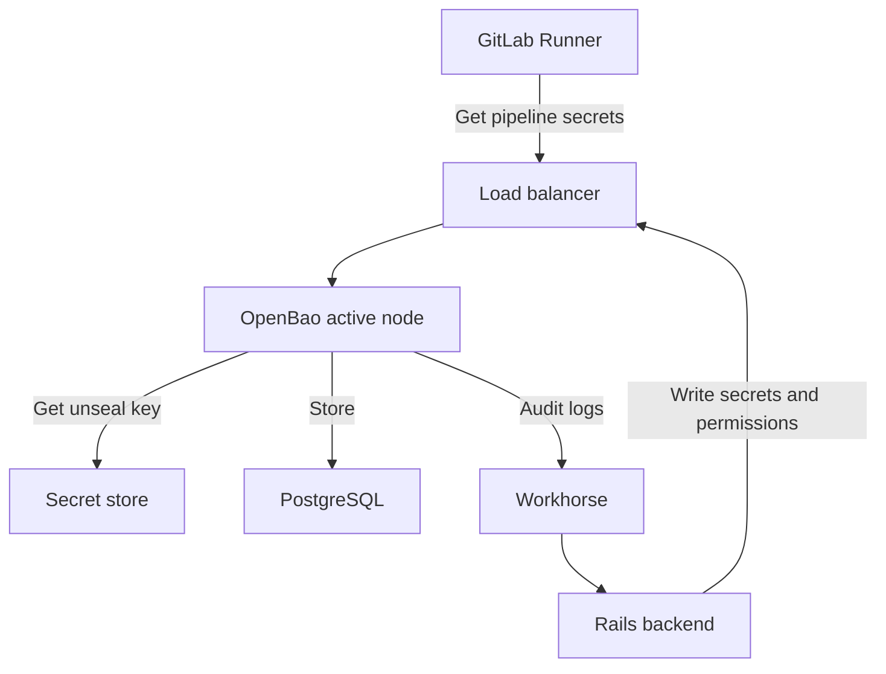



- Tier: 专业版，旗舰版
- Offering: 私有化部署
- Status: 测试版



[极狐GitLab 密钥管理器](../../ci/secrets/secrets_manager/_index.md)使用 [OpenBao](https://openbao.org/)，
这是一个开源的密钥管理解决方案。OpenBao 为极狐GitLab 实例中使用的密钥提供安全存储、访问控制和生命周期管理。

使用极狐GitLab 密钥管理器中密钥的极狐GitLab CI/CD 作业必须使用
[极狐GitLab Runner](https://gitlab.cn/docs/runner/#gitlab-runner-versions) 19.0 或更高版本。

<a id="openbao-architecture"></a>

## OpenBao 架构

OpenBao 作为可选组件与极狐GitLab 集成，与现有极狐GitLab 服务并行运行。

- Rails 后端和 Runner 通过负载均衡器连接到 OpenBao API。
- OpenBao 将数据存储在 PostgreSQL 中。
  Helm chart 将 OpenBao 配置为使用同一 PostgreSQL 实例上的独立逻辑数据库。
  在 Helm chart 中使用 `global.openbao.psql` 配置连接。
- OpenBao 从配置的密钥存储中获取解封密钥（默认情况下，是由 Helm chart 挂载的 Kubernetes 密钥）。
- 启用审计日志后，OpenBao 会将审计日志发送到 Rails 后端。



OpenBao 运行时有一个处理所有请求的活动节点，以及可选的多个备用节点，在活动节点发生故障时接管。

<a id="install-openbao"></a>

## 安装 OpenBao

先决条件：

- 管理员访问权限。
- 极狐GitLab 19.0 或更高版本。
- 一个 Kubernetes 集群。
- 对于 Cloud Native GitLab 部署，需要外部（非 Omnibus）PostgreSQL 实例。
  外部 PostgreSQL 实例是 GitLab Helm chart 对 Cloud Native 部署的要求，
  并非 OpenBao 本身的要求。OpenBao 使用该实例上的独立逻辑数据库。

根据您的极狐GitLab 部署方式选择安装方法：

- **Cloud Native GitLab**：如果您将极狐GitLab 部署到 Kubernetes，请使用此方法。
  更多信息，请参见 [OpenBao Helm chart 文档](https://gitlab.cn/docs/charts/charts/openbao/)。
- **Linux 软件包**：如果您使用 Linux 软件包在单节点或多节点上部署极狐GitLab，请使用此方法。更多信息，请参见
  [为 Linux 软件包实例安装 OpenBao](linux_package_integration.md)。

安装后，请按照 [极狐GitLab 密钥管理器用户文档](../../ci/secrets/secrets_manager/_index.md)验证 OpenBao 是否正常工作。

<a id="sizing-recommendations"></a>

## 规模建议

OpenBao 的资源需求取决于您的极狐GitLab 实例规模和密钥使用模式。

这些建议是经过验证的起点。请监控您的部署，并根据实际使用模式调整资源。您的需求会因获取密钥的 CI/CD 作业数量，以及启用了密钥管理器的群组和项目数量而有所不同。

<a id="pod-resources"></a>

### Pod 资源

OpenBao 运行时有一个处理所有请求的活动节点。额外的副本仅提供高可用故障转移。备用节点不提供读取流量，因为 OpenBao 在连接到 PostgreSQL 数据库时不支持水平读取可扩展性（HRS）。

| 密钥获取次数/秒 | CPU 请求 | 内存请求 | 副本数 |
|------------------|-------------|----------------|----------|
| 最多 3          | 500m        | 2 GB           | 2        |
| 最多 6          | 500m        | 3 GB           | 2        |
| 最多 12         | 500m        | 4 GB           | 2        |
| 最多 30         | 500m        | 9 GB           | 2        |
| 最多 60         | 1,000m      | 16 GB          | 2        |
| 最多 150        | 2,000m      | 31 GB          | 2        |

<a id="estimate-your-secret-fetch-rate"></a>

#### 估算您的密钥获取速率

要确定适用哪一行，请估算每秒的密钥获取次数：

```plaintext
fetches/s = Git Pull RPS × adoption rate × 3
```

其中：

- `Git Pull RPS` 是极狐GitLab 实例的 Git 拉取峰值吞吐量。
  您可以从现有环境监控中测量此值，
  请参见
  [提取峰值流量指标](../../install/sizing.md#extract-peak-traffic-metrics)。
- `adoption rate` 是使用密钥管理器的 CI/CD 作业所占比例
  （例如，5% 为 0.05，20% 为 0.20，50% 为 0.50）。
- `3` 是使用密钥管理器的每个作业假定获取的平均密钥数量。

选择**密钥获取次数/秒**达到或略高于您计算结果的那一行。例如，一个测得 20 Git 拉取 RPS、采用率为 20% 的部署：`20 × 0.20 × 3 = 12 fetches/s`。至少使用**最多 12** 这一行。

部署后，请根据实际使用情况验证您的估算。使用[监控查询](#monitor-your-openbao-deployment)测量资源使用情况，并在超过阈值时扩展到下一行。

<a id="how-resources-are-calculated"></a>

### 资源如何计算

**CPU** 取决于 CI/CD 作业获取密钥的频率。密钥写入操作（创建或更新密钥）相对于流水线数量而言并不频繁，对 CPU 负载的贡献可忽略不计。该表使用 Git 克隆速率（Git Pull RPS）作为 CI 作业速率的代理指标，因为每个 CI/CD 作业都以 Git 克隆开始。有关公式，请参见[估算您的密钥获取速率](#estimate-your-secret-fetch-rate)。将 CPU 限制设置为 CPU 请求的两倍。这为启动和预配峰值提供了突发余量，同时在稳态期间不会在节点上过度预留。

**内存**由 OpenBao 命名空间的数量决定，该数量对应于启用了密钥管理器的极狐GitLab 群组和项目的数量。每个命名空间分配约 1 MB，另加 1 GB 的安全余量，且最低为 2 GB。将内存限制设置为与内存请求相等（Guaranteed QoS 类）。OpenBao 超出内存限制时会立即崩溃，不会优雅降级。

**副本数**仅提供高可用故障转移。所有部署都使用 2 个副本。
OpenBao 在使用 PostgreSQL 存储后端时不支持水平读取可扩展性（HRS），
因此额外的副本不会带来吞吐量收益。

<a id="database-resources"></a>

### 数据库资源

OpenBao 将其数据存储在独立的 PostgreSQL 数据库中。
您可以将其与极狐GitLab 数据库放在同一台 PostgreSQL 服务器上。除了
[参考架构 PostgreSQL 建议](../reference_architectures/_index.md)之外，
不需要额外的数据库计算容量。

<a id="database-connection-pool"></a>

#### 数据库连接池

OpenBao Helm chart 配置了以下 PostgreSQL 连接池默认值：

| 设置                                              | 默认值 |
|------------------------------------------------------|---------------|
| `config.storage.postgresql.maxParallel`              | 5             |
| `config.storage.postgresql.maxIdleConnections`       | 2             |

除非您在监控中观察到数据库连接等待时间，否则不要增加这些值。

<a id="database-storage"></a>

#### 数据库存储

数据库存储需求主要取决于密钥总数。每个密钥（包括其元数据和存储的版本）需要约 13 KB 的存储空间。

| 密钥总数  | 估计存储 |
|----------------|-------------------|
| 10,000         | ~130 MB           |
| 50,000         | ~650 MB           |
| 100,000        | ~1.3 GB           |
| 200,000        | ~2.6 GB           |

对于所有参考架构层级，存储增长都可忽略不计。分配 5 到 10 GB 的数据库存储可提供充足的余量。

<a id="enable-gitlab-secrets-manager"></a>

## 启用极狐GitLab 密钥管理器

为实例启用密钥管理器后，您可以为特定的[群组和项目](../../ci/secrets/secrets_manager/_index.md#enable-gitlab-secrets-manager)启用它。

先决条件：

- 管理员访问权限。
- 必须已安装并配置 OpenBao。

要为实例启用密钥管理器：

1. 在右上角，选择**管理员**。
1. 在左侧边栏中，选择**设置** > **通用**。
1. 展开**极狐GitLab 密钥管理器**。
1. 打开**密钥管理器**开关。

<a id="monitor-your-openbao-deployment"></a>

## 监控您的 OpenBao 部署

使用以下查询验证您的部署规模是否正确，并检测何时需要扩展。

<a id="cpu-utilization"></a>

### CPU 利用率

要测量 OpenBao CPU 使用情况：

```prometheus
sum(rate(container_cpu_usage_seconds_total{container="openbao-server"}[5m]))
```

结果以 CPU 核心为单位。乘以 1,000 可转换为毫核，以便与规模表中的 CPU 请求值进行比较。如果 CPU 利用率持续超过 CPU 请求的 50%，请考虑扩展到规模表中的下一行。

<a id="memory-utilization"></a>

### 内存利用率

要测量 OpenBao 内存使用情况：

```prometheus
sum(container_memory_working_set_bytes{container="openbao-server"})
```

结果为字节数。随着群组和项目启用密钥管理器，内存会增长，大约每个命名空间 1 MB。重启后，随着 OpenBao 从数据库加载命名空间元数据，内存会趋于稳定。

要计算正确的内存请求，请统计已启用密钥管理器的群组和项目数量，乘以 1 MB，然后加上 1 GB。如果结果超过当前的内存请求，请更新您的 Pod 资源。如果内存持续呈上升趋势且没有正在进行的预配操作，请调查是否存在潜在问题。

<a id="cpu-throttling"></a>

### CPU 节流

要检测可能影响延迟的 CPU 节流：

```prometheus
sum(rate(container_cpu_cfs_throttled_periods_total{container="openbao-server"}[5m]))
/
sum(rate(container_cpu_cfs_periods_total{container="openbao-server"}[5m]))
```

节流比率高于 0.25（25%）表示 CPU 限制对于当前工作负载而言过低。当 OpenBao 被节流时，等待 CPU 时间的 goroutine 会导致密钥获取延迟增加。

<a id="openbao-metrics"></a>

### OpenBao 指标

使用 OpenBao Prometheus 指标监控请求延迟、存储后端性能、缓存效率和节点健康状况。

默认情况下，OpenBao 在端口 `8209` 上的未认证监听器上提供指标，路径为 `/v1/sys/metrics`。指标名称使用 `openbao_` 前缀，OpenBao 保留指标数据 24 小时。要更改端口、指标前缀或保留时间，请参见[监控配置选项](https://gitlab.cn/docs/charts/charts/openbao/#monitoring-configuration-options)。

指标端口未通过服务公开，因此请配置您的监控以直接抓取
OpenBao Pod。

如果您使用 Prometheus Operator，GitLab chart 包含一个默认禁用的 PodMonitor。
要启用它，请将 `openbao.podMonitor.enabled` 设置为 `true`。

这些指标对于运维部署最为有用：

| 指标                               | 类型    | 描述 |
|--------------------------------------|---------|-------------|
| `openbao_core_active`                | Gauge   | 节点是活动节点（`1`）还是备用节点（`0`）。 |
| `openbao_core_unsealed`              | Gauge   | 节点是已解封（`1`）还是已密封（`0`）。 |
| `openbao_core_in_flight_requests`    | Gauge   | 正在并发处理的请求数。 |
| `openbao_core_handle_request`        | Summary | 请求处理的延迟。 |
| `openbao_postgres_get`               | Summary | 从 PostgreSQL 存储后端读取条目所需的时间。 |
| `openbao_postgres_put`               | Summary | 向 PostgreSQL 存储后端写入条目所需的时间。 |
| `openbao_postgres_list`              | Summary | 列出 PostgreSQL 存储后端中条目所需的时间。 |
| `openbao_postgres_delete`            | Summary | 从 PostgreSQL 存储后端删除条目所需的时间。 |
| `openbao_barrier_get`                | Summary | 通过加密屏障读取条目所需的时间。 |
| `openbao_barrier_put`                | Summary | 通过加密屏障写入条目所需的时间。 |
| `openbao_barrier_list`               | Summary | 通过加密屏障列出条目所需的时间。 |
| `openbao_barrier_delete`             | Summary | 通过加密屏障删除条目所需的时间。 |
| `openbao_cache_hit`                  | Counter | 缓存命中次数。 |
| `openbao_cache_miss`                 | Counter | 缓存未命中次数。 |
| `openbao_cache_write`                | Counter | 缓存写入次数。 |
| `openbao_audit_log_request_failure`  | Counter | 审计日志请求失败次数。 |
| `openbao_audit_log_response_failure` | Counter | 审计日志响应失败次数。 |
| `openbao_runtime_alloc_bytes`        | Gauge   | OpenBao 进程分配的内存字节数。 |

Summary 指标公开 `_count`、`_sum` 和分位数序列（`0.5`、`0.9` 和 `0.99`）。要计算平均值，请将 `_sum` 序列的速率除以 `_count` 序列的速率，如[确认延迟升高](troubleshooting.md#confirm-latency-is-elevated)中所示。

有关使用这些指标的阈值和诊断查询，请参见[诊断缓慢的密钥操作](troubleshooting.md#diagnose-slow-secret-operations)。

有关 OpenBao 指标的完整列表，请参见 [OpenBao 遥测指标](https://openbao.org/docs/internals/telemetry/metrics/all/)。

<a id="health-check-endpoints"></a>

### 健康检查端点

OpenBao 提供用于监控的健康检查端点：

- `<your-openbao-url>/v1/sys/health`：返回 OpenBao 的健康状态
- `<your-openbao-url>/v1/sys/seal-status`：返回密封状态

您可以将这些端点与您的监控系统集成。

<a id="high-availability"></a>

## 高可用性

OpenBao 使用单活动节点架构。一个节点处理所有请求，备用节点在活动节点发生故障时提供自动故障转移。

<a id="failover"></a>

### 故障转移

当活动节点发生故障时，备用节点会接管，并在能够提供密钥操作之前初始化每个命名空间。故障转移时间随命名空间数量增加而增加，类似于[升级停机时间](#upgrade-downtime)。

按需加载命名空间可以减少此初始化时间。此工作已在[议题 607703](https://gitlab.com/gitlab-org/gitlab/-/work_items/607703)中提出。

对于生产部署：

- 至少运行两个 OpenBao 副本以实现冗余。
- 使用高可用的 PostgreSQL 后端。
- 使用[监控查询](#monitor-your-openbao-deployment)实施监控和告警。

<a id="upgrade-downtime"></a>

### 升级停机时间

OpenBao 不支持零停机升级。在升级期间，OpenBao
会在启动时依次初始化每个命名空间。每个启用了密钥管理器的群组或项目都算作一个命名空间。

升级时，每 1,000 个命名空间大约需要 11 秒，外加 5 秒的基准时间。

当 OpenBao 实现按需加载命名空间后，升级停机时间将显著减少。更多信息，请参见[议题 595721](https://gitlab.com/gitlab-org/gitlab/-/work_items/595721)。

<a id="geo-deployment"></a>

## Geo 部署

OpenBao 支持 [Geo](../geo/_index.md) 部署。OpenBao 部署在主站点和
Geo 从站点上，但只有主站点运行活动的 OpenBao 节点。

> [!warning]
> OpenBao 不支持故障转移到使用不同域名的从站点。如果
> 从站点保留自己的域名，而不是更新 DNS 将主域名指向它，
> 您必须为每个启用了极狐GitLab 密钥
> 管理器的项目和群组手动重新预配 JWT 认证。重新预配适用于根级别和每个命名空间，对于大型部署而言
> 非常耗时。正在
> [议题 595722](https://gitlab.com/gitlab-org/gitlab/-/issues/595722)中提议迁移工具。在工具出现之前，请更新
> DNS 记录，使主域名指向提升后的从站点。

<a id="openbao-behavior-in-geo"></a>

### OpenBao 在 Geo 中的行为

在主站点上，OpenBao 作为活动节点运行，连接到可写的 PostgreSQL 数据库。在从站点上，OpenBao 以备用模式运行，
连接到 PostgreSQL 只读副本。

PostgreSQL 流复制会自动将
所有 OpenBao 数据（密钥、策略、认证配置）从主站点传输到从站点。

两个极狐GitLab 实例（主实例和从实例）都连接到主 OpenBao URL。从站点的 OpenBao 部署保持备用状态，并在 [Geo 故障转移](../geo/disaster_recovery/_index.md#step-4-optional-promote-the-openbao-ha-cluster)期间从 PostgreSQL 数据库变为可写时提升为活动状态。

在从站点上，OpenBao 会记录 `failed to acquire lock` 和 `cannot execute INSERT in a read-only transaction` 错误。这些错误是预期内的。OpenBao 无法在只读数据库上获取 HA 领导者锁。

<a id="install-openbao-on-a-secondary-site"></a>

### 在从站点上安装 OpenBao

先决条件：

- 必须配置 Geo。有关更多信息，请参见[设置 Geo](../geo/setup/_index.md)。
- 在从站点上部署 OpenBao 之前，必须在主站点上安装并正常运行 OpenBao。
  有关更多信息，请参见[安装 OpenBao](#install-openbao)。

1. 从站点的 OpenBao 必须使用与主站点相同的解封配置，才能解密复制的数据。
   具体步骤取决于您配置的解封方法：

   - Kubernetes 密钥（默认）：将 `gitlab-openbao-unseal` Kubernetes 密钥从
     主集群复制到从集群：

     ```shell
     kubectl --namespace gitlab get secret gitlab-openbao-unseal -o yaml
     ```

     将导出的密钥应用到从集群。更多信息，请参见
     [备份密钥](https://gitlab.cn/docs/charts/backup-restore/backup/#back-up-the-secrets)。

   - 基于 KMS 的自动解封：使用相同的 KMS 密钥配置从集群。
     更多信息，请参见
     [解封和初始化选项](https://gitlab.cn/docs/charts/charts/openbao/#unsealing-and-initialization-options)。

1. 如果您计划在故障转移期间更新主域名的 DNS 记录以指向从站点，
   您可能需要提前相应地配置 OpenBao。
   配置 Helm chart，并将 `url` 和 `jwt_audience` 设置为主 OpenBao URL：

   ```yaml
   global:
     openbao:
       enabled: true
       url: https://openbao.<primary-domain>
       jwt_audience: https://openbao.<primary-domain>
   ```

   有关 chart 配置选项的更多信息，
   请参见 [OpenBao chart 文档](https://gitlab.cn/docs/charts/charts/openbao/)。

1. 在从站点上部署 GitLab Helm chart。OpenBao Pod 会启动并保持备用
   模式。这是预期内的。

1. 在从集群上，检查 OpenBao Pod 是否正在运行：

   ```shell
   kubectl --namespace gitlab get pods -l app=openbao
   ```

   所有 Pod 都应处于 `Running` 状态。从站点的 Pod 没有 `openbao-active: "true"`
   标签。这是预期内的。

1. 确认活动服务在从集群上没有端点：

   ```shell
   kubectl --namespace gitlab get endpoints gitlab-openbao-active
   ```

   从站点上端点为零是预期内的。

1. 通过在从站点上运行使用
   [密钥管理器变量](../../ci/secrets/secrets_manager/_index.md)的 CI 流水线来测试密钥管理器。

<a id="troubleshooting"></a>

## 故障排除

要诊断部署、连接、预配、密封、数据库、审计和 Geo 问题，请参见[故障排除 OpenBao](troubleshooting.md)。

<a id="maintenance"></a>

## 维护

要备份和恢复 OpenBao、管理恢复密钥或恢复 OpenBao 认证，请参见
[维护 OpenBao](maintenance.md)。
