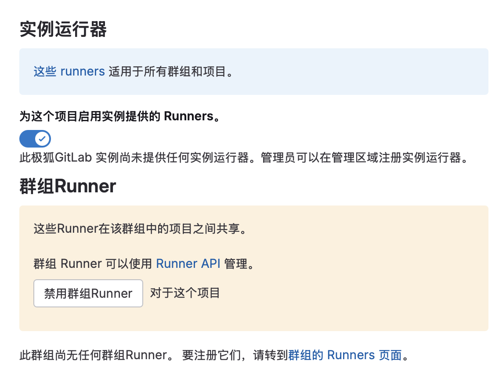
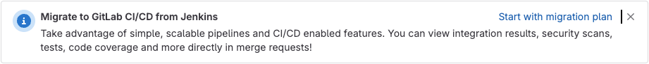



- Tier: 基础版，专业版，旗舰版
- Offering: 私有化部署



在管理区域中为您的极狐GitLab 实例配置 CI/CD 设置。

先决条件：

- 您必须具有管理员访问权限。

以下设置可供使用：

- 变量：配置实例中所有项目均可使用的 CI/CD 变量。
- 持续集成与部署：配置 Auto DevOps、作业、产物、实例 Runner 和流水线功能的设置。
- 软件包仓库：配置软件包转发和文件大小限制。
- Runner：配置 Runner 注册、版本管理和令牌设置。
- 作业令牌权限：控制作业令牌跨项目的访问。
- 作业日志：配置作业日志设置，例如增量日志记录。
- [CI/CD 限制](../cicd/limits.md)。

## 访问持续集成与部署设置

自定义 CI/CD 设置，包括 Auto DevOps、实例 Runner 和作业产物。

要访问这些设置：

1. 在右上角，选择**管理员**。
1. 在左侧边栏中，选择**设置** > **CI/CD**。
1. 展开**持续集成与部署**。

### 为所有项目配置 Auto DevOps

配置 [Auto DevOps](../../topics/autodevops/_index.md)，
使其为所有没有`.gitlab-ci.yml` 文件的项目运行。这适用于现有项目和任何新项目。

要为实例中的所有项目配置 Auto DevOps：

1. 选中**默认对所有项目使用 Auto DevOps 流水线**复选框。
1. 可选。要使用自动部署和自动审查应用，
   请指定 [Auto DevOps 基础域名](../../topics/autodevops/requirements.md#auto-devops-base-domain)。
1. 选择**保存更改**。

### 实例 Runner

#### 为新项目启用实例 Runner

默认情况下，使实例 Runner 可供所有新项目使用。

要使实例 Runner 可供新项目使用：

1. 选中**为新项目启用实例 Runner** 复选框。
1. 选择**保存更改**。

#### 为实例 Runner 添加详细信息

添加有关实例 Runner 的说明文本。此文本会显示在所有项目的 Runner 设置中。

要添加实例 Runner 详细信息：

1. 在**实例 Runner 详细信息**文本框中输入文本。您可以使用 Markdown 格式。
1. 选择**保存更改**。

要查看渲染后的详细信息：

1. 在顶部栏中，选择**搜索或跳转到**并找到您的项目或群组。
1. 在左侧边栏中，选择**设置** > **CI/CD**。
1. 展开 **Runner**。

#### 与多个项目共享项目 Runner

将项目 Runner 与多个项目共享。

先决条件：

- 您必须拥有已注册的[项目 Runner](../../ci/runners/runners_scope.md#project-runners)。

要将项目 Runner 与多个项目共享：

1. 在右上角，选择**管理员**。
1. 在左侧边栏中，选择 **CI/CD** > **Runner**。
1. 选择您要编辑的 Runner。
1. 在右上角，选择**编辑**（）。
1. 在**限制此 Runner 的项目**下，搜索一个项目。
1. 在项目左侧，选择**启用**。
1. 对每个其他项目重复此过程。

### 作业产物

控制[作业产物](../cicd/job_artifacts.md)在您的极狐GitLab 实例中的存储和管理方式。

#### 设置默认产物过期时间

设置作业产物在被自动删除之前保留多长时间。默认过期时间为 30 天。

时长语法在 [`artifacts:expire_in`](../../ci/yaml/_index.md#artifactsexpire_in)中描述。单个作业定义可以在项目的`.gitlab-ci.yml` 文件中覆盖此默认值。

对此设置的更改仅适用于新产物。现有产物保留其原始过期时间。有关手动使较旧产物过期的信息，请参阅[故障排除文档](../cicd/job_artifacts_troubleshooting.md#delete-old-builds-and-artifacts)。

要设置作业产物的默认过期时间：

1. 在**默认产物过期时间**文本框中输入一个值。
1. 选择**保存更改**。

#### 保留最新成功流水线中的产物

对于每个 Git 引用（分支或标签），极狐GitLab 会保留以下内容中的产物：

- 该引用的最新流水线，即使它失败或被手动作业阻止。
- 最近一次成功的流水线（如果它与最新流水线不同）。

默认情况下，无论其过期时间如何，这些产物都会被保留。

此设置优先于[项目设置](../../ci/jobs/job_artifacts.md#keep-artifacts-from-most-recent-successful-jobs)。如果为实例关闭了此设置，则无法为单个项目开启。

当此功能关闭时，现有已保留的产物不会立即过期。分支上必须有更新的流水线完成，或被手动作业阻止，这些产物才会过期。

> [!note]
> 所有应用程序设置都有一个[可自定义的缓存过期时间间隔](../application_settings_cache.md)，
> 这可能会延迟设置更改的生效。

要保留最新成功流水线中的产物：

1. 选中**保留最新成功流水线中所有作业的最新产物**复选框。
1. 选择**保存更改**。

要让产物根据其过期设置过期，请改为清除该复选框。

#### 显示或隐藏外部重定向警告页面

控制当用户通过 GitLab Pages 查看作业产物时是否显示警告页面。此警告会提醒用户注意用户生成内容可能带来的安全风险。

外部重定向警告页面默认显示。要隐藏它：

1. 清除**为作业产物启用外部重定向页面**复选框。
1. 选择**保存更改**。

### 流水线

#### 归档流水线

在指定时间段后自动归档旧流水线及其所有作业。已归档的作业：

- 在作业日志顶部显示一条信息性通知**此作业已归档**。
- 无法重新运行或重试。
- 当环境自动停止时，无法作为[停止时部署操作](../../ci/environments/_index.md#stopping-an-environment)运行。
- 继续保留可见的作业日志。

归档时长从流水线创建时开始计算。它必须至少为 1 天。有效时长示例包括 `15 days`、`1 month` 和 `2 years`。将此字段留空可永不自动归档流水线。

对于 JihuLab.com，请参阅[流水线归档](../../user/jihulab_com/_index.md#gitlab-cicd)。

要设置作业归档：

1. 在**归档流水线**文本框中输入一个值。
1. 选择**保存更改**。

#### 默认允许流水线变量

控制新群组中的新项目是否默认允许流水线变量。

禁用时，新群组的[使用流水线变量的默认角色](../../user/group/access_and_permissions.md#set-the-default-role-that-can-use-pipeline-variables)设置会设为**不允许任何人**，并级联到新群组中的新项目。启用时，该设置则默认为**开发者**。

> [!warning]
> 为了保持新群组和新项目最安全的默认值，建议
> 将此设置设为禁用。

要默认允许新群组中所有新项目使用流水线变量：

1. 选中**默认允许新群组使用流水线变量**复选框。
1. 选择**保存更改**。

群组或项目创建后，维护者可以选择不同的设置。

#### 默认保护 CI/CD 变量

将项目和群组中的所有新 CI/CD 变量默认设为受保护。受保护的变量仅对在受保护分支或受保护标签上运行的流水线可用。

要默认保护所有新 CI/CD 变量：

1. 选中**默认保护 CI/CD 变量**复选框。
1. 选择**保存更改**。

#### 指定默认 CI/CD 配置文件

设置一个自定义路径和文件名，用作所有新项目中 CI/CD 配置文件的默认值。默认情况下，极狐GitLab 使用项目根目录中的`.gitlab-ci.yml` 文件。

此设置仅适用于您更改后创建的新项目。现有项目继续使用其当前的 CI/CD 配置文件路径。

要设置自定义默认 CI/CD 配置文件路径：

1. 在**默认 CI/CD 配置文件**文本框中输入一个值。
1. 选择**保存更改**。

单个项目可以通过[指定自定义 CI/CD 配置文件](../../ci/pipelines/settings.md#specify-a-custom-cicd-configuration-file)来覆盖此实例默认值。

#### 显示或隐藏 Jenkins 迁移横幅

控制是否显示鼓励从 Jenkins 迁移到极狐GitLab CI/CD 的横幅。此横幅会显示在已[启用 Jenkins 集成](../../integration/jenkins.md)的项目的合并请求中。

Jenkins 迁移横幅默认显示。要隐藏它：

1. 选中**显示从 Jenkins 迁移横幅**复选框。
1. 选择**保存更改**。

## 访问软件包仓库设置

配置 NuGet 软件包验证、Helm 软件包限制、软件包文件大小限制和软件包转发。

要访问这些设置：

1. 在右上角，选择**管理员**。
1. 在左侧边栏中，选择**设置** > **CI/CD**。
1. 展开**软件包仓库**。

### 跳过 NuGet 软件包元数据 URL 验证

跳过对 NuGet 软件包中 `projectUrl`、`iconUrl` 和 `licenseUrl` 元数据的验证。

默认情况下，极狐GitLab 会验证这些 URL。如果您的极狐GitLab 实例无法访问互联网，此验证会失败并阻止您上传 NuGet 软件包。

要跳过 NuGet 软件包元数据 URL 验证：

1. 选中**跳过 NuGet 软件包的元数据 URL 验证**复选框。
1. 选择**保存更改**。

### 设置每个频道的最大 Helm 软件包数

设置每个频道可列出的 Helm 软件包的最大数量。

要设置 Helm 软件包限制：

1. 在**软件包限制**下，在**每个频道的最大 Helm 软件包数**字段中输入一个值。
1. 选择**保存更改**。

### 设置软件包文件大小限制

为每种软件包类型设置最大文件大小限制，以控制存储用量并保持系统性能。

您可以按字节配置以下软件包的最大文件大小限制：

- Conan 软件包
- Helm chart
- Maven 软件包
- npm 软件包
- NuGet 软件包
- PyPI 软件包
- Terraform Module 软件包
- 通用软件包

要配置软件包文件大小限制：

1. 在**软件包文件大小限制**下，为您要配置的限制输入值。
1. 选择**保存大小限制**。

### 控制软件包转发



- Tier: 专业版，旗舰版
- Offering: 私有化部署



控制在您的极狐GitLab 软件包仓库中找不到软件包时，是否将软件包请求转发到公共仓库。

默认情况下，极狐GitLab 会将软件包请求转发到各自的公共仓库：

- Maven 请求转发到 [Maven Central](https://search.maven.org/)。
- npm 请求转发到 [npmjs.com](https://www.npmjs.com/)。
- PyPI 请求转发到 [pypi.org](https://pypi.org/)。

要关闭软件包转发：

1. 在右上角，选择**管理员**。
1. 在左侧边栏中，选择**概览** > **群组**并找到您的群组。
1. 选择**设置** > **CI/CD**。
1. 展开**软件包仓库**。
1. 清除以下任一复选框：
   - **转发 npm 软件包请求**
   - **转发 PyPI 软件包请求**
1. 选择**保存更改**。

要关闭 Maven 软件包的请求转发，请参阅[软件包仓库中的 Maven 软件包](../../user/packages/maven_repository/_index.md#request-forwarding-to-maven-central)。

## 访问 Runner 设置

配置 Runner 版本管理和注册设置。

要访问这些设置：

1. 在右上角，选择**管理员**。
1. 在左侧边栏中，选择**设置** > **CI/CD**。
1. 展开 **Runner**。

### 控制 Runner 版本管理

控制您的实例是否从 JihuLab.com 获取官方 Runner 版本数据，以[确定 Runner 是否需要升级](../../ci/runners/runners_scope.md#determine-which-runners-need-to-be-upgraded)。

默认情况下，极狐GitLab 会获取 Runner 版本数据。要停止获取此数据：

1. 在 **Runner 版本管理**下，清除**从 JihuLab.com 获取极狐GitLab Runner 发布版本数据**复选框。
1. 选择**保存更改**。

### 控制 Runner 注册

控制谁可以注册 Runner 以及是否允许注册令牌。

> [!warning]
> 传递 Runner 注册令牌的选项以及对某些配置参数的支持被视为旧版功能，
> 不建议使用。
> 请使用 [Runner 创建工作流](https://gitlab.cn/docs/runner/register/#register-with-a-runner-authentication-token)
> 生成认证令牌来注册 Runner。此过程可提供 Runner 所有权的完整
> 可追溯性，并增强您 Runner 集群的安全性。
>
> 有关更多信息，请参阅
> [迁移到新的 Runner 注册工作流](../../ci/runners/new_creation_workflow.md)。

默认情况下，允许使用 Runner 注册令牌，也允许项目和群组成员注册。
要限制 Runner 注册：

1. 在 **Runner 注册**下，清除以下任一复选框：
   - **允许 Runner 注册令牌**
   - **项目成员可以创建 Runner**
   - **群组成员可以创建 Runner**
1. 选择**保存更改**。

> [!note]
> 当您为项目成员禁用 Runner 注册时，注册
> 令牌会自动轮换。先前的令牌将失效，您必须
> 为该项目使用新的注册令牌。

### 限制特定群组的 Runner 注册

控制特定群组的成员是否可以注册 Runner。

先决条件：

- 必须在 [Runner 注册设置](#control-runner-registration)中选中
  **群组成员可以创建 Runner** 复选框。

要限制特定群组的 Runner 注册：

1. 在右上角，选择**管理员**。
1. 在左侧边栏中，选择**概览** > **群组**并找到您的群组。
1. 选择**编辑**。
1. 在 **Runner 注册**下，清除**可以注册新的群组 Runner** 复选框。
1. 选择**保存更改**。

## 访问作业令牌权限设置

控制 CI/CD 作业令牌如何访问您的项目。

要访问这些设置：

1. 在右上角，选择**管理员**。
1. 在左侧边栏中，选择**设置** > **CI/CD**。
1. 展开**作业令牌权限**。

### 强制使用作业令牌允许名单

要求所有项目使用允许名单来控制作业令牌访问。

启用此设置后：

- 仅当令牌的源项目已添加到允许名单时，CI/CD 作业令牌才能访问项目。
- 如果用户尝试禁用允许名单，[CI/CD 作业令牌范围 API](../../api/project_job_token_scopes.md#update-the-cicd-job-token-access-settings-for-a-project)
  会返回错误。

有关更多信息，请参阅[控制对您项目的作业令牌访问](../../ci/jobs/ci_job_token.md#control-job-token-access-to-your-project)。

要强制使用作业令牌允许名单：

1. 在**已授权群组和项目**下，选中**为所有项目启用并强制使用作业令牌允许名单**复选框。
1. 选择**保存更改**。

## 对回收项目路径的 JWT 限制

对于被重命名或移动到先前使用过的命名空间路径的项目，极狐GitLab 会阻止在 CI/CD 流水线中生成 JWT 和 OIDC 令牌。此限制可防止命名空间回收认证绕过攻击。

如果已移动或重命名的项目中的 CI/CD 流水线被阻止，管理员可以禁用此限制，但这会带来安全风险。

> [!warning]
> 禁用此限制会移除一项防止命名空间回收
> 认证绕过攻击的安全控制。只有在您理解并接受
> 内部威胁风险时，才应禁用此设置。该限制默认启用，并且
> 在大多数实例上应保持启用。

要禁用回收路径的 JWT 限制：

1. 在右上角，选择**管理员**。
1. 在左侧边栏中，选择**设置** > **CI/CD**。
1. 展开**持续集成与部署**。
1. 清除**阻止在回收的项目路径中生成 JWT** 复选框。
1. 选择**保存更改**。

启用后，令牌在 CI/CD 作业中生成失败，并显示以下错误：

- ``ID token issuance is disabled in CI because a project path in the `sub` claim was previously used by a different project.``

## 访问作业日志设置

控制 CI/CD 作业日志的存储、处理和更新方式。

要访问这些设置：

1. 在右上角，选择**管理员**。
1. 在左侧边栏中，选择**设置** > **CI/CD**。
1. 展开**作业日志**。

### 配置作业日志更新频率

配置作业运行期间发送作业日志更新的频率。较低的间隔会使作业日志更快显示，但会增加跟踪更新请求的数量。作业日志打开时使用的间隔必须小于或等于作业日志未打开时使用的间隔。

要配置作业日志更新间隔：

1. 在**作业日志更新间隔**中，输入一个值。
1. 在**打开时的作业日志更新间隔**中，输入一个值。
1. 选择**保存更改**。

### 配置增量日志记录

使用 Redis 临时缓存作业日志，并将归档日志增量上传到对象存储。这可以提高性能并减少磁盘空间用量。

有关更多信息，请参阅[增量日志记录](../cicd/job_logs.md#incremental-logging)。

先决条件：

- 您必须为 CI/CD 产物、日志和构建
  [配置对象存储](../cicd/job_artifacts.md#using-object-storage)。

要为所有项目开启增量日志记录：

1. 在右上角，选择**管理员**。
1. 在左侧边栏中，选择**设置** > **CI/CD**。
1. 展开**作业日志**部分。
1. 在**增量日志记录配置**下，选中**开启增量日志记录**复选框。
1. 选择**保存更改**。

## CI/CD Catalog 设置



- Tier: 专业版，旗舰版
- Offering: 私有化部署



控制哪些项目可以将组件发布到 [CI/CD Catalog](../../ci/components/_index.md)。

要访问这些设置：

1. 在右上角，选择**管理员**。
1. 在左侧边栏中，选择**设置** > **CI/CD**。
1. 展开 **Catalog**。

### 限制 CI/CD Catalog 发布

默认情况下，任何项目都可以将组件发布到 CI/CD Catalog。您可以通过配置允许名单，将发布限制为特定项目。

当允许名单为：

- 空（默认）：所有项目都可以发布到 Catalog。
- 填充了任意数量的项目：只有与允许名单中某个条目匹配的项目才能发布。

您可以使用以下方式定义允许名单中的条目：

- 精确的项目路径，例如 `my-group/my-project`。
- 正则表达式，例如：
  - `my-group/.*`：该群组中的所有项目。
  - `my-group/security-.*`：以 `security-`开头的项目。

要配置 CI/CD Catalog 发布允许名单：

1. 在右上角，选择**管理员**。
1. 在左侧边栏中，选择**设置** > **CI/CD**。
1. 展开 **Catalog**。
1. 在 **CI/CD Catalog 发布允许名单**文本区域中，每行输入一个路径模式。
1. 选择**保存更改**。

不在允许名单中的项目在尝试发布组件版本时会收到 `not authorized to publish` 错误。

## 必需的流水线配置（已弃用）



- Tier: 旗舰版
- Offering: 私有化部署



> [!warning]
> 此功能在极狐GitLab 15.9 中[已弃用](https://gitlab.com/gitlab-org/gitlab/-/issues/389467)，
> 并在 17.0 中移除。从 17.4 起，它仅在启用功能标志 `required_pipelines` 时可用，该功能标志默认禁用。
> 请改用[合规流水线](../../user/compliance/compliance_pipelines.md)。此更改是一项破坏性更改。

您可以将 CI/CD 模板设置为极狐GitLab 实例上所有项目的必需流水线配置。您可以使用以下来源的模板：

- 默认 CI/CD 模板。
- 存储在[实例模板仓库](instance_template_repository.md)中的自定义模板。

  > [!note]
  > 当您使用实例模板仓库中定义的配置时，
  > 嵌套的 [`include:`](../../ci/yaml/_index.md#include)关键字
  > （包括 `include:file`、`include:local`、`include:remote` 和 `include:template`）
  > [无法正常工作](https://gitlab.com/gitlab-org/gitlab/-/issues/35345)。

当流水线运行时，项目 CI/CD 配置会合并到必需的流水线配置中。合并后的配置与必需的流水线配置使用 [`include` 关键字](../../ci/yaml/_index.md#include)添加项目配置时相同。要查看项目的完整合并配置，请在流水线编辑器中[查看完整配置](../../ci/pipeline_editor/_index.md#view-full-configuration)。

要为必需的流水线配置选择 CI/CD 模板：

1. 在左侧边栏中，选择底部的**管理员**。
1. 选择**设置** > **CI/CD**。
1. 展开**必需的流水线配置**部分。
1. 从下拉列表中选择一个 CI/CD 模板。
1. 选择**保存更改**。
