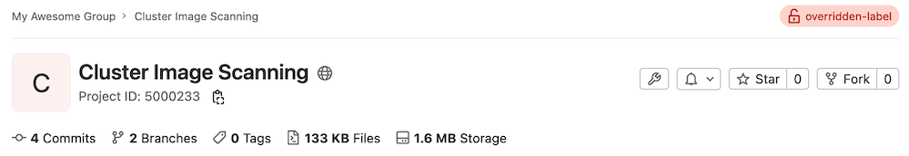



- Tier: 基础版，专业版，旗舰版
- Offering: 私有化部署



在高度受控的环境中，访问策略可能需要由外部服务控制，该服务根据项目分类和用户访问权限来授予访问权限。极狐GitLab 提供了一种方式，让您可以使用自己定义的服务来检查项目授权。

配置并启用外部服务后，当访问某个项目时，会向外部服务发送一个请求，其中包含用户信息以及分配给该项目的分类标记。当服务返回已知响应时，结果会被缓存六个小时。

如果启用了外部授权，极狐GitLab 还会进一步阻止渲染跨项目数据的页面和功能，包括：

- 仪表板下的大多数页面（活动、里程碑、代码片段、指派给您的合并请求、指派给您的议题、待办事项列表）。
- 特定群组下的页面（活动、贡献分析、议题、议题看板、标记、里程碑、合并请求）。
- 全局搜索和群组搜索会被禁用。

这样做是为了避免一次性向外部授权服务发送过多请求。

每当访问被授予或拒绝时，都会记录到名为 `external-policy-access-control.log`的日志文件中。要详细了解极狐GitLab 保留的日志，请参阅 [Linux 软件包文档](https://gitlab.cn/docs/omnibus/settings/logs/)。

使用自签名证书进行 TLS 认证时，CA 证书需要被 OpenSSL 安装所信任。如果使用通过 Linux 软件包安装的极狐GitLab，请参阅 [Linux 软件包文档](https://gitlab.cn/docs/omnibus/settings/ssl/)了解如何安装自定义 CA。或者，使用 `openssl version -d`了解自定义证书的安装位置。

<a id="configuration"></a>

## 配置

管理员可以启用外部授权服务：

1. 在右上角，选择**管理员**。
1. 在左侧边栏中，选择**设置** > **通用**。
1. 展开**外部授权**。
1. 填写各字段。
1. 选择**保存更改**。

<a id="allow-external-authorization-with-deploy-tokens-and-deploy-keys"></a>

### 允许使用部署令牌和部署密钥进行外部授权

您可以将实例设置为允许使用[部署令牌](../../user/project/deploy_tokens/_index.md)或[部署密钥](../../user/project/deploy_keys/_index.md)对 Git 操作进行外部授权。

先决条件：

- 您必须使用不带服务 URL 的分类标记来进行外部授权。

要允许使用部署令牌和部署密钥进行授权：

1. 在右上角，选择**管理员**。
1. 在左侧边栏中，选择**设置** > **通用**。
1. 展开**外部授权**，然后：
   - 将服务 URL 字段留空。
   - 选择**允许部署令牌和部署密钥与外部授权一起使用**。
1. 选择**保存更改**。

> [!warning]
> 如果启用外部授权，部署令牌将无法访问容器镜像仓库或软件包仓库。如果您使用部署令牌访问这些仓库，此措施会破坏这些令牌的此类用途。要使用令牌访问容器镜像仓库或软件包仓库，请禁用外部授权。

<a id="how-gitlab-connects-to-an-external-authorization-service"></a>

## 极狐GitLab 如何连接到外部授权服务

当极狐GitLab 请求访问权限时，它会向外部服务发送一个 JSON POST 请求，请求体如下：

```json
{
  "user_identifier": "jane@acme.org",
  "project_classification_label": "project-label",
  "user_ldap_dn": "CN=Jane Doe,CN=admin,DC=acme",
  "identities": [
    { "provider": "ldap", "extern_uid": "CN=Jane Doe,CN=admin,DC=acme" },
    { "provider": "bitbucket", "extern_uid": "2435223452345" }
  ]
}
```

`user_ldap_dn` 是可选的，仅在用户通过 LDAP 登录时才会发送。

`identities` 包含与该用户关联的所有身份详情。如果该用户没有关联任何身份，则为空数组。

当外部授权服务返回状态码 200 时，用户被授予访问权限。当外部服务返回状态码 401 或 403 时，用户被拒绝访问。无论哪种情况，请求都会被缓存六个小时。

拒绝访问时，可以在 JSON 请求体中可选地指定 `reason`：

```json
{
  "reason": "You are not allowed access to this project."
}
```

除 200、401 或 403 之外的任何其他状态码也会拒绝用户访问，但响应不会被缓存。

如果服务超时（超过 500 毫秒），会显示消息“External Policy Server did not respond”。

<a id="classification-labels"></a>

## 分类标记

您可以在项目的**设置** > **通用** > **常规项目设置**页面的“分类标记”框中，使用您自己的分类标记。当项目未指定分类标记时，将使用[全局设置](#configuration)中定义的默认标记。

在所有项目页面的右上角，都会显示该标记。


