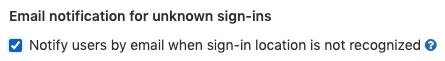



- Tier: 基础版，专业版，旗舰版
- Offering: 私有化部署



使用登录限制可为 Web 界面和 Git over HTTP(S) 自定义身份验证限制。

先决条件：

- 您必须具有管理员访问权限。

<a id="password-and-passkey-authentication"></a>

## 密码和通行密钥身份验证

<a id="allow-password-and-passkey-authentication-for-the-web-interface"></a>

### 允许 Web 界面使用密码和通行密钥身份验证

此设置默认启用。禁用后，用户将无法使用标准登录界面，而必须改用[外部身份验证提供商](../auth/_index.md)。这还会禁用使用通行密钥进行双重身份验证。

要允许 Web 界面使用密码和通行密钥身份验证：

1. 在右上角，选择**管理员**。
1. 在左侧边栏中，选择**设置** > **通用**。
1. 展开**登录限制**部分。
1. 选中**允许 Web 界面使用密码和通行密钥身份验证**复选框。
1. 选择**保存更改**。

> [!note]
> 如果外部身份验证提供商发生故障，请使用 [GitLab Rails 控制台](../operations/rails_console.md)
> [重新启用标准 Web 登录表单](#re-enable-standard-web-sign-in-form-in-rails-console)。
> 您也可以使用[应用设置 API](../../api/settings.md#update-application-settings)
> 来配置 `password_authentication_enabled_for_web` 设置。

<a id="allow-password-authentication-for-git-over-https"></a>

### 允许 Git over HTTP(S) 使用密码身份验证

此设置默认启用。禁用后，用户必须使用[个人访问令牌](../../user/profile/personal_access_tokens.md)或 LDAP 密码进行身份验证。

要允许 Git over HTTP(S) 使用密码身份验证：

1. 在右上角，选择**管理员**。
1. 在左侧边栏中，选择**设置** > **通用**。
1. 展开**登录限制**部分。
1. 选中**允许 Git over HTTP(S) 使用密码身份验证**复选框。
1. 选择**保存更改**。

<a id="disable-password-and-passkey-authentication-for-users-with-an-sso-identity"></a>

### 为具有 SSO 身份的用户禁用密码和通行密钥身份验证

组织可能希望限制 SSO 用户使用密码或通行密钥登录，并要求他们改用外部身份验证提供商。这会同时限制 Web 界面和 Git over HTTP(S) 的密码身份验证，以及 Web 界面的通行密钥身份验证。通行密钥永远不能用于 Git over HTTP(S)。

要为具有 SSO 身份的用户禁用密码和通行密钥身份验证：

1. 在右上角，选择**管理员**。
1. 在左侧边栏中，选择**设置** > **通用**。
1. 展开**登录限制**部分。
1. 选中**为具有 SSO 身份的用户禁用密码和通行密钥身份验证**复选框。
1. 选择**保存更改**。

<a id="two-factor-authentication"></a>

## 双重身份验证

您可以要求用户为其账号注册双重身份验证 (2FA) 方式。

<a id="enforce-two-factor-authentication-for-all-users"></a>

### 为所有用户强制使用双重身份验证

这会要求所有用户（包括管理员）注册 2FA 方式。

要为所有用户强制使用双重身份验证：

1. 在右上角，选择**管理员**。
1. 在左侧边栏中，选择**设置** > **通用**。
1. 展开**登录限制**部分。
1. 选中**强制使用双重身份验证**复选框。
1. 可选。在**双重身份验证宽限期**中，输入小时数。用户必须在此时间结束时注册 2FA
   方式。设置为 `0` 以强制在下次登录时注册。
1. 选择**保存更改**。

<a id="enforce-two-factor-authentication-for-administrators"></a>

### 为管理员强制使用双重身份验证

这仅要求管理员注册 2FA 方式。这也包括具有[自定义管理员角色](../../user/custom_roles/_index.md)的用户。

要为管理员强制使用双重身份验证：

1. 在右上角，选择**管理员**。
1. 在左侧边栏中，选择**设置** > **通用**。
1. 展开**登录限制**部分。
1. 选中**为管理员强制使用双重身份验证**复选框。
1. 可选。在**双重身份验证宽限期**中，输入小时数。用户必须在此时间结束时注册 2FA
   方式。设置为 `0` 以强制在下次登录时注册。
1. 选择**保存更改**。

<a id="enable-email-otp"></a>

### 启用电子邮件 OTP

要允许用户配置[电子邮件一次性密码](../../user/profile/account/two_factor_authentication.md#enable-email-otp)：

1. 在右上角，选择**管理员**。
1. 在左侧边栏中，选择**设置** > **通用**。
1. 展开**登录限制**部分。
1. 同时选中**启用基于电子邮件的一次性密码**复选框
   和**账号被锁定时要求电子邮件验证**复选框。
1. 选择**保存更改**。

<a id="admin-mode"></a>

## 管理员模式

如果您是管理员，您可能希望在不具有管理员访问权限的情况下使用极狐GitLab。您可以创建一个不具有管理员访问权限的单独用户账号，或使用管理员模式。

使用管理员模式时，您的账号默认不具有管理员访问权限。您仍可以访问您是成员的群组和项目。但是，对于管理任务，您必须进行身份验证（[某些功能](#known-issues)除外）。

启用管理员模式后，它会应用于实例上的所有管理员。

为实例启用管理员模式后，管理员：

- 可以访问他们是成员的群组和项目。
- 无法访问**管理**区域。

<a id="enable-admin-mode-for-your-instance"></a>

### 为您的实例启用管理员模式

管理员可以通过 API、Rails 控制台或 UI 启用管理员模式。

<a id="use-the-api-to-enable-admin-mode"></a>

#### 使用 API 启用管理员模式

向您的实例端点发出以下请求：

```shell
curl --request PUT --header "PRIVATE-TOKEN:$ADMIN_TOKEN" "<gitlab.example.com>/api/v4/application/settings?admin_mode=true"
```

将 `<gitlab.example.com>` 替换为您的实例 URL。

有关更多信息，请参阅[可通过 API 调用访问的设置列表](../../api/settings.md)。

<a id="use-the-rails-console-to-enable-admin-mode"></a>

#### 使用 Rails 控制台启用管理员模式



- Offering: 私有化部署



打开 [Rails 控制台](../operations/rails_console.md)并运行以下命令：

```ruby
::Gitlab::CurrentSettings.update!(admin_mode: true)
```

<a id="use-the-ui-to-enable-admin-mode"></a>

#### 使用 UI 启用管理员模式

要通过 UI 启用管理员模式：

1. 在右上角，选择**管理员**。
1. 在左侧边栏中，选择**设置** > **通用**。
1. 展开**登录限制**。
1. 选择**启用管理员模式**。
1. 选择**保存更改**。

<a id="turn-on-admin-mode-for-your-session"></a>

### 为您的会话开启管理员模式

要为当前会话开启管理员模式并访问可能具有风险的资源：

1. 在右上角，选择您的头像。
1. 选择**进入管理员模式**。
1. 尝试访问 URL 中包含 `/admin`的任何 UI 部分（这需要管理员访问权限）。

当管理员模式状态被禁用或关闭时，管理员无法访问资源，除非他们已被明确授予访问权限。例如，如果管理员尝试打开私有群组或项目，他们会收到 `404` 错误，除非他们是该群组或项目的成员。

应为管理员启用 2FA。管理员模式支持 2FA、OmniAuth 提供商和 LDAP 身份验证。管理员模式状态存储在当前的用户会话中，并保持活动状态，直到：

- 它被明确禁用。
- 它在六小时后被自动禁用。

<a id="check-if-your-session-has-admin-mode-enabled"></a>

### 检查您的会话是否启用了管理员模式

转到您的活动会话列表：

1. 在右上角，选择您的头像。
1. 选择**编辑个人资料**。
1. 在左侧边栏中，选择**访问** > **活动会话**。

已开启管理员模式的会话会显示文本**在 `date of session` 以管理员模式登录**。

<a id="turn-off-admin-mode-for-your-session"></a>

### 为您的会话关闭管理员模式

要为当前会话关闭管理员模式：

1. 在右上角，选择您的头像。
1. 选择**离开管理员模式**。

<a id="known-issues"></a>

### 已知问题

管理员模式会在六小时后超时，您无法更改此超时限制。

以下访问方式不受管理员模式保护：

- Git 客户端访问（使用公钥的 SSH 或使用个人访问令牌的 HTTPS）。

换句话说，受管理员模式限制的管理员仍然可以使用 Git 客户端，而无需额外的身份验证步骤。

要使用极狐GitLab REST 或 GraphQL API，管理员必须[创建个人访问令牌](../../user/profile/personal_access_tokens.md#create-a-personal-access-token)或 [OAuth 令牌](../../api/oauth2.md)，并具有 [`admin_mode` 范围](../../security/tokens/access_token_scopes.md)。

如果持有具有 `admin_mode` 范围的个人访问令牌的管理员失去了管理员访问权限，该用户即使仍持有具有 `admin_mode` 范围的令牌，也无法以管理员身份访问 API。有关更多信息，请参阅[史诗 2158](https://gitlab.com/groups/gitlab-org/-/work_items/2158)。

此外，启用极狐GitLab Geo 后，您在从节点上时无法查看项目和设计的复制状态。当项目（[议题 367926](https://gitlab.com/gitlab-org/gitlab/-/issues/367926)）和设计（[议题 355660](https://gitlab.com/gitlab-org/gitlab/-/issues/355660)）迁移到新的 Geo 框架后，将提出修复方案。

<a id="troubleshooting-admin-mode"></a>

### 故障排除管理员模式

如有必要，管理员可以使用以下两种方法之一禁用**管理员模式**：

- API：

  ```shell
  curl --request PUT --header "PRIVATE-TOKEN:$ADMIN_TOKEN" "<gitlab-url>/api/v4/application/settings?admin_mode=false"
  ```

- [Rails 控制台](../operations/rails_console.md#starting-a-rails-console-session)：

  ```ruby
  ::Gitlab::CurrentSettings.update!(admin_mode: false)
  ```

<a id="email-notification-for-unknown-sign-ins"></a>

## 未知登录的电子邮件通知

启用后，极狐GitLab 会通知用户来自未知 IP 地址或设备的登录。有关更多信息，请参阅[未知登录的电子邮件通知](../../user/profile/notifications.md#notifications-for-unknown-sign-ins)。



<a id="sign-in-information"></a>

## 登录信息

所有未登录的用户都会被重定向到配置的**主页 URL** 所表示的页面（如果该值不为空）。

所有用户在退出登录后都会被重定向到配置的**退出登录页面 URL** 所表示的页面（如果该值不为空）。

要向登录页面添加帮助消息，请[自定义您的登录和注册页面](../appearance.md#customize-your-sign-in-and-register-pages)。

<a id="troubleshooting"></a>

## 故障排除

<a id="re-enable-standard-web-sign-in-form-in-rails-console"></a>

### 在 Rails 控制台中重新启用标准 Web 登录表单



- Offering: 私有化部署



如果标准用户名和密码登录表单因[登录限制](#password-and-passkey-authentication)而被禁用，请重新启用它。

当配置的外部身份验证提供商（通过 SSO 或 LDAP 配置）发生故障，且需要直接登录访问极狐GitLab 时，您可以通过 [Rails 控制台](../operations/rails_console.md#starting-a-rails-console-session)使用此方法。

```ruby
Gitlab::CurrentSettings.update!(password_authentication_enabled_for_web: true)
```
