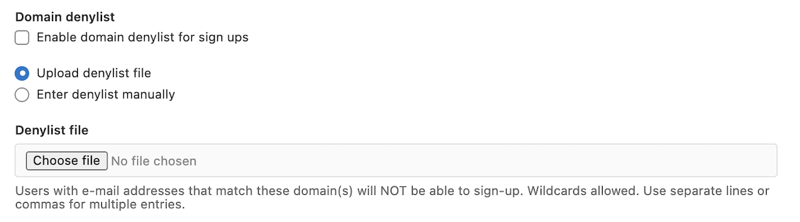



- Tier: 基础版，专业版，旗舰版
- Offering: 私有化部署



您可以对新用户账号实施以下限制：

- 阻止账号创建。
- 要求新账号必须经管理员审批。
- 要求用户确认邮箱。
- 允许或拒绝使用特定邮箱域名的新账号。

<a id="prerequisites"></a>

## 先决条件

您必须拥有管理员访问权限。

<a id="disable-new-user-account-creation"></a>

## 禁用新用户账号创建

默认情况下，任何访问您极狐GitLab 域名的用户都可以创建账号。对于运行面向公众的极狐GitLab 实例的客户，如果您不希望公众用户创建账号，强烈建议您考虑禁用新账号创建。

要阻止新账号创建：

1. 在右上角，选择**管理员**。
1. 在左侧边栏中，选择**设置** > **通用**。
1. 展开**新用户账号限制**。
1. 清除**允许新用户账号**复选框，然后选择**保存更改**。

您也可以通过 [Rails 控制台](../operations/rails_console.md)运行以下命令来阻止新用户账号：

```ruby
::Gitlab::CurrentSettings.update!(signup_enabled: false)
```

<a id="require-administrator-approval-for-new-user-accounts"></a>

## 要求新用户账号必须经管理员审批

对于新的极狐GitLab 实例，此设置默认启用。启用此设置后，任何访问您极狐GitLab 域名并通过注册表单注册新账号的用户，都必须经管理员明确批准后才能开始使用其账号。此设置仅在允许用户账号时适用。

要要求新用户账号必须经管理员审批：

1. 在右上角，选择**管理员**。
1. 在左侧边栏中，选择**设置** > **通用**。
1. 展开**新用户账号限制**。
1. 选中**新用户账号需要管理员批准**复选框，然后选择**保存更改**。

如果管理员禁用此设置，处于待审批状态的用户将在后台作业中自动获得批准。

> [!note]
> 此设置不适用于 LDAP 或 OmniAuth 用户。要对使用 OmniAuth 或 LDAP
> 注册的新用户强制实施审批，请在
> [OmniAuth 配置](../../integration/omniauth.md#configure-common-settings)或
> [LDAP 配置](../auth/ldap/_index.md#basic-configuration-settings)中将 `block_auto_created_users` 设置为 `true`。
> 也可以使用[用户上限](../../subscriptions/manage_seats.md#user-cap)来对新用户强制实施审批。

<a id="confirm-user-email"></a>

## 确认用户邮箱

您可以在创建账号时发送确认邮件，并要求用户在允许登录前确认其邮箱地址。

要对新账号使用的邮箱地址强制实施确认：

1. 在右上角，选择**管理员**。
1. 在左侧边栏中，选择**设置** > **通用**。
1. 展开**新用户账号限制**。
1. 在**电子邮件确认设置**下，选择**严格**。

以下设置可用：

- **严格** - 在创建账号时发送确认邮件。新用户必须确认其邮箱地址后才能登录。
- **宽松** - 在创建账号时发送确认邮件。新用户可以立即登录，但必须在三天内确认其邮箱。三天后，用户必须确认邮箱才能登录。
- **关闭** - 新用户无需确认邮箱地址即可登录。

<a id="turn-on-restricted-access"></a>

## 开启受限访问

先决条件：

- 您必须是管理员。
- 该群组或其某个子群组或项目不得对外共享。

要开启受限访问：

1. 在左侧边栏中，选择**设置** > **通用**。
1. 展开**新用户账号限制**。
1. 在**席位控制**下，选择**受限访问**。

<a id="set-a-user-cap"></a>

## 设置用户上限

先决条件：

- 您必须是管理员。

要设置用户上限：

1. 在右上角，选择**管理员**。
1. 在左侧边栏中，选择**设置** > **通用**。
1. 展开**新用户账号限制**。
1. 在**用户上限**字段中，输入一个数字，或留空表示不限制。
1. 选择**保存更改**。

<a id="remove-the-user-cap"></a>

## 移除用户上限

移除用户上限，这样无需管理员审批即可创建账号的新用户数量就不再受到限制。

移除用户上限后，待审批的用户将自动获得批准。

先决条件：

- 您必须是管理员。

要移除用户上限：

1. 在右上角，选择**管理员**。
1. 在左侧边栏中，选择**设置** > **通用**。
1. 展开**新用户账号限制**。
1. 从**用户上限**中移除数字。
1. 选择**保存更改**。

<a id="modify-password-complexity-requirements"></a>

## 修改密码复杂度要求

默认情况下，用户密码有数量有限的[要求](../../user/profile/user_passwords.md#password-requirements)。您可以修改这些要求，以增加最小长度或要求特定字符类型。

更改密码要求不会影响现有用户密码。修改后的复杂度要求仅在以下情况下强制执行：

- 新用户创建账号时。
- 现有用户重置密码时。

要修改密码复杂度要求：

1. 在右上角，选择**管理员**。
1. 在左侧边栏中，选择**设置** > **通用**。
1. 展开**新用户账号限制**。
1. 修改复杂度要求：

   | 设置 | 描述 |
   |---------|-------------|
   | **最小密码长度** | 设置所需的最小字符数。不能少于 8 个字符，也不能多于 128 个字符。 |
   | **要求数字** | 要求密码至少包含一个数字（0-9）。仅专业版和旗舰版可用。 |
   | **要求大写字母** | 要求密码至少包含一个大写字母（A-Z）。仅专业版和旗舰版可用。 |
   | **要求小写字母** | 要求密码至少包含一个小写字母（a-z）。仅专业版和旗舰版可用。 |
   | **要求符号** | 要求密码至少包含一个符号。仅专业版和旗舰版可用。 |

1. 选择**保存更改**。

<a id="allow-or-deny-account-creation-by-using-specific-email-domains"></a>

## 使用特定邮箱域名允许或拒绝账号创建

您可以指定可用于新用户账号的邮箱域名的包含列表或排除列表。

这些限制仅在外部用户创建新账号时应用。管理员可以通过管理员面板添加使用被禁止域名的用户。用户也可以在创建账号后将其邮箱地址更改为被禁止的域名。

<a id="allowlist-email-domains"></a>

### 允许名单邮箱域名

您可以限制用户只能使用与给定域名列表匹配的邮箱地址创建用户账号。

<a id="denylist-email-domains"></a>

### 拒绝名单邮箱域名

您可以阻止用户使用特定域名的邮箱地址注册。这可以降低恶意用户使用一次性邮箱地址创建垃圾账号的风险。

<a id="create-email-domain-allowlist-or-denylist"></a>

### 创建邮箱域名允许名单或拒绝名单

要创建邮箱域名允许名单或拒绝名单：

1. 在右上角，选择**管理员**。
1. 在左侧边栏中，选择**设置** > **通用**。
1. 展开**新用户账号限制**。
1. 对于允许名单，您必须手动输入列表。对于拒绝名单，您可以手动输入列表，
   或上传包含列表条目的 `.txt` 文件。

   允许名单和拒绝名单都接受通配符。例如，您可以使用
   `*.company.com` 接受所有 `company.com` 子域名，或使用 `*.io` 阻止所有
   以 `.io` 结尾的域名。域名之间必须用空格、
   分号、逗号或换行符分隔。

   

<a id="set-up-ldap-user-filter"></a>

## 设置 LDAP 用户过滤器

您可以将极狐GitLab 访问权限限制为 LDAP 服务器上的部分 LDAP 用户。

有关更多信息，请参阅[设置 LDAP 用户过滤器的文档](../auth/ldap/_index.md#set-up-ldap-user-filter)。

<a id="turn-on-administrator-approval-for-role-promotions"></a>

## 开启角色提升的管理员审批



- Tier: 旗舰版
- Offering: 私有化部署



要阻止现有用户被提升为项目或群组中的计费角色，请开启角色提升的管理员审批。然后，您可以批准或拒绝[待管理员审批](../moderate_users.md#view-users-pending-role-promotion)的提升请求。

- 如果管理员将用户添加到群组或项目：
  - 如果新用户角色是[计费角色](../../subscriptions/manage_seats.md#billable-users)，
    该用户的所有其他成员资格请求将自动获得批准。
  - 如果新用户角色不是计费角色，该用户的其他请求将保持待审批状态，直到管理员审批。
- 如果非管理员用户将用户添加到群组或项目：
  - 如果该用户在任何群组或项目中都没有计费角色，并被添加或提升为计费角色，
    其请求将保持[待管理员审批](../moderate_users.md#view-users-pending-role-promotion)。
  - 如果该用户已有计费角色，则无需管理员审批。

先决条件：

- 您必须是管理员。

要开启角色提升的审批：

1. 在右上角，选择**管理员**。
1. 在左侧边栏中，选择**设置** > **通用**。
1. 展开**新用户账号限制**。
1. 在**席位控制**部分，选择**批准角色提升**。

> [!note]
> 此审批要求不适用于通过
> [LDAP 同步](../auth/ldap/ldap_synchronization.md)
> 或 [SAML 群组链接](../../user/group/saml_sso/group_sync.md)授予的成员资格。通过 LDAP 或 SAML
> 获得角色提升的用户无需管理员审批，无论他们之前
> 是否拥有计费角色。
