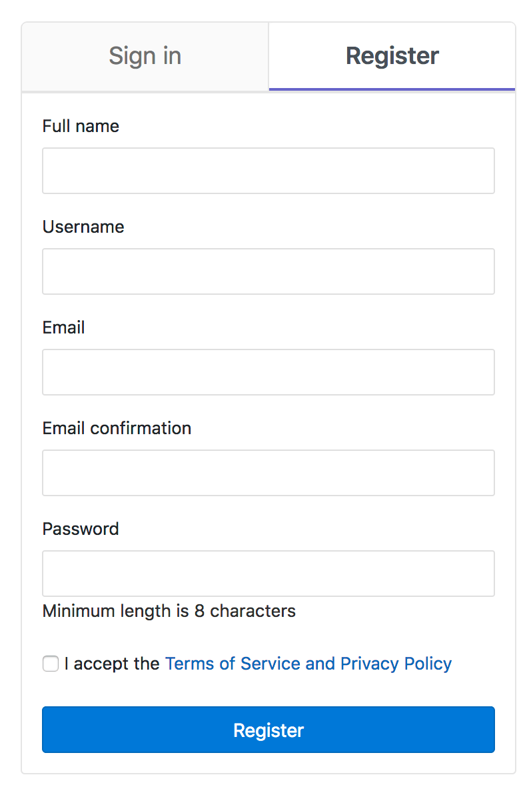



- Tier: 基础版，专业版，旗舰版
- Offering: 私有化部署



管理员可以强制要求接受服务条款和隐私政策。启用此选项后，新用户和现有用户都必须接受这些条款。

启用后，您可以在实例的 `-/users/terms` 页面查看服务条款，例如 `https://gitlab.example.com/-/users/terms`。

如果定义了任何条款，帮助菜单中将显示 `Terms and privacy` 链接。

## 强制要求接受服务条款和隐私政策

要强制要求接受服务条款和隐私政策：

1. 在右上角，选择**管理员**。
1. 在左侧边栏中，选择**设置** > **通用**。
1. 展开**服务条款和隐私政策**部分。
1. 勾选**所有用户必须接受服务条款和隐私政策才能访问极狐GitLab** 复选框。
1. 输入**服务条款和隐私政策**的文本。您可以在此文本框中
   使用 [Markdown](../../user/markdown.md)。
1. 选择**保存更改**。

每次更新条款时，都会存储一个新版本。当用户接受或拒绝条款时，极狐GitLab 会记录他们接受或拒绝的版本。

现有用户必须在下次与极狐GitLab 交互时接受这些条款。如果已认证用户拒绝这些条款，系统会将其退出登录。

启用后，它会在新用户账户页面添加一个必填复选框：

