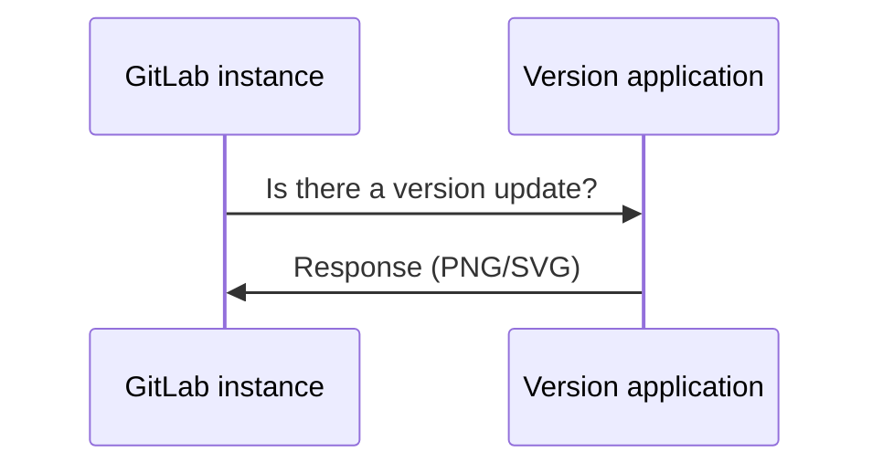



- Tier: 基础版，专业版，旗舰版
- Offering: 私有化部署



极狐GitLab 定期收集有关您实例的信息，以执行各种操作。

对于基础版极狐GitLab 私有化部署实例，所有使用情况统计均为[可选择退出](#enable-or-disable-service-ping)。

<a id="service-ping"></a>

## Service Ping

Service Ping 是每周收集并向极狐GitLab 发送载荷的流程。
启用 Service Ping 后，极狐GitLab 会收集其他实例的数据，并启用某些依赖 Service Ping 的[实例级分析功能](../../user/analytics/_index.md)。

<a id="why-enable-service-ping"></a>

### 为什么要启用 Service Ping？

Service Ping 的主要目的是打造更好的极狐GitLab。我们收集有关极狐GitLab 使用方式的数据，以了解功能或阶段的采用情况和使用情况。这些数据可让我们深入了解极狐GitLab 如何创造价值，并帮助我们的团队理解人们使用极狐GitLab 的原因，借助这些知识，我们能够做出更好的产品决策。

启用 Service Ping 还有其他几项好处：

- 分析您的极狐GitLab 安装中用户随时间的活动情况。
- [DevOps 评分](../analytics/devops_adoption.md)，让您大致了解整个实例从规划到监控对并发 DevOps 的采用情况。
- 通过客户成功经理（CSM）利用所收集的数据提供更主动的支持。
- 就如何从极狐GitLab 投资中获得最大价值提供洞察和建议。
- 展示您与其他类似组织（匿名化）对比情况的报告，并附有关于如何改进 DevOps 流程的具体建议和推荐。
- 参与我们的[注册功能计划](#registration-features-program)，以获取免费的付费功能。

<a id="service-ping-settings"></a>

### Service Ping 设置

极狐GitLab 提供三项与 Service Ping 相关的设置：

- **启用 Service Ping**：控制是否将 Service Ping 数据发送到极狐GitLab。
- **启用 Service Ping 生成**：控制是否在您的实例上生成 Service Ping 数据。
- **在 Service Ping 中包含可选数据**：控制是否在 Service Ping 数据中包含可选指标。

这三项设置的交互方式如下：

- 启用 **Service Ping** 后，**Service Ping 生成**会自动启用，且无法禁用。
- 禁用 **Service Ping** 后，您可以独立控制 **Service Ping 生成**。
- **在 Service Ping 中包含可选数据**仅在启用 **Service Ping** 或 **Service Ping 生成**时可用。

<a id="registration-features-program"></a>

## 注册功能计划

在极狐GitLab 私有化部署实例上运行极狐GitLab 企业版的基础版客户，可以通过[启用注册功能](#enable-registration-features)并通过 Service Ping 向我们发送活动数据，来获取付费功能。此处引入的功能不会将该功能从其付费层级中移除。付费层级的实例须遵守由 [Cloud Licensing](https://about.gitlab.com/pricing/licensing-faq/cloud-licensing/) 管理的[产品使用数据政策](https://handbook.gitlab.com/handbook/legal/privacy/customer-product-usage-information/)。

<a id="available-features"></a>

### 可用功能

注册功能计划提供以下功能：

- [来自极狐GitLab 的电子邮件](../email_from_gitlab.md)
- [代码仓库大小限制](account_and_limit_settings.md#repository-size-limit)
- [按 IP 地址限制群组访问](../../user/group/access_and_permissions.md#restrict-group-access-by-ip-address)
- [查看描述变更历史](../../user/discussions/_index.md#view-description-change-history)
- [维护模式](../maintenance_mode/_index.md)
- [可配置的议题看板](../../user/project/issue_board.md#configurable-issue-boards)
- [覆盖率引导的模糊测试](../../user/application_security/coverage_fuzzing/_index.md)
- [修改密码复杂度要求](sign_up_restrictions.md#modify-password-complexity-requirements)
- [群组 Wiki](../../user/project/wiki/group.md)
- [议题分析](../../user/group/issues_analytics/_index.md)
- [电子邮件中的自定义文本](email.md#custom-additional-text)
- [贡献分析](../../user/group/contribution_analytics/_index.md)
- [群组文件模板](../../user/group/manage.md#group-file-templates)
- [群组 Webhook](../../user/project/integrations/webhooks.md#group-webhooks)
- [服务级别协议倒计时](../../operations/incident_management/incidents.md#service-level-agreement-countdown-timer)
- [将项目成员资格锁定到群组](../../user/group/access_and_permissions.md#prevent-members-from-being-added-to-projects-in-a-group)
- [用户和权限报告](../admin_area.md#user-permission-export)
- [高级搜索](../../user/search/advanced_search.md)
- [按群组的 DevOps 采用情况](../../user/group/devops_adoption/_index.md)
- [按实例的 DevOps 采用情况](../analytics/devops_adoption.md)
- [带产物依赖的跨项目流水线](../../ci/yaml/_index.md#needsproject)
- [功能标志相关议题](../../operations/feature_flags.md#feature-flag-related-issues)
- [合并结果流水线](../../ci/pipelines/merged_results_pipelines.md)
- [外部代码仓库的 CI/CD](../../ci/ci_cd_for_external_repos/_index.md)
- [GitHub 的 CI/CD](../../ci/ci_cd_for_external_repos/github_integration.md)
- [代码仓库镜像](../../user/project/repository/mirror/_index.md)

<a id="enable-registration-features"></a>

### 启用注册功能

1. 以具有管理员访问权限的用户身份登录。
1. 在右上角，选择**管理员**。
1. 在左侧边栏中，选择**设置** > **指标和分析**。
1. 展开**使用情况统计**部分。
1. 如果尚未启用，请选中**启用 Service Ping** 复选框。
1. 选中**启用注册功能**复选框。
1. 选择**保存更改**。

<a id="version-check"></a>

## 版本检查

如果启用，版本检查会通过状态告知您是否有新版本可用及其重要性。该状态会显示在所有已认证用户的帮助页面（`/help`）上，以及**管理**区域页面上。状态包括：

- 绿色：您正在运行最新版本的极狐GitLab。
- 橙色：有更新版本的极狐GitLab 可用。
- 红色：您正在运行的极狐GitLab 版本存在漏洞。您应尽快安装包含安全修复的最新版本。


<a id="enable-or-disable-version-check"></a>

### 启用或禁用版本检查

先决条件：

- 管理员访问权限。

1. 在右上角，选择**管理员**。
1. 在左侧边栏中，选择**设置** > **指标和分析**。
1. 展开**使用情况统计**。
1. 选中或清除**启用版本检查**复选框。
1. 选择**保存更改**。

<a id="request-flow-example"></a>

### 请求流程示例

以下示例展示了您的实例与 GitLab 版本应用程序之间的基本请求/响应流程：



<a id="configure-your-network"></a>

## 配置您的网络

要将使用情况统计发送到极狐GitLab，您必须允许从您的极狐GitLab 实例到主机 `version.gitlab.com`的 `443` 端口的网络流量。

如果您的极狐GitLab 实例位于代理后面，请设置相应的[代理配置变量](https://gitlab.cn/docs/omnibus/settings/environment-variables/)。

<a id="enable-or-disable-service-ping"></a>

## 启用或禁用 Service Ping

> [!note]
> 您能否完全禁用 Service Ping 取决于实例的层级和具体许可证。
> Service Ping 设置仅控制数据是与极狐GitLab 共享，还是仅限于实例内部使用。
> 即使您禁用 Service Ping，`gitlab_service_ping_worker` 后台作业仍会定期为您的实例生成 Service Ping 载荷。
> 该载荷可在[指标和分析](#manually-upload-service-ping-payload)管理部分中查看。

<a id="through-the-ui"></a>

### 通过 UI

先决条件：

- 管理员访问权限。

要启用或禁用 Service Ping：

1. 在右上角，选择**管理员**。
1. 在左侧边栏中，选择**设置** > **指标和分析**。
1. 展开**使用情况统计**。
1. 选中或清除**启用 Service Ping** 复选框。
1. 选择**保存更改**。

<a id="through-the-configuration-file"></a>

### 通过配置文件

要禁用 Service Ping 并防止将来通过**管理**区域对其进行配置。





1. 编辑 `/etc/gitlab/gitlab.rb`：

   ```ruby
   gitlab_rails['usage_ping_enabled'] = false
   ```

1. 重新配置极狐GitLab：

   ```shell
   sudo gitlab-ctl reconfigure
   ```





1. 编辑 `/home/git/gitlab/config/gitlab.yml`：

   ```yaml
   production: &base
     # ...
     gitlab:
       # ...
       usage_ping_enabled: false
   ```

1. 重启极狐GitLab：

   ```shell
   sudo service gitlab restart
   ```





<a id="enable-or-disable-service-ping-generation"></a>

## 启用或禁用 Service Ping 生成

Service Ping 生成控制是否在您的实例上自动生成 Service Ping 数据。启用后，极狐GitLab 会定期生成包含使用情况统计的 Service Ping 载荷。此设置独立于数据是否与极狐GitLab 共享。

<a id="through-the-ui-1"></a>

### 通过 UI

先决条件：

- 管理员访问权限。

要启用或禁用 Service Ping 生成：

1. 在右上角，选择**管理员**。
1. 在左侧边栏中，选择**设置** > **指标和分析**。
1. 展开**使用情况统计**。
1. 选中或清除**启用 Service Ping 生成**复选框。
   - 如果选中**启用 Service Ping**，此设置会自动启用并禁止交互。
   - 如果清除**启用 Service Ping**，您可以独立控制此设置。
1. 选择**保存更改**。

<a id="through-the-configuration-file-1"></a>

### 通过配置文件

要通过配置控制 Service Ping 生成：





1. 编辑 `/etc/gitlab/gitlab.rb`：

   ```ruby
   gitlab_rails['usage_ping_enabled'] = false
   gitlab_rails['usage_ping_generation_enabled'] = false
   ```

1. 重新配置极狐GitLab：

   ```shell
   sudo gitlab-ctl reconfigure
   ```





1. 编辑 `/home/git/gitlab/config/gitlab.yml`：

   ```yaml
   production: &base
     # ...
     gitlab:
       # ...
       usage_ping_enabled: false
       usage_ping_generation_enabled: false
   ```

1. 重启极狐GitLab：

   ```shell
   sudo service gitlab restart
   ```





<a id="enable-or-disable-optional-data-in-service-ping"></a>

## 启用或禁用 Service Ping 中的可选数据

极狐GitLab 区分运营数据和可选收集数据。

> [!note]
> **在 Service Ping 中包含可选数据**选项仅在启用**启用 Service Ping** 或**启用 Service Ping 生成**时可用。如果两项设置均被禁用，此选项会自动禁用。

<a id="through-the-ui-2"></a>

### 通过 UI

先决条件：

- 管理员访问权限。

要启用或禁用 Service Ping 中的可选数据：

1. 在右上角，选择**管理员**。
1. 转到**设置** > **指标和分析**。
1. 展开**使用情况统计**部分。
1. 确保选中**启用 Service Ping** 或**启用 Service Ping 生成**的复选框。
1. 要启用可选数据，请选中**在 Service Ping 中包含可选数据**复选框。要禁用，请清除该复选框。
1. 选择**保存更改**。

<a id="through-the-configuration-file-2"></a>

### 通过配置文件





1. 编辑 `/etc/gitlab/gitlab.rb`：

   ```ruby
   gitlab_rails['include_optional_metrics_in_service_ping'] = false
   ```

1. 重新配置极狐GitLab：

   ```shell
   sudo gitlab-ctl reconfigure
   ```





1. 编辑 `/home/git/gitlab/config/gitlab.yml`：

   ```yaml
   production: &base
     # ...
     gitlab:
       # ...
       include_optional_metrics_in_service_ping: false
   ```

1. 重启极狐GitLab：

   ```shell
   sudo service gitlab restart
   ```





<a id="access-the-service-ping-payload"></a>

## 访问 Service Ping 载荷

您可以在**管理**区域中或通过 API 访问发送到极狐GitLab 的确切 JSON 载荷。

<a id="in-the-ui"></a>

### 在 UI 中

1. 以具有管理员访问权限的用户身份登录。
1. 在右上角，选择**管理员**。
1. 在左侧边栏中，选择**设置** > **指标和分析**。
1. 展开**使用情况统计**。
1. 选择**预览载荷**。

<a id="through-the-api"></a>

### 通过 API

请参阅 [Service Ping API 文档](../../api/usage_data.md)。

<a id="manually-upload-service-ping-payload"></a>

## 手动上传 Service Ping 载荷

即使您的实例无法访问互联网，或者未启用 Service Ping 定时任务，您也可以将 Service Ping 载荷上传到极狐GitLab。

要手动上传载荷：

1. 以具有管理员访问权限的用户身份登录。
1. 在右上角，选择**管理员**。
1. 在左侧边栏中，选择**设置** > **指标和分析**。
1. 展开**使用情况统计**。
1. 选择**下载载荷**。
1. 保存 JSON 文件。
1. 访问 [服务使用数据中心](https://version.gitlab.com/usage_data/new)。
1. 选择**选择文件**，然后选择包含已下载载荷的 JSON 文件。
1. 选择**上传**。

上传的文件会加密，并使用安全的 HTTPS 协议发送。HTTPS 在 Web 浏览器和服务器之间创建安全的通信通道，并保护传输的数据免受中间人攻击。

如果手动上传出现问题：

1. 在 [version app 项目的安全 fork](https://gitlab.com/gitlab-org/security/version.gitlab.com)中创建议题（机密）。
1. 如有可能，附上 JSON 载荷。
1. 标记 `@gitlab-org/analytics-section/analytics-instrumentation`，他们将对该议题进行排查。
