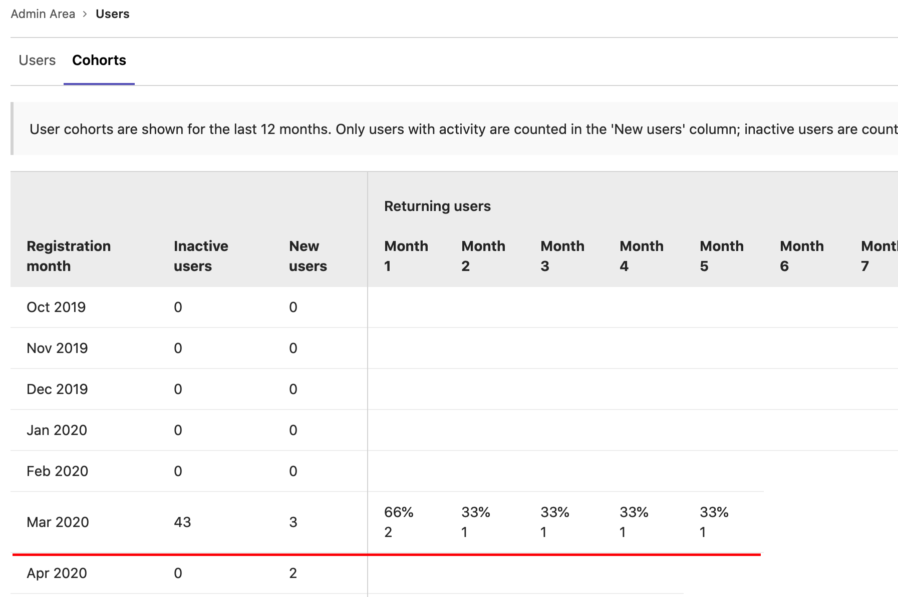



- Tier: 基础版，专业版，旗舰版
- Offering: 私有化部署



您可以分析用户在一段时间内的极狐GitLab 活动。

如何解读用户群组表格？让我们通过以下用户群组示例来了解：

对于 2020 年 3 月的群组，该服务器新增了三名用户，并且他们自该月起一直保持活跃。一个月后（2020 年 4 月），仍有两名用户保持活跃。五个月后（2020 年 8 月），该群组中仍有一名用户保持活跃，占 3 月加入的原始三名用户的 33%。

**非活跃用户**列显示当月新增但从未在实例中有过任何活动的用户数量。

如何衡量用户的活动？极狐GitLab 在以下情况下认为用户处于活跃状态：

- 用户登录。
- 用户有 Git 活动（无论是推送还是拉取）。
- 用户访问与仪表板、项目、议题或合并请求相关的页面。
- 用户使用 API。
- 用户使用 GraphQL API。

## 查看用户群组

先决条件：

- 管理员访问权限。

查看用户群组：

1. 在右上角，选择**管理员**。
1. 在左侧边栏中，选择**概览** > **用户**。
1. 选择**群组**标签页。
