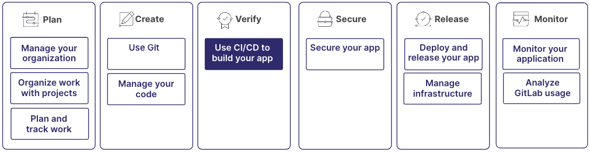



- Tier: 基础版，专业版，旗舰版
- Offering: JihuLab.com，私有化部署



CI/CD 是一种持续性的软件开发方法，您可以在其中持续构建、测试、部署和监控迭代的代码变更。

这一迭代过程有助于降低您基于有缺陷或失败的先前版本开发新代码的可能性。极狐GitLab CI/CD 可以在开发周期的早期发现缺陷，并帮助确保部署到生产环境的代码符合您既定的代码标准。

此过程是更大工作流的一部分：



<a id="step-1-configure-your-pipeline"></a>

## 第 1 步：配置您的流水线

要使用极狐GitLab CI/CD，请将 `.gitlab-ci.yml` 文件添加到项目根目录。`.gitlab-ci.yml` 文件定义了构成 CI/CD 流水线的阶段、作业和脚本，包括变量、作业依赖关系，以及每个作业运行的时间和方式。

默认情况下，文件名必须为 `.gitlab-ci.yml`。文件名区分大小写。您也可以使用自定义文件名。

流水线由阶段和作业组成：

- 阶段定义执行顺序。典型的阶段可能包括 `build`、`test` 和 `deploy`。
- 作业指定每个阶段中要执行的任务。例如，作业可以编译或测试代码。

例如，一个包含构建阶段和测试阶段的 `.gitlab-ci.yml` 文件可能如下所示：

```yaml
stages:
  - build
  - test

build-job:
  stage: build
  script:
    - echo "Compiling the code..."
test-job:
  stage: test
  script:
    - echo "Running tests..."
```

极狐GitLab 在每次触发流水线时都会创建一条流水线，例如通过提交、合并请求、按计划触发，或您手动运行流水线时。随后由 Runner 执行流水线的作业。在您的流水线中，您可以与各种工具和平台集成。

更多信息，请参阅：

- [教程：创建并运行您的第一个极狐GitLab CI/CD 流水线](quick_start/_index.md#create-a-gitlab-ciyml-file)
- [指定自定义 CI/CD 配置文件](pipelines/settings.md#specify-a-custom-cicd-configuration-file)
- [流水线](pipelines/_index.md)

<a id="step-2-find-or-create-runners"></a>

## 第 2 步：查找或创建 Runner

Runner 是运行您作业的代理。这些代理可以运行在物理机或虚拟实例上。在您的 `.gitlab-ci.yml` 文件中，您可以指定运行作业时要使用的容器镜像。Runner 会加载该镜像、克隆您的项目，并在本地或容器中运行作业。

如果您使用 JihuLab.com，Linux、Windows 和 macOS 上的 Runner 已经可供使用。
如有需要，您也可以注册自己的 Runner。

如果您不使用 JihuLab.com，您可以：

- 注册 Runner，或使用已为您的极狐GitLab 私有化部署实例注册的 Runner。
- 在本地机器上创建 Runner。

更多信息，请参阅：

- [创建、注册并运行您自己的项目 Runner](../tutorials/create_register_first_runner/_index.md)

<a id="step-3-use-cicd-variables-and-expressions"></a>

## 第 3 步：使用 CI/CD 变量和表达式

极狐GitLab CI/CD 变量是键值对，用于存储配置设置和敏感信息（如密码或 API 密钥），并将其传递给流水线中的作业。

极狐GitLab CI/CD 表达式允许您将数据动态注入到流水线配置中。可用的数据取决于表达式上下文。例如，`inputs` 上下文允许您访问从父文件传入配置文件的信息，或在运行流水线时传入的信息。

<a id="cicd-variables"></a>

### CI/CD 变量

使用 CI/CD 变量，可以让作业访问在其他位置定义的值，从而自定义作业。您可以在 `.gitlab-ci.yml` 文件中硬编码 CI/CD 变量，在项目设置中设置它们，或动态生成它们。您可以为项目、群组或实例定义它们。

以下类型的变量可供使用：

- 自定义变量：您在 UI、API 或配置文件中创建和管理的变量。
- 预定义变量：极狐GitLab 自动设置的变量，用于提供有关当前作业、流水线和环境的信息。

您可以通过安全设置来配置变量：

- 受保护变量：限制对受保护分支或标签上运行的作业的访问。
- 掩码变量：在作业日志中隐藏变量值，以防止敏感信息泄露。

更多信息，请参阅：

- [CI/CD 变量](variables/_index.md)

<a id="cicd-expressions"></a>

### CI/CD 表达式

CI/CD 表达式使用 `$[[ ]]` 语法，并在您创建流水线时进行验证。您也可以在提交更改之前，在流水线编辑器中验证表达式。

表达式支持基于不同上下文的动态配置：

- **Inputs 上下文**（`$[[ inputs.INPUT_NAME ]]`）：访问通过 `include:inputs` 传入配置文件，或在运行新流水线时传入的类型化参数
- **Matrix 上下文**（`$[[ matrix.IDENTIFIER ]]`）：在作业依赖关系中访问矩阵值，以在矩阵作业之间创建 1:1 映射

更多信息，请参阅：

- [CI 表达式](yaml/expressions.md)

<a id="step-4-use-cicd-components"></a>

## 第 4 步：使用 CI/CD 组件

CI/CD 组件是可复用的流水线配置单元。使用 CI/CD 组件可以组合出完整的流水线配置，或较大流水线中的一小部分。

您可以使用 `include:component` 将组件添加到流水线配置中。

可复用组件有助于减少重复、提高可维护性，并促进项目之间的一致性。创建一个组件项目并将其发布到 CI/CD Catalog，即可在多个项目之间共享您的组件。

极狐GitLab 还提供用于常见任务和集成的 CI/CD 组件模板。

更多信息，请参阅：

- [CI/CD 组件](components/_index.md)
