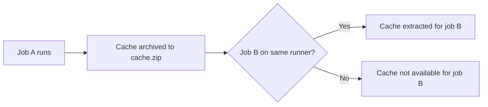



- Tier: 基础版，专业版，旗舰版
- Offering: JihuLab.com，私有化部署



缓存是作业下载并保存的一个或多个文件。后续使用同一缓存的作业无需再次下载这些文件，因此执行速度更快。

要了解如何在`.gitlab-ci.yml` 文件中定义缓存，请参阅 [`cache` 参考](../yaml/_index.md#cache)。

对于高级缓存键策略，您可以使用：

- [`cache:key:files`](../yaml/_index.md#cachekeyfiles)：生成与特定文件内容关联的键。
- [`cache:key:files_commits`](../yaml/_index.md#cachekeyfiles_commits)：生成与特定文件最新提交关联的键。

有关更多用例和示例，请参阅 [CI/CD 缓存示例](examples.md)。

<a id="how-cache-is-different-from-artifacts"></a>

## 缓存与产物的区别

将缓存用于依赖项，例如您从互联网下载的软件包。缓存存储在安装极狐GitLab Runner 的位置，如果[启用了分布式缓存](https://gitlab.cn/docs/runner/configuration/autoscale/#distributed-runners-caching)，则会上传到 S3。

使用产物在阶段之间传递中间构建结果。产物由作业生成，存储在极狐GitLab 中，并且可以下载。

产物和缓存都定义相对于项目目录的路径，并且不能链接到该目录之外的文件。

<a id="cache"></a>

### 缓存

- 使用 `cache` 关键字为每个作业定义缓存。否则缓存处于禁用状态。
- 后续流水线可以使用该缓存。
- 同一流水线中的后续作业可以使用该缓存，前提是依赖项完全相同。
- 不同项目不能共享缓存。
- 默认情况下，受保护分支和非受保护分支[不共享缓存](#cache-key-names)。不过，您可以[更改此行为](#use-the-same-cache-for-all-branches)。

<a id="artifacts"></a>

### 产物

- 为每个作业定义产物。
- 同一流水线后续阶段中的作业可以使用产物。
- 产物默认在 30 天后过期。您可以定义自定义的[过期时间](../yaml/_index.md#artifactsexpire_in)。
- 如果启用了[保留最新产物](../jobs/job_artifacts.md#keep-artifacts-from-most-recent-successful-jobs)，最新产物不会过期。
- 使用[依赖项](../yaml/_index.md#dependencies)控制哪些作业获取产物。

<a id="good-caching-practices"></a>

## 良好的缓存实践

为确保缓存的最大可用性，请执行以下一项或多项操作：

- [为您的 Runner 添加标签](../runners/configure_runners.md#control-jobs-that-a-runner-can-run)，并在共享缓存的作业上
  使用该标签。
- [使用仅对特定项目可用的 Runner](../runners/runners_scope.md#prevent-a-project-runner-from-being-enabled-for-other-projects)。
- [使用适合您工作流的 `key`](../yaml/_index.md#cachekey)。例如，
  您可以为每个分支配置不同的缓存。

要让 Runner 高效地使用缓存，您必须执行以下操作之一：

- 为所有作业使用单个 Runner。
- 使用多个具有
  [分布式缓存](https://gitlab.cn/docs/runner/configuration/autoscale/#distributed-runners-caching)的 Runner，
  其中缓存存储在 S3 存储桶中。JihuLab.com 上的实例 Runner 就是这种工作方式。这些 Runner 可以处于自动扩缩模式，
  但并非必须如此。要管理缓存对象，
  请应用生命周期规则，在一段时间后删除缓存对象。
  生命周期规则在对象存储服务器上可用。
- 使用多个具有相同架构的 Runner，并让这些 Runner
  共享一个通用的网络挂载目录来存储缓存。此目录应使用 NFS 或类似方案。
  这些 Runner 必须处于自动扩缩模式。

<a id="use-multiple-caches"></a>

## 使用多个缓存

每个作业最多可以有四个缓存：

```yaml
test-job:
  stage: build
  cache:
    - key:
        files:
          - Gemfile.lock
      paths:
        - vendor/ruby
    - key:
        files:
          - yarn.lock
      paths:
        - .yarn-cache/
  script:
    - bundle config set --local path 'vendor/ruby'
    - bundle install
    - yarn install --cache-folder .yarn-cache
    - echo Run tests...
```

如果多个缓存与回退缓存键组合使用，则每次找不到缓存时都会获取全局回退缓存。

<a id="use-a-fallback-cache-key"></a>

## 使用回退缓存键

<a id="per-cache-fallback-keys"></a>

### 每个缓存的回退键

每个缓存条目最多支持五个回退键，使用 [`fallback_keys` 关键字](../yaml/_index.md#cachefallback_keys)。当作业找不到缓存键时，作业会尝试改为检索回退缓存。回退键按顺序搜索，直到找到缓存。如果未找到任何缓存，作业将在不使用缓存的情况下运行。例如：

```yaml
test-job:
  stage: build
  cache:
    - key: cache-$CI_COMMIT_REF_SLUG
      fallback_keys:
        - cache-$CI_DEFAULT_BRANCH
        - cache-default
      paths:
        - vendor/ruby
  script:
    - bundle config set --local path 'vendor/ruby'
    - bundle install
    - echo Run tests...
```

在此示例中：

1. 作业查找 `cache-$CI_COMMIT_REF_SLUG` 缓存。
1. 如果未找到 `cache-$CI_COMMIT_REF_SLUG`，作业会查找 `cache-$CI_DEFAULT_BRANCH`
   作为回退选项。
1. 如果也未找到 `cache-$CI_DEFAULT_BRANCH`，作业会查找 `cache-default`
   作为第二个回退选项。
1. 如果都未找到，作业将在不使用缓存的情况下下载所有 Ruby 依赖项，
   但在作业完成时为 `cache-$CI_COMMIT_REF_SLUG` 创建新缓存。

回退键遵循与 `cache:key` 相同的处理逻辑：

- 如果您[手动清除缓存](#clear-the-cache-manually)，每个缓存的回退键会像其他缓存键一样
  附加一个索引。
- 如果启用了[**为受保护分支使用单独的缓存**](#cache-key-names)设置，
  每个缓存的回退键会附加`-protected` 或`-non_protected`。

<a id="global-fallback-key"></a>

### 全局回退键

您可以使用`$CI_COMMIT_REF_SLUG` [预定义变量](../variables/predefined_variables.md)来指定您的 [`cache:key`](../yaml/_index.md#cachekey)。例如，如果您的 `$CI_COMMIT_REF_SLUG` 是 `test`，您可以将作业设置为下载标记为 `test`的缓存。

如果找不到带有此标记的缓存，您可以使用 `CACHE_FALLBACK_KEY` 指定在不存在缓存时要使用的缓存。

在以下示例中，如果找不到`$CI_COMMIT_REF_SLUG`，作业将使用由 `CACHE_FALLBACK_KEY` 变量定义的键：

```yaml
variables:
  CACHE_FALLBACK_KEY: fallback-key

job1:
  script:
    - echo
  cache:
    key: "$CI_COMMIT_REF_SLUG"
    paths:
      - binaries/
```

缓存提取的顺序为：

1. 尝试检索 `cache:key`
1. 按顺序尝试检索 `fallback_keys`中的每个条目
1. 尝试检索 `CACHE_FALLBACK_KEY`中的全局回退键

缓存提取过程在成功检索到第一个缓存后停止。

<a id="disable-cache-for-specific-jobs"></a>

## 为特定作业禁用缓存

如果您全局定义缓存，每个作业都会使用相同的定义。您可以为每个作业覆盖此行为。

要为某个作业完全禁用它，请使用空列表：

```yaml
job:
  cache: []
```

<a id="inherit-global-configuration-but-override-specific-settings-per-job"></a>

## 继承全局配置，但为每个作业覆盖特定设置

您可以使用[锚点](../yaml/yaml_optimization.md#anchors)覆盖缓存设置，而无需覆盖全局缓存。例如，如果您想为一个作业覆盖
`policy`：

```yaml
default:
  cache: &global_cache
    key: $CI_COMMIT_REF_SLUG
    paths:
      - node_modules/
      - public/
      - vendor/
    policy: pull-push

job:
  cache:
    # inherit all global cache settings
    <<: *global_cache
    # override the policy
    policy: pull
```

有关更多信息，请参阅 [`cache: policy`](../yaml/_index.md#cachepolicy)。

<a id="cache-key-names"></a>

## 缓存键名称

缓存键会添加一个后缀，但[全局回退缓存键](#global-fallback-key)除外。

如果流水线满足以下条件，缓存键会获得`-protected` 后缀：

- 为受保护分支或标签运行。用户必须具有合并到
  [受保护分支](../../user/project/repository/branches/protected.md)的权限，或具有
  创建[受保护标签](../../user/project/protected_tags.md)的权限。
- 由具有维护者或所有者角色的用户启动。

在其他流水线中生成的键会获得 `non_protected` 后缀。

例如，如果：

- `cache:key` 设置为`$CI_COMMIT_REF_SLUG`。
- `main` 是受保护分支。
- `feature` 是非受保护分支。

| 分支      | 开发者角色缓存键 | 维护者角色缓存键 |
|-------------|--------------------------|---------------------------|
| `main`      | `main-protected`         | `main-protected`          |
| `feature`   | `feature-non_protected`  | `feature-protected`       |

此外，对于标签的流水线，后缀以标签的保护状态为准，而不是流水线执行所在的分支。此行为可确保一致的安全边界，因为触发引用决定了缓存访问权限。

例如，如果：

- `cache:key` 设置为`$CI_COMMIT_TAG`。
- `main` 是受保护分支。
- `feature` 是非受保护分支。
- `1.0.0` 是受保护标签。
- `1.1.1-rc1` 是非受保护标签。

| 标签         | 分支    | 开发者角色缓存键  | 维护者角色缓存键 |
|-------------|-----------|---------------------------|---------------------------|
| `1.0.0`     | `main`    | `1.0.0-protected`         | `1.0.0-protected`         |
| `1.0.0`     | `feature` | `1.0.0-protected`         | `1.0.0-protected`         |
| `1.1.1-rc1` | `main`    | `1.1.1-rc1-non_protected` | `1.1.1-rc1-protected`     |
| `1.1.1-rc1` | `feature` | `1.1.1-rc1-non_protected` | `1.1.1-rc1-protected`     |

<a id="use-the-same-cache-for-all-branches"></a>

### 为所有分支使用同一缓存

如果您不想使用[缓存键名称](#cache-key-names)，可以让所有分支（受保护和非受保护）使用同一缓存。

使用[缓存键名称](#cache-key-names)进行缓存分离是一项安全功能，只应在所有具有开发者角色的用户都高度可信的环境中禁用它。

要为所有分支使用同一缓存：

1. 在顶部栏中，选择**搜索或跳转到**，然后找到您的项目。
1. 在左侧边栏中，选择**设置** > **CI/CD**。
1. 展开**流水线通用设置**。
1. 清除**为受保护分支使用单独的缓存**复选框。
1. 选择**保存更改**。

<a id="availability-of-the-cache"></a>

## 缓存的可用性

缓存是一种优化，但并不能保证始终有效。您可能需要在需要缓存的每个作业中重新生成缓存文件。

在`.gitlab-ci.yml`中[定义缓存](../yaml/_index.md#cache)后，缓存的可用性取决于：

- Runner 的执行器类型。
- 是否使用不同的 Runner 在作业之间传递缓存。

<a id="where-the-caches-are-stored"></a>

### 缓存的存储位置

为作业定义的所有缓存都归档在单个 `cache.zip` 文件中。Runner 配置定义了该文件的存储位置。默认情况下，缓存存储在安装极狐GitLab Runner 的机器上。位置还取决于执行器的类型。

| Runner 执行器        | 缓存的默认路径 |
| ---------------------- | ------------------------- |
| [Shell](https://gitlab.cn/docs/runner/executors/shell/) | 本地，位于 `gitlab-runner` 用户的主目录下：`/home/gitlab-runner/cache/<user>/<project>/<cache-key>/cache.zip`。 |
| [Docker](https://gitlab.cn/docs/runner/executors/docker/) | 本地，位于 [Docker 卷](https://gitlab.cn/docs/runner/executors/docker/#configure-directories-for-the-container-build-and-cache)下：`/var/lib/docker/volumes/<volume-id>/_data/<user>/<project>/<cache-key>/cache.zip`。 |
| [Docker Machine](https://gitlab.cn/docs/runner/executors/docker_machine/)（自动扩缩 Runner） | 与 Docker 执行器相同。 |

如果您在作业中使用缓存和产物存储同一路径，缓存可能会被覆盖，因为缓存会在产物之前恢复。

<a id="archive-and-extraction-workflow"></a>

### 归档和提取工作流

此示例展示了两个连续阶段中的两个作业：

```yaml
stages:
  - build
  - test

default:
  cache:
    key: build-cache
    paths:
      - vendor/
  before_script:
    - echo "Hello"

job A:
  stage: build
  script:
    - mkdir vendor/
    - echo "build" > vendor/hello.txt
  after_script:
    - echo "World"

job B:
  stage: test
  script:
    - cat vendor/hello.txt
```

如果您的项目使用安装在单台机器上的单个 Runner，所有作业都在该主机上运行：

1. 流水线开始。
1. `job A` 运行。
1. 提取缓存（如果找到）。
1. 执行 `before_script`。
1. 执行 `script`。
1. 执行 `after_script`。
1. `cache` 运行，`vendor/`目录被压缩为 `cache.zip`。
   然后，此文件根据
   [Runner 的设置](#where-the-caches-are-stored)和 `cache: key` 保存到相应目录中。
1. `job B` 运行。
1. 提取缓存（如果找到）。
1. 执行 `before_script`。
1. 执行 `script`。
1. 流水线结束。

通过在单台机器上使用单个 Runner，您不会遇到 `job B` 可能在不同于 `job A`的 Runner 上执行的问题。此设置可保证缓存可以在阶段之间重用。它仅在执行从 `build` 阶段到 `test` 阶段在同一 Runner/机器上进行时才有效。否则，缓存[可能不可用](#cache-mismatch)。

存在此限制是因为为一个 Runner 创建的缓存在被另一个 Runner 使用时通常无效。不同的 Runner 可能使用不同的架构，因此缓存的二进制文件可能无法工作。Runner 也可能运行在不同的机器上，因此极狐GitLab 默认使用同一 Runner 来保持缓存可靠。



在缓存过程中，还要考虑以下事项：

- 如果其他作业使用不同的缓存配置，将其
  缓存保存到同一 zip 文件中，则该缓存会被覆盖。如果使用基于 S3 的共享缓存，
  该文件还会根据缓存键上传到 S3 中的某个对象。因此，两个路径不同但缓存键相同的作业
  会覆盖各自的缓存。
- 从 `cache.zip` 提取缓存时，zip 文件中的所有内容都会
  提取到作业的工作目录中（通常是拉取下来的代码仓库），并且 Runner 不介意 `job A`的归档
  是否覆盖 `job B` 归档中的内容。

<a id="clearing-the-cache"></a>

## 清除缓存

Runner 使用[缓存](../yaml/_index.md#cache)通过重用现有数据来加速作业执行。这有时可能导致行为不一致。

要从全新的缓存副本开始，请更改 `cache:key` 或手动清除它。

<a id="clear-the-cache-by-changing-cachekey"></a>

### 通过更改 `cache:key` 清除缓存

更改`.gitlab-ci.yml` 文件中 `cache: key`的值。下次流水线运行时，缓存将存储在不同的位置。

<a id="clear-the-cache-manually"></a>

### 手动清除缓存

先决条件：

- 您必须至少具有项目的开发者角色。

> [!note]
> 清除缓存会强制下一次流水线（包括受保护分支上的流水线）重新获取依赖项。
> 如果作业未固定其依赖项版本，该获取可能会解析到无人审查过的更新上游版本。
> 请固定您的依赖项版本，以便在清除缓存时流水线的内容不会发生变化。

您可以在极狐GitLab UI 中清除缓存：

1. 在顶部栏中，选择**搜索或跳转到**，然后找到您的项目。
1. 在左侧边栏中，选择**构建** > **流水线**。
1. 在右上角，选择**清除 Runner 缓存**。

在下一次提交时，您的 CI/CD 作业将使用新缓存。

> [!note]
> 每次手动清除缓存时，[内部缓存名称](#where-the-caches-are-stored)都会更新。该名称使用 `cache-<index>`格式，索引递增一。旧缓存不会被删除。您可以从 Runner 存储中手动删除这些文件。

<a id="troubleshooting"></a>

## 故障排除

<a id="cache-mismatch"></a>

### 缓存不匹配

如果您遇到缓存不匹配，请按照以下步骤进行故障排除。

| 缓存不匹配的原因 | 如何修复 |
| --------------------------- | ------------- |
| 您使用多个独立 Runner（不处于自动扩缩模式）连接到一个项目，但没有共享缓存。 | 为您的项目仅使用一个 Runner，或使用多个启用了分布式缓存的 Runner。 |
| 您在自动扩缩模式下使用 Runner，但未启用分布式缓存。 | 将自动扩缩 Runner 配置为使用分布式缓存。 |
| 安装 Runner 的机器磁盘空间不足，或者如果您设置了分布式缓存，存储缓存的 S3 存储桶空间不足。 | 确保清理一些空间以允许存储新缓存。没有自动执行此操作的方法。 |
| 您为缓存不同路径的作业使用相同的 `key`。 | 使用不同的缓存键，以便缓存归档存储到不同的位置，不会覆盖错误的缓存。 |
| 您尚未在 Runner 上启用[分布式 Runner 缓存](https://gitlab.cn/docs/runner/configuration/autoscale/#distributed-runners-caching)。 | 设置 `Shared = false` 并重新预配您的 Runner。 |

<a id="cache-mismatch-example-1"></a>

#### 缓存不匹配示例 1

如果您的项目只分配了一个 Runner，缓存默认存储在 Runner 的机器上。

如果两个作业具有相同的缓存键但路径不同，缓存可能会被覆盖。例如：

```yaml
stages:
  - build
  - test

job A:
  stage: build
  script: make build
  cache:
    key: same-key
    paths:
      - public/

job B:
  stage: test
  script: make test
  cache:
    key: same-key
    paths:
      - vendor/
```

1. `job A` 运行。
1. `public/`被缓存为 `cache.zip`。
1. `job B` 运行。
1. 解压之前的缓存（如果有）。
1. `vendor/`被缓存为 `cache.zip` 并覆盖之前的缓存。
1. 下次 `job A` 运行时，它会使用 `job B`的缓存，该缓存不同，
   因此无效。

要解决此问题，请为每个作业使用不同的 `keys`。

<a id="cache-mismatch-example-2"></a>

#### 缓存不匹配示例 2

在此示例中，您的项目分配了多个 Runner，并且未启用分布式缓存。

第二次流水线运行时，您希望 `job A` 和 `job B` 重用它们的缓存（在此例中缓存不同）：

```yaml
stages:
  - build
  - test

job A:
  stage: build
  script: build
  cache:
    key: keyA
    paths:
      - vendor/

job B:
  stage: test
  script: test
  cache:
    key: keyB
    paths:
      - vendor/
```

即使 `key` 不同，如果作业在后续流水线中运行在不同的 Runner 上，缓存的文件也可能在每个阶段之前被“清理”。

<a id="concurrent-runners-missing-local-cache"></a>

### 并发 Runner 缺少本地缓存

如果您使用 Docker 执行器配置了多个并发 Runner，本地缓存的文件可能不会如您预期的那样对并发运行的作业可用。缓存卷的名称是为每个 Runner 实例唯一构造的，因此一个 Runner 实例缓存的文件不会被另一个 Runner 实例在缓存中找到。

要在并发 Runner 之间共享缓存，您可以：

- 使用 Runner 的 `config.toml`中的`[runners.docker]`部分，在主机上配置一个挂载点，
  将其映射到每个容器中的`/cache`，例如 `volumes = ["/mnt/gitlab-runner/cache-for-all-concurrent-jobs:/cache"]`。
  此方法可防止 Runner 为并发作业创建唯一的卷名称。
- 使用[分布式缓存](https://gitlab.cn/docs/runner/configuration/speed_up_job_execution/#use-a-distributed-cache)。
