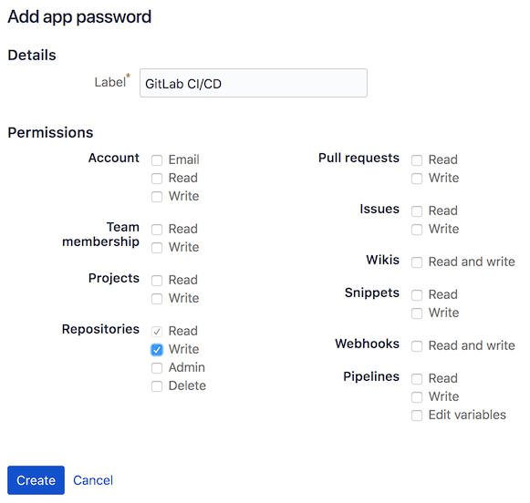



- Tier: 专业版，旗舰版
- Offering: JihuLab.com，私有化部署



极狐GitLab CI/CD 可通过以下方式与 Bitbucket Cloud 配合使用：

1. 创建 [CI/CD 项目](_index.md)。
1. 通过 URL 连接您的 Git 代码仓库。

要将极狐GitLab CI/CD 与 Bitbucket Cloud 代码仓库配合使用：

1. 在 Bitbucket 中，创建一个[**应用密码**](https://support.atlassian.com/bitbucket-cloud/docs/api-tokens/)，用于对
   在 Bitbucket 中设置提交构建
   状态的脚本进行身份验证。需要代码仓库写入权限。

   

1. 在 Bitbucket 中，从您的代码仓库中选择**克隆**，然后复制 `git clone` 之后开始的 URL。
1. 在极狐GitLab 中，创建一个项目：

   1. 在右上角，选择**新建**（）和**新建项目/仓库**。
   1. 选择**为外部仓库运行 CI/CD**。
   1. 选择**仓库（URL）**。
   1. 填写字段：
      - 在 **Git 仓库 URL**中，输入您的 Bitbucket 代码仓库的 URL。请务必移除其中的 `@username`。
      - 在**用户名**中，输入与应用密码关联的用户名。
      - 在**密码**中，输入 Bitbucket 中的应用密码。

   极狐GitLab 会导入该代码仓库并启用[拉取镜像](../../user/project/repository/mirror/pull.md)。
   您可以在项目的**设置** > **代码仓库** > **镜像仓库**中检查镜像是否正常工作。

1. 在极狐GitLab 中，生成一个具有 `api` 范围的
   [个人访问令牌](../../user/profile/personal_access_tokens.md)。
   该令牌用于对来自 Bitbucket 中创建的 Webhook 的请求进行身份验证，
   以便将新提交通知给极狐GitLab。

1. 在 Bitbucket 中，从**设置** > **Webhooks** 创建一个新的 Webhook，以便将
   新提交通知给极狐GitLab。

1. 将 Webhook URL 设置为[极狐GitLab 拉取镜像](../../api/project_pull_mirroring.md#start-the-pull-mirroring-process-for-a-project)端点，并使用
   您刚刚生成的个人访问令牌进行身份验证。

   ```plaintext
   https://gitlab.example.com/api/v4/projects/:project_id/mirror/pull?private_token=<your_personal_access_token>
   ```

   Webhook 触发器应设置为**代码仓库推送**。

   

   保存后，通过向您的 Bitbucket 代码仓库推送一项更改来测试该 Webhook。

1. 在极狐GitLab 中，从**设置** > **CI/CD** > **变量**添加变量，以允许
   通过 Bitbucket API 与 Bitbucket 通信：

   - `BITBUCKET_ACCESS_TOKEN`：之前创建的 Bitbucket 应用密码。此变量应[设为掩码](../variables/_index.md#mask-a-cicd-variable)。
   - `BITBUCKET_USERNAME`：Bitbucket 账号的用户名。
   - `BITBUCKET_NAMESPACE`：如果您的极狐GitLab 和 Bitbucket 命名空间不同，请设置此变量。
   - `BITBUCKET_REPOSITORY`：如果您的极狐GitLab 和 Bitbucket 项目名称不同，请设置此变量。

1. 在 Bitbucket 中，添加一个将流水线状态推送到 Bitbucket 的脚本。该脚本
   在 Bitbucket 中创建，但镜像过程会将其复制到极狐GitLab 镜像中。极狐GitLab
   CI/CD 流水线会运行该脚本，并将状态推送回 Bitbucket。

   创建一个文件 `build_status`，插入以下脚本，并在终端中运行
   `chmod +x build_status` 以使该脚本可执行。

   ```shell
   #!/usr/bin/env bash

   # Push GitLab CI/CD build status to Bitbucket Cloud

   if [ -z "$BITBUCKET_ACCESS_TOKEN" ]; then
      echo "ERROR: BITBUCKET_ACCESS_TOKEN is not set"
   exit 1
   fi
   if [ -z "$BITBUCKET_USERNAME" ]; then
       echo "ERROR: BITBUCKET_USERNAME is not set"
   exit 1
   fi
   if [ -z "$BITBUCKET_NAMESPACE" ]; then
       echo "Setting BITBUCKET_NAMESPACE to $CI_PROJECT_NAMESPACE"
       BITBUCKET_NAMESPACE=$CI_PROJECT_NAMESPACE
   fi
   if [ -z "$BITBUCKET_REPOSITORY" ]; then
       echo "Setting BITBUCKET_REPOSITORY to $CI_PROJECT_NAME"
       BITBUCKET_REPOSITORY=$CI_PROJECT_NAME
   fi

   BITBUCKET_API_ROOT="https://api.bitbucket.org/2.0"
   BITBUCKET_STATUS_API="$BITBUCKET_API_ROOT/repositories/$BITBUCKET_NAMESPACE/$BITBUCKET_REPOSITORY/commit/$CI_COMMIT_SHA/statuses/build"
   BITBUCKET_KEY="ci/gitlab-ci/$CI_JOB_NAME"

   case "$BUILD_STATUS" in
   running)
      BITBUCKET_STATE="INPROGRESS"
      BITBUCKET_DESCRIPTION="The build is running!"
      ;;
   passed)
      BITBUCKET_STATE="SUCCESSFUL"
      BITBUCKET_DESCRIPTION="The build passed!"
      ;;
   failed)
      BITBUCKET_STATE="FAILED"
      BITBUCKET_DESCRIPTION="The build failed."
      ;;
   esac

   echo "Pushing status to $BITBUCKET_STATUS_API..."
   curl --request POST "$BITBUCKET_STATUS_API" \
   --user $BITBUCKET_USERNAME:$BITBUCKET_ACCESS_TOKEN \
   --header "Content-Type:application/json" \
   --silent \
   --data "{ \"state\": \"$BITBUCKET_STATE\", \"key\": \"$BITBUCKET_KEY\", \"description\":
   \"$BITBUCKET_DESCRIPTION\",\"url\": \"$CI_PROJECT_URL/-/jobs/$CI_JOB_ID\" }"
   ```

1. 在 Bitbucket 中，创建一个 `.gitlab-ci.yml` 文件，以使用该脚本将
   流水线的成功和失败推送到 Bitbucket。与之前添加的脚本类似，
   该文件会作为镜像过程的一部分复制到极狐GitLab 代码仓库。

   ```yaml
   stages:
     - test
     - ci_status

   unit-tests:
     script:
       - echo "Success. Add your tests!"

   success:
     stage: ci_status
     before_script:
       - ""
     after_script:
       - ""
     script:
       - BUILD_STATUS=passed BUILD_KEY=push ./build_status
     when: on_success

   failure:
     stage: ci_status
     before_script:
       - ""
     after_script:
       - ""
     script:
       - BUILD_STATUS=failed BUILD_KEY=push ./build_status
     when: on_failure
   ```

极狐GitLab 现已配置为镜像来自 Bitbucket 的更改、运行在 `.gitlab-ci.yml`中配置的 CI/CD 流水线，
并将状态推送到 Bitbucket。
