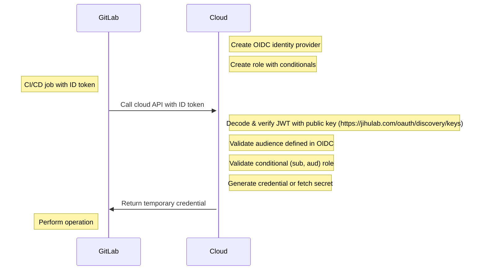



- Tier: 基础版，专业版，旗舰版
- Offering: JihuLab.com，私有化部署



> [!warning]
> `CI_JOB_JWT` 和 `CI_JOB_JWT_V2` 已在 [极狐GitLab 17.0 中移除](../../update/deprecations.md#old-versions-of-json-web-tokens-are-deprecated)。
> 请改用 [ID 令牌](../secrets/id_token_authentication.md)。

极狐GitLab CI/CD 支持 [OpenID Connect (OIDC)](https://openid.net/developers/how-connect-works/)，
使您的构建和部署作业能够访问云凭据和服务。过去，团队会在项目中存储密钥，或在极狐GitLab Runner 实例上应用权限来进行构建和部署。支持 OIDC 的 [ID 令牌](../secrets/id_token_authentication.md)可在 CI/CD 作业中配置，让您能够采用可扩展且遵循最小权限原则的安全方案。

<a id="prerequisites"></a>

## 先决条件

- 拥有极狐GitLab 账号。
- 能够访问支持 OIDC 的云提供商，以配置授权并创建角色。

ID 令牌支持使用 OIDC 的云提供商，包括：

- AWS
- Azure
- GCP
- HashiCorp Vault

> [!note]
> 配置 OIDC 会使 JWT 令牌能够访问所有流水线的目标环境。
> 当您为流水线配置 OIDC 时，应针对该流水线完成软件供应链安全
> 审查，重点关注新增的访问权限。有关供应链攻击的更多信息，请参阅
> [DevOps 平台如何帮助防范供应链攻击](https://about.gitlab.com/blog/devops-platform-supply-chain-attacks/)。

通过 OIDC 连接云服务具有以下优势：

- 无需在极狐GitLab 群组或项目中存储密钥。可通过 OIDC 从云提供商处获取临时凭据。
- 通过细粒度的极狐GitLab 条件（包括群组、项目、分支或标签）提供对云资源的临时访问权限。
- 让您能够在 CI/CD 作业中通过条件访问环境来定义职责分离。过去，应用可能使用指定的极狐GitLab Runner 进行部署，而该 Runner 只能访问预发布或生产环境。这导致 Runner 数量激增，因为每台机器都有专用权限。
- 允许实例 Runner 安全地访问多个云账号。访问权限由 JWT 令牌决定，而该令牌特定于运行流水线的用户。
- 默认获取临时凭据，因此无需再编写密钥轮换逻辑。

<a id="id-token-authentication-for-cloud-services"></a>

## 云服务的 ID 令牌认证

每个作业都可以配置 ID 令牌，它以 CI/CD 变量的形式提供，其中包含[令牌负载](../secrets/id_token_authentication.md#token-payload)。这些 JWT 可用于向支持 OIDC 的云提供商（如 AWS、Azure、GCP 或 Vault）进行认证。

<a id="authorization-workflow"></a>

### 授权工作流



1. 在云中（例如 AWS、Azure、GCP、Vault）创建 OIDC 身份提供商。
1. 在云服务中创建条件角色，按群组、项目、分支或标签进行筛选。
1. CI/CD 作业包含一个 ID 令牌，即 JWT 令牌。您可以使用此令牌向云 API 进行授权。
1. 云会验证该令牌，根据负载校验条件角色，并返回临时凭据。

<a id="configure-a-conditional-role-with-oidc-claims"></a>

## 使用 OIDC 声明配置条件角色

配置条件角色时，在云提供商支持的情况下，除了 `sub` 等基于路径的声明外，还应包含稳定且唯一的标识符，例如 `namespace_id` 或 `project_id`。这些标识符与路径无关，因此引用它们的信任策略不会受到路径变更（例如群组或项目重命名）的影响。

对这些条件键的支持因云提供商和极狐GitLab 交付方式而异。例如，AWS 仅对 `gitlab.com` OIDC 身份提供商支持 `namespace_id` 和 `project_id`。有关提供商的示例，请参阅[在 AWS 中配置 OpenID Connect](aws/_index.md#configure-a-role-and-trust)。

要配置极狐GitLab 与 OIDC 之间的信任关系，您必须在云提供商中创建一个针对 JWT 进行校验的条件角色。该条件会针对 JWT 进行校验，以专门针对两个声明建立信任：受众和主体。

- 受众或 `aud`：作为 ID 令牌的一部分进行配置：

  ```yaml
  job_needing_oidc_auth:
    id_tokens:
      OIDC_TOKEN:
        aud: https://oidc.provider.com
    script:
      - echo $OIDC_TOKEN
  ```

- 主体或 `sub`：由描述极狐GitLab CI/CD 工作流的元数据拼接而成，包括群组、项目、分支和标签。默认情况下，`sub` 字段采用以下格式：
  - `project_path:{group}/{project}:ref_type:{type}:ref:{branch_name}`

| 筛选类型                                        | 示例 |
|----------------------------------------------------|---------|
| 筛选到任意分支                               | 支持通配符。`project_path:mygroup/myproject:ref_type:branch:ref:*` |
| 筛选到特定项目的主分支            | `project_path:mygroup/myproject:ref_type:branch:ref:main` |
| 筛选到某个群组下的所有项目               | 支持通配符。`project_path:mygroup/*:ref_type:branch:ref:main` |
| 筛选到某个 Git 标签                                | 支持通配符。`project_path:mygroup/*:ref_type:tag:ref:1.0` |

<a id="use-the-project-id-as-the-subject"></a>

### 使用项目 ID 作为主体

要将云信任策略绑定到不可变的标识符，请使用 `project_id` 作为 `sub` 声明的第一个组成部分。当项目被重命名或移动时，可使用此选项保持云访问的稳定性。

要启用它，请通过[项目 API 端点](../../api/projects.md#update-a-project)将 `ci_id_token_sub_claim_components` 设置为类似 `["project_id", "ref_type", "ref"]` 的值。此时 `sub` 字段采用以下格式：

- `project_id:{id}:ref_type:{type}:ref:{branch_name}`

<a id="use-the-project-that-runs-the-job-as-the-subject"></a>

### 使用运行作业的项目作为主体

在合并请求流水线中，源分支和目标分支可能位于不同的项目中，例如两个具有复刻关系的项目。当源和目标来自不同项目时：

- `sub` 声明的 `project_path` 组成部分是源项目的路径。
- 该流水线可能[在目标项目中运行](../pipelines/merge_request_pipelines.md#run-pipelines-in-the-parent-project)。

在这种情况下，`project_path` 组成部分无法标识运行作业的项目。要将云信任策略绑定到运行作业的项目，请使用 `job_project_path` 或 `job_project_id` 作为 `sub` 声明的第一个组成部分。与 `project_id` 一样，`job_project_id` 在项目被重命名或移动时不会改变。

> [!warning]
> 使用 `job_project_path` 或 `job_project_id` 时，`sub` 声明不会显示源分支
> 位于不同的项目中。`ref` 组成部分是合并请求的源分支，
> 但该分支可能与目标项目中的某个分支同名，例如 `main`。
>
> 仅当您的信任策略能够安全地将其云访问权限授予来自不同项目的
> 合并请求的流水线时，才使用这些组成部分。
>
> 当源项目和目标项目不同时，合并请求流水线具有 `ref_protected:false`。
> 因此，要将这些流水线排除在信任策略之外，请将 `ref_protected` 添加到 `sub` 声明
> 组成部分中，并在策略中要求 `ref_protected:true`。

要使用其中某个组成部分，请通过[项目 API](../../api/projects.md#update-a-project) 设置 `ci_id_token_sub_claim_components`。此时 `sub` 字段采用以下格式之一：

| `ci_id_token_sub_claim_components`        | `sub` 格式 |
|-------------------------------------------|--------------|
| `["job_project_path", "ref_type", "ref"]` | `job_project_path:{group}/{project}:ref_type:{type}:ref:{branch_name}` |
| `["job_project_id", "ref_type", "ref"]`   | `job_project_id:{id}:ref_type:{type}:ref:{branch_name}` |

<a id="oidc-authorization-with-your-cloud-provider"></a>

## 使用云提供商进行 OIDC 授权

要连接您的云提供商，请参阅以下教程：

- [在 AWS 中配置 OpenID Connect](aws/_index.md)
- [在 Azure 中配置 OpenID Connect](azure/_index.md)
- [在 Google Cloud 中配置 OpenID Connect](google_cloud/_index.md)
