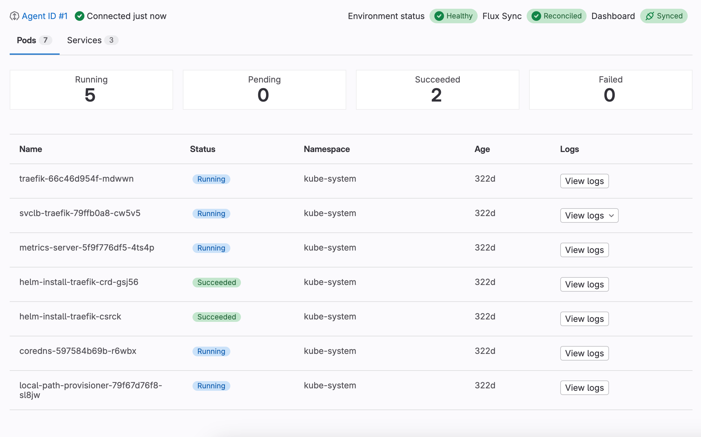
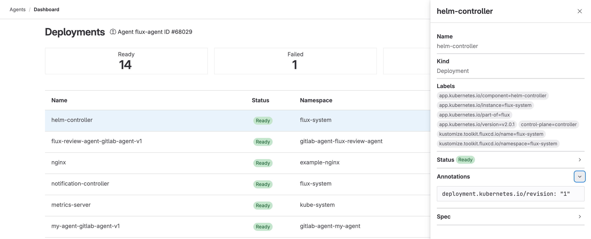



- Tier: 基础版，专业版，旗舰版
- Offering: JihuLab.com，私有化部署
- Status: 测试版



使用 Kubernetes 仪表板，通过直观的可视化界面了解集群的状态。该仪表板适用于所有已连接的 Kubernetes 集群，无论您是通过 CI/CD 还是 GitOps 部署的。



<a id="configure-a-dashboard"></a>

## 配置仪表板

为特定环境配置仪表板后即可使用。您可以为已存在的环境配置仪表板，也可以在创建环境时添加。

先决条件：

- 已[安装](../../user/clusters/agent/install/_index.md)极狐GitLab Kubernetes Agent，并且已为环境的项目或其父群组配置了 [`user_access`](../../user/clusters/agent/user_access.md)。





1. 在顶部栏中，选择**搜索或跳转到**，找到您的项目。
1. 在左侧边栏中，选择**运维** > **环境**。
1. 选择要与极狐GitLab Kubernetes Agent 关联的环境。
1. 选择**编辑**。
1. 选择一个极狐GitLab Kubernetes Agent。
1. 可选。从 **Kubernetes 命名空间** 下拉列表中，选择一个命名空间。
1. 可选。从 **Flux 资源** 下拉列表中，选择一个 Flux 资源。
1. 选择**保存**。





1. 在顶部栏中，选择**搜索或跳转到**，找到您的项目。
1. 在左侧边栏中，选择**运维** > **环境**。
1. 选择**新建环境**。
1. 填写**名称**字段。
1. 选择一个极狐GitLab Kubernetes Agent。
1. 可选。从 **Kubernetes 命名空间** 下拉列表中，选择一个命名空间。
1. 可选。从 **Flux 资源** 下拉列表中，选择一个 Flux 资源。
1. 选择**保存**。





<a id="configure-a-dashboard-for-a-dynamic-environment"></a>

### 为动态环境配置仪表板

要为动态环境配置仪表板：

- 在 `.gitlab-ci.yml` 文件中指定 Agent。您必须指定 Agent 配置项目的完整路径，
  后跟一个冒号和 Agent 的名称。

例如：

```yaml
deploy_review_app:
  stage: deploy
  script: make deploy
  environment:
    name: review/$CI_COMMIT_REF_SLUG
    kubernetes:
      agent: path/to/agent/project:agent-name
```

更多信息，请参见 [CI/CD YAML 语法参考](../yaml/_index.md#environmentkubernetes)。

<a id="view-a-dashboard"></a>

## 查看仪表板

查看仪表板以了解已连接集群的状态。您的 Kubernetes 资源和 Flux 协调的状态会实时更新。

要查看已配置的仪表板：

1. 在顶部栏中，选择**搜索或跳转到**，找到您的项目。
1. 在左侧边栏中，选择**运维** > **环境**。
1. 选择与极狐GitLab Kubernetes Agent 关联的环境。
1. 选择 **Kubernetes 概览** 标签页。

此时会显示 pod 列表。选择一个 pod 可查看其详细信息。

<a id="flux-sync-status"></a>

### Flux 同步状态

您可以从仪表板查看 Flux 部署的同步状态。要显示部署状态，您的仪表板必须获取 `Kustomization` 和 `HelmRelease` 资源，这要求为环境配置一个命名空间。

极狐GitLab 会搜索环境设置中 **Flux 资源** 下拉列表所指定的 `Kustomization` 和 `HelmRelease` 资源。

仪表板会显示以下状态徽章之一：

| 状态 | 描述 |
|---------|-------------|
| **已同步** | 部署已成功与其环境协调。 |
| **同步中** | 协调正在进行中。 |
| **已停止** | 由于错误导致协调停滞，且无法在无人工干预的情况下解决。 |
| **失败** | 由于不可恢复的错误，部署无法协调。 |
| **未知** | 无法获取部署的同步状态。 |
| **不可用** | 无法获取 `Kustomization` 或 `HelmRelease` 资源。 |

<a id="trigger-flux-reconciliation"></a>

### 触发 Flux 协调

您可以手动将部署与其 Flux 资源进行协调。

要触发协调：

1. 在仪表板上，选择某个 Flux 部署的同步状态徽章。
1. 选择**操作** () > **触发重新协调** ()。

<a id="suspend-or-resume-flux-reconciliation"></a>

### 暂停或恢复 Flux 协调

您可以从 UI 手动暂停或恢复 Flux 协调。

要暂停或恢复协调：

1. 在仪表板上，选择某个 Flux 部署的同步状态徽章。
1. 选择**操作** ()，然后选择以下之一：
   - **暂停调谐** ()，暂停 Flux 协调。
   - **恢复调谐** ()，重新启动 Flux 协调。

<a id="view-pod-logs"></a>

### 查看 pod 日志

当您想从已配置的仪表板快速了解并排查各环境中的问题时，可以查看 pod 日志。您可以查看 pod 中每个容器的日志。

- 选择**查看日志**，然后选择您要查看日志的容器。

您也可以从 pod 详情中查看 pod 日志。

<a id="delete-a-pod"></a>

### 删除 pod

要重启失败的 pod，请从 Kubernetes 仪表板中将其删除。

要删除 pod：

1. 在 **Kubernetes 概览** 标签页中，找到您要删除的 pod。
1. 选择**操作** () > **删除 pod** ()。

您也可以从 pod 详情中删除 pod。

<a id="detailed-dashboard"></a>

## 详细仪表板

> [!flag]
> 此功能的可用性由功能标志控制。
> 此功能可用于测试，但尚未准备好用于生产环境。

详细仪表板提供以下 Kubernetes 资源的信息：

- Pods
- Services
- Deployments
- ReplicaSets
- StatefulSets
- DaemonSets
- Jobs
- CronJobs

每个仪表板都会显示资源列表及其状态、命名空间和存在时长。您可以选择一个资源，打开抽屉查看更多信息，包括标签以及 YAML 格式的状态、注解和 spec。



由于[此议题](https://gitlab.com/gitlab-org/ci-cd/deploy-stage/environments-group/general/-/issues/53#note_1720060812)中描述的重点转移，详细仪表板的开发工作已暂停。

要就详细仪表板提供反馈，请参见[议题 460279](https://gitlab.com/gitlab-org/gitlab/-/issues/460279)。

<a id="view-a-detailed-dashboard"></a>

### 查看详细仪表板

先决条件：

- 已[配置](../../user/clusters/agent/install/_index.md)极狐GitLab Kubernetes Agent，并使用 [`user_access`](../../user/clusters/agent/user_access.md) 关键字将其共享给环境的项目或其父群组。

详细仪表板未从侧边栏导航中链接。要查看详细仪表板：

1. 找到您的极狐GitLab Kubernetes Agent ID：
   1. 在顶部栏中，选择**搜索或跳转到**，找到您的项目。
   1. 选择**运维** > **Kubernetes 集群**。
   1. 复制您要访问的 Agent 的数字 ID。
1. 转到以下 URL 之一，将 `<agent_id>` 替换为您的 Agent ID：

   | 资源类型 | URL |
   | --- | --- |
   | Pods | `https://myinstance.gitlab.com/-/kubernetes/<agent_id>/pods` |
   | Services | `https://myinstance.gitlab.com/-/kubernetes/<agent_id>/services` |
   | Deployments | `https://myinstance.gitlab.com/-/kubernetes/<agent_id>/deployments` |
   | ReplicaSets | `https://myinstance.gitlab.com/-/kubernetes/<agent_id>/replicaSets` |
   | StatefulSets | `https://myinstance.gitlab.com/-/kubernetes/<agent_id>/statefulSets` |
   | DaemonSets | `https://myinstance.gitlab.com/-/kubernetes/<agent_id>/daemonSets` |
   | Jobs | `https://myinstance.gitlab.com/-/kubernetes/<agent_id>/jobs` |
   | CronJobs | `https://myinstance.gitlab.com/-/kubernetes/<agent_id>/cronJobs` |

<a id="troubleshooting"></a>

## 故障排除

使用 Kubernetes 仪表板时，您可能会遇到以下问题。

<a id="user-cannot-list-resource-in-api-group"></a>

### 用户无法在 API 组中列出资源

您可能会收到如下错误：`Error: services is forbidden: User "gitlab:user:<user-name>" cannot list resource "<resource-name>" in API group "" at the cluster scope`。

当用户不被允许在 [Kubernetes RBAC](https://kubernetes.io/docs/reference/access-authn-authz/rbac/)中执行指定操作时，就会发生此错误。

要解决此问题，请检查您的 [RBAC 配置](../../user/clusters/agent/user_access.md#configure-kubernetes-access)。如果 RBAC 配置正确，请联系您的 Kubernetes 管理员。

<a id="gitlab-agent-dropdown-list-is-empty"></a>

### GitLab 代理下拉列表为空

当您配置新环境时，即使您已配置 Kubernetes 集群，**GitLab 代理** 下拉列表也可能为空。

要填充 **GitLab 代理** 下拉列表，请使用 [`user_access`](../../user/clusters/agent/user_access.md) 关键字为 Agent 授予 Kubernetes 访问权限。
