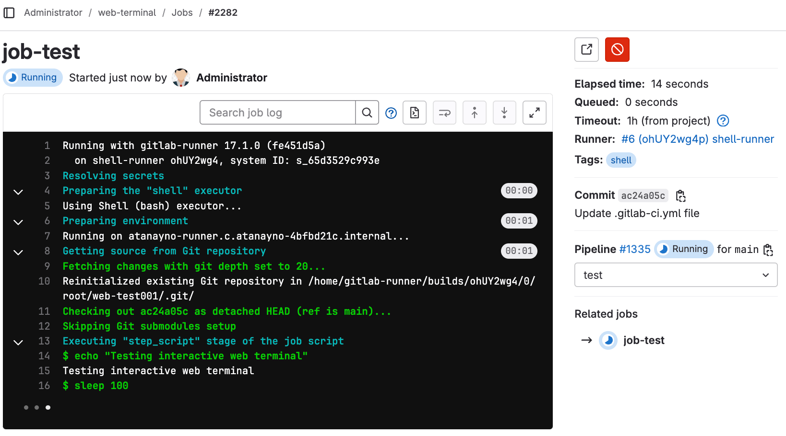
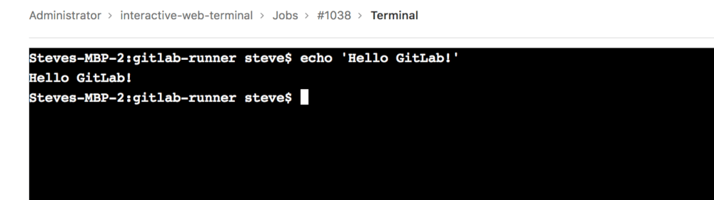
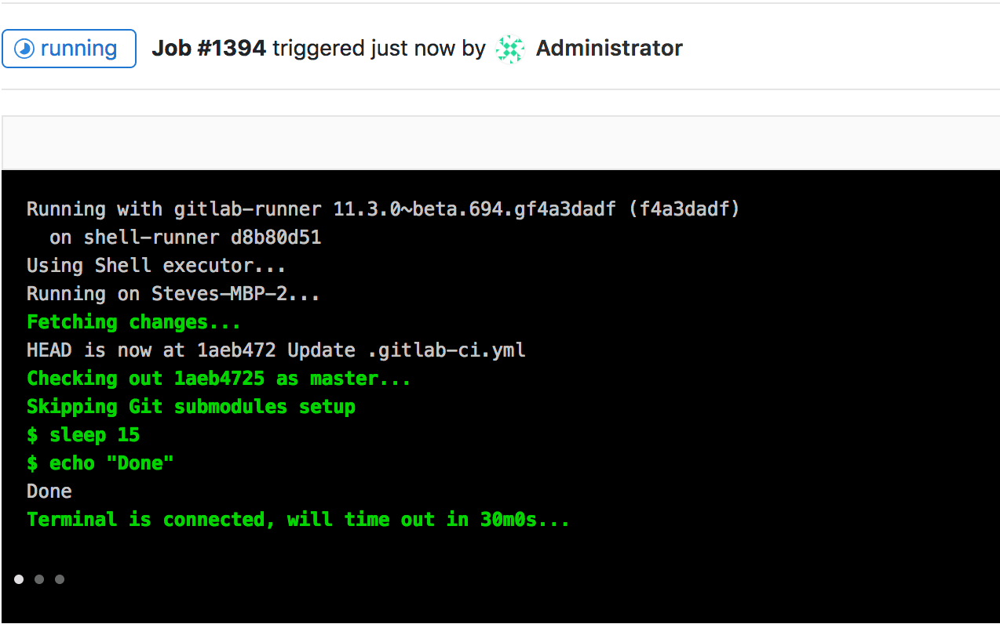



- Tier: 基础版，专业版，旗舰版
- Offering: JihuLab.com，私有化部署



交互式 Web 终端让用户可以在极狐GitLab 中访问终端，为他们的 CI 流水线运行一次性命令。您可以把它想象成一种通过 SSH 进行调试的方法，只不过直接在作业页面上完成。由于这会向用户提供部署[极狐GitLab Runner](https://gitlab.cn/docs/runner/) 所在环境的 shell 访问权限，因此采取了一些[安全预防措施](../../administration/integration/terminal.md#security)来保护用户。

> [!note]
> [JihuLab.com 上的实例 Runner](../runners/_index.md) 不
> 提供交互式 Web 终端。有关添加支持的进展，请关注
> [此议题](https://gitlab.com/gitlab-org/gitlab/-/issues/24674)。对于托管在 JihuLab.com 上的群组和项目，使用您自己的群组或项目 Runner 时可以使用交互式 Web 终端。

## 配置

要使交互式 Web 终端正常工作，需要配置两项内容：

- Runner 需要正确
  [配置 `[session_server]`](https://gitlab.cn/docs/runner/configuration/advanced-configuration/#the-session_server-section)
- 如果您的极狐GitLab 实例使用了反向代理，则需要
  [启用](../../administration/integration/terminal.md#enabling-and-disabling-terminal-support) Web 终端

### 对 Helm chart 的部分支持

交互式 Web 终端在 `gitlab-runner` Helm chart 中受部分支持。在以下情况下会启用：

- 副本数量为一
- 您使用 `loadBalancer` 服务

修复这些限制的支持工作记录在以下议题中：

- [支持多个副本](https://gitlab.com/gitlab-org/charts/gitlab-runner/-/issues/323)
- [支持更多服务类型](https://gitlab.com/gitlab-org/charts/gitlab-runner/-/issues/324)

## 调试正在运行的作业

> [!note]
> 并非所有执行器都
> [受支持](https://gitlab.cn/docs/runner/executors/#compatibility-chart)。
>
> `docker` 执行器在构建脚本完成后不会继续运行。
> 此时，终端会自动断开连接，不会等待用户完成。有关改进此行为的更新，请关注
> [此议题](https://gitlab.com/gitlab-org/gitlab-runner/-/issues/3605)。

先决条件：

- 您必须拥有该项目的开发者、维护者或所有者角色，或者拥有实例的管理员访问权限。
- 您必须已启动作业，除非您是管理员。
- 如果实例开启了[管理员模式](../../administration/settings/sign_in_restrictions.md#admin-mode)，
  管理员必须为其会话开启管理员模式。
- 如果作业在受保护分支上运行，您必须被允许推送到该分支或合并到该分支。
  如果作业在受保护标签上运行，您必须被允许创建该标签。
  更多信息，请参见 [CI/CD 权限](../../user/permissions.md#project-cicd)。

有时，作业运行时情况并不如您所愿。如果能够使用 shell 来辅助调试，将会很有帮助。作业运行时，右侧面板会显示一个 `debug` 按钮（），用于打开当前作业的终端。只有启动作业的人才能调试该作业。管理员也可以调试并非由他们启动的作业。

选中后，会打开一个新标签页进入终端页面，您可以在其中访问终端并像在标准 shell 中一样输入命令。

如果作业完成后您的终端仍处于打开状态，则作业会一直等到配置的
[`[session_server].session_timeout`](https://gitlab.cn/docs/runner/configuration/advanced-configuration/#the-session_server-section)
时长结束后才完成。为避免这种情况，您可以在作业完成后关闭终端。

