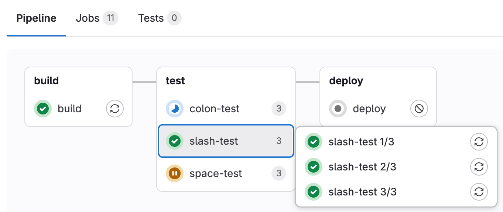
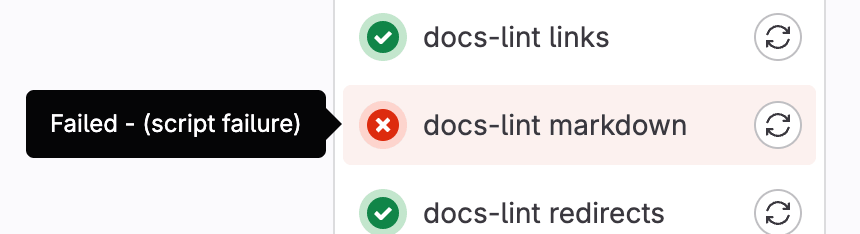



- Tier: 基础版，专业版，旗舰版
- Offering: JihuLab.com，私有化部署



CI/CD 作业是[极狐GitLab CI/CD 流水线](../pipelines/_index.md)的基本组成单元。作业在 `.gitlab-ci.yml` 文件中配置，其中包含要执行的命令列表，用于完成构建、测试或部署代码等任务。

作业：

- 在 [Runner](../runners/_index.md) 上执行，例如在 Docker 容器中执行。
- 独立于其他作业运行。
- 具有[作业日志](job_logs.md)，其中包含该作业的完整执行日志。

作业通过 [YAML 关键字](../yaml/_index.md)定义，这些关键字定义了作业执行的各个方面，包括以下关键字：

- 控制作业运行的[方式](job_control.md)和[时机](job_rules.md)。
- 将作业分组到称为[阶段](../yaml/_index.md#stages)的集合中。
  阶段按顺序运行，而同一阶段中的所有作业可以并行运行。
- 定义 [CI/CD 变量](../variables/_index.md)以实现灵活配置。
- 定义[缓存](../caching/_index.md)以加快作业执行速度。
- 将文件保存为[产物](job_artifacts.md)，供其他作业使用。

<a id="add-a-job-to-a-pipeline"></a>

## 向流水线添加作业

要向流水线添加作业，请将其添加到您的 `.gitlab-ci.yml` 文件中。该作业必须：

- 定义在 YAML 配置的顶层。
- 具有唯一的[作业名称](#job-names)。
- 具有定义要运行的命令的 [`script`](../yaml/_index.md#script) 部分，
  或具有用于触发[下游流水线](../pipelines/downstream_pipelines.md)运行的
  [`trigger`](../yaml/_index.md#trigger) 部分。

例如：

```yaml
my-ruby-job:
  script:
    - bundle install
    - bundle exec my_ruby_command

my-shell-script-job:
  script:
    - my_shell_script.sh
```

<a id="job-names"></a>

### 作业名称

您不能将这些关键字用作作业名称：

- `image`
- `services`
- `stages`
- `before_script`
- `after_script`
- `variables`
- `cache`
- `include`
- `pages:deploy`（为 `deploy` 阶段配置）

此外，这些名称在加引号时有效，但不建议使用，因为它们可能使流水线配置不清晰：

- `"true":`
- `"false":`
- `"nil":`

作业名称不得超过 255 个字符。

请为作业使用唯一的名称。如果文件中有多个作业使用相同名称，则只有一个会被添加到流水线中，并且很难预测会选择哪一个。如果在一个或多个包含的文件中使用了相同的作业名称，则[参数会被合并](../yaml/includes.md#override-included-configuration-values)。

<a id="hide-a-job"></a>

### 隐藏作业

要在不删除配置文件中的作业的情况下临时禁用它，请在作业名称开头添加一个句点（`.`）。隐藏作业不需要包含 `script` 或 `trigger` 关键字，但必须包含有效的 YAML 配置。

例如：

```yaml
.hidden_job:
  script:
    - run test
```

隐藏作业不会被极狐GitLab CI/CD 处理，但它们可以用作可复用配置的模板，方式包括：

- [`extends` 关键字](../yaml/yaml_optimization.md#use-extends-to-reuse-configuration-sections)。
- [YAML 锚点](../yaml/yaml_optimization.md#anchors)。

<a id="set-default-values-for-job-keywords"></a>

## 为作业关键字设置默认值

您可以使用 `default` 关键字设置默认的作业关键字和值，流水线中的所有作业默认使用这些值。

例如：

```yaml
default:
  image: 'ruby:2.4'
  before_script:
    - echo Hello World

rspec-job:
  script: bundle exec rspec
```

当流水线运行时，该作业使用默认关键字：

```yaml
rspec-job:
  image: 'ruby:2.4'
  before_script:
    - echo Hello World
  script: bundle exec rspec
```

<a id="control-the-inheritance-of-default-keywords-and-variables"></a>

### 控制默认关键字和变量的继承

您可以控制以下内容的继承：

- 使用 [`inherit:default`](../yaml/_index.md#inheritdefault) 控制[默认关键字](../yaml/_index.md#default)。
- 使用 [`inherit:variables`](../yaml/_index.md#inheritvariables) 控制[默认变量](../yaml/_index.md#default)。

例如：

```yaml
default:
  image: 'ruby:2.4'
  before_script:
    - echo Hello World

variables:
  DOMAIN: example.com
  WEBHOOK_URL: https://my-webhook.example.com

rubocop:
  inherit:
    default: false
    variables: false
  script: bundle exec rubocop

rspec:
  inherit:
    default: [image]
    variables: [WEBHOOK_URL]
  script: bundle exec rspec

capybara:
  inherit:
    variables: false
  script: bundle exec capybara

karma:
  inherit:
    default: true
    variables: [DOMAIN]
  script: karma
```

在此示例中：

- `rubocop`：
  - 继承：无。
- `rspec`：
  - 继承：默认 `image` 和 `WEBHOOK_URL` 变量。
  - 不继承：默认 `before_script` 和 `DOMAIN` 变量。
- `capybara`：
  - 继承：默认 `before_script` 和 `image`。
  - 不继承：`DOMAIN` 和 `WEBHOOK_URL` 变量。
- `karma`：
  - 继承：默认 `image` 和 `before_script`，以及 `DOMAIN` 变量。
  - 不继承：`WEBHOOK_URL` 变量。

<a id="view-jobs-in-a-pipeline"></a>

## 查看流水线中的作业

当您访问某个流水线时，可以看到该流水线的相关作业。

流水线中作业的顺序取决于流水线图的类型。

- 对于[完整流水线图](../pipelines/_index.md#pipeline-details)，作业按名称字母顺序排序。
- 对于[流水线迷你图](../pipelines/_index.md#pipeline-mini-graphs)，作业按状态严重程度排序，
  失败的作业排在最前面，然后按名称字母顺序排序。

选择单个作业会显示其[作业日志](job_logs.md)，并允许您：

- 取消该作业。
- 重试该作业（如果失败）。
- 再次运行该作业（如果通过）。
- 擦除作业日志。

<a id="view-project-jobs"></a>

### 查看项目作业



- Offering: JihuLab.com，私有化部署



要查看项目中运行的作业：

1. 在顶部栏中，选择**搜索或跳转到**，然后找到您的项目。
1. 在左侧边栏中，选择**构建** > **作业**。

您可以按作业状态、来源、名称和类型筛选列表。

> [!note]
> 按名称筛选会返回过去 30 天内创建的作业。此保留期适用于 UI 和 API 筛选。

默认情况下，筛选器仅显示构建作业。要查看触发器作业，请清除筛选条件，然后选择**类型** > **触发器**。

> [!note]
> **类型**筛选器仅适用于项目作业。它在**管理**区域中不可用。

<a id="available-job-statuses"></a>

### 可用的作业状态

CI/CD 作业可以具有以下状态：

- `canceled`：作业被手动取消或自动中止。
- `canceling`：作业正在被取消，但 `after_script` 正在运行。
- `created`：作业已创建但尚未处理。
- `failed`：作业执行失败。
- `manual`：作业需要手动操作才能启动。
- `pending`：作业在队列中等待 Runner。
- `preparing`：Runner 正在准备执行环境。
- `running`：作业正在 Runner 上执行。
- `scheduled`：作业已计划，但执行尚未开始。
- `skipped`：作业因条件或依赖关系被跳过。
- `success`：作业成功完成。
- `waiting_for_callback`：作业正在等待外部服务的回调。
- `waiting_for_resource`：作业正在等待资源可用。

<a id="view-the-source-of-a-job"></a>

### 查看作业的来源

极狐GitLab CI/CD 作业包含一个来源属性，用于指示触发该作业的操作。使用此属性可以跟踪作业的启动方式，或根据特定来源筛选作业运行。

<a id="available-job-sources"></a>

#### 可用的作业来源

来源属性可以具有以下值：

- `api`：作业由对 Jobs API 的 REST 调用启动。
- `chat`：作业由使用极狐GitLab ChatOps 的聊天命令启动。
- `container_registry_push`：作业由容器镜像仓库推送启动。
- `duo_workflow`：作业由极狐GitLab Duo Agent Platform 启动。
- `external`：作业由与极狐GitLab 集成的外部代码仓库中的事件启动。这不包括拉取请求事件。
- `external_pull_request_event`：作业由外部代码仓库中的拉取请求事件启动。
- `merge_request_event`：作业由合并请求事件启动。
- `ondemand_dast_scan`：作业由按需 DAST 扫描启动。
- `ondemand_dast_validation`：作业由按需 DAST 验证启动。
- `parent_pipeline`：作业由父流水线启动
- `pipeline`：作业由用户手动运行流水线启动。
- `pipeline_execution_policy`：作业由流水线执行策略启动。
- `pipeline_execution_policy_schedule`：作业由计划的流水线执行策略启动。
- `push`：作业由代码推送启动。
- `scan_execution_policy`：作业由扫描执行策略启动。
- `schedule`：作业由计划的流水线启动。
- `security_orchestration_policy`：作业由计划的扫描执行策略启动。
- `trigger`：作业由另一个作业或流水线启动。
- `unknown`：作业由未知来源启动。
- `web`：作业由用户从极狐GitLab UI 启动。
- `webide`：作业由用户从 Web IDE 启动。

<a id="group-similar-jobs-together-in-pipeline-views"></a>

### 在流水线视图中将相似作业分组

如果您有许多相似的作业，您的[流水线图](../pipelines/_index.md#pipeline-details)会变得很长且难以阅读。

您可以自动将相似的作业分组。如果作业名称按特定方式格式化，它们会在常规流水线图（不是迷你图）中折叠为一个组。

如果作业名称旁边显示的是数字而不是重试或取消按钮，您就可以识别出流水线中有分组的作业。该数字表示分组的作业数量。将鼠标悬停在其上会显示所有作业是否已通过或是否有任何作业失败。选择即可展开它们。



要创建一组作业，请在 `.gitlab-ci.yml` 文件中，用数字和以下符号之一分隔每个作业名称：

- 正斜杠或反斜杠（`/` 或 ` \ `），例如 `slash-test 1/3`、
  `slash-test 2/3`、`slash-test 3/3`。
- 冒号（`:`），例如 `colon-test 1:3`、`colon-test 2:3`、`colon-test 3:3`。
- 空格，例如 `space-test 0 3`、`space-test 1 3`、`space-test 2 3`。

您可以互换使用这些符号。

在以下示例中，这三个作业位于名为 `build ruby`的组中：

```yaml
build ruby 1/3:
  stage: build
  script:
    - echo "ruby1"

build ruby 2/3:
  stage: build
  script:
    - echo "ruby2"

build ruby 3/3:
  stage: build
  script:
    - echo "ruby3"
```

流水线图会显示一个名为 `build ruby`的组，其中包含三个作业。

作业通过从左到右比较数字来排序。您通常希望第一个数字是索引，第二个数字是总数。

<a id="retry-jobs"></a>

## 重试作业

您可以在作业完成后重试它，无论其最终状态如何（失败、成功或已取消）。

当您重试作业时：

- 会创建一个具有新作业 ID 的新作业实例。
- 该作业使用与原始作业相同的参数和变量运行。
- 如果该作业生成产物，则会创建并存储新的产物。
- 新作业与发起重试的用户关联，而不是与创建原始流水线的用户关联。
- 之前被跳过的任何后续作业都会重新分配给发起重试的用户。

当您重试触发下游流水线的[触发器作业](../yaml/_index.md#trigger)时：

- 触发器作业会生成新的下游流水线。
- 下游流水线也会与发起重试的用户关联。
- 下游流水线使用重试时存在的配置运行，
  这可能与原始运行不同。

<a id="retry-a-job"></a>

### 重试作业

先决条件：

- 您必须具有项目的开发者、维护者或所有者角色。
- 该作业不能处于[已归档](../../administration/settings/continuous_integration.md#archive-pipelines)状态。

要从合并请求重试作业：

1. 在顶部栏中，选择**搜索或跳转到**，然后找到您的项目。
1. 在您的合并请求中，执行以下操作之一：
   - 在流水线小组件中，在要重试的作业旁边，选择**再次运行**（）。
   - 选择**流水线**选项卡，在要重试的作业旁边，选择**再次运行**（）。

要从作业日志重试作业：

1. 转到该作业的日志页面。
1. 在右上角，选择**再次运行**（）。

要从流水线重试作业：

1. 在顶部栏中，选择**搜索或跳转到**，然后找到您的项目。
1. 在左侧边栏中，选择**构建** > **流水线**。
1. 找到包含要重试作业的流水线。
1. 在流水线图中，在要重试的作业旁边，选择**再次运行**（）。

<a id="retry-all-failed-or-canceled-jobs-in-a-pipeline"></a>

### 重试流水线中所有失败或已取消的作业

如果流水线有多个失败或已取消的作业，您可以一次性重试所有这些作业：

1. 在顶部栏中，选择**搜索或跳转到**，然后找到您的项目。
1. 执行以下操作之一：
   - 选择**构建** > **流水线**。
   - 转到合并请求并选择**流水线**选项卡。
1. 对于包含失败或已取消作业的流水线，选择**重试所有失败或已取消的作业**（）。

<a id="cancel-jobs"></a>

## 取消作业

您可以取消尚未完成的 CI/CD 作业。当您取消作业时，接下来会发生什么取决于其状态：

- 对于尚未开始执行的作业，该作业会立即被取消。
- 对于正在运行的作业：
  1. 该作业被标记为 `canceling`。
  1. 正在运行的命令会继续执行直至完成。该作业的
     [`before_script`](../yaml/_index.md#before_script) 或 [`script`](../yaml/_index.md#script)中的其余命令会被跳过。
  1. 如果该作业有 `after_script` 部分，它始终会启动并运行至完成。
  1. 该作业被标记为 `canceled`。

如果您需要立即取消作业而不等待 `after_script`，请使用[强制取消](#force-cancel-a-job)。

<a id="cancel-a-job"></a>

### 取消作业

先决条件：

- 您必须具有项目的开发者、维护者或所有者角色，
  或具有[取消流水线或作业所需的最低角色](../pipelines/settings.md#restrict-roles-that-can-cancel-pipelines-or-jobs)。

要从合并请求取消作业：

1. 在顶部栏中，选择**搜索或跳转到**，然后找到您的项目。
1. 在您的合并请求中，执行以下操作之一：
   - 在流水线小组件中，在要取消的作业旁边，选择**取消**（）。
   - 选择**流水线**选项卡，在要取消的作业旁边，选择**取消**（）。

要从作业日志取消作业：

1. 转到该作业的日志页面。
1. 在右上角，选择**取消**（）。

要从流水线取消作业：

1. 在顶部栏中，选择**搜索或跳转到**，然后找到您的项目。
1. 在左侧边栏中，选择**构建** > **流水线**。
1. 找到包含要取消作业的流水线。
1. 在流水线图中，在要取消的作业旁边，选择**取消**（）。

<a id="cancel-all-running-jobs-in-a-pipeline"></a>

### 取消流水线中所有正在运行的作业

您可以一次性取消正在运行的流水线中的所有作业。

1. 在顶部栏中，选择**搜索或跳转到**，然后找到您的项目。
1. 执行以下操作之一：
   - 选择**构建** > **流水线**。
   - 转到合并请求并选择**流水线**选项卡。
1. 对于要取消的流水线，选择**取消正在运行的流水线**（）。

<a id="force-cancel-a-job"></a>

### 强制取消作业

如果您不想等待 `after_script` 完成，或者作业无响应，您可以强制取消它。强制取消会立即将作业从 `canceling` 状态移至 `canceled`。

当您强制取消作业时，[作业令牌](ci_job_token.md)会立即被撤销。如果 Runner 仍在执行该作业，它将失去对极狐GitLab 的访问权限。Runner 会中止该作业，而不等待 `after_script` 完成。

先决条件：

- 您必须具有项目的维护者或所有者角色。
- 该作业必须处于 `canceling` 状态，这需要：
  - 极狐GitLab 17.0 及更高版本。
  - 极狐GitLab Runner 16.10 及更高版本。

要强制取消作业：

1. 转到该作业的日志页面。
1. 在右上角，选择**强制取消**。

<a id="troubleshoot-a-failed-job"></a>

## 对失败的作业进行故障排除

当流水线失败或被允许失败时，您可以在多个位置找到原因：

- 在[流水线图](../pipelines/_index.md#pipeline-details)中，即流水线详情视图中。
- 在流水线小组件中，即合并请求和提交页面中。
- 在作业视图中，即作业的全局视图和详细视图中。

在每个位置，如果您将鼠标悬停在失败的作业上，就可以看到其失败原因。



您也可以在作业详情页面上看到其失败原因。

<a id="with-root-cause-analysis"></a>

### 使用根因分析

您可以在极狐GitLab Duo Chat 中使用极狐GitLab Duo 根因分析来[对失败的 CI/CD 作业进行故障排除](../../user/gitlab_duo_chat/examples.md#troubleshoot-failed-cicd-jobs-with-root-cause-analysis)。

<a id="deployment-jobs"></a>

## 部署作业

部署作业是使用[环境](../environments/_index.md)的 CI/CD 作业。部署作业是任何使用 `environment` 关键字和 [`start` 环境 `action`](../yaml/_index.md#environmentaction)的作业。部署作业不需要位于 `deploy` 阶段。以下 `deploy me` 作业是部署作业的一个示例。`action: start` 是默认行为，此处为清晰起见而定义，但您可以省略它：

```yaml
deploy me:
  script:
    - deploy-to-cats.sh
  environment:
    name: production
    url: https://cats.example.com
    action: start
```

部署作业的行为可以通过[部署安全](../environments/deployment_safety.md)设置来控制，例如[防止过时的部署作业](../environments/deployment_safety.md#prevent-outdated-deployment-jobs)和[确保一次只运行一个部署作业](../environments/deployment_safety.md#ensure-only-one-deployment-job-runs-at-a-time)。
