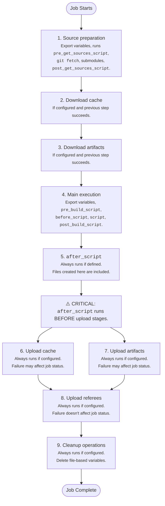



- Tier: 基础版，专业版，旗舰版
- Offering: JihuLab.com，私有化部署



作业执行流程描述了极狐GitLab Runner 如何从头到尾处理 CI/CD 作业。

极狐GitLab Runner 在收到作业后执行 CI/CD 作业，从 vault 中获取密钥（如果已配置），并准备执行器。每个 CI/CD 作业都作为一系列顺序步骤执行，每个步骤都在独立的 shell 上下文中运行。Runner 会：

1. 为作业准备源代码：

   - 将变量导出到 shell 上下文
   - 如果配置中定义了 `pre_get_sources_script`，则运行它
   - 执行 `git fetch` 和其他源代码处理命令，除非配置了 `none` 策略
   - 如果存在子模块，则运行命令更新子模块
   - 如果配置中定义了 `post_get_sources_script`，则运行它

1. 如果配置了[缓存](../yaml/_index.md#cache)且上一步成功，则下载缓存文件：

   - 将变量导出到 shell 上下文
   - 执行命令，从之前的作业运行中下载缓存文件

1. 如果配置了产物下载且上一步成功，则从之前的作业下载[产物](../yaml/_index.md#artifacts)：

   - 将变量导出到 shell 上下文
   - 执行命令，从之前的作业下载产物文件

1. 如果上一步成功，则执行主作业脚本：

   - 将变量导出到 shell 上下文
   - 如果配置中定义了 `pre_build_script`，则运行它
   - 如果定义了 `before_script` 命令，则执行它们
   - 执行主 `script` 命令
   - 如果配置中定义了 `post_build_script`，则运行它

1. 如果定义了 `after_script` 命令，则执行它们，无论之前的步骤是否失败：

   - 将变量导出到新的 shell 上下文
   - 执行 `after_script` 命令
   - 这些命令失败不会影响作业的整体状态

1. 如果配置了缓存上传，则将文件上传到缓存，无论之前的步骤是否失败：

   - 将变量导出到 shell 上下文
   - 执行命令，将指定文件上传到缓存存储
   - 此步骤失败可能会影响作业的整体状态

1. 如果配置了产物上传，则上传产物，无论之前的步骤是否失败：

   - 将变量导出到 shell 上下文
   - 执行命令，将指定文件作为作业产物上传
   - 此步骤失败可能会影响作业的整体状态

1. 如果配置了 referee 上传，则上传 referee 数据，无论之前的步骤是否失败：

   - 将变量导出到 shell 上下文
   - 执行命令，上传 referee 信息
   - 这些命令失败不会影响作业的整体状态

1. 如果配置了清理操作，则执行清理，无论之前的步骤是否失败：

   - 将变量导出到 shell 上下文
   - 执行命令，从工作目录中删除基于文件的变量
   - 这些命令失败不会影响作业的整体状态

## Shell 上下文隔离

每个 shell 上下文在设计上都是隔离的。上下文之间唯一的连接是共享的工作目录文件系统。

- 在一个上下文中手动导出的变量（如 `export my_variable=$(date)`）在其他上下文中不可用
- 每个脚本都使用 `set -eo pipefail`（对于 Unix shell）运行，以便在出现第一个错误时尽早失败
- 每个步骤的结果会影响后续步骤是否执行，并影响作业的整体状态
