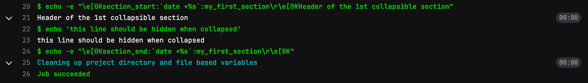
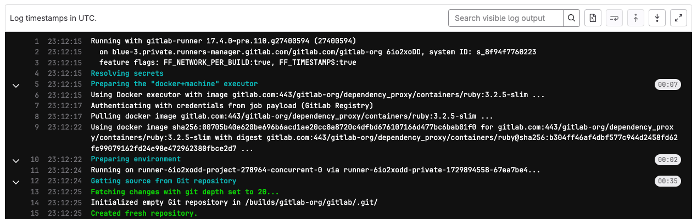



- Tier: 基础版，专业版，旗舰版
- Offering: JihuLab.com，私有化部署



作业日志显示 [CI/CD 作业](_index.md)的完整执行历史。

<a id="view-job-logs"></a>

## 查看作业日志

查看作业日志：

1. 选择您要查看作业日志的项目。
1. 在左侧边栏中，选择 **CI/CD** > **流水线**。
1. 选择您要检查的流水线。
1. 在流水线视图中，从作业列表中选择一个作业，以查看作业日志页面。

要查看有关作业及其日志输出的详细信息，请滚动浏览作业日志页面。

<a id="view-job-logs-in-full-screen-mode"></a>

## 在全屏模式下查看作业日志

您可以通过点击 **显示全屏** 以全屏模式查看作业日志的内容。

要使用全屏模式，您的 Web 浏览器也必须支持该模式。如果您的 Web 浏览器不支持全屏模式，则该选项不可用。

<a id="expand-and-collapse-job-log-sections"></a>

## 展开和折叠作业日志区段

> [!flag]
> 此功能的可用性由功能标志控制。

当启用 `FF_SCRIPT_SECTIONS` 时，多行脚本命令会在作业日志中显示为可折叠的区段。单行命令会直接输出，并带有 `$` 前缀。不显示持续时间。

在 `powershell` 和 `pwsh` shell 中，`FF_SCRIPT_SECTIONS` 不会创建可折叠的区段。命令仅以彩色输出形式打印。

<a id="create-custom-collapsible-sections"></a>

### 创建自定义可折叠区段

您可以通过手动输出极狐GitLab 用于分隔可折叠区段的特殊代码，在作业日志中创建可折叠区段：

- 区段开始标记：`\e[0Ksection_start:UNIX_TIMESTAMP:SECTION_NAME\r\e[0K` + `TEXT_OF_SECTION_HEADER`
- 区段结束标记：`\e[0Ksection_end:UNIX_TIMESTAMP:SECTION_NAME\r\e[0K`

您必须将这些代码添加到 CI 配置的脚本部分。例如，使用 `printf`：

```yaml
job1:
  script:
    - printf '\e[0Ksection_start:%d:%s\r\e[0K%s\n' "$(date +%s)" 'my_first_section' 'Header of the 1st collapsible section'
    - echo 'this line should be hidden when collapsed'
    - printf '\e[0Ksection_end:%d:%s\r\e[0K\n' "$(date +%s)" 'my_first_section'
```

在上面的示例中：

- `date +%s`：生成 Unix 时间戳的命令（例如 `1560896352`）。
- `my_first_section`：为区段指定的名称。名称只能由字母、数字以及
  `_`、`.` 或 `-` 字符组成。
- `\r\e[0K`：转义序列，用于防止区段标记显示在
  渲染后（带颜色）的作业日志中。查看原始作业日志时，这些标记会显示出来，可通过
  在作业日志右上角选择 **显示完整源**（）来访问。
  - `\r`：回车（将光标返回到行首）。
  - `\e[0K`：ANSI 转义码，用于清除从光标位置到行尾的内容。
    （仅使用 `\e[K` 不起作用；必须包含 `0`）。

原始作业日志示例：

```plaintext
\e[0Ksection_start:1560896352:my_first_section\r\e[0KHeader of the 1st collapsible section
this line should be hidden when collapsed
\e[0Ksection_end:1560896353:my_first_section\r\e[0K
```

作业控制台日志示例：



<a id="improve-section-display-with-a-script"></a>

#### 使用脚本改进区段显示

要从作业输出中移除创建区段标记的 `printf` 语句，您可以将作业内容移动到脚本文件中，并从作业中调用它：

1. 创建一个可以处理区段标题的脚本。例如：

   ```shell
   # Function for starting the section
   section_start () {
     local section_title="${1}"
     local section_description="${2:-$section_title}"

     printf '\e[0Ksection_start:%d:%s[collapsed=true]\r\e[0K%s\n' "$(date +%s)" "$section_title" "$section_description"
   }

   # Function for ending the section
   section_end () {
     local section_title="${1}"

     printf '\e[0Ksection_end:%d:%s\r\e[0K\n' "$(date +%s)" "$section_title"
   }

   # Create sections
   section_start "my_first_section" "Header of the 1st collapsible section"

   echo "this line should be hidden when collapsed"

   section_end "my_first_section"

   # Repeat as required
   ```

1. 将该脚本添加到 `.gitlab-ci.yml` 文件：

   ```yaml
   job:
     script:
       - source script.sh
   ```

<a id="collapse-sections-by-default"></a>

### 默认折叠区段

要默认折叠区段，请在区段开始标记中，在区段名称之后、`\r` 之前添加 `[collapsed=true]`：

- 带 `[collapsed=true]` 的区段开始标记：`\e[0Ksection_start:UNIX_TIMESTAMP:SECTION_NAME[collapsed=true]\r\e[0K` + `TEXT_OF_SECTION_HEADER`
- 区段结束标记（不变）：`\e[0Ksection_end:UNIX_TIMESTAMP:SECTION_NAME\r\e[0K`

将更新后的区段开始文本添加到 CI 配置中。例如，使用 `printf`：

```yaml
job1:
  script:
    - printf '\e[0Ksection_start:%d:%s[collapsed=true]\r\e[0K%s\n' "$(date +%s)" 'my_first_section' 'Header of the 1st collapsible section'
    - echo 'this line should be hidden automatically after loading the job log'
    - printf '\e[0Ksection_end:%d:%s\r\e[0K\n' "$(date +%s)" 'my_first_section'
```

<a id="delete-job-logs"></a>

## 删除作业日志

删除作业日志时，您也会[清除整个作业](../../api/jobs.md#erase-a-job)。

更多详情，请参见[删除作业日志](../../user/storage_management_automation.md#delete-job-logs)。

<a id="timestamps"></a>

## 时间戳



- Tier: 基础版，专业版，旗舰版
- Offering: JihuLab.com，私有化部署



默认情况下，作业日志会为每一行包含 [ISO 8601 格式](https://www.iso.org/iso-8601-date-and-time-format.html)的时间戳。使用时间戳可以排查性能问题、识别瓶颈，并衡量特定构建步骤的耗时。

启用时间戳后，作业日志会多占用约 10% 的存储空间。

以下示例展示了一个带时间戳的作业日志：



<a id="control-timestamps-in-job-logs"></a>

### 控制作业日志中的时间戳

先决条件：

- 极狐GitLab Runner 18.7 或更高版本。

要控制作业日志中是否显示时间戳，请使用 `FF_TIMESTAMPS` CI/CD 变量：

- 设置为 `false` 以禁用时间戳
- 设置为 `true` 以显式启用时间戳

例如：

```yaml
variables:
  FF_TIMESTAMPS: false  # Disables timestamps

job:
  script:
    - echo "This job's log behavior depends on FF_TIMESTAMPS value"
```

更多信息，请参见[在 `.gitlab-ci.yml` 文件中定义 CI/CD 变量](../variables/_index.md#define-a-cicd-variable-in-the-gitlab-ciyml-file)。

<a id="troubleshooting"></a>

## 故障排除

<a id="job-log-slow-to-update"></a>

### 作业日志更新缓慢

当您访问正在运行的作业的作业日志页面时，日志更新可能会有最多 60 秒的延迟。默认刷新时间为 60 秒，但在 UI 中查看过一次日志后，日志更新应每 3 秒发生一次。

<a id="error-this-job-does-not-have-a-trace-in-gitlab-180-or-later"></a>

### 错误：在极狐GitLab 18.0 或更高版本中出现 `This job does not have a trace`

将极狐GitLab 私有化部署实例升级到 18.0 或更高版本后，您可能会看到 `This job does not have a trace` 错误。这可能是由实例上失败的升级迁移引起的，该实例同时满足以下两个条件：

- 启用了对象存储
- 之前通过已移除的功能标志 `ci_enable_live_trace` 启用了增量日志记录。
  该功能标志在 GitLab Environment Toolkit 或 Helm Chart 部署中默认启用，
  但也可以手动启用。

要查看受影响作业的作业日志，请[重新启用增量日志记录](../../administration/settings/continuous_integration.md#configure-incremental-logging)
