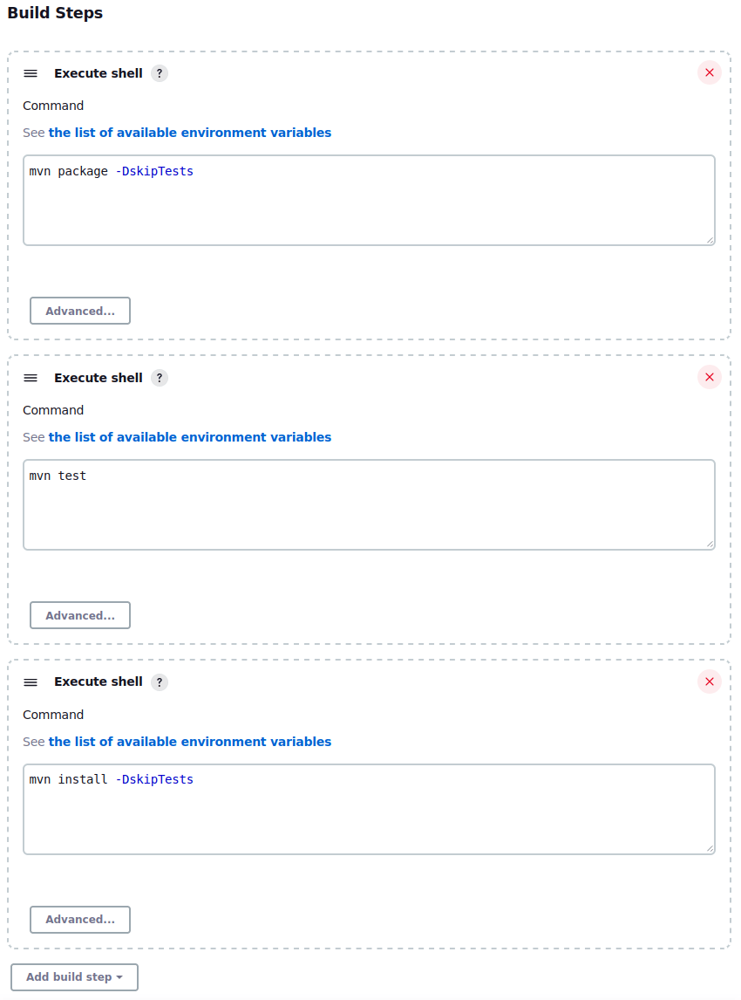
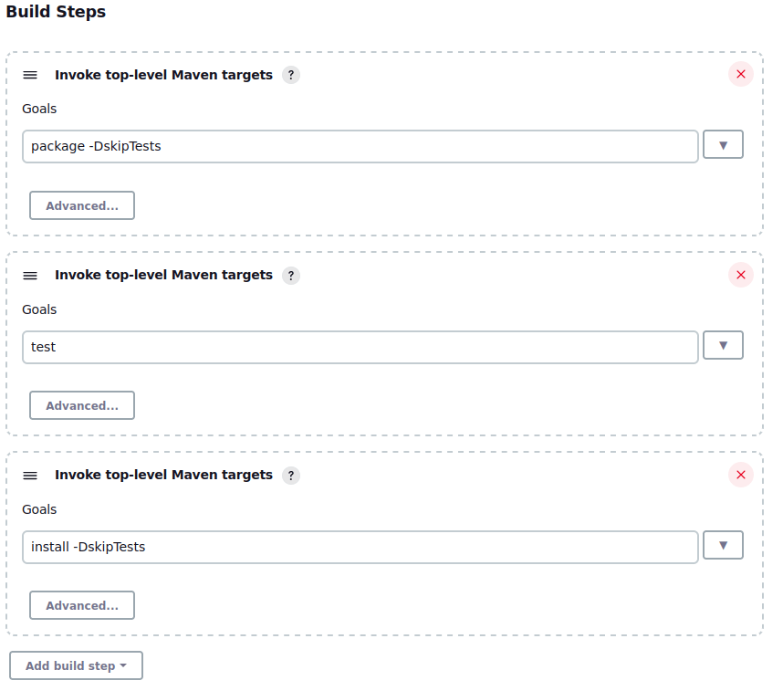



- Tier: 基础版，专业版，旗舰版
- Offering: JihuLab.com，私有化部署



如果您的 Jenkins 中有 Maven 构建，可以使用 [Java Spring](https://gitlab.com/gitlab-org/project-templates/spring)
项目模板迁移到极狐GitLab。该模板使用 Maven 进行底层依赖管理。

<a id="sample-jenkins-configurations"></a>

## 示例 Jenkins 配置

以下三个 Jenkins 示例分别使用不同的方法，将 Maven 项目的测试、构建和安装过程放入 shell 代理中执行：

- 使用 shell 执行的自由风格项目
- 使用 Maven 任务插件的自由风格项目
- 使用 Jenkinsfile 的声明式流水线

这三个示例都在三个不同的阶段中按顺序运行相同的三条命令：

- `mvn test`：运行代码库中的所有测试
- `mvn package -DskipTests`：将代码编译为 POM 中定义的可执行类型，
  并跳过运行任何测试，因为测试已在第一个阶段完成。
- `mvn install -DskipTests`：将编译后的可执行文件安装到代理本地的 Maven
  `.m2` 代码仓库中，并再次跳过运行测试。

这些示例使用单个持久化的 Jenkins 代理，这要求代理上预先安装 Maven。这种执行方式类似于
使用 [shell 执行器](https://gitlab.cn/docs/runner/executors/shell/)的极狐GitLab Runner。

<a id="freestyle-with-shell-execution"></a>

### 使用 shell 执行的自由风格项目

如果使用 Jenkins 内置的 shell 执行选项，直接在代理的 shell 中调用 `mvn` 命令，配置可能如下所示：



<a id="freestyle-with-maven-task-plugin"></a>

### 使用 Maven 任务插件的自由风格项目

如果在 Jenkins 中使用 Maven 插件来声明并执行 [Maven 构建生命周期](https://maven.apache.org/guides/introduction/introduction-to-the-lifecycle.html)中的特定目标，配置可能如下所示：



该插件要求 Jenkins 代理上安装 Maven，并使用脚本包装器来调用 Maven 命令。

<a id="using-a-declarative-pipeline"></a>

### 使用声明式流水线

如果使用声明式流水线，配置可能如下所示：

```groovy
pipeline {
    agent any
    tools {
        maven 'maven-3.6.3'
        jdk 'jdk11'
    }
    stages {
        stage('Build') {
            steps {
                sh "mvn package -DskipTests"
            }
        }
        stage('Test') {
            steps {
                sh "mvn test"
            }
        }
        stage('Install') {
            steps {
                sh "mvn install -DskipTests"
            }
        }
    }
}
```

此示例使用 shell 执行命令，而不是插件。

默认情况下，声明式流水线配置存储在 Jenkins 流水线配置中，或直接存储在 Git 代码仓库的 `Jenkinsfile`中。

<a id="convert-jenkins-configuration-to-gitlab-cicd"></a>

## 将 Jenkins 配置转换为极狐GitLab CI/CD

虽然前面的示例都略有不同，但它们都可以使用相同的流水线配置迁移到极狐GitLab CI/CD。

先决条件：

- 一个使用 Shell 执行器的极狐GitLab Runner
- 在 shell runner 上安装 Maven 3.6.3 和 Java 11 JDK

此示例模拟在 Jenkins 上构建、测试和安装的行为和语法。

在极狐GitLab CI/CD 流水线中，命令在“作业”中运行，作业被分组到各个阶段中。`.gitlab-ci.yml` 配置文件中的迁移后配置由两个全局关键字（`stages` 和 `variables`）以及 3 个作业组成：

```yaml
stages:
  - build
  - test
  - install

variables:
  MAVEN_OPTS: >-
    -Dhttps.protocols=TLSv1.2
    -Dmaven.repo.local=$CI_PROJECT_DIR/.m2/repository
  MAVEN_CLI_OPTS: >-
    -DskipTests

build-JAR:
  stage: build
  script:
    - mvn $MAVEN_CLI_OPTS package

test-code:
  stage: test
  script:
    - mvn test

install-JAR:
  stage: install
  script:
    - mvn $MAVEN_CLI_OPTS install
```

在此示例中：

- `stages` 定义了按顺序运行的三个阶段。与前面的 Jenkins 示例一样，
  测试作业首先运行，然后是构建作业，最后是安装作业。
- `variables` 定义了所有作业都可以使用的 [CI/CD 变量](../../variables/_index.md)：
  - `MAVEN_OPTS` 是每次执行 Maven 时都需要的 Maven 环境变量：
    - `-Dhttps.protocols=TLSv1.2` 将流水线中任何 HTTP 请求的 TLS 协议设置为 1.2 版本。
    - `-Dmaven.repo.local=$CI_PROJECT_DIR/.m2/repository` 将
      本地 Maven 代码仓库的位置设置为 runner 上的极狐GitLab 项目目录，以便作业
      可以访问和修改该代码仓库。
  - `MAVEN_CLI_OPTS` 是要添加到 `mvn` 命令中的特定参数：
    - `-DskipTests` 跳过 Maven 构建生命周期中的 `test` 阶段。
- `test-code`、`build-JAR` 和 `install-JAR` 是要在流水线中运行的
  作业的用户自定义名称：
  - `stage` 定义作业在哪个阶段运行。一个流水线包含一个或多个阶段，
    一个阶段包含一个或多个作业。此示例有三个阶段，每个阶段只有一个作业。
  - `script` 定义在该作业中运行的命令，类似于 `Jenkinsfile`中的 `steps`。
    作业可以按顺序运行多条命令，这些命令在镜像容器中运行，
    但在本示例中，每个作业只运行一条命令。

<a id="run-jobs-in-docker-containers"></a>

### 在 Docker 容器中运行作业

与 Jenkins 示例使用持久化机器处理此构建过程不同，此示例使用临时 Docker 容器来处理执行。使用容器无需维护虚拟机及其上安装的 Maven 版本。它还提高了扩展和延伸流水线功能的灵活性。

先决条件：

- 一个使用 Docker 执行器的极狐GitLab Runner，可供该项目使用。
  如果您使用的是 JihuLab.com，可以使用公共实例 runner。

此迁移后的流水线配置由三个全局关键字（`stages`、`default` 和 `variables`）以及 3 个作业组成。与[前一个示例](#convert-jenkins-configuration-to-gitlab-cicd)相比，此配置利用了额外的极狐GitLab CI/CD 功能，以改进流水线：

```yaml
stages:
  - build
  - test
  - install

default:
  image: maven:3.6.3-openjdk-11
  cache:
    key: $CI_COMMIT_REF_SLUG
    paths:
      - .m2/

variables:
  MAVEN_OPTS: >-
    -Dhttps.protocols=TLSv1.2
    -Dmaven.repo.local=$CI_PROJECT_DIR/.m2/repository
  MAVEN_CLI_OPTS: >-
    -DskipTests

build-JAR:
  stage: build
  script:
    - mvn $MAVEN_CLI_OPTS package

test-code:
  stage: test
  script:
    - mvn test

install-JAR:
  stage: install
  script:
    - mvn $MAVEN_CLI_OPTS install
```

在此示例中：

- `stages` 定义了按顺序运行的三个阶段。与前面的 Jenkins 示例一样，
  测试作业首先运行，然后是构建作业，最后是安装作业。
- `default` 定义了默认在所有作业中复用的标准配置：
  - `image` 定义要使用并在其中执行命令的 Docker 镜像容器。在此示例中，
    它是官方 Maven Docker 镜像，所需的一切都已安装。
  - `cache` 用于缓存和复用依赖项：
    - `key` 是特定缓存归档的唯一标识符。在此示例中，
      它是 Git 提交 ref 的缩短版本，作为[预定义 CI/CD 变量](../../variables/predefined_variables.md)自动生成。
      为同一提交 ref 运行的任何作业都会复用同一缓存。
    - `paths` 是要包含在缓存中的目录或文件。此示例
      缓存 `.m2/` 目录，以避免在作业运行之间重新安装依赖项。
- `variables` 定义了所有作业都可以使用的 [CI/CD 变量](../../variables/_index.md)：
  - `MAVEN_OPTS` 是每次执行 Maven 时都需要的 Maven 环境变量：
    - `-Dhttps.protocols=TLSv1.2` 将流水线中任何 HTTP 请求的 TLS 协议设置为 1.2 版本。
    - `-Dmaven.repo.local=$CI_PROJECT_DIR/.m2/repository` 将
      本地 Maven 代码仓库的位置设置为 runner 上的极狐GitLab 项目目录，以便作业
      可以访问和修改该代码仓库。
  - `MAVEN_CLI_OPTS` 是要添加到 `mvn` 命令中的特定参数：
    - `-DskipTests` 跳过 Maven 构建生命周期中的 `test` 阶段。
- `test-code`、`build-JAR` 和 `install-JAR` 是要在流水线中运行的
  作业的用户自定义名称：
  - `stage` 定义作业在哪个阶段运行。一个流水线包含一个或多个阶段，
    一个阶段包含一个或多个作业。此示例有三个阶段，每个阶段只有一个作业。
  - `script` 定义在该作业中运行的命令，类似于 `Jenkinsfile`中的 `steps`。
    作业可以按顺序运行多条命令，这些命令在镜像容器中运行，
    但在本示例中，每个作业只运行一条命令。
