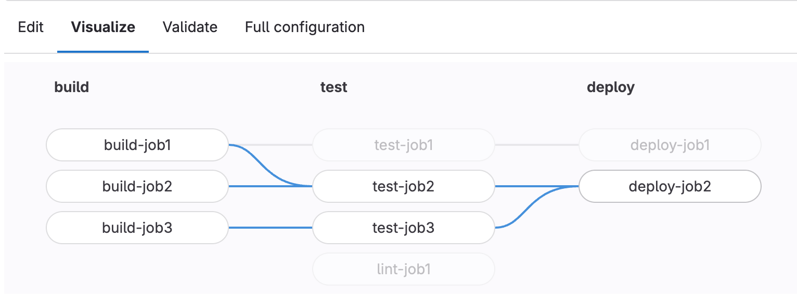



- Tier: 基础版，专业版，旗舰版
- Offering: JihuLab.com，私有化部署



流水线编辑器是编辑代码仓库根目录下 `.gitlab-ci.yml` 文件中极狐GitLab CI/CD 配置的主要场所。要访问该编辑器，请转到**构建** > **流水线编辑器**。

在流水线编辑器页面上，您可以：

- 选择要使用的分支。
- 在编辑文件时[验证](#validate-cicd-syntax)配置语法。
- 对[配置进行更深入的验证](#validate-cicd-configuration)，该验证会结合通过 [`include`](../yaml/_index.md#include) 关键字添加的任何配置进行检查。
- 查看[通过 `include` 关键字添加的 CI/CD 配置列表](#view-included-cicd-configuration)。
- 查看当前配置的[可视化视图](#visualize-cicd-configuration)。
- 查看[完整配置](#view-full-configuration)，其中显示合并 `include` 中所有配置后的结果。
- 将更改[提交](#commit-changes-to-ci-configuration)到特定分支。

<a id="validate-cicd-syntax"></a>

## 验证 CI/CD 语法

在使用流水线编辑器时，流水线配置语法会持续根据极狐GitLab CI/CD 流水线模式进行验证。系统会检查 CI/CD YAML 的语法以及一些基本的逻辑验证。

验证结果显示在编辑器页面顶部。如果验证失败，此部分会显示提示以帮助您解决问题。

<a id="validate-cicd-configuration"></a>

## 验证 CI/CD 配置

要在提交更改之前测试极狐GitLab CI/CD 配置的有效性，请使用流水线编辑器验证工具。此工具会模拟因 Git 推送事件而创建流水线的过程，可帮助排查逻辑问题，包括错误的 `rules` 和 `needs` 作业依赖关系：

1. 在顶部栏中，选择**搜索或跳转到**，然后找到您的项目。
1. 在左侧边栏中，选择**构建** > **流水线编辑器**。
1. 选择**验证**选项卡。
1. 可选。使用**流水线运行来源**下拉列表，选择用于模拟推送事件的其他分支。
1. 选择**验证流水线**。

模拟的流水线使用**编辑**选项卡中现有的流水线配置。

要验证 CI/CD YAML 代码片段而不将其添加到**编辑**选项卡，请改用 [CI Lint 工具](../yaml/lint.md#simulate-a-pipeline)。

<a id="view-included-cicd-configuration"></a>

## 查看包含的 CI/CD 配置

您可以在流水线编辑器中查看通过 [`include`](../yaml/_index.md#include) 关键字添加的配置。在右上角，选择文件树 () 以查看所有包含的配置文件列表。选中的文件会在新选项卡中打开以供查看。

<a id="visualize-cicd-configuration"></a>

## 可视化 CI/CD 配置

要查看 `.gitlab-ci.yml` 配置的可视化视图，请在您的项目中转到**构建** > **流水线编辑器**，然后选择**可视化**选项卡。该可视化视图会显示所有阶段和作业。任何 [`needs`](../yaml/_index.md#needs) 关系都会以连接作业的线条形式显示，展示执行层级。

将鼠标悬停在作业上可高亮显示其 `needs` 关系：



如果配置没有任何 `needs` 关系，则不会绘制任何线条，因为每个作业仅依赖于前一阶段成功完成。

来自[流水线执行策略](../../user/application_security/policies/pipeline_execution_policies.md)的作业不会显示在此可视化视图中，因为它们未在项目的 `.gitlab-ci.yml` 配置中定义。

<a id="view-full-configuration"></a>

## 查看完整配置

要将完全展开的 CI/CD 配置作为单个合并文件查看，请转到流水线编辑器的**完整配置**选项卡。此选项卡显示展开后的配置，其中：

- 通过 [`include`](../yaml/_index.md#include) 导入的配置会复制到视图中。
- 使用 [`extends`](../yaml/_index.md#extends) 的作业会显示[合并扩展配置后的结果](../yaml/yaml_optimization.md#merge-details)。
- [YAML 锚点](../yaml/yaml_optimization.md#anchors)会替换为链接的配置。
- [YAML `!reference` 标签](../yaml/yaml_optimization.md#reference-tags)也会替换为链接的配置。
- 条件规则会假定默认分支推送事件进行评估。

使用 `!reference` 标签可能会导致嵌套配置在展开视图中行首显示多个连字符（`-`）。此行为是预期行为，多余的连字符不会影响作业的执行。例如，以下配置和完全展开版本都是有效的：

- `.gitlab-ci.yml` 文件：

  ```yaml
  .python-req:
    script:
      - pip install pyflakes

  .rule-01:
    rules:
      - if: $CI_MERGE_REQUEST_SOURCE_BRANCH_NAME =~ /^feature/
        when: manual
        allow_failure: true
      - if: $CI_MERGE_REQUEST_SOURCE_BRANCH_NAME

  .rule-02:
    rules:
      - if: $CI_COMMIT_BRANCH == "main"
        when: manual
        allow_failure: true

  lint-python:
    image: python:latest
    script:
      - !reference [.python-req, script]
      - pyflakes python/
    rules:
      - !reference [.rule-01, rules]
      - !reference [.rule-02, rules]
  ```

- **完整配置**选项卡中的展开配置：

  ```yaml
  ".python-req":
    script:
    - pip install pyflakes
  ".rule-01":
    rules:
    - if: "$CI_MERGE_REQUEST_SOURCE_BRANCH_NAME =~ /^feature/"
      when: manual
      allow_failure: true
    - if: "$CI_MERGE_REQUEST_SOURCE_BRANCH_NAME"
  ".rule-02":
    rules:
    - if: $CI_COMMIT_BRANCH == "main"
      when: manual
      allow_failure: true
  lint-python:
    image: python:latest
    script:
    - - pip install pyflakes                                     # <- The extra hyphens do not affect the job's execution.
    - pyflakes python/
    rules:
    - - if: "$CI_MERGE_REQUEST_SOURCE_BRANCH_NAME =~ /^feature/" # <- The extra hyphens do not affect the job's execution.
        when: manual
        allow_failure: true
      - if: "$CI_MERGE_REQUEST_SOURCE_BRANCH_NAME"               # <- No extra hyphen but aligned with previous rule
    - - if: $CI_COMMIT_BRANCH == "main"                          # <- The extra hyphens do not affect the job's execution.
        when: manual
        allow_failure: true
  ```

<a id="commit-changes-to-ci-configuration"></a>

## 将更改提交到 CI 配置

提交表单会显示在编辑器中每个选项卡的底部，以便您随时提交更改。

当您对更改满意后，添加描述性的提交消息并输入分支。分支字段默认为项目的默认分支。

如果您输入新的分支名称，则会出现**使用这些更改启动新的合并请求**复选框。选中它可在提交更改后启动新的合并请求。


<a id="editor-accessibility-options"></a>

## 编辑器无障碍选项

流水线编辑器基于 [Monaco Editor](https://github.com/microsoft/monaco-editor)，它提供了多项[无障碍功能](https://github.com/microsoft/monaco-editor/wiki/Monaco-Editor-Accessibility-Guide)，包括：

| 功能                          | Windows 或 Linux 快捷键      | macOS 快捷键                                    | 详情 |
|----------------------------------|-----------------------------------|------------------------------------------------------|---------|
| 键盘导航命令列表 | <kbd>F1</kbd>                     | <kbd>F1</kbd>                                        | [命令列表](https://github.com/microsoft/monaco-editor/wiki/Monaco-Editor-Accessibility-Guide#keyboard-navigation)，让编辑器无需鼠标即可更轻松地使用。 |
| Tab 捕获                     | <kbd>Control</kbd>+<kbd>m</kbd> | <kbd>Control</kbd>+<kbd>Shift</kbd>+<kbd>m</kbd> | 启用 [Tab 捕获](https://github.com/microsoft/monaco-editor/wiki/Monaco-Editor-Accessibility-Guide#tab-trapping)可转到页面上下一个可聚焦元素，而不是插入制表符。 |

<a id="troubleshooting"></a>

## 故障排除

<a id="unable-to-validate-cicd-configuration-message"></a>

### `Unable to validate CI/CD configuration.` 消息

此消息是由流水线编辑器中的语法验证问题引起的。当极狐GitLab 无法与验证语法的服务通信时，可能会发生这种情况。

以下部分中的信息可能无法正确显示：

- **编辑**选项卡上的语法状态（有效或无效）。
- **可视化**选项卡。
- **Lint** 选项卡。
- **完整配置**选项卡。

您仍然可以处理 CI/CD 配置并顺利提交所做的更改。一旦该服务再次可用，语法验证应立即显示。
