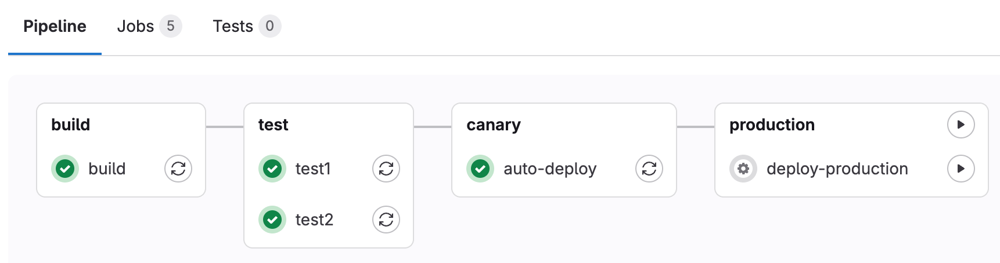
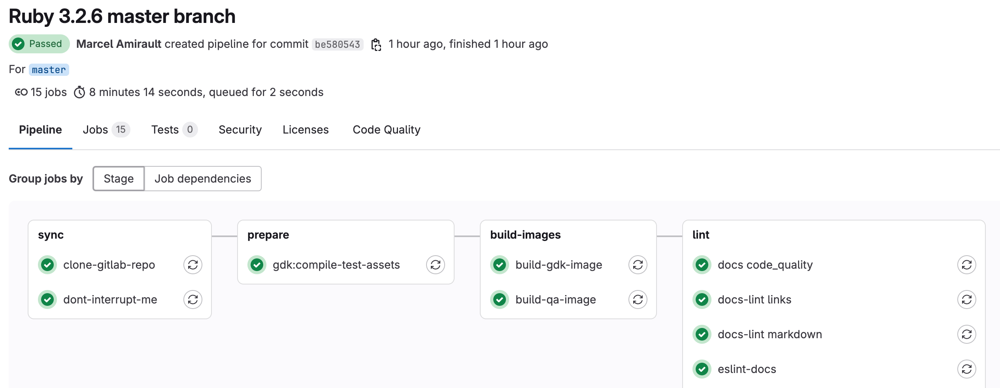
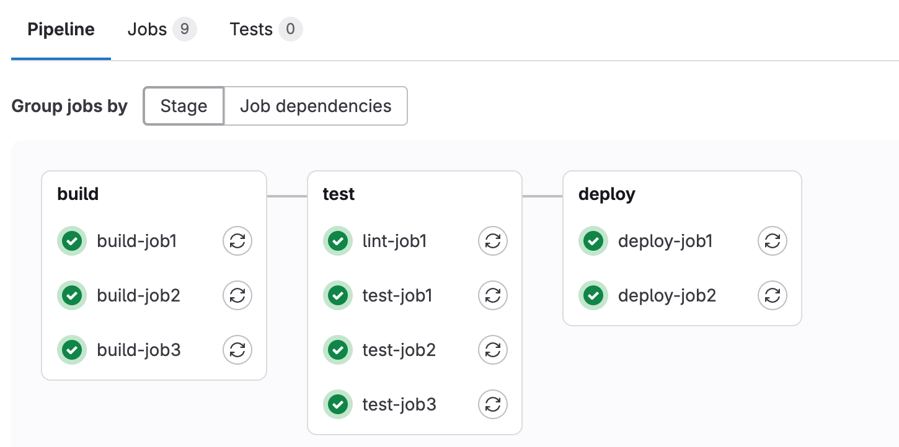
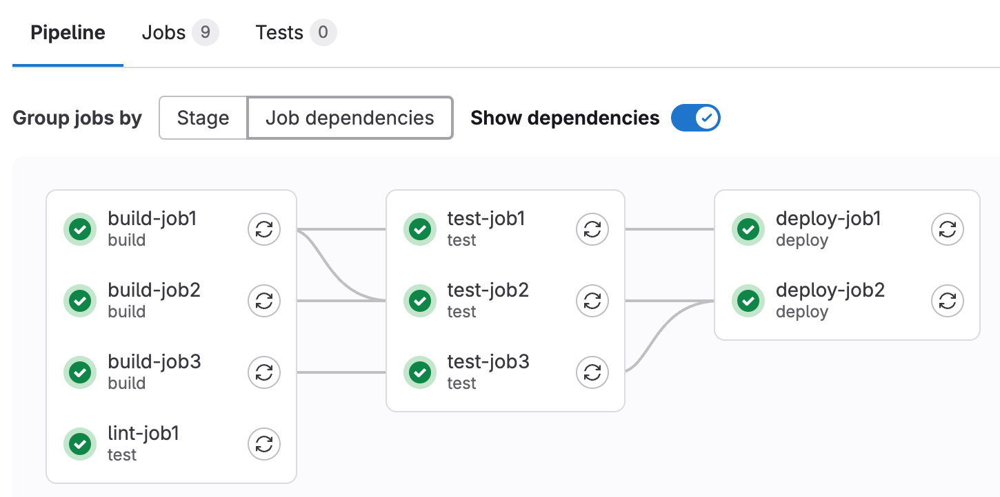
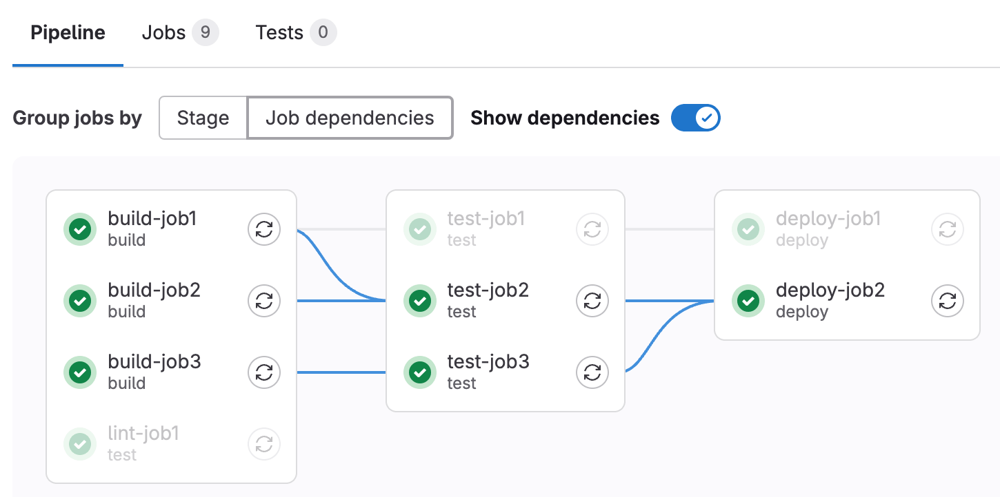
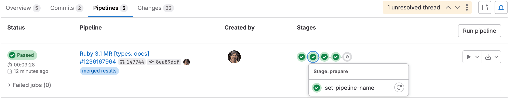



- Tier: 基础版，专业版，旗舰版
- Offering: JihuLab.com，私有化部署



CI/CD 流水线是极狐GitLab CI/CD 的基本组成部分。流水线通过 [YAML 关键字](../yaml/_index.md)在 `.gitlab-ci.yml` 文件中进行配置。

流水线可以针对特定事件自动运行，例如推送到分支、创建合并请求或按计划运行时。需要时，您也可以手动运行流水线。

流水线由以下部分组成：

- [全局 YAML 关键字](../yaml/_index.md#global-keywords)，用于控制项目流水线的整体行为。
- [作业](../jobs/_index.md)，用于执行命令以完成任务。例如，作业可以编译、测试或部署代码。作业彼此独立运行，并由 [Runner](../runners/_index.md) 执行。
- 阶段，用于定义如何将作业分组。阶段按顺序运行，而同一阶段中的作业并行运行。例如，较早的阶段可以包含对代码进行 lint 和编译的作业，而较晚的阶段可以包含测试和部署代码的作业。如果某个阶段中的所有作业都成功，流水线会进入下一个阶段。如果某个阶段中有任何作业失败，则下一个阶段（通常）不会执行，流水线会提前结束。

一个小的流水线可以由三个阶段组成，按以下顺序执行：

- 一个 `build` 阶段，其中包含一个名为 `compile`的作业，用于编译项目的代码。
- 一个 `test` 阶段，其中包含两个名为 `test1` 和 `test2`的作业，用于对代码运行各种测试。这些测试仅在 `compile` 作业成功完成后才会运行。
- 一个 `deploy` 阶段，其中包含一个名为 `deploy-to-production`的作业。该作业仅在 `test` 阶段中的两个作业都成功启动并完成后才会运行。

要开始使用您的第一个流水线，请参阅[创建并运行您的第一个极狐GitLab CI/CD 流水线](../quick_start/_index.md)。

<a id="types-of-pipelines"></a>

## 流水线的类型

流水线可以通过多种不同方式进行配置：

- [基础流水线](pipeline_architectures.md#basic-pipelines)会并发运行每个阶段中的所有内容，然后进入下一个阶段。
- [使用 `needs` 关键字的流水线](../yaml/needs.md)根据作业之间的依赖关系运行，并且可以比基础流水线运行得更快。
- [分支流水线](pipeline_types.md#branch-pipeline)在您每次将提交推送到分支时运行，无需任何配置。
- [合并请求流水线](merge_request_pipelines.md)仅针对合并请求运行（而不是针对每次提交）。
- [合并结果流水线](merged_results_pipelines.md)是一种合并请求流水线，其行为就像源分支中的更改已经合并到目标分支中一样。
- [合并列车](merge_trains.md)使用合并结果流水线将一个又一个合并请求排队。
- [工作负载流水线](pipeline_types.md#workload-pipeline)在临时 Git 引用上运行，用于按需执行流水线，而无需创建临时分支。
- [父子流水线](downstream_pipelines.md#parent-child-pipelines)将复杂的流水线分解为一个父流水线，该父流水线可以触发多个子流水线，这些子流水线都在同一项目中并使用相同的 SHA 运行。这种流水线架构通常用于单体代码仓库。
- [多项目流水线](downstream_pipelines.md#multi-project-pipelines)将不同项目的流水线组合在一起。

<a id="configure-a-pipeline"></a>

## 配置流水线

流水线及其组成作业和阶段通过每个项目的 CI/CD 流水线配置文件中的 [YAML 关键字](../yaml/_index.md)进行定义。在极狐GitLab 中编辑 CI/CD 配置时，您应使用[流水线编辑器](../pipeline_editor/_index.md)。

您还可以通过极狐GitLab UI 配置流水线的特定方面：

- 每个项目的[流水线设置](settings.md)。
- [流水线计划](schedules.md)。
- [自定义 CI/CD 变量](../variables/_index.md#for-a-project)。

如果您使用 VS Code 编辑极狐GitLab CI/CD 配置，[GitLab for VS Code 扩展](../../editor_extensions/visual_studio_code/_index.md)可帮助您[验证配置](../../editor_extensions/visual_studio_code/cicd.md#test-gitlab-cicd-configuration)并[查看流水线状态](../../editor_extensions/visual_studio_code/cicd.md#monitor-and-manage-pipelines)。

<a id="run-a-pipeline-manually"></a>

### 手动运行流水线

流水线可以使用预定义或手动指定的[变量](../variables/_index.md)手动执行。

如果需要在流水线的标准运行之外获取流水线的结果（例如代码构建结果），您可能会这样做。

要手动执行流水线：

1. 在顶部栏中，选择**搜索或跳转到**，然后找到您的项目。
1. 在左侧边栏中，选择**构建** > **流水线**。
1. 选择**新建流水线**。
1. 在**为分支名称或标签运行**字段中，选择要为其运行流水线的分支或标签。
1. 可选。输入以下任意内容：
   - 流水线运行所需的[输入](../inputs/_index.md)。输入的默认值已预填，但可以修改。输入值必须符合预期的类型。
   - [CI/CD 变量](../variables/_index.md)。您可以将变量配置为[在表单中预填其值](#prefill-variables-in-manual-pipelines)。与 CI/CD 变量相比，使用输入来控制流水线行为可提供更高的安全性和灵活性。
1. 选择**新建流水线**。

流水线现在会按配置执行作业。

<a id="view-manual-pipeline-variables"></a>

#### 查看手动流水线变量

您可以查看手动运行流水线时指定的所有变量。

先决条件：

- 您必须拥有该项目的所有者角色。

所需的角色取决于您要执行的操作：

| 操作 | 最低角色 |
|--------|-------------|
| 查看变量名称 | 访客 |
| 查看变量值 | 开发者 |
| 配置可见性设置 | 所有者 |

> [!warning]
> 当您开启此设置后，具有开发者角色的用户可以从任何手动流水线运行中查看可能包含敏感信息的变量值。对于凭据或令牌等敏感数据，请使用[受保护变量](../variables/_index.md#protect-a-cicd-variable)或[外部密钥管理](../secrets/_index.md)，而不是手动流水线变量。

要查看手动流水线变量：

1. 在顶部栏中，选择**搜索或跳转到**，然后找到您的项目。
1. 在左侧边栏中，选择**设置** > **CI/CD**。
1. 选择**显示流水线变量**。
1. 转到**构建** > **流水线**，然后选择一个手动运行的流水线。
1. 选择**手动变量**选项卡。

变量值默认会被遮盖。如果您拥有开发者、维护者或所有者角色，可以选择眼睛图标来显示值。

<a id="prefill-variables-in-manual-pipelines"></a>

#### 在手动流水线中预填变量

您可以使用 [`description` 和 `value`](../yaml/_index.md#variablesdescription) 关键字来[定义流水线级（全局）变量](../variables/_index.md#define-a-cicd-variable-in-the-gitlab-ciyml-file)，这些变量在手动运行流水线时会预填。使用描述来说明诸如该变量的用途以及可接受的值等信息。您可以在描述中使用 Markdown。

作业级变量无法预填。

在手动触发的流水线中，**新建流水线**页面会显示所有在 `.gitlab-ci.yml` 文件中定义了 `description`的流水线级变量。描述显示在变量下方。

您可以更改预填值，这会为该次流水线运行[覆盖该值](../variables/_index.md#use-pipeline-variables)。通过此过程覆盖的任何变量都会被[展开](../variables/_index.md#allow-cicd-variable-expansion)，而不会被[遮盖](../variables/_index.md#mask-a-cicd-variable)。如果您未在配置文件中为变量定义 `value`，变量名称仍会列出，但值字段为空。

例如：

```yaml
variables:
  DEPLOY_CREDENTIALS:
    description: "The deployment credentials."
  DEPLOY_ENVIRONMENT:
    description: "Select the deployment target. Valid options are: 'canary', 'staging', 'production', or a stable branch of your choice."
    value: "canary"
```

在此示例中：

- `DEPLOY_CREDENTIALS` 会列在**新建流水线**页面中，但未设置值。用户需要在每次手动运行流水线时定义该值。
- `DEPLOY_ENVIRONMENT` 会在**新建流水线**页面中预填为默认值 `canary`，并且消息会说明其他选项。

> [!note]
> 由于一个[已知问题](https://gitlab.com/gitlab-org/gitlab/-/issues/382857)，使用[合规流水线](../../user/compliance/compliance_pipelines.md)的项目在手动运行流水线时，可能不会显示预填变量。要变通解决此问题，请[更改合规流水线配置](../../user/compliance/compliance_pipelines.md#prefilled-variables-are-not-shown)。

<a id="configure-a-list-of-selectable-prefilled-variable-values"></a>

#### 配置可选择预填变量值的列表

您可以定义一个 CI/CD 变量值数组，供用户在手动运行流水线时从中选择。这些值会显示在**新建流水线**页面的下拉列表中。将值选项列表添加到 `options`，并使用 `value` 设置默认值。`value`中的字符串也必须包含在 `options` 列表中。

例如：

```yaml
variables:
  DEPLOY_ENVIRONMENT:
    value: "staging"
    options:
      - "production"
      - "staging"
      - "canary"
    description: "The deployment target. Set to 'staging' by default."
```

<a id="run-a-pipeline-by-using-a-url-query-string"></a>

### 使用 URL 查询字符串运行流水线

您可以使用查询字符串预填充**新建流水线**页面。例如，查询字符串 `.../pipelines/new?ref=my_branch&var[foo]=bar&file_var[file_foo]=file_bar` 会将**新建流水线**页面预填充为：

- **为以下对象运行**字段：`my_branch`。
- **变量**部分：
  - 变量：
    - 键：`foo`
    - 值：`bar`
  - 文件：
    - 键：`file_foo`
    - 值：`file_bar`

`pipelines/new` URL 的格式为：

```plaintext
.../pipelines/new?ref=<branch>&var[<variable_key>]=<value>&file_var[<file_key>]=<value>
```

支持以下参数：

- `ref`：指定要填充到**为以下对象运行**字段中的分支。
- `var`：指定一个 `Variable` 变量。
- `file_var`：指定一个 `File` 变量。

对于每个 `var` 或 `file_var`，都需要一个键和一个值。

<a id="add-manual-interaction-to-your-pipeline"></a>

### 为流水线添加手动交互

[手动作业](../jobs/job_control.md#create-a-job-that-must-be-run-manually)允许您要求在流水线中继续推进之前进行手动交互。

您可以直接从流水线图中执行此操作。选择**运行**（）来执行该特定作业。

例如，您的流水线可以自动启动，但需要手动操作才能[部署到生产环境](../environments/deployments.md#configure-manual-deployments)。在以下示例中，`production` 阶段有一个带手动操作的作业：



<a id="start-all-manual-jobs-in-a-stage"></a>

#### 启动阶段中的所有手动作业

如果某个阶段仅包含手动作业，您可以通过选择该阶段上方的**全部手动运行**（）来同时启动所有作业。如果该阶段包含非手动作业，则不会显示该选项。

<a id="skip-a-pipeline"></a>

### 跳过流水线

当您不想为推送或合并请求运行 CI/CD 时，可以跳过流水线。

当您跳过流水线时：

- 极狐GitLab 中仍会创建一个空的流水线，其中没有作业或阶段。该流水线会显示在 UI 中，并可在 API 响应中返回。
- 该流水线在 UI 中的状态为**已跳过**，在 API 中为 `skipped`。

> [!note]
> 流水线执行策略和扫描执行策略可以限制或禁用 `[skip ci]` 指令。有关更多信息，请参阅：
>
> - 流水线执行策略中的 [`skip_ci` 类型](../../user/application_security/policies/pipeline_execution_policies.md#skip_ci-type)。
> - 扫描执行策略中的 [`skip_ci` 类型](../../user/application_security/policies/scan_execution_policies.md#skip_ci-type)。

<a id="for-a-push"></a>

#### 对于推送

要在不触发流水线的情况下推送提交，请在提交消息中添加 `[ci skip]` 或 `[skip ci]`（不区分大小写）。

或者，使用 Git 2.10 或更高版本时，使用 `ci.skip` [Git 推送选项](../../topics/git/commit.md#push-options-for-gitlab-cicd)。

> [!note]
> `ci.skip` 推送选项不会跳过合并请求流水线。

<a id="for-merge-requests"></a>

#### 对于合并请求

> [!flag]
> 此功能的可用性由功能标志控制。

要跳过合并请求流水线，请在合并请求标题中添加 `[ci skip]` 或 `[skip ci]`（不区分大小写）。这会跳过基础合并请求流水线、合并结果流水线和合并列车流水线。当合并请求存在冲突时，该指令同样适用。

如果您在合并请求位于合并列车上时添加该指令，极狐GitLab 会将该合并请求从列车中移除，因为被跳过的流水线未成功。

合并请求流水线会保持跳过状态，直到您从标题中移除该指令。对于合并结果流水线，在您移除该指令后，流水线可能仍保持跳过状态，直到下一次推送重新生成虚拟提交。

<a id="delete-a-pipeline"></a>

### 删除流水线

先决条件：

- 您必须拥有该项目的所有者角色，或具有实例的管理员访问权限。
- 如果实例启用了[管理员模式](../../administration/settings/sign_in_restrictions.md#admin-mode)，管理员必须为其会话开启管理员模式。

要删除流水线：

1. 在顶部栏中，选择**搜索或跳转到**，然后找到您的项目。
1. 在左侧边栏中，选择**构建** > **流水线**。
1. 选择要删除的流水线的流水线 ID（例如 `#123456789`）或流水线状态图标（例如**已通过**）。
1. 在流水线详情页面的右上角，选择**删除**。

删除流水线不会自动删除其[子流水线](downstream_pipelines.md#parent-child-pipelines)。有关更多详细信息，请参阅[议题 39503](https://gitlab.com/gitlab-org/gitlab/-/issues/39503)。

> [!warning]
> 删除流水线会使所有流水线缓存过期，并删除所有直接相关的对象，例如作业、日志、产物和触发器。
> 此操作无法撤销。

<a id="pipeline-security-on-protected-branches"></a>

### 受保护分支上的流水线安全

在[受保护分支](../../user/project/repository/branches/protected.md)上执行流水线时，会强制执行严格的安全模型。

如果用户[被允许合并或推送](../../user/project/repository/branches/protected.md)到该特定分支，则允许在受保护分支上执行以下操作：

- 运行手动流水线（使用 [Web UI](#run-a-pipeline-manually) 或[流水线 API](#pipelines-api)）。
- 运行计划流水线。
- 使用触发器令牌运行流水线。
- 运行按需 DAST 扫描。
- 在现有流水线上运行手动作业。
- 重试或取消现有作业（使用 Web UI 或流水线 API）。

标记为**受保护**的**变量**可供在受保护分支的流水线中运行的作业访问。仅当用户有权访问部署凭据和令牌等敏感信息时，才应授予其合并到受保护分支的权限。

标记为**受保护**的 **Runner** 只能在受保护分支上运行作业，从而防止不受信任的代码在受保护的 Runner 上执行，并避免部署密钥和其他凭据被意外访问。为确保计划在受保护 Runner 上执行的作业不使用常规 Runner，必须相应地为其[添加标签](../yaml/_index.md#tags)。

请查看[合并请求流水线上下文](merge_request_pipelines.md#control-access-to-protected-variables-and-runners)中受保护变量和 Runner 的访问方式。

请查看[部署安全](../environments/deployment_safety.md)页面，了解保护流水线的其他安全建议。

<a id="trigger-a-pipeline-when-an-upstream-project-is-rebuilt"></a>

## 当上游项目重新构建时触发流水线



- Tier: 专业版，旗舰版
- Offering: JihuLab.com，私有化部署



您可以将项目设置为根据另一个项目中的标签自动触发流水线。当订阅项目中的新标签流水线完成时，它会在您项目的默认分支上触发一个流水线，无论该标签流水线是成功、失败还是取消。

作为替代方案，您可以使用[带流水线触发器令牌的 CI/CD 作业](../triggers/_index.md#use-a-cicd-job)在另一个流水线运行时触发流水线。此方法比流水线订阅更可靠、更灵活，是推荐的方法。

先决条件：

- 上游项目必须是[公开的](../../user/public_access.md)。
- 用户必须在上游项目中拥有开发者角色。

要在上游项目重新构建时触发流水线：

1. 在顶部栏中，选择**搜索或跳转到**，然后找到您的项目。
1. 在左侧边栏中，选择**设置** > **CI/CD**。
1. 展开**流水线订阅**。
1. 选择**添加项目**。
1. 输入您要订阅的项目，格式为 `<namespace>/<project>`。例如，如果项目是 `https://gitlab.com/gitlab-org/gitlab`，请使用 `gitlab-org/gitlab`。
1. 选择**订阅**。

上游流水线订阅的最大数量默认对于上游和下游项目均为 2。在极狐GitLab 私有化部署上，管理员可以更改此[限制](../../administration/cicd/limits.md#number-of-cicd-subscriptions-to-a-project)。

<a id="how-pipeline-duration-is-calculated"></a>

## 流水线时长如何计算

给定流水线的总运行时间不包括：

- 任何被重试或手动重新运行的作业的初始运行时长。
- 任何待处理（排队）时间。

这意味着，如果某个作业被重试或手动重新运行，则总运行时间中仅包含最新一次运行的时长。

每个作业表示为一个 `Period`，它由以下部分组成：

- `Period#first`（作业开始的时间）。
- `Period#last`（作业完成的时间）。

例如：

- A (0, 2)
- A' (2, 4)
  - A' 重试 A
- B (1, 3)
- C (6, 7)

在此示例中：

- A 从 0 开始，到 2 结束。
- A' 从 2 开始，到 4 结束。
- B 从 1 开始，到 3 结束。
- C 从 6 开始，到 7 结束。

从视觉上看，可以表示为：

```plaintext
0  1  2  3  4  5  6  7
AAAAAAA
   BBBBBBB
      A'A'A'A
                  CCCC
```

由于 A 被重试，因此会被忽略，只计算作业 A'。B、A' 和 C 的并集为 (1, 4) 和 (6, 7)。因此，总运行时间为：

```plaintext
(4 - 1) + (7 - 6) => 4
```

<a id="view-pipelines"></a>

## 查看流水线

要查看为您的项目运行的所有流水线：

1. 在顶部栏中，选择**搜索或跳转到**，然后找到您的项目。
1. 在左侧边栏中，选择**构建** > **流水线**。

您可以按以下条件筛选**流水线**页面：

- 触发作者
- 分支名称
- 状态
- 标签
- 来源

在右上角的下拉列表中选择**流水线 ID**，以显示流水线 ID（在实例范围内唯一的 ID）。选择**流水线 IID**，以显示流水线 IID（内部 ID，仅在项目范围内唯一）。

要查看与特定合并请求相关的流水线，请转到该合并请求中的**流水线**选项卡。

<a id="pipeline-details"></a>

### 流水线详情

选择一个流水线以打开流水线详情页面，其中显示流水线中的每个作业。在此页面中，您可以取消正在运行的流水线、重试失败的作业，或[删除流水线](#delete-a-pipeline)。

流水线详情页面会显示流水线中所有作业的图：



您可以使用标准 URL 访问特定流水线的详情：

- `gitlab.example.com/my-group/my-project/-/pipelines/latest`：项目中默认分支上最近一次提交的最新流水线的详情页面。
- `gitlab.example.com/my-group/my-project/-/pipelines/<branch>/latest`：项目中分支 `<branch>` 上最近一次提交的最新流水线的详情页面。

<a id="group-jobs-by-stage-or-needs-configuration"></a>

#### 按阶段或 `needs` 配置对作业分组

当您使用 [`needs`](../yaml/_index.md#needs) 关键字配置作业时，您有两种方式在流水线详情页面中对作业进行分组。要按阶段配置对作业分组，请在**作业分组方式**部分选择 **阶段**：



要按 [`needs`](../yaml/_index.md#needs) 配置对作业分组，请选择**作业依赖关系**。您还可以选择**显示依赖关系**，以在相互依赖的作业之间绘制连线。



最左侧列中的作业最先运行，依赖于它们的作业会分组在接下来的列中。在此示例中：

- `lint-job` 配置了 `needs: []`，不依赖任何作业，因此尽管它位于 `test` 阶段，仍显示在第一列中。
- `test-job1` 依赖于 `build-job1`，而 `test-job2` 同时依赖于 `build-job1` 和 `build-job2`，因此两个测试作业都显示在第二列中。
- 两个 `deploy` 作业都依赖于第二列中的作业（这些作业本身又依赖于更早的其他作业），因此部署作业显示在第三列中。

当您在**作业依赖关系**视图中将鼠标悬停在某个作业上时，必须先于所选作业运行的每个作业都会高亮显示：



<a id="pipeline-mini-graphs"></a>

### 流水线迷你图

流水线迷你图占用空间更少，可以让您快速了解所有作业是否通过或是否有作业失败。它们会显示单个提交的所有相关作业，以及流水线每个阶段的最终结果。您可以快速查看哪些作业失败并进行修复。

流水线迷你图始终按阶段对作业分组，并在极狐GitLab 中显示流水线或提交详情时显示。



流水线迷你图中的阶段可以展开。将鼠标悬停在每个阶段上可查看名称和状态，并选择一个阶段以展开其作业列表。

<a id="downstream-pipeline-graphs"></a>

### 下游流水线图

当流水线包含触发[下游流水线](downstream_pipelines.md)的作业时，您可以在流水线详情视图和迷你图中看到下游流水线。

在流水线详情视图中，每个触发的下游流水线都会在流水线图右侧显示一张卡片。将鼠标悬停在卡片上可查看哪个作业触发了下游流水线。选择卡片可在流水线图右侧显示下游流水线。

在流水线迷你图中，每个触发的下游流水线的状态会作为附加状态图标显示在迷你图右侧。选择下游流水线状态图标可转到该下游流水线的详情页面。

<a id="pipeline-success-and-duration-charts"></a>

## 流水线成功率和时长图表

流水线分析可在 [**CI/CD 分析**页面](../../user/analytics/ci_cd_analytics.md)中查看。

<a id="pipeline-badges"></a>

## 流水线徽章

每个项目都可以使用并配置流水线状态和测试覆盖率报告徽章。有关向项目添加流水线徽章的信息，请参阅[流水线徽章](settings.md#pipeline-badges)。

<a id="pipelines-api"></a>

## 流水线 API

极狐GitLab 提供 API 端点以：

- 执行基本功能。有关更多信息，请参阅[流水线 API](../../api/pipelines.md)。
- 维护流水线计划。有关更多信息，请参阅[流水线计划 API](../../api/pipeline_schedules.md)。
- 触发流水线运行。有关更多信息，请参阅：
  - [通过 API 触发流水线](../triggers/_index.md)。
  - [流水线触发器令牌 API](../../api/pipeline_triggers.md)。

<a id="ref-specs-for-runners"></a>

## Runner 的 ref 规范

当 Runner 获取流水线作业时，极狐GitLab 会提供该作业的元数据。其中包括 [Git refspec](https://git-scm.com/book/en/v2/Git-Internals-The-Refspec)，它指示从项目代码仓库中检出哪个 ref（例如分支或标签）和提交（SHA1）。

下表列出了为每种流水线类型注入的 refspec：

| 流水线类型                                        | Refspec |
|------------------------------------------------------|----------|
| 分支的流水线                                | `+<sha>:refs/pipelines/<id>` 和 `+refs/heads/<name>:refs/remotes/origin/<name>` |
| 标签的流水线                                    | `+<sha>:refs/pipelines/<id>` 和 `+refs/tags/<name>:refs/tags/<name>` |
| [合并请求流水线](merge_request_pipelines.md) | `+refs/pipelines/<id>:refs/pipelines/<id>` |
| [工作负载 ref 的流水线](pipeline_types.md#workload-pipeline)  | `+refs/pipelines/<id>:refs/pipelines/<id>` |

ref `refs/heads/<name>` 和 `refs/tags/<name>` 存在于您的项目代码仓库中。极狐GitLab 会在流水线作业运行期间生成特殊 ref `refs/pipelines/<id>`。即使关联的分支或标签已被删除，也可以创建此 ref。您可以在某些功能中使用它，例如[自动停止环境](../environments/_index.md#stopping-an-environment)，以及可能在分支删除后运行流水线的[合并列车](merge_trains.md)。

<a id="troubleshooting"></a>

## 故障排除

<a id="pipeline-subscriptions-continue-after-user-deletion"></a>

### 用户删除后流水线订阅仍继续

当用户[删除其 JihuLab.com 账号](../../user/profile/account/delete_account.md#delete-your-own-account)时，删除操作不会立即生效，而是在七天后生效。在此期间，该用户创建的任何流水线订阅都会继续以该用户原有的权限运行。为防止未经授权的流水线执行，请立即更新已删除用户的流水线订阅设置。

<a id="pre-filled-variables-do-not-show-up-in-new-pipeline-page"></a>

### 预填变量未显示在**新建流水线**页面中

如果流水线的预定义变量[定义在单独的文件中](../yaml/includes.md)，它们可能不会显示在**新建流水线**页面中。您必须拥有访问该单独文件的权限，否则无法显示预定义变量。
