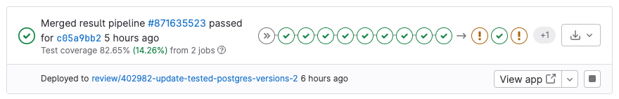
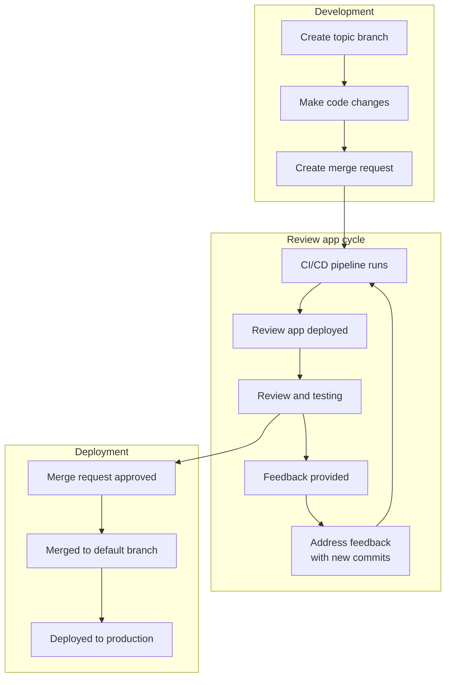
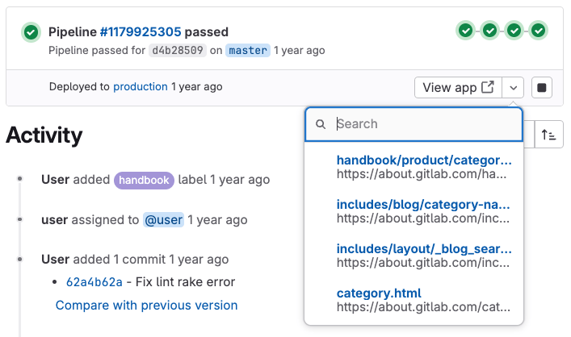



- Tier: 基础版，专业版，旗舰版
- Offering: JihuLab.com，私有化部署



评审应用是为每个分支或合并请求自动创建的临时测试环境。您无需搭建本地开发环境，即可预览和验证变更。

评审应用基于[动态环境](../environments/_index.md#create-a-dynamic-environment)构建，为每个分支或合并请求提供独立的环境。



这些环境通过以下方式帮助简化开发工作流：

- 无需本地搭建即可测试变更。
- 为所有团队成员提供一致的环境。
- 让相关方可以通过 URL 预览变更。
- 在变更进入生产环境之前加快反馈周期。

> [!note]
> 如果您有 Kubernetes 集群，可以使用 [Auto DevOps](../../topics/autodevops/_index.md) 自动设置评审应用。

<a id="review-app-workflow"></a>

## 评审应用工作流

评审应用工作流可能类似于：



<a id="configure-review-apps"></a>

## 配置评审应用

当您想为每个分支或合并请求提供应用程序的预览环境时，可以配置评审应用。

先决条件：

- 您必须拥有该项目的开发者、维护者或所有者角色。
- 项目中必须有可用的 CI/CD 流水线。
- 您必须搭建好用于托管和部署评审应用的基础设施。

要在项目中配置评审应用：

1. 在顶部栏中，选择**搜索或跳转到**，找到您的项目。
1. 在左侧边栏中，选择**构建** > **流水线编辑器**。
1. 在您的 `.gitlab-ci.yml` 文件中，添加一个用于创建[动态环境](../environments/_index.md#create-a-dynamic-environment)的作业。
   您可以使用[预定义 CI/CD 变量](../variables/predefined_variables.md)来区分各个环境。例如，使用 `CI_COMMIT_REF_SLUG` 预定义变量：

   ```yaml
   review_app:
     stage: deploy
     script:
       - echo "Deploy to review app environment"
       # Add your deployment commands here
     environment:
       name: review/$CI_COMMIT_REF_SLUG
       url: https://$CI_COMMIT_REF_SLUG.example.com
     rules:
       - if: $CI_COMMIT_BRANCH && $CI_COMMIT_BRANCH != $CI_DEFAULT_BRANCH
   ```

1. 可选。为作业添加 `when: manual`，以便仅手动部署评审应用。
1. 可选。添加一个作业，在不再需要时[停止评审应用](#stop-review-apps)。
1. 输入提交信息，然后选择**提交变更**。

<a id="use-the-review-apps-template"></a>

### 使用评审应用模板

极狐GitLab 提供了一个内置模板，默认已针对合并请求流水线进行配置。

要使用并自定义此模板：

1. 在顶部栏中，选择**搜索或跳转到**，找到您的项目。
1. 在左侧边栏中，选择**运维** > **环境**。
1. 选择**启用 Review Apps**。
1. 在出现的**启用 Review Apps**对话框中，复制 YAML 模板：

   ```yaml
   deploy_review:
     stage: deploy
     script:
       - echo "Add script here that deploys the code to your infrastructure"
     environment:
       name: review/$CI_COMMIT_REF_NAME
       url: https://$CI_ENVIRONMENT_SLUG.example.com
     rules:
       - if: $CI_PIPELINE_SOURCE == "merge_request_event"
   ```

1. 选择**构建** > **流水线编辑器**。
1. 将模板粘贴到您的 `.gitlab-ci.yml` 文件中。
1. 根据您的部署需求自定义模板：

   - 修改部署脚本和环境 URL，使其与您的基础设施配合使用。
   - 如果您希望即使没有合并请求也为分支部署评审应用，请调整[规则部分](../jobs/job_rules.md)。

   例如，部署到 Heroku：

   ```yaml
   deploy_review:
     stage: deploy
     image: ruby:latest
     script:
       - apt-get update -qy
       - apt-get install -y ruby-dev
       - gem install dpl
       - dpl --provider=heroku --app=$HEROKU_APP_NAME --api-key=$HEROKU_API_KEY
     environment:
       name: review/$CI_COMMIT_REF_NAME
       url: https://$HEROKU_APP_NAME.herokuapp.com
       on_stop: stop_review_app
     rules:
       - if: $CI_PIPELINE_SOURCE == "merge_request_event"
   ```

   此配置会在流水线针对合并请求运行时，自动部署到 Heroku。
   它使用 Ruby 的 `dpl` 部署工具来处理该过程，并创建一个可通过指定 URL 访问的动态审查环境。

1. 输入提交信息，然后选择**提交变更**。

<a id="stop-review-apps"></a>

### 停止评审应用

您可以将评审应用配置为手动或自动停止，以节省资源。

有关停止评审应用环境的更多信息，请参见[停止环境](../environments/_index.md#stopping-an-environment)。

<a id="auto-stop-review-apps-on-merge"></a>

#### 合并时自动停止评审应用

要将评审应用配置为在关联的合并请求被合并或分支被删除时自动停止：

1. 在部署作业中添加 [`on_stop`](../yaml/_index.md#environmenton_stop) 关键字。
1. 使用 [`environment:action: stop`](../yaml/_index.md#environmentaction) 创建一个停止作业。
1. 可选。为停止作业添加 [`when: manual`](../yaml/_index.md#when)，以便可以随时手动停止评审应用。

例如：

```yaml
# In your .gitlab-ci.yml file
deploy_review:
  # Other configuration...
  environment:
    name: review/${CI_COMMIT_REF_NAME}
    url: https://${CI_ENVIRONMENT_SLUG}.example.com
    on_stop: stop_review_app  # References the stop_review_app job

stop_review_app:
  stage: deploy
  script:
    - echo "Stop review app"
    # Add your cleanup commands here
  environment:
    name: review/${CI_COMMIT_REF_NAME}
    action: stop
  when: manual  # Makes this job manually triggerable
  rules:
    - if: $CI_PIPELINE_SOURCE == "merge_request_event"
```

<a id="time-based-automatic-stop"></a>

#### 基于时间的自动停止

要将评审应用配置为在一段时间后自动停止，请在部署作业中添加 [`auto_stop_in`](../yaml/_index.md#environmentauto_stop_in) 关键字：

```yaml
# In your .gitlab-ci.yml file
review_app:
  script: deploy-review-app
  environment:
    name: review/$CI_COMMIT_REF_SLUG
    auto_stop_in: 1 week  # Stops after one week of inactivity
  rules:
    - if: $CI_MERGE_REQUEST_ID
```

<a id="view-review-apps"></a>

## 查看评审应用

要部署并访问评审应用：

1. 转到您的合并请求。
1. 可选。如果评审应用作业是手动作业，请选择**运行**（）以开始部署。
1. 当流水线完成后，选择**查看应用**，在浏览器中打开评审应用。

<a id="example-implementations"></a>

## 示例实现

以下项目演示了不同的评审应用实现：

| 项目                                                                                 | 配置文件 |
| --------------------------------------------------------------------------------------- | ------------------ |
| [NGINX](https://gitlab.com/gitlab-examples/review-apps-nginx)                           | [`.gitlab-ci.yml`](https://gitlab.com/gitlab-examples/review-apps-nginx/-/blob/b9c1f6a8a7a0dfd9c8784cbf233c0a7b6a28ff27/.gitlab-ci.yml#L20) |
| [OpenShift](https://gitlab.com/gitlab-examples/review-apps-openshift)                   | [`.gitlab-ci.yml`](https://gitlab.com/gitlab-examples/review-apps-openshift/-/blob/82ebd572334793deef2d5ddc379f38942f3488be/.gitlab-ci.yml#L42) |
| [HashiCorp Nomad](https://gitlab.com/gitlab-examples/review-apps-nomad)                 | [`.gitlab-ci.yml`](https://gitlab.com/gitlab-examples/review-apps-nomad/-/blob/ca372c778be7aaed5e82d3be24e98c3f10a465af/.gitlab-ci.yml#L110) |
| [GitLab 文档](https://gitlab.com/gitlab-org/technical-writing/docs-gitlab-com) | [`build.gitlab-ci.yml`](https://gitlab.com/gitlab-org/technical-writing/docs-gitlab-com/-/blob/bdbf11814428a06e82d7b712c72b5cb53c750f29/.gitlab/ci/build.gitlab-ci.yml#L73-76) |
| [`https://about.gitlab.com/`](https://gitlab.com/gitlab-com/www-gitlab-com/)            | [`.gitlab-ci.yml`](https://gitlab.com/gitlab-com/www-gitlab-com/-/blob/6ffcdc3cb9af2abed490cbe5b7417df3e83cd76c/.gitlab-ci.yml#L332) |
| [GitLab Insights](https://gitlab.com/gitlab-org/gitlab-insights/)                       | [`.gitlab-ci.yml`](https://gitlab.com/gitlab-org/gitlab-insights/-/blob/9e63f44ac2a5a4defc965d0d61d411a768e20546/.gitlab-ci.yml#L234) |

评审应用的其他示例：

- [Android 的评审应用](https://about.gitlab.com/blog/how-to-create-review-apps-for-android-with-gitlab-fastlane-and-appetize-dot-io/)。

<a id="route-maps"></a>

## 路由映射

路由映射让您可以直接从源文件跳转到评审应用环境中对应的公开页面。此功能让您更轻松地预览合并请求中的特定变更。

配置后，路由映射会添加上下文链接，让您可以查看与映射模式匹配的文件的评审应用版本。这些链接会出现在：

- 合并请求小组件中。
- 提交和文件视图中。

<a id="configure-route-maps"></a>

### 配置路由映射

要设置路由映射：

1. 在您的代码仓库中创建文件 `.gitlab/route-map.yml`。
1. 定义源路径（代码仓库中）与公开路径（评审应用基础设施或网站上）之间的映射。

路由映射是一个 YAML 数组，其中每个条目将一个 `source` 路径映射到一个 `public` 路径。

路由映射中的每个映射都遵循以下格式：

```yaml
- source: 'path/to/source/file'  # Source file in repository
  public: 'path/to/public/page'  # Public page on the website
```

您可以使用两种类型的映射：

- 精确匹配：用单引号括起来的字符串字面量
- 模式匹配：用正斜杠括起来的正则表达式

使用正则表达式进行模式匹配时：

- 正则表达式必须匹配整个源路径（隐含 `^` 和 `$` 锚点）。
- 您可以使用捕获组 `()`，并在 `public` 路径中引用它们。
- 按出现顺序使用 `\N` 表达式引用捕获组（`\1`、`\2` 等）。
- 将斜杠（`/`）转义为 `\/`，将句点（`.`）转义为 `\.`。

极狐GitLab 按定义顺序评估映射。第一个匹配的 `source` 表达式决定 `public` 路径。

<a id="example-route-map"></a>

### 路由映射示例

以下示例展示了 [Middleman](https://middlemanapp.com)的路由映射，这是一个用于 [GitLab 网站](https://about.gitlab.com)的静态站点生成器：

```yaml
# Team data
- source: 'data/team.yml'  # data/team.yml
  public: 'team/'  # team/

# Blogposts
- source: /source\/posts\/([0-9]{4})-([0-9]{2})-([0-9]{2})-(.+?)\..*/  # source/posts/2017-01-30-around-the-world-in-6-releases.html.md.erb
  public: '\1/\2/\3/\4/'  # 2017/01/30/around-the-world-in-6-releases/

# HTML files
- source: /source\/(.+?\.html).*/  # source/index.html.haml
  public: '\1'  # index.html

# Other files
- source: /source\/(.*)/  # source/images/blogimages/around-the-world-in-6-releases-cover.png
  public: '\1'  # images/blogimages/around-the-world-in-6-releases-cover.png
```

在此示例中：

- 映射按顺序评估。
- 第三个映射确保 `source/index.html.haml` 匹配 `/source\/(.+?\.html).*/`，而不是兜底规则 `/source\/(.*)/`。
  这会生成公开路径 `index.html`，而不是 `index.html.haml`。

<a id="view-mapped-pages"></a>

### 查看已映射的页面

使用路由映射，可以直接从源文件跳转到评审应用中对应的页面。

先决条件：

- 您必须已在 `.gitlab/route-map.yml` 中配置路由映射。
- 必须已为您的分支或合并请求部署评审应用。

要从合并请求小组件查看已映射的页面：

1. 在合并请求小组件中，选择**查看应用**。
   下拉列表最多显示 5 个已映射的页面（如果有更多可用页面，则提供筛选功能）。



要从文件查看已映射的页面：

1. 使用以下任一方法转到与您的路由映射匹配的文件：
   - 从合并请求中：在**变更**标签页中，选择**查看文件 @ [commit]**。
   - 从提交页面：选择文件名。
   - 从比较页面：比较修订版本时，选择文件名。
1. 在文件页面上，选择右上角的**在 [environment-name] 上查看**（）。

要从提交查看已映射的页面：

1. 转到已部署评审应用的提交：
   - 对于分支流水线：在左侧边栏中，选择**代码** > **提交**，然后选择带有流水线徽章的提交。
   - 对于合并请求流水线：在您的合并请求中，选择**提交**标签页，然后选择一个提交。
   - 对于合并结果流水线：在您的合并请求中，选择**流水线**标签页，然后选择流水线提交。
1. 选择与您的路由映射匹配的文件名旁边的评审应用图标（）。
   该图标会在您的评审应用中打开对应页面。

> [!note]
> 合并结果流水线会创建一个内部提交，将您的分支与目标分支合并。
> 要访问这些流水线的评审应用链接，请使用**流水线**标签页中的提交，
> 而不是**提交**标签页。
