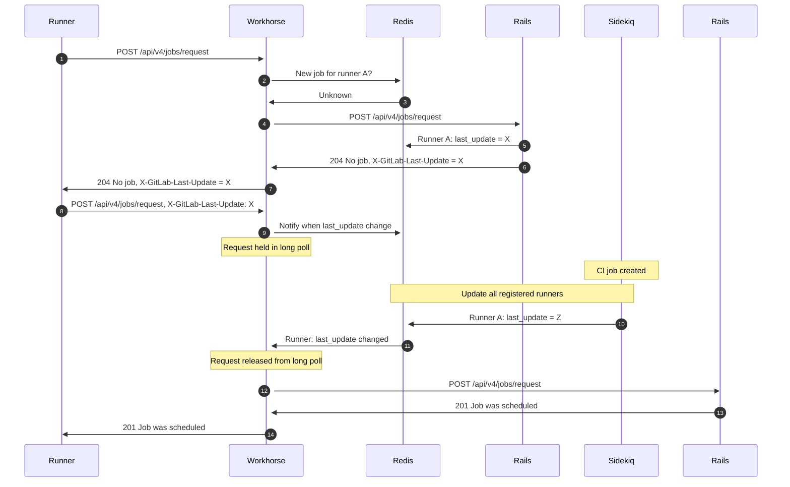



- Tier: 基础版，专业版，旗舰版
- Offering: JihuLab.com，私有化部署



默认情况下，极狐GitLab Runner 会定期向极狐GitLab 实例轮询新的 CI/CD
作业。实际的轮询间隔[取决于 `check_interval` 以及 runner 配置文件中配置的 runner 数量](https://gitlab.cn/docs/runner/configuration/advanced-configuration/#how-check_interval-works)。

在需要处理大量 runner 的服务器上，这种轮询可能会导致以下性能问题：

- 排队时间变长。
- 极狐GitLab 实例的 CPU 使用率升高。

要缓解这些问题，您应启用长轮询。

先决条件：

- 您必须是管理员。

<a id="enable-long-polling"></a>

## 启用长轮询

您可以将极狐GitLab 实例配置为在长轮询中保持来自 runner 的作业请求，直到有新作业就绪。

为此，请通过配置 GitLab Workhorse 的长轮询时长（`apiCiLongPollingDuration`）来启用长轮询：





1. 编辑 `/etc/gitlab/gitlab.rb`：

   ```ruby
   gitlab_workhorse['api_ci_long_polling_duration'] = "50s"
   ```

1. 保存文件并重新配置极狐GitLab：

   ```shell
   sudo gitlab-ctl reconfigure
   ```





使用 `gitlab.webservice.workhorse.extraArgs` 设置启用长轮询。

1. 导出 Helm values：

   ```shell
   helm get values gitlab > gitlab_values.yaml
   ```

1. 编辑 `gitlab_values.yaml`：

   ```yaml
   gitlab:
     webservice:
       workhorse:
         extraArgs: "-apiCiLongPollingDuration 50s"
   ```

1. 保存文件并应用新的 values：

   ```shell
   helm upgrade -f gitlab_values.yaml gitlab gitlab/gitlab
   ```





1. 编辑 `docker-compose.yml`：

   ```yaml
   version: "3.6"
   services:
     gitlab:
       image: 'registry.gitlab.cn/omnibus/gitlab-jh:latest'
       restart: always
       hostname: 'gitlab.example.com'
       environment:
         GITLAB_OMNIBUS_CONFIG: |
           gitlab_workhorse['api_ci_long_polling_duration'] = "50s"
   ```

1. 保存文件并重启极狐GitLab：

   ```shell
   docker compose up -d
   ```





<a id="metrics"></a>

## 指标

启用长轮询后，GitLab Workhorse 会订阅 Redis
PubSub 频道并等待通知。当 runner 的键发生变化，或达到 `apiCiLongPollingDuration` 时，作业请求会从长轮询中释放。您可以监控以下
Prometheus 指标：

| 指标 | 类型 | 描述 | 标签 |
| -----  | ---- | ----------- | ------ |
| `gitlab_workhorse_keywatcher_keywatchers` | Gauge | GitLab Workhorse 正在监视的键数量 | |
| `gitlab_workhorse_keywatcher_redis_subscriptions` | Gauge | Redis PubSub 订阅数量 | |
| `gitlab_workhorse_keywatcher_total_messages` | Counter | GitLab Workhorse 在 PubSub 频道上接收到的消息总数 | |
| `gitlab_workhorse_keywatcher_actions_total` | Counter | 各种键监视器操作的计数 | `action` |
| `gitlab_workhorse_keywatcher_received_bytes_total` | Counter | 在 PubSub 频道上接收到的总字节数 | |

您可以查看[一个用户如何通过这些指标发现长轮询问题的示例](https://gitlab.com/gitlab-org/omnibus-gitlab/-/issues/8329)。

<a id="long-polling-workflow"></a>

## 长轮询工作流

下图展示了在启用长轮询的情况下，单个 runner 如何获取作业：



在第 1 步中，当 runner 请求新作业时，它会向极狐GitLab 服务器发出一个 `POST` 请求
（`/api/v4/jobs/request`），该请求首先由 Workhorse 处理。

Workhorse 从
`X-GitLab-Last-Update` HTTP 请求头中读取 runner 令牌和值，构造一个键，并订阅使用该键的 Redis PubSub 频道。如果该键不存在任何值，则 Workhorse 会立即将请求转发给 Rails（第 3 步和第 4 步）。

Rails 检查作业队列。如果没有可供该
runner 使用的作业，Rails 会向 runner 返回 `204 No job` 以及一个 `last_update` 令牌
（第 5 步到第 7 步）。

runner 使用该 `last_update` 令牌再次发出作业请求，并将该令牌填入 `X-GitLab-Last-Update` HTTP 请求头。这一次，Workhorse 会检查 runner 的 `last_update` 令牌是否已更改。如果未更改，Workhorse 会保持该请求，最长持续 `apiCiLongPollingDuration` 指定的时长。

如果用户触发新的流水线或作业运行，Sidekiq 中的后台任务会更新该作业可用的所有 runner 的 `last_update` 值。Runner 可以注册到项目、群组、实例或这些的任意组合。

第 10 步和第 11 步中的这一“滴答”会将作业请求从 Workhorse 长轮询队列中释放，随后该请求会被发送到 Rails（第 12 步）。Rails 查找可用的作业，并将该 runner 分配给该作业（第 13 步和第 14 步）。

使用长轮询后，runner 会在有新作业可用时立即收到通知。这不仅有助于减少作业排队时间，还能减少服务器开销，因为作业请求只有在有新工作时
才会到达 Rails。

<a id="troubleshooting"></a>

## 故障排除

使用长轮询时，您可能会遇到以下问题。

<a id="slow-job-pickup"></a>

### 作业获取缓慢

默认情况下不启用长轮询，因为在某些 runner 配置中，runner 无法及时获取作业。请参阅[议题 27709](https://gitlab.com/gitlab-org/gitlab-runner/-/issues/27709)。

如果 runner `config.toml`中的 `concurrent` 设置被设置为低于已定义的 runner 数量，就可能发生这种情况。要解决此问题，请确保 `concurrent`的值等于或大于
runner 数量。

例如，如果 `config.toml`中有三个 `[[runners]]` 条目，请确保 `concurrent` 至少设置为 3。

启用长轮询后，runner 会：

1. 启动 `concurrent` 数量的 Goroutine。
1. 等待 Goroutine 在长轮询后返回。
1. 运行下一批请求。

例如，假设单个 `config.toml` 配置了：

- 项目 A 的 3 个 runner。
- 项目 B 的 1 个 runner。
- `concurrent` 设置为 3。

在此示例中，runner 会为前 3 个项目启动 Goroutine。
在最坏的情况下，runner 会为项目 A 等待整个长轮询间隔，然后才继续为项目 B 请求作业。
