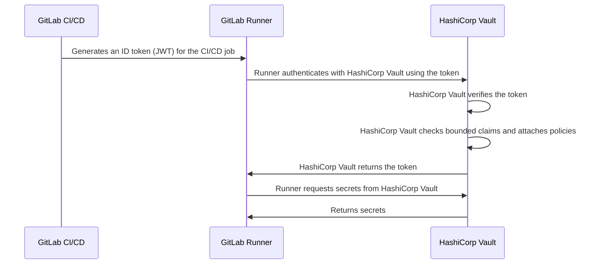



- Tier: 基础版，专业版，旗舰版
- Offering: JihuLab.com，私有化部署



ID 令牌是由极狐GitLab CI/CD 生成的 [JSON Web 令牌 (JWT)](https://www.rfc-editor.org/info/rfc7519/)。
CI/CD 作业可以使用 ID 令牌与第三方服务进行 OIDC 认证，包括：

- [密钥提供方](_index.md)
- [云服务](../cloud_services/_index.md)

例如，使用 ID 令牌向 HashiCorp Vault 进行认证的流程如下图所示：



[`secrets`](../yaml/_index.md#secrets) 关键字也会使用 ID 令牌。

极狐GitLab Duo Agent Platform [任务流](../../user/duo_agent_platform/flows/execution/_index.md#configure-id-tokens)
和[外部 Agent](../../user/duo_agent_platform/agents/external.md#authenticate-with-id-tokens)
也可以声明 `id_tokens`，以便在执行期间与第三方服务进行认证。

<a id="configure-id-tokens-in-a-cicd-job"></a>

## 在 CI/CD 作业中配置 ID 令牌

要使用 ID 令牌，请使用 [`id_tokens`](../yaml/_index.md#id_tokens) 关键字配置 CI/CD 作业。然后您可以在 `script`、`before_script` 或 `after_script` 部分中使用该令牌。

例如：

```yaml
job_with_id_tokens:
  id_tokens:
    FIRST_ID_TOKEN:
      aud: https://first.service.com
    SECOND_ID_TOKEN:
      aud: https://second.service.com
  script:
    - first-service-authentication-script.sh $FIRST_ID_TOKEN
    - second-service-authentication-script.sh $SECOND_ID_TOKEN
```

在此示例中，两个令牌具有不同的 `aud` 声明。可以将第三方服务配置为拒绝 `aud` 声明与其绑定受众不匹配的令牌。使用此功能可以减少令牌能够进行认证的服务数量。这会降低令牌被泄露后的严重程度。

<a id="token-payload"></a>

## 令牌负载

每个 ID 令牌都包含以下标准声明：

| 字段                                                              | 描述 |
|--------------------------------------------------------------------|-------------|
| [`iss`](https://www.rfc-editor.org/rfc/rfc7519.html#section-4.1.1) | 令牌的签发者，即极狐GitLab 实例的域名（“issuer”声明）。 |
| [`sub`](https://www.rfc-editor.org/rfc/rfc7519.html#section-4.1.2) | 令牌的主体（“subject”声明）。默认为 `project_path:{group}/{project}:ref_type:{type}:ref:{branch_name}`。可以使用 [projects API](../../api/projects.md#update-a-project) 为项目配置。当作业指定环境时，`sub` 声明可以包含其他字段，例如 `ref_protected`，以及与环境相关的字段，例如 `environment_protected` 和 `deployment_tier`。在极狐GitLab 18.7 中引入。 |
| [`aud`](https://www.rfc-editor.org/rfc/rfc7519.html#section-4.1.3) | 令牌的预期受众（“audience”声明）。在 [ID 令牌](#configure-id-tokens-in-a-cicd-job)配置中指定。默认为极狐GitLab 实例的域名。 |
| [`exp`](https://www.rfc-editor.org/rfc/rfc7519.html#section-4.1.4) | 过期时间（“expiration time”声明）。 |
| [`nbf`](https://www.rfc-editor.org/rfc/rfc7519.html#section-4.1.5) | 令牌在此时间之后生效（“not before”声明）。 |
| [`iat`](https://www.rfc-editor.org/rfc/rfc7519.html#section-4.1.6) | JWT 的签发时间（“issued at”声明）。 |
| [`jti`](https://www.rfc-editor.org/rfc/rfc7519.html#section-4.1.7) | 令牌的唯一标识符（“JWT ID”声明）。 |

令牌还包含极狐GitLab 提供的自定义声明：

| 字段                   | 出现时机                                       | 描述 |
|-------------------------|--------------------------------------------|-------------|
| `project_id`            | 始终                                     | 运行该作业的项目的 ID。在合并请求流水线中，这是源项目的 ID。 |
| `project_path`          | 始终                                     | 运行该作业的项目的路径。在合并请求流水线中，这是源项目的路径。 |
| `namespace_id`          | 始终                                     | 运行该作业的项目的命名空间 ID。在合并请求流水线中，这是源项目的命名空间 ID。 |
| `namespace_path`        | 始终                                     | 运行该作业的项目的命名空间路径。在合并请求流水线中，这是源项目的命名空间路径。 |
| `user_id`               | 始终                                     | 执行该作业的用户的 ID。 |
| `user_login`            | 始终                                     | 执行该作业的用户的用户名。 |
| `user_email`            | 始终                                     | 执行该作业的用户的电子邮件。 |
| `user_access_level`     | 始终                                     | 执行该作业的用户的访问级别。 |
| `job_project_id`        | 始终                                     | 运行该作业的项目的 ID。使用此字段可按 ID 限定到该项目。[引入于](https://gitlab.com/gitlab-org/gitlab/-/issues/563038)极狐GitLab 18.4。 |
| `job_project_path`      | 始终                                     | 运行该作业的项目的路径。使用此字段可按路径限定到该项目。[引入于](https://gitlab.com/gitlab-org/gitlab/-/issues/563038)极狐GitLab 18.4。 |
| `job_namespace_id`      | 始终                                     | 运行该作业的项目的命名空间 ID。使用此字段可按 ID 限定到群组或用户级命名空间。[引入于](https://gitlab.com/gitlab-org/gitlab/-/issues/563038)极狐GitLab 18.4。 |
| `job_namespace_path`    | 始终                                     | 运行该作业的项目的命名空间路径。使用此字段可按路径限定到群组或用户级命名空间。[引入于](https://gitlab.com/gitlab-org/gitlab/-/issues/563038)极狐GitLab 18.4。 |
| `source_project_id`     | 始终                                     | 包含源代码的项目的 ID。在合并请求流水线中，这是合并请求的源项目的 ID。[引入于](https://gitlab.com/gitlab-org/gitlab/-/work_items/565925)极狐GitLab 19.5。 |
| `source_project_path`   | 始终                                     | 包含源代码的项目的路径。在合并请求流水线中，这是合并请求的源项目的路径。[引入于](https://gitlab.com/gitlab-org/gitlab/-/work_items/565925)极狐GitLab 19.5。 |
| `source_namespace_id`   | 始终                                     | 包含源代码的项目的命名空间 ID。在合并请求流水线中，这是合并请求的源项目的命名空间 ID。[引入于](https://gitlab.com/gitlab-org/gitlab/-/work_items/565925)极狐GitLab 19.5。 |
| `source_namespace_path` | 始终                                     | 包含源代码的项目的命名空间路径。在合并请求流水线中，这是合并请求的源项目的命名空间路径。[引入于](https://gitlab.com/gitlab-org/gitlab/-/work_items/565925)极狐GitLab 19.5。 |
| `user_identities`       | 用户偏好设置                    | 用户的外部身份列表。 |
| `pipeline_id`           | 始终                                     | 流水线的 ID。 |
| `pipeline_source`       | 始终                                     | [流水线来源](../jobs/job_rules.md#common-if-clauses-with-predefined-variables)。 |
| `job_id`                | 始终                                     | 作业的 ID。 |
| `ref`                   | 始终                                     | 该作业的 Git 引用。在合并请求流水线中，这是源分支引用。 |
| `ref_type`              | 始终                                     | Git 引用类型，为 `branch` 或 `tag`。 |
| `ref_path`              | 始终                                     | 该作业的完全限定引用。例如 `refs/heads/main`。在合并请求流水线中，这是源分支引用路径。 |
| `ref_protected`         | 始终                                     | 如果 Git 引用受保护，则为 `true`，否则为 `false`。 |
| `groups_direct`         | 用户是 0 到 200 个群组的直接成员 | 用户直接成员身份所属群组的路径。如果用户是超过 200 个群组的直接成员，则省略此字段。[功能标志](../../administration/feature_flags/_index.md) `ci_jwt_groups_direct` [添加于](https://gitlab.com/gitlab-org/gitlab/-/merge_requests/146881)极狐GitLab 17.3。默认禁用。 |
| `environment`           | 作业指定了环境               | 此作业部署到的环境。 |
| `environment_protected` | 作业指定了环境               | 如果部署环境受保护，则为 `true`，否则为 `false`。 |
| `deployment_tier`       | 作业指定了环境               | 作业所指定环境的[部署层级](../environments/_index.md#deployment-tier-of-environments)。 |
| `environment_action`    | 作业指定了环境               | 作业中指定的[环境操作 (`environment:action`)](../environments/_index.md)。 |
| `runner_id`             | 始终                                     | 执行该作业的 runner 的 ID。 |
| `runner_environment`    | 始终                                     | 该作业使用的 runner 类型。可以是 `gitlab-hosted` 或 `self-hosted`。 |
| `sha`                   | 始终                                     | 该作业的提交 SHA。 |
| `ci_config_ref_uri`     | 始终                                     | 顶层流水线定义的引用路径，例如 `gitlab.example.com/my-group/my-project//.gitlab-ci.yml@refs/heads/main`。除非流水线定义位于同一项目中，否则此声明为 `null`。 |
| `ci_config_sha`         | 始终                                     | `ci_config_ref_uri`的 Git 提交 SHA。除非流水线定义位于同一项目中，否则此声明为 `null`。 |
| `project_visibility`    | 始终                                     | 运行流水线的项目的[可见性](../../user/public_access.md)。可以是 `internal`、`private` 或 `public`。 |
| `job_source`            | 始终                                     | [作业来源](../jobs/_index.md#available-job-sources)。[引入于](https://gitlab.com/gitlab-org/gitlab/-/work_items/459001)极狐GitLab 18.9。 |
| `job_config`              | 作业由策略触发                  | 有关作业来源的元数据。对于策略作业，包含策略配置的 `sha` 和 `url`。[引入于](https://gitlab.com/gitlab-org/gitlab/-/work_items/459001)极狐GitLab 18.9。 |

```json
{
  "namespace_id": "72",
  "namespace_path": "my-group",
  "project_id": "20",
  "project_path": "my-group/my-project",
  "user_id": "1",
  "user_login": "sample-user",
  "user_email": "sample-user@example.com",
  "user_identities": [
      {"provider": "github", "extern_uid": "2435223452345"},
      {"provider": "bitbucket", "extern_uid": "john.smith"}
  ],
  "pipeline_id": "574",
  "pipeline_source": "push",
  "job_id": "302",
  "ref": "feature-branch-1",
  "ref_type": "branch",
  "ref_path": "refs/heads/feature-branch-1",
  "ref_protected": "false",
  "groups_direct": ["mygroup/mysubgroup", "myothergroup/myothersubgroup"],
  "environment": "test-environment2",
  "environment_protected": "false",
  "deployment_tier": "testing",
  "environment_action": "start",
  "job_source": "push",
  "job_config": {
    "url": "https://gitlab.example.com/my-group/my-policy-project/-/blob/ab035e64eca9a7a85bd62e485d3593f52a2804ac/.gitlab/security-policies/policy.yml",
    "sha": "ab035e64eca9a7a85bd62e485d3593f52a2804ac"
  },
  "runner_id": 1,
  "runner_environment": "self-hosted",
  "sha": "714a629c0b401fdce83e847fc9589983fc6f46bc",
  "project_visibility": "public",
  "ci_config_ref_uri": "gitlab.example.com/my-group/my-project//.gitlab-ci.yml@refs/heads/main",
  "ci_config_sha": "714a629c0b401fdce83e847fc9589983fc6f46bc",
  "jti": "235b3a54-b797-45c7-ae9a-f72d7bc6ef5b",
  "iss": "https://gitlab.example.com",
  "iat": 1681395193,
  "nbf": 1681395188,
  "exp": 1681398793,
  "sub": "project_path:my-group/my-project:ref_type:branch:ref:feature-branch-1",
  "aud": "https://vault.example.com"
}
```

ID 令牌使用 RS256 编码，并使用专用私钥签名。如果指定了作业超时时间，令牌的过期时间将设置为该超时时间；如果未指定超时时间，则为 5 分钟。

<a id="use-id-token-claims-in-cloud-trust-policies"></a>

### 在云信任策略中使用 ID 令牌声明

与极狐GitLab 联合作为 OIDC 身份提供商的云提供商，可以在信任策略中将这些声明作为条件键进行验证。

编写信任策略时，在云提供商和极狐GitLab 产品支持的情况下，请将稳定且唯一的标识符（例如 `namespace_id` 和 `project_id`）与基于路径的声明（例如 `sub`）一起使用。`project_id` 全局唯一，并在项目的整个生命周期内保持不变。只要项目仍位于当前命名空间中，`namespace_id` 就是稳定的。由于这两个标识符都与路径无关，包含它们的信任策略不会受到路径变更（例如群组或项目重命名）的影响。

对于 JihuLab.com 上的 AWS，以下极狐GitLab 声明可作为 `jihulab.com` OIDC 身份提供商的条件键使用：

- `namespace_id`
- `project_id`
- `user_id`
- `user_login`
- `user_email`
- `user_access_level`
- `ref_protected`
- `pipeline_source`

这些条件键仅适用于 `jihulab.com` OIDC 身份提供商。它们不适用于极狐GitLab 私有化部署，在后者中仅支持将 `sub` 声明作为 AWS 条件键。

不要仅依赖 `user_login` 或 `user_email` 作为唯一条件，因为用户可以更改它们。请根据 AWS 为极狐GitLab 身份提供商发布的条件键，确认所支持声明的确切集合。

有关使用 `sub`、`namespace_id` 和 `project_id`的完整 AWS 信任策略示例，请参阅[在 AWS 中配置 OpenID Connect](../cloud_services/aws/_index.md#configure-a-role-and-trust)。对于 HashiCorp Vault，请参阅[绑定声明](hashicorp_vault_tutorial.md)。

<a id="troubleshooting"></a>

## 故障排除

<a id="400-missing-token-status-code"></a>

### `400: missing token` 状态码

此错误表示 ID 令牌所需的一个或多个基本组成部分缺失或未按预期配置。

要查找问题，管理员可以在实例的 `exceptions_json.log`中查找失败的具体方法的更多详细信息。

<a id="gitlabcijwtnosigningkeyerror"></a>

### `GitLab::Ci::Jwt::NoSigningKeyError`

`exceptions_json.log` 文件中的此错误很可能是因为签名密钥在数据库中缺失，导致无法生成令牌。要验证是否为此问题，请在实例的 PostgreSQL 终端上运行以下查询：

```sql
SELECT encrypted_ci_jwt_signing_key FROM application_settings;
```

如果返回值为空，请使用以下 Rails 代码片段生成新密钥并在内部替换它：

```ruby
  key = OpenSSL::PKey::RSA.new(2048).to_pem

  ApplicationSetting.find_each do |application_setting|
    application_setting.update(ci_jwt_signing_key: key)
  end
```

<a id="401-unauthorized-status-code"></a>

### `401: unauthorized` 状态码

此错误表示认证请求失败。当使用从极狐GitLab 流水线到外部服务的 OpenID Connect (OIDC) 认证时，`401 Unauthorized` 错误可能由以下几种常见原因导致：

- 您使用了已弃用的令牌（例如 `$CI_JOB_JWT_V2`），而不是 [ID 令牌](#configure-id-tokens-in-a-cicd-job)。有关更多信息，请参阅[旧版 JSON Web 令牌已弃用](../../update/deprecations.md#old-versions-of-json-web-tokens-are-deprecated)。
- 您在 `.gitlab-ci.yml` 文件与外部服务上的 OIDC 身份提供商配置之间，`provider_name` 值不匹配。
- 您遗漏或错误匹配了极狐GitLab 签发的 ID 令牌与外部服务所期望的 `aud`（受众）声明。
- 您未在极狐GitLab CI/CD 作业中启用或配置 `id_tokens:` 块。

要解决此错误，请在作业中解码令牌：

```shell
echo $OIDC_TOKEN | cut -d '.' -f2 | base64 -d | jq .
```

请确保：

- `aud`（受众）与预期受众匹配（例如外部服务的 URL）。
- `sub`（主体）已在服务的身份提供商设置中映射。
- `preferred_username` 默认情况下不存在于极狐GitLab ID 令牌中。

<a id="error-id-token-issuance-is-disabled"></a>

### 错误：`ID token issuance is disabled`

当 CI/CD 作业请求 ID 令牌时，您可能会收到此错误：

```plaintext
ID token issuance is disabled in CI because a project path in the `sub` claim was previously used by a different project.
```

当配置的 `sub` 声明包含 `project_path`、`job_project_path` 或 `source_project_path`，且其路径是另一个项目之前使用过的路径时，极狐GitLab 会阻止签发 ID 令牌。此限制可防止新项目继承属于前一个项目的外部信任策略。

要解决此错误，请使用 [projects API](../../api/projects.md#update-a-project) 将
`ci_id_token_sub_claim_components` 设置为以 ID 组件作为第一个值。使用与您原有路径组件匹配的 ID 组件：`project_path` 对应 `project_id`，`job_project_path` 对应 `job_project_id`，或 `source_project_path` 对应 `source_project_id`。例如：

```json
{
  "ci_id_token_sub_claim_components": ["project_id", "ref_type", "ref"]
}
```

生成的 `sub` 声明具有以下格式：

```plaintext
project_id:<id>:ref_type:<type>:ref:<ref>
```

更新每个外部服务的信任策略，使其与新主体匹配。如果路径历史记录不符合预期，请让实例管理员进行审查。

有关云服务信任策略的指导，请参阅[使用项目 ID 作为主体](../cloud_services/_index.md#use-the-project-id-as-the-subject)。
