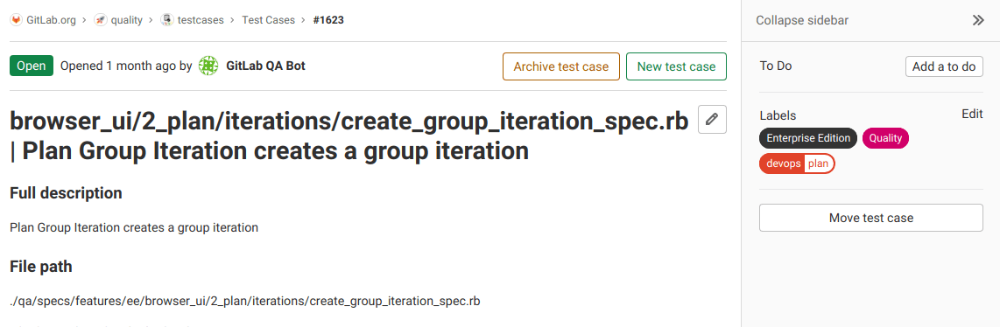



- Tier: 旗舰版
- Offering: JihuLab.com，私有化部署



测试用例将测试规划直接集成到您的极狐GitLab 工作流中。团队可以：

- 在管理代码的同一平台中记录测试场景。
- 将测试需求与开发任务一同跟踪。
- 在实施团队和测试团队之间共享测试计划。
- 通过机密设置管理测试用例的可见性。
- 根据需要存档和重新打开测试用例。

团队使用测试用例来简化开发团队和测试团队之间的协作，从而无需使用外部测试规划工具。

## 创建测试用例

先决条件：

- 您必须具有计划者、报告者、开发者、维护者或所有者角色。

要在极狐GitLab 项目中创建测试用例：

1. 在顶部栏中，选择**搜索或跳转到**，然后找到您的项目。
1. 在左侧边栏中，选择**构建** > **测试用例**。
1. 选择**新建测试用例**。您将进入新建测试用例表单。在这里，您可以输入
   新用例的标题、[描述](../../user/markdown.md)、附加文件，并分配[标记](../../user/project/labels.md)。
1. 选择**提交测试用例**。您将进入查看新测试用例的页面。

## 查看测试用例

您可以在测试用例列表中查看项目中的所有测试用例。使用搜索查询筛选议题列表，包括标记或测试用例的标题。

先决条件：

- 公开项目中的非机密测试用例：您不必是项目成员。
- 私有项目中的非机密测试用例：您必须具有该项目的访客、计划者、报告者、开发者、维护者或所有者角色。
- 机密测试用例（无论项目可见性如何）：您必须具有该项目的计划者、报告者、开发者、维护者或所有者角色。

要查看测试用例：

1. 在顶部栏中，选择**搜索或跳转到**，然后找到您的项目。
1. 在左侧边栏中，选择**构建** > **测试用例**。
1. 选择您要查看的测试用例的标题。您将进入测试用例页面。

## 编辑测试用例

您可以编辑测试用例的标题和描述。

先决条件：

- 您必须具有计划者、报告者、开发者、维护者或所有者角色。
- 被降级为访客角色的用户仍可继续编辑他们在担任更高角色时
  创建的测试用例。

要编辑测试用例：

1. [查看测试用例](#view-a-test-case)。
1. 在右上角，选择**编辑**。
1. 编辑测试用例的标题或描述。
1. 选择**保存更改**。

## 将测试用例设为机密

如果您正在处理的测试用例包含私有信息，可以将其设为机密。

先决条件：

- 您必须具有计划者、报告者、开发者、维护者或所有者角色。

要将测试用例设为机密：

- 在您[创建测试用例](#create-a-test-case)时：在**机密性**下，选中**此测试用例为机密**复选框。
- 在您[编辑测试用例](#edit-a-test-case)时：在右侧边栏中，**机密性**旁边，选择**编辑**，然后选择**开启**。

在创建新测试用例或编辑现有测试用例时，您也可以使用 [`/confidential` 快速操作](../../user/project/quick_actions.md#confidential)。

## 存档测试用例

当您想停止使用某个测试用例时，可以将其存档。您稍后可以[重新打开已存档的测试用例](#reopen-an-archived-test-case)。

先决条件：

- 您必须具有计划者、报告者、开发者、维护者或所有者角色。

要存档测试用例，请在测试用例页面上选择**存档测试用例**。

要查看已存档的测试用例：

1. 在顶部栏中，选择**搜索或跳转到**，然后找到您的项目。
1. 在左侧边栏中，选择**构建** > **测试用例**。
1. 选择**已存档**。

## 重新打开已存档的测试用例

如果您决定再次开始使用某个已存档的测试用例，可以重新打开它。

先决条件：

- 您必须具有计划者、报告者、开发者、维护者或所有者角色。

要重新打开已存档的测试用例：

1. [查看测试用例](#view-a-test-case)。
1. 选择**重新打开测试用例**。
