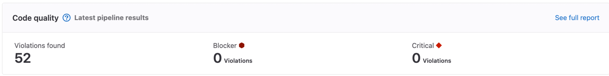



- Tier: 基础版，专业版，旗舰版
- Offering: JihuLab.com，私有化部署



代码质量可在可维护性问题演变为技术债务之前将其识别出来。代码评审期间产生的自动反馈可帮助您的团队编写更好的代码。检查结果会直接显示在合并请求中，让问题在修复成本最低时就能被发现。

代码质量支持多种编程语言，并可与常见的 linter、样式检查器和复杂度分析器集成。您现有的工具可以接入代码质量工作流，在保留团队偏好的同时，统一结果的显示方式。

<a id="features-per-tier"></a>

## 各版本的功能

不同[极狐GitLab 版本](https://gitlab.cn/pricing)提供不同的功能，如下表所示：

| 功能                                                                                     | 基础版     | 专业版  | 旗舰版 |
|:--------------------------------------------------------------------------------------------|:------------|:------------|:------------|
| [从 CI/CD 作业导入代码质量结果](#import-code-quality-results-from-a-cicd-job) |  |  |  |
| [使用基于 CodeClimate 的扫描](#use-the-built-in-code-quality-cicd-template-deprecated)   |  |  |  |
| [在合并请求报告中查看检查结果](#merge-request-reports)                             |  |  |  |
| [在流水线报告中查看检查结果](#pipeline-details-view)                                 |   |  |  |
| [在合并请求变更视图中查看检查结果](#merge-request-changes-view)               |   |   |  |
| [在项目质量摘要视图中分析整体健康状况](#project-quality-view)           |   |   |  |

<a id="scan-code-for-quality-violations"></a>

## 扫描代码中的质量违规问题

代码质量是一个开放系统，支持从多种扫描工具导入结果。要发现并呈现违规问题，您可以：

- 直接使用扫描工具并[导入其结果](#import-code-quality-results-from-a-cicd-job)。_（推荐。）_
- [使用内置 CI/CD 模板](#use-the-built-in-code-quality-cicd-template-deprecated)启用扫描。该模板使用 CodeClimate 引擎，它封装了常见的开源工具。_（已废弃。）_

您可以在单个流水线中收集来自多个工具的结果。例如，您可以运行代码 linter 来扫描代码，同时运行语言 linter 来扫描文档，也可以将独立工具与基于 CodeClimate 的扫描结合使用。代码质量会合并所有报告，因此当您[查看结果](#view-code-quality-results)时可以看到全部结果。

<a id="import-code-quality-results-from-a-cicd-job"></a>

### 从 CI/CD 作业导入代码质量结果

许多开发团队已经在 CI/CD 流水线中使用 linter、样式检查器或其他工具来自动检测编码标准的违规情况。您可以将这些工具的检查结果与代码质量集成，从而更轻松地查看和修复问题。

要查看您的工具是否已有文档化的集成方式，请参阅[将常用工具与代码质量集成](#integrate-common-tools-with-code-quality)。

要将其他工具与代码质量集成：

1. 将该工具添加到您的 CI/CD 流水线中。
1. 配置该工具，使其将报告输出为文件。
   - 该文件必须使用[特定的 JSON 格式](#code-quality-report-format)。
   - 许多工具原生支持此输出格式。它们可能将其称为“CodeClimate 报告”“极狐GitLab 代码质量报告”或其他类似名称。
   - 其他工具有时可以使用自定义 JSON 格式或模板来生成 JSON 输出。由于[报告格式](#code-quality-report-format)只有少数几个必填字段，这种输出类型可能适用于代码质量报告。
1. 声明一个与此文件匹配的 [`codequality` 报告产物](../yaml/artifacts_reports.md#artifactsreportscodequality)。

现在，流水线运行后，质量工具的结果会被[处理并显示](#view-code-quality-results)。

<a id="use-the-built-in-code-quality-cicd-template-deprecated"></a>

### 使用内置的代码质量 CI/CD 模板（已废弃）

> [!warning]
> 此功能在极狐GitLab 17.3 中[已废弃](../../update/deprecations.md#codeclimate-based-code-quality-scanning-will-be-removed)，并计划在 19.0 中移除。
> 请改为[直接集成受支持工具的结果](#import-code-quality-results-from-a-cicd-job)。

代码质量还包含一个内置 CI/CD 模板 `Code-Quality.gitlab-ci.yaml`。该模板基于开源 CodeClimate 扫描引擎运行扫描。

CodeClimate 引擎会运行：

- 针对[一组受支持语言](https://docs.codeclimate.com/docs/supported-languages-for-maintainability)的基本可维护性检查。
- 一组可配置的[插件](https://docs.codeclimate.com/docs/list-of-engines)，它们封装了开源扫描器，用于分析您的源代码。

<a id="migrate-from-codeclimate-based-scanning"></a>

#### 从基于 CodeClimate 的扫描迁移

CodeClimate 引擎使用一组可自定义的分析插件。其中一些默认开启，另一些必须显式启用。以下集成可用于替代内置插件：

| 插件       | 默认开启                    | 替代方案 |
|--------------|----------------------------------|-------------|
| Duplication  |                       | [集成 PMD Copy/Paste Detector](#pmd-copypaste-detector)。 |
| ESLint       |                       | [集成 ESLint](#eslint)。 |
| gofmt        |                        | [集成 golangci-lint](#golangci-lint) 并启用 [gofmt linter](https://golangci-lint.run/usage/linters#gofmt)。 |
| golint       |                        | [集成 golangci-lint](#golangci-lint) 并启用其中一个可替代 golint 的内置 linter。golint [已废弃并冻结](https://github.com/golang/go/issues/38968)。 |
| govet        |                        | [集成 golangci-lint](#golangci-lint)。golangci-lint [默认包含 govet](https://golangci-lint.run/usage/linters#enabled-by-default)。 |
| markdownlint | （社区支持） | [集成 markdownlint-cli2](#markdownlint-cli2)。 |
| pep8         |                        | 集成替代的 Python linter，例如 [Flake8](#flake8)、[Pylint](#pylint) 或 [Ruff](#ruff)。 |
| RuboCop      |                       | [集成 RuboCop](#rubocop)。 |
| SonarPython  |                        | 集成替代的 Python linter，例如 [Flake8](#flake8)、[Pylint](#pylint) 或 [Ruff](#ruff)。 |
| Stylelint    | （社区支持） | [集成 Stylelint](#stylelint)。 |
| SwiftLint    |                        | [集成 SwiftLint](#swiftlint)。 |

<a id="view-code-quality-results"></a>

## 查看代码质量结果

代码质量结果显示在：

- [合并请求报告](#merge-request-reports)
- [合并请求变更视图](#merge-request-changes-view)
- [流水线详情视图](#pipeline-details-view)
- [项目质量视图](#project-quality-view)

<a id="merge-request-reports"></a>

### 合并请求报告

代码质量分析结果显示在合并请求的**报告**选项卡中。具有相同指纹的多个代码质量检查结果会显示为单个条目。为确定哪些检查结果是新增或已解决的，极狐GitLab 会将其与目标分支上[基线流水线](_index.md#baseline-pipeline-selection)的检查结果进行比较。

更多信息，请参阅[合并请求报告](../../user/project/merge_requests/reports.md)。

<a id="merge-request-changes-view"></a>

### 合并请求变更视图



- Tier: 旗舰版
- Offering: JihuLab.com，私有化部署



代码质量结果显示在合并请求的**变更**视图中。包含代码质量问题的行会在行号旁用符号标记。选择该符号可查看问题列表，然后选择某个问题可查看其详情。


<a id="pipeline-details-view"></a>

### 流水线详情视图



- Tier: 专业版，旗舰版
- Offering: JihuLab.com，私有化部署



流水线生成的全部代码质量违规问题列表显示在流水线详情页面的**代码质量**选项卡中。流水线详情视图会显示在其运行所在分支上发现的所有代码质量检查结果。


<a id="project-quality-view"></a>

### 项目质量视图



- Tier: 旗舰版
- Offering: JihuLab.com，私有化部署
- Status: 测试版



项目质量视图显示代码质量检查结果的概览。该视图位于**分析** > **CI/CD 分析**下，并且需要为特定项目启用 [`project_quality_summary_page`](../../administration/feature_flags/_index.md) 功能标志。



<a id="code-quality-report-format"></a>

## 代码质量报告格式

您可以从任何能够按以下格式输出报告的工具中[导入代码质量结果](#import-code-quality-results-from-a-cicd-job)。此格式是 [CodeClimate 报告格式](https://github.com/codeclimate/platform/blob/master/spec/analyzers/SPEC.md#data-types)的一个版本，包含的字段更少。

您作为[代码质量报告产物](../yaml/artifacts_reports.md#artifactsreportscodequality)提供的文件必须包含单个 JSON 数组。该数组中的每个对象必须至少具有以下属性：

| 名称                                                      | 类型    | 描述 |
|-----------------------------------------------------------|---------|-------------|
| `description`                                             | String  | 代码质量违规问题的可读描述。 |
| `check_name`                                              | String  | 表示与此违规问题关联的检查或规则的唯一名称。 |
| `fingerprint`                                             | String  | 用于标识此特定代码质量违规问题的唯一指纹，例如其内容的哈希值。 |
| `location.path`                                           | String  | 包含代码质量违规问题的文件，以代码仓库中的相对路径表示。不要添加 `./` 前缀。 |
| `location.lines.begin` 或 `location.positions.begin.line` | Integer | 代码质量违规问题所在的行。 |
| `severity`                                                | String  | 违规问题的严重程度，可以是 `info`、`minor`、`major`、`critical` 或 `blocker` 之一。 |

该格式与 [CodeClimate 报告格式](https://github.com/codeclimate/platform/blob/master/spec/analyzers/SPEC.md#data-types)在以下方面有所不同：

- 尽管 [CodeClimate 报告格式](https://github.com/codeclimate/platform/blob/master/spec/analyzers/SPEC.md#data-types)支持更多属性，代码质量仅处理前面列出的字段。
- 极狐GitLab 解析器不允许文件开头出现[字节顺序标记](https://en.wikipedia.org/wiki/Byte_order_mark)。
  某些工具默认会在其输出中添加 UTF-8 字节顺序标记，尤其是源自 Windows 或 .NET 环境的工具。
  要检查并移除 UTF-8 字节顺序标记，请运行：

  ```shell
  [ "$(head -c3 report.json | od -An -tx1 | tr -d ' \n')" = "efbbbf" ] && {
    sed -i.bak '1s/^\xEF\xBB\xBF//' report.json &&
      echo "BOM removed" ||
      echo "BOM detected but removal failed"
  } || echo "No BOM found, nothing changed"
  ```

例如，以下是一个合规的报告：

```json
[
  {
    "description": "'unused' is assigned a value but never used.",
    "check_name": "no-unused-vars",
    "fingerprint": "7815696ecbf1c96e6894b779456d330e",
    "severity": "minor",
    "location": {
      "path": "lib/index.js",
      "lines": {
        "begin": 42
      }
    }
  }
]
```

<a id="integrate-common-tools-with-code-quality"></a>

## 将常用工具与代码质量集成

许多工具原生支持所需的[报告格式](#code-quality-report-format)，可将其结果与代码质量集成。它们可能将其称为“CodeClimate 报告”“极狐GitLab 代码质量报告”或其他类似名称。

其他工具可以通过提供自定义模板或格式规范来配置为生成 JSON 输出。由于[报告格式](#code-quality-report-format)只有少数几个必填字段，这种输出类型可能适用于代码质量报告。

如果您已经在 CI/CD 流水线中使用某个工具，应调整现有作业以添加代码质量报告。调整现有作业可避免运行单独的作业，因为单独的作业可能会让开发者感到困惑，并使您的流水线运行时间更长。

如果您尚未使用某个工具，可以从头编写 CI/CD 作业，或通过使用 [CI/CD Catalog](../components/_index.md#cicd-catalog)中的组件来采用该工具。

<a id="code-scanning-tools"></a>

### 代码扫描工具

<a id="eslint"></a>

#### ESLint

如果您的 CI/CD 流水线中已有 [ESLint](https://eslint.org/) 作业，应添加一个报告以将其输出发送到代码质量。要集成其输出：

1. 在您的项目中添加 [`eslint-formatter-gitlab`](https://www.npmjs.com/package/eslint-formatter-gitlab) 作为开发依赖项。
1. 在用于运行 ESLint 的命令中添加 `--format gitlab` 选项。
1. 声明一个指向报告文件位置的 [`codequality` 报告产物](../yaml/artifacts_reports.md#artifactsreportscodequality)。
   - 默认情况下，该格式化程序会读取您的 CI/CD 配置，并推断其应保存报告的文件名。
     如果该格式化程序无法推断您在产物声明中使用的文件名，请将 CI/CD 变量 `ESLINT_CODE_QUALITY_REPORT` 设置为您为产物指定的文件名，例如 `gl-code-quality-report.json`。

您也可以使用或调整 [ESLint CI/CD 组件](https://gitlab.com/explore/catalog/components/code-quality-oss/codequality-os-scanners-integration)来运行扫描，并将其输出与代码质量集成。

<a id="stylelint"></a>

#### Stylelint

如果您的 CI/CD 流水线中已有 [Stylelint](https://stylelint.io/) 作业，应添加一个报告以将其输出发送到代码质量。要集成其输出：

1. 在您的项目中添加 [`@studiometa/stylelint-formatter-gitlab`](https://www.npmjs.com/package/@studiometa/stylelint-formatter-gitlab) 作为开发依赖项。
1. 在用于运行 Stylelint 的命令中添加 `--custom-formatter=@studiometa/stylelint-formatter-gitlab` 选项。
1. 声明一个指向报告文件位置的 [`codequality` 报告产物](../yaml/artifacts_reports.md#artifactsreportscodequality)。
   - 默认情况下，该格式化程序会读取您的 CI/CD 配置，并推断其应保存报告的文件名。
     如果该格式化程序无法推断您在产物声明中使用的文件名，请将 CI/CD 变量 `STYLELINT_CODE_QUALITY_REPORT` 设置为您为产物指定的文件名，例如 `gl-code-quality-report.json`。

更多详情和示例 CI/CD 作业定义，请参阅 [`@studiometa/stylelint-formatter-gitlab`的文档](https://www.npmjs.com/package/@studiometa/stylelint-formatter-gitlab#usage)。

<a id="mypy"></a>

#### MyPy

如果您的 CI/CD 流水线中已有 [MyPy](https://mypy-lang.org/) 作业，应添加一个报告以将其输出发送到代码质量。要集成其输出：

1. 在您的项目中安装 [`mypy-gitlab-code-quality`](https://pypi.org/project/mypy-gitlab-code-quality/) 作为依赖项。
1. 更改您的 `mypy` 命令，使其将输出发送到文件。
1. 在作业的 `script`中添加一个步骤，使用 `mypy-gitlab-code-quality` 将该文件重新处理为所需格式。例如：

   ```yaml
   - mypy $(find -type f -name "*.py" ! -path "**/.venv/**") --no-error-summary > mypy-out.txt || true  # "|| true" is used for preventing job failure when mypy find errors
   - mypy-gitlab-code-quality < mypy-out.txt > gl-code-quality-report.json
   ```

1. 声明一个指向报告文件位置的 [`codequality` 报告产物](../yaml/artifacts_reports.md#artifactsreportscodequality)。

您也可以使用或调整 [MyPy CI/CD 组件](https://gitlab.com/explore/catalog/components/code-quality-oss/codequality-os-scanners-integration)来运行扫描，并将其输出与代码质量集成。

<a id="flake8"></a>

#### Flake8

如果您的 CI/CD 流水线中已有 [Flake8](https://flake8.pycqa.org/en/latest/) 作业，应添加一个报告以将其输出发送到代码质量。要集成其输出：

1. 在您的项目中安装 [`flake8-gl-codeclimate`](https://github.com/awelzel/flake8-gl-codeclimate) 作为依赖项。
1. 在用于运行 Flake8 的命令中添加参数 `--format gl-codeclimate --output-file gl-code-quality-report.json`。
1. 声明一个指向报告文件位置的 [`codequality` 报告产物](../yaml/artifacts_reports.md#artifactsreportscodequality)。

您也可以使用或调整 [Flake8 CI/CD 组件](https://gitlab.com/explore/catalog/components/code-quality-oss/codequality-os-scanners-integration)来运行扫描，并将其输出与代码质量集成。

<a id="pylint"></a>

#### Pylint

如果您的 CI/CD 流水线中已有 [Pylint](https://pypi.org/project/pylint/) 作业，应添加一个报告以将其输出发送到代码质量。要集成其输出：

1. 在您的项目中安装 [`pylint-gitlab`](https://pypi.org/project/pylint-gitlab/) 作为依赖项。
1. 在用于运行 Pylint 的命令中添加参数 `--output-format=pylint_gitlab.GitlabCodeClimateReporter`。
1. 更改您的 `pylint` 命令，使其将输出发送到文件。
1. 声明一个指向报告文件位置的 [`codequality` 报告产物](../yaml/artifacts_reports.md#artifactsreportscodequality)。

您也可以使用或调整 [Pylint CI/CD 组件](https://gitlab.com/explore/catalog/components/code-quality-oss/codequality-os-scanners-integration)来运行扫描，并将其输出与代码质量集成。

<a id="ruff"></a>

#### Ruff

如果您的 CI/CD 流水线中已有 [Ruff](https://docs.astral.sh/ruff/) 作业，应添加一个报告以将其输出发送到代码质量。要集成其输出：

1. 在用于运行 Ruff 的命令中添加参数 `--output-format=gitlab`。
1. 更改您的 `ruff check` 命令，使其将输出发送到文件。
1. 声明一个指向报告文件位置的 [`codequality` 报告产物](../yaml/artifacts_reports.md#artifactsreportscodequality)。

您也可以使用或调整[文档化的 Ruff 极狐GitLab CI/CD 集成](https://docs.astral.sh/ruff/integrations/#gitlab-cicd)来运行扫描，并将其输出与代码质量集成。

<a id="golangci-lint"></a>

#### golangci-lint

如果您的 CI/CD 流水线中已有 [`golangci-lint`](https://golangci-lint.run/) 作业，应添加一个报告以将其输出发送到代码质量。要集成其输出：

1. 在用于运行 `golangci-lint`的命令中添加参数。

   - 对于 v1，添加 `--out-format code-climate:gl-code-quality-report.json,line-number`。
   - 对于 v2，添加 `--output.code-climate.path=gl-code-quality-report.json`。

1. 声明一个指向报告文件位置的 [`codequality` 报告产物](../yaml/artifacts_reports.md#artifactsreportscodequality)。

您也可以使用或调整 [golangci-lint CI/CD 组件](https://gitlab.com/explore/catalog/components/code-quality-oss/codequality-os-scanners-integration)来运行扫描，并将其输出与代码质量集成。

<a id="pmd-copypaste-detector"></a>

#### PMD Copy/Paste Detector

[PMD Copy/Paste Detector (CPD)](https://pmd.github.io/pmd/pmd_userdocs_cpd.html) 需要额外配置，因为其默认输出不符合所需格式。

您可以使用或调整 [PMD CI/CD 组件](https://gitlab.com/explore/catalog/components/code-quality-oss/codequality-os-scanners-integration)来运行扫描，并将其输出与代码质量集成。

<a id="swiftlint"></a>

#### SwiftLint

使用 [SwiftLint](https://realm.github.io/SwiftLint/) 需要额外配置，因为其默认输出不符合所需格式。

您可以使用或调整 [SwiftLint CI/CD 组件](https://gitlab.com/explore/catalog/components/code-quality-oss/codequality-os-scanners-integration)来运行扫描，并将其输出与代码质量集成。

<a id="rubocop"></a>

#### RuboCop

使用 [RuboCop](https://rubocop.org/) 需要额外配置，因为其默认输出不符合所需格式。

您可以使用或调整 [RuboCop CI/CD 组件](https://gitlab.com/explore/catalog/components/code-quality-oss/codequality-os-scanners-integration)来运行扫描，并将其输出与代码质量集成。

<a id="roslynator"></a>

#### Roslynator

使用 [Roslynator](https://josefpihrt.github.io/docs/roslynator/) 需要额外配置，因为其默认输出不符合所需格式。

您可以使用或调整 [Roslynator CI/CD 组件](https://gitlab.com/explore/catalog/components/code-quality-oss/codequality-os-scanners-integration)来运行扫描，并将其输出与代码质量集成。

<a id="documentation-scanning-tools"></a>

### 文档扫描工具

您可以使用代码质量扫描代码仓库中存储的任何文件，即使它不是代码。

<a id="vale"></a>

#### Vale

如果您的 CI/CD 流水线中已有 [Vale](https://vale.sh/) 作业，应添加一个报告以将其输出发送到代码质量。要集成其输出：

1. 在您的代码仓库中创建一个 Vale 模板文件，用于定义所需格式。
   - 您可以复制用于检查 GitLab 文档的开源[模板](https://gitlab.com/gitlab-org/gitlab/-/blob/master/doc/.vale/vale-json.tmpl)。
   - 您也可以使用其他开源变体，例如社区 [`gitlab-ci-utils` Vale 项目](https://gitlab.com/gitlab-ci-utils/container-images/vale/-/blob/main/vale/vale-glcq.tmpl)中使用的变体。该社区项目还提供[一个预制的容器镜像](https://gitlab.com/gitlab-ci-utils/container-images/vale)，其中包含相同的模板，因此您可以直接在流水线中使用它。
1. 在用于运行 Vale 的命令中添加参数 `--output="$VALE_TEMPLATE_PATH" --no-exit`。
1. 更改您的 `vale` 命令，使其将输出发送到文件。
1. 声明一个指向报告文件位置的 [`codequality` 报告产物](../yaml/artifacts_reports.md#artifactsreportscodequality)。

您也可以使用或调整开源作业定义来运行扫描，并将其输出与代码质量集成，例如：

- 用于检查 GitLab 文档的 [Vale linting 步骤](https://gitlab.com/gitlab-org/gitlab/-/blob/94f870b8e4b965a41dd2ad576d50f7eeb271f117/.gitlab/ci/docs.gitlab-ci.yml#L71-87)。
- 社区 [`gitlab-ci-utils` Vale 项目](https://gitlab.com/gitlab-ci-utils/container-images/vale#usage)。

<a id="markdownlint-cli2"></a>

#### markdownlint-cli2

如果您的 CI/CD 流水线中已有 [markdownlint-cli2](https://github.com/DavidAnson/markdownlint-cli2) 作业，应添加一个报告以将其输出发送到代码质量。要集成其输出：

1. 在您的项目中添加 [`markdownlint-cli2-formatter-codequality`](https://www.npmjs.com/package/markdownlint-cli2-formatter-codequality) 作为开发依赖项。
1. 如果您还没有，请在代码仓库的顶层创建一个 `.markdownlint-cli2.jsonc` 文件。
1. 在 `.markdownlint-cli2.jsonc`中添加 `outputFormatters` 指令：

   ```json
   {
     "outputFormatters": [
       [ "markdownlint-cli2-formatter-codequality" ]
     ]
   }
   ```

1. 声明一个指向报告文件位置的 [`codequality` 报告产物](../yaml/artifacts_reports.md#artifactsreportscodequality)。
   默认情况下，报告文件名为 `markdownlint-cli2-codequality.json`。
   1. 推荐。将报告的文件名添加到代码仓库的 `.gitignore` 文件中。

更多详情和示例 CI/CD 作业定义，请参阅 [`markdownlint-cli2-formatter-codequality`的文档](https://www.npmjs.com/package/markdownlint-cli2-formatter-codequality)。
