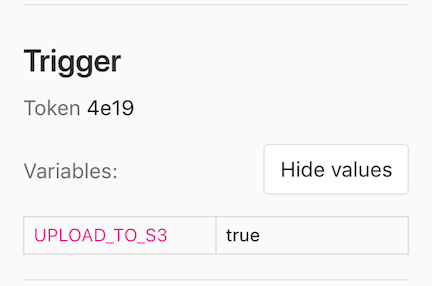



- Tier: 基础版，专业版，旗舰版
- Offering: JihuLab.com，私有化部署



您可以使用对[流水线触发器 API 端点](../../api/pipeline_triggers.md)的 API 调用，为特定分支或标签触发流水线。

您也可以使用 `trigger` 关键字，[从 CI/CD 作业触发下游流水线](../pipelines/downstream_pipelines.md)。

如果您正在[迁移到极狐GitLab CI/CD](../migration/plan_a_migration.md)，可以通过从其他提供方的作业中调用该 API 端点来触发极狐GitLab CI/CD 流水线。
例如，作为从 [Jenkins](../migration/jenkins.md) 或 [CircleCI](../migration/circleci.md) 迁移的一部分。

使用 API 进行身份验证时，您可以使用：

- [流水线触发器令牌](#create-a-pipeline-trigger-token)，通过[流水线触发器 API 端点](../../api/pipeline_triggers.md)
  触发分支或标签流水线。
- [CI/CD 作业令牌](../jobs/ci_job_token.md)，用于[触发多项目流水线](../pipelines/downstream_pipelines.md#trigger-a-multi-project-pipeline-by-using-the-api)。
- 另一个[具有 API 访问权限的令牌](../../security/tokens/_index.md)，通过[项目流水线 API 端点](../../api/pipelines.md#create-a-new-pipeline)
  创建新的流水线。

<a id="create-a-pipeline-trigger-token"></a>

## 创建流水线触发器令牌

您可以通过生成流水线触发器令牌并使用它进行 API 调用身份验证，来为分支或标签触发流水线。该令牌会模拟用户的项目访问权限和权限。

先决条件：

- 您必须拥有该项目的维护者或所有者角色。

要创建触发器令牌：

1. 在顶部栏中，选择**搜索或跳转到**，找到您的项目。
1. 在左侧边栏中，选择**设置** > **CI/CD**。
1. 展开**流水线触发器令牌**。
1. 选择**添加新令牌**。
1. 输入描述，然后选择**创建流水线触发器令牌**。
   - 您可以查看并复制您创建的所有触发器的完整令牌。
   - 对于其他项目成员创建的令牌，您只能看到前 4 个字符。

> [!warning]
> 在公开项目中以纯文本形式保存令牌，或以恶意用户可访问的方式存储令牌，都存在安全风险。
> 泄露的触发器令牌可能被用于强制进行计划外部署、尝试访问 CI/CD 变量，
> 或用于其他恶意用途。[掩码 CI/CD 变量](../variables/_index.md#mask-a-cicd-variable)
> 有助于提高触发器令牌的安全性。有关确保令牌安全的更多信息，
> 请参阅[安全注意事项](../../security/tokens/_index.md#security-considerations)。

<a id="trigger-a-pipeline"></a>

## 触发流水线

在您[创建流水线触发器令牌](#create-a-pipeline-trigger-token)后，您可以使用它，通过能够访问 API 的工具或
webhook 来触发流水线。

<a id="use-curl"></a>

### 使用 cURL

您可以使用 cURL，通过[流水线触发器 API 端点](../../api/pipeline_triggers.md)触发流水线。例如：

- 使用多行 cURL 命令：

  ```shell
  curl --request POST \
       --form token=<token> \
       --form ref=<ref_name> \
       "https://gitlab.example.com/api/v4/projects/<project_id>/trigger/pipeline"
  ```

- 使用 cURL，并在查询字符串中传递 `<token>` 和 `<ref_name>`：

  ```shell
  curl --request POST \
       "https://gitlab.example.com/api/v4/projects/<project_id>/trigger/pipeline?token=<token>&ref=<ref_name>"
  ```

在每个示例中，请替换：

- 将 URL 替换为 `https://jihulab.com` 或您的实例的 URL。
- 将 `<token>` 替换为您的触发器令牌。
- 将 `<ref_name>` 替换为分支或标签名称，例如 `main`。
- 将 `<project_id>` 替换为您的项目 ID，例如 `123456`。项目 ID 显示在
  [项目概览页面](../../user/project/working_with_projects.md#find-the-project-id)上。

<a id="use-a-cicd-job"></a>

### 使用 CI/CD 作业

您可以使用带有流水线触发器令牌的 CI/CD 作业，在另一个流水线运行时触发流水线。

例如，要在 `project-A`中创建标签时，触发 `project-B`的 `main` 分支上的流水线，请将以下作业添加到项目 A 的 `.gitlab-ci.yml` 文件中：

```yaml
trigger_pipeline:
  stage: deploy
  script:
    - 'curl --fail --request POST --form token=$MY_TRIGGER_TOKEN --form ref=main "${CI_API_V4_URL}/projects/123456/trigger/pipeline"'
  rules:
    - if: $CI_COMMIT_TAG
  environment: production
```

在此示例中：

- `1234` 是 `project-B`的项目 ID。项目 ID 显示在
  [项目概览页面](../../user/project/working_with_projects.md#find-the-project-id)上。
- [`rules`](../yaml/_index.md#rules) 使该作业在每次向 `project-A` 添加标签时运行。
- `MY_TRIGGER_TOKEN` 是一个[掩码 CI/CD 变量](../variables/_index.md#mask-a-cicd-variable)，
  其中包含触发器令牌。

<a id="use-a-webhook"></a>

### 使用 webhook

要从另一个项目的 webhook 触发流水线，请为推送和标签事件使用如下所示的 webhook URL：

```plaintext
https://gitlab.example.com/api/v4/projects/<project_id>/ref/<ref_name>/trigger/pipeline?token=<token>
```

请替换：

- 将 URL 替换为 `https://jihulab.com` 或您的实例的 URL。
- 将 `<project_id>` 替换为您的项目 ID，例如 `123456`。项目 ID 显示在
  [项目概览页面](../../user/project/working_with_projects.md#find-the-project-id)上。
- 将 `<ref_name>` 替换为分支或标签名称，例如 `main`。此值优先于 webhook 负载中的 `ref_name`。
  负载中的 `ref` 是源代码仓库中触发该触发器的分支。
  如果 `ref_name` 包含斜杠，您必须对其进行 URL 编码。
- 将 `<token>` 替换为您的流水线触发器令牌。

<a id="access-webhook-payload"></a>

#### 访问 webhook 负载

如果您使用 webhook 触发流水线，可以使用 `TRIGGER_PAYLOAD` [预定义 CI/CD 变量](../variables/predefined_variables.md)访问 webhook 负载。该负载以[文件类型变量](../variables/_index.md#use-file-type-cicd-variables)的形式公开，因此您可以使用 `cat $TRIGGER_PAYLOAD` 或类似命令访问数据。

<a id="pass-cicd-variables-in-the-api-call"></a>

### 在 API 调用中传递 CI/CD 变量

您可以在触发器 API 调用中传递任意数量的 [CI/CD 变量](../variables/_index.md)，不过[使用输入来控制流水线行为](#pass-pipeline-inputs-in-the-api-call)比 CI/CD 变量提供更好的安全性和灵活性。

这些变量具有[最高优先级](../variables/_index.md#cicd-variable-precedence)，并会覆盖所有同名变量。

该参数的格式为 `variables[key]=value`，例如：

```shell
curl --request POST \
     --form token=TOKEN \
     --form ref=main \
     --form "variables[UPLOAD_TO_S3]=true" \
     "https://gitlab.example.com/api/v4/projects/123456/trigger/pipeline"
```

触发的流水线中的 CI/CD 变量会显示在每个作业的页面上，但只有拥有所有者和维护者角色的用户才能查看其值。



使用输入来控制流水线行为比 CI/CD 变量提供更好的安全性和灵活性。

<a id="pass-pipeline-inputs-in-the-api-call"></a>

### 在 API 调用中传递流水线输入

您可以在触发器 API 调用中传递流水线输入。[输入](../inputs/_index.md)提供了一种结构化的方式，通过内置验证和文档来参数化您的流水线。

参数格式为 `inputs[name]=value`，例如：

```shell
curl --request POST \
     --form token=TOKEN \
     --form ref=main \
     --form "inputs[environment]=production" \
     "https://gitlab.example.com/api/v4/projects/123456/trigger/pipeline"
```

输入值会根据您流水线的 `spec:inputs` 部分中定义的类型和约束进行验证：

```yaml
spec:
  inputs:
    environment:
      type: string
      description: "Deployment environment"
      options: [dev, staging, production]
      default: dev
```

<a id="revoke-a-pipeline-trigger-token"></a>

## 撤销流水线触发器令牌

要撤销流水线触发器令牌：

1. 在顶部栏中，选择**搜索或跳转到**，找到您的项目。
1. 在左侧边栏中，选择**设置** > **CI/CD**。
1. 展开**流水线触发器**。
1. 在您要撤销的触发器令牌左侧，选择**撤销**（）。

已撤销的触发器令牌无法重新添加。

<a id="configure-cicd-jobs-to-run-in-triggered-pipelines"></a>

## 配置 CI/CD 作业在触发的流水线中运行

要[配置在触发的流水线中何时运行作业](../jobs/job_control.md)，您可以：

- 将 [`rules`](../yaml/_index.md#rules) 与 `$CI_PIPELINE_SOURCE` [预定义 CI/CD 变量](../variables/predefined_variables.md)一起使用。
- 使用 [`only`/`except`](../yaml/deprecated_keywords.md#onlyrefs--exceptrefs) 关键字，不过 `rules`
  是首选关键字。

| `$CI_PIPELINE_SOURCE` 值 | `only`/`except` 关键字 | 触发方式      |
|-----------------------------|--------------------------|---------------------|
| `trigger`                   | `triggers`               | 在使用[触发器令牌](#create-a-pipeline-trigger-token)通过[流水线触发器 API](../../api/pipeline_triggers.md) 触发的流水线中。 |
| `pipeline`                  | `pipelines`              | 在使用 [`$CI_JOB_TOKEN`](../jobs/ci_job_token.md) 通过[流水线触发器 API](../../api/pipeline_triggers.md) 触发的[多项目流水线](../pipelines/downstream_pipelines.md#trigger-a-multi-project-pipeline-by-using-the-api)中，或通过使用 CI/CD 配置文件中的 [`trigger`](../yaml/_index.md#trigger) 关键字触发。 |

此外，在使用流水线触发器令牌触发的流水线中，预定义 CI/CD 变量 `$CI_PIPELINE_TRIGGERED` 会设置为 `true`。

<a id="see-which-pipeline-trigger-token-was-used"></a>

## 查看使用了哪个流水线触发器令牌

您可以通过访问单个作业页面，查看是哪个流水线触发器令牌导致作业运行。触发器令牌的一部分会显示在右侧边栏的**作业详情**下。

在使用触发器令牌触发的流水线中，作业会在**构建** > **作业**中标记为 `triggered`。

<a id="troubleshooting"></a>

## 故障排除

<a id="403-forbidden-when-you-trigger-a-pipeline-with-a-webhook"></a>

### 使用 webhook 触发流水线时出现 `403 Forbidden`

当您使用 webhook 触发流水线时，API 可能会返回 `{"message":"403 Forbidden"}` 响应。为避免触发循环，请勿使用[流水线事件](../../user/project/integrations/webhook_events.md#pipeline-events)来触发流水线。

<a id="404-not-found-when-triggering-a-pipeline"></a>

### 触发流水线时出现 `404 Not Found`

触发流水线时返回 `{"message":"404 Not Found"}` 响应，可能是因为使用了[个人访问令牌](../../user/profile/personal_access_tokens.md)而不是流水线触发器令牌。[创建新的触发器令牌](#create-a-pipeline-trigger-token)并使用它来代替个人访问令牌。

触发流水线时返回 `{"message":"404 Not Found"}` 响应，也可能是因为使用了 `GET` 请求。流水线只能使用 `POST` 请求触发。

<a id="the-requested-url-returned-error-400-when-triggering-a-pipeline"></a>

### 触发流水线时出现 `The requested URL returned error: 400`

如果您尝试使用一个不存在的分支名称作为 `ref` 来触发流水线，
极狐GitLab 会返回 `The requested URL returned error: 400`。

例如，您可能在一个默认分支使用其他分支名称的项目中，意外地将分支名称用成了 `main`。

此错误的另一个可能原因是，某条规则在 `CI_PIPELINE_SOURCE` 值为 `trigger` 时阻止创建流水线，例如：

```yaml
rules:
  - if: $CI_PIPELINE_SOURCE == "trigger"
    when: never
```

请检查您的 [`workflow:rules`](../yaml/_index.md#workflowrules)，确保在 `CI_PIPELINE_SOURCE` 值为 `trigger` 时可以创建流水线。
