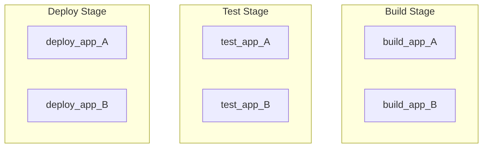
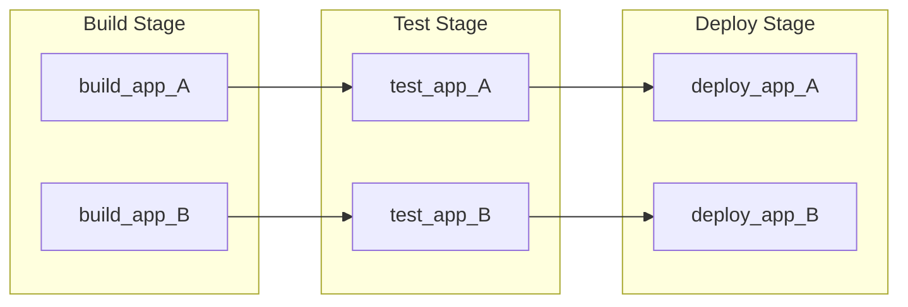
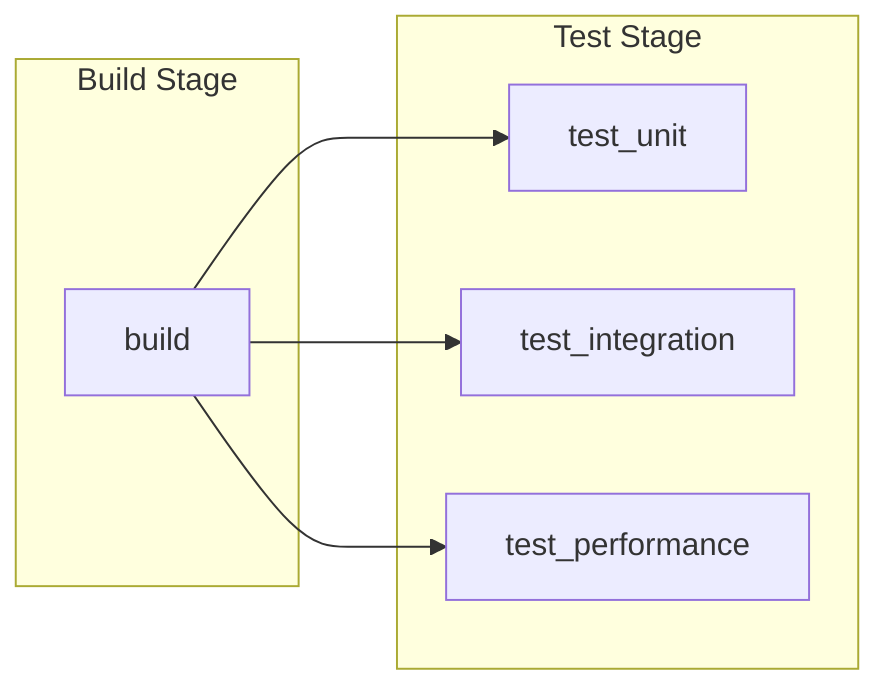
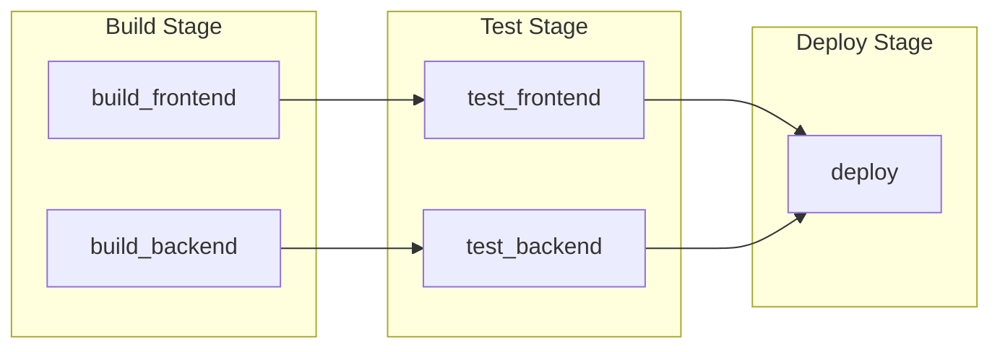
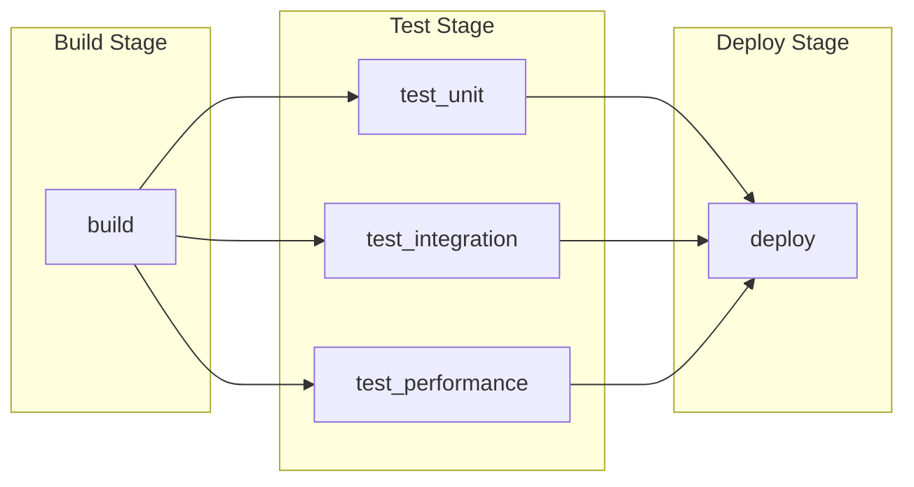
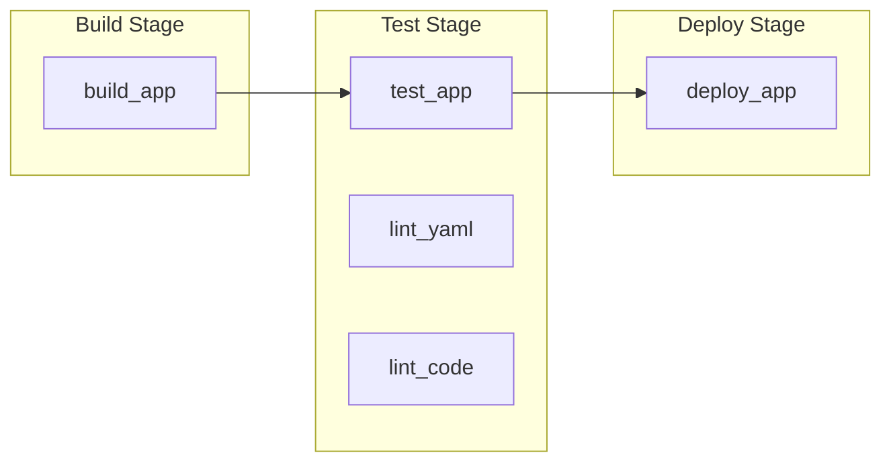
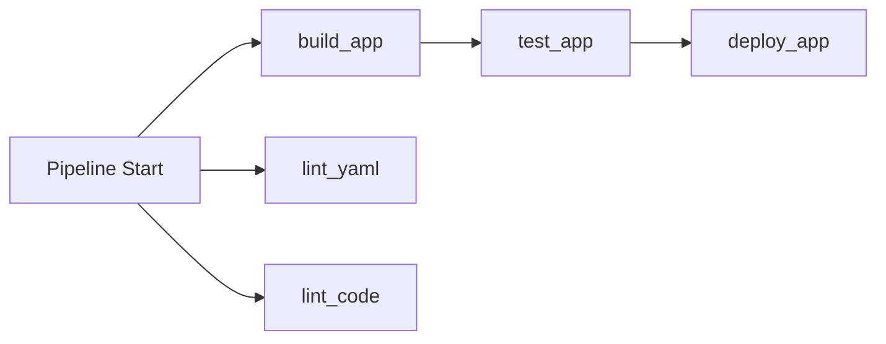



- Tier: 基础版，专业版，旗舰版
- Offering: JihuLab.com，私有化部署



使用 [`needs`](_index.md#needs) 关键字在流水线中指定作业依赖关系。作业会在其依赖项完成后立即启动，无需等待流水线阶段全部完成。这样您就能更早地运行作业，避免不必要的等待。

使用场景：

- 单体仓库：以并行执行路径构建和测试相互独立的服务。
- 多平台构建：为不同平台编译，无需等待所有构建完成。
- 更快获得反馈：更早获取测试结果和错误。

> [!note]
> `needs: project` 和 `needs: pipeline` 关键字不用于指定作业依赖关系。
> 使用 [`needs: project`](_index.md#needsproject) 从其他流水线中获取产物。
> 使用 [`needs: pipeline`](_index.md#needspipeline) 镜像上游流水线的流水线状态。

<a id="needs-workflow"></a>

## `needs` 工作流

默认情况下，作业按阶段运行。一个阶段中的所有作业都必须成功完成，后续阶段中的任何作业才能启动。例如，使用默认的 `build`、`test` 和 `deploy` 阶段时，`build`中的所有作业都必须运行并完成，`test`中的任何作业才能启动。

使用 `needs` 时，您可以列出某个作业所依赖的特定作业。该作业会在这些依赖项完成后立即启动，即使前面阶段中的其他作业仍在运行。这会创建一种具有[有向无环图（DAG）](https://en.wikipedia.org/wiki/Directed_acyclic_graph)结构的流水线。

您可以在同一流水线中混用分阶段作业和带 `needs` 依赖关系的作业。

此外，您可以使用 `needs: []` 将作业设置为立即运行，无需等待更早的作业或阶段完成。常见的做法是让 lint 作业或扫描器立即运行，因为它们可以基于源代码运行，不依赖构建结果。

<a id="needs-compared-to-staged-jobs"></a>

## `needs` 与分阶段作业的对比

为了演示 `needs`的优势，我们可以比较两个包含六个作业的流水线。

这个流水线将六个作业按阶段组织。不使用 `needs` 时，一个阶段中的所有作业都必须完成，下一个阶段才能开始，即使某些作业相互独立：



```yaml
stages:
  - build
  - test
  - deploy

build_app_A:
  stage: build
  script: echo "Building A..."

build_app_B:
  stage: build
  script: echo "Building B..."

test_app_A:
  stage: test
  script: echo "Testing A..."

test_app_B:
  stage: test
  script: echo "Testing B..."

deploy_app_A:
  stage: deploy
  script: echo "Deploying A..."

deploy_app_B:
  stage: deploy
  script: echo "Deploying B..."
```

在此示例中，`build` 阶段中的所有作业完成之前，不会运行任何测试或部署作业。如果 B 作业运行时间很长，A 测试和部署作业可能会在等待 B 作业完成期间被延迟。

使用 `needs` 时，您可以定义两条独立的执行路径。每个作业只依赖它实际需要的作业，从而允许两条路径并行执行：



```yaml
stages:
  - build
  - test
  - deploy

build_app_A:
  stage: build
  script: echo "Building A..."

build_app_B:
  stage: build
  script: echo "Building B..."

test_app_A:
  stage: test
  needs: ["build_app_A"]
  script: echo "Testing A..."

test_app_B:
  stage: test
  needs: ["build_app_B"]
  script: echo "Testing B..."

deploy_app_A:
  stage: deploy
  needs: ["test_app_A"]
  script: echo "Deploying A..."

deploy_app_B:
  stage: deploy
  needs: ["test_app_B"]
  script: echo "Deploying B..."
```

在此示例中，`test_app_A` 会在 `build_app_A` 成功完成后立即运行，即使 `build_app_B` 仍在运行。同样，`deploy_app_A` 也可以在 `build_app_B` 完成之前运行并部署。

<a id="view-dependencies-between-jobs"></a>

### 查看作业之间的依赖关系

您可以在流水线图上查看作业之间的依赖关系。

要启用此视图，请在流水线详情页中：

- 选择**作业依赖关系**。
- 可选。切换**显示依赖关系**，以显示表示哪些作业相互关联的连线。


<a id="needs-examples"></a>

## `needs` 示例

使用 `needs` 在作业之间创建依赖关系，减少作业等待启动的时间。模式可以包括扇出、扇入和菱形依赖。

<a id="fan-out"></a>

### 扇出

要创建扇出作业依赖图，请将多个作业配置为依赖同一个作业。

例如：



```yaml
stages:
  - build
  - test

build:
  stage: build
  script: echo "Building..."

test_unit:
  stage: test
  needs: ["build"]
  script: echo "Unit tests..."

test_integration:
  stage: test
  needs: ["build"]
  script: echo "Integration tests..."

test_performance:
  stage: test
  needs: ["build"]
  script: echo "Performance tests..."
```

<a id="fan-in"></a>

### 扇入

要创建扇入依赖图，请将一个作业配置为等待多个作业完成。

例如：



```yaml
stages:
  - build
  - test
  - deploy

build_frontend:
  stage: build
  script: echo "Building frontend..."

build_backend:
  stage: build
  script: echo "Building backend..."

test_frontend:
  stage: test
  needs: ["build_frontend"]
  script: echo "Testing frontend..."

test_backend:
  stage: test
  needs: ["build_backend"]
  script: echo "Testing backend..."

deploy:
  stage: deploy
  needs: ["test_frontend", "test_backend"]
  script: echo "Deploying..."
```

<a id="diamond-dependency"></a>

### 菱形依赖

要创建菱形依赖图，请结合扇出和扇入。一个作业扇出到多个作业，这些作业再扇入到单个作业。例如：



```yaml
stages:
  - build
  - test
  - deploy

build:
  stage: build
  script: echo "Building..."

test_unit:
  stage: test
  needs: ["build"]
  script: echo "Unit tests..."

test_integration:
  stage: test
  needs: ["build"]
  script: echo "Integration tests..."

test_performance:
  stage: test
  needs: ["build"]
  script: echo "Performance tests..."

deploy:
  stage: deploy
  needs: ["test_unit", "test_integration", "test_performance"]
  script: echo "Deploying..."
```

<a id="immediate-start"></a>

### 立即启动

使用 `needs: []` 将作业设置为在流水线创建时立即启动，无需等待其他作业或阶段。可将其用于可以立即运行但应出现在后续阶段（如 `test`）中的 lint 或扫描工具。

例如：

```yaml
stages:
  - build
  - test
  - deploy

build_app:
  stage: build
  script: echo "Building app..."

test_app:
  stage: test
  script: echo "Testing app..."

lint_yaml:
  stage: test
  needs: []
  script: echo "Linting YAML..."

lint_code:
  stage: test
  needs: []
  script: echo "Linting code..."

deploy_app:
  stage: deploy
  script: echo "Deploying app..."
```

在此示例中，`lint_yaml` 和 `lint_code` 通过 `needs: []` 立即启动，无需等待 `build_app` 或 `test` 阶段完成。`deploy_app` 不使用 `needs`，因此它会等待前面阶段中的所有作业完成后才启动。

流水线视图显示按阶段分组的作业：



作业会尽可能早地开始运行：



<a id="stageless-pipelines"></a>

## 无阶段流水线

您可以省略 `stage` 和 `stages` 关键字，仅使用 `needs` 来定义作业顺序。所有没有 `stage` 关键字的作业都在默认的 `test` 阶段中运行：

```yaml
compile:
  script: echo "Compiling..."

unit_tests:
  needs: ["compile"]
  script: echo "Running unit tests..."

integration_tests:
  needs: ["compile"]
  script: echo "Running integration tests..."

package:
  needs: ["unit_tests", "integration_tests"]
  script: echo "Packaging..."
```

要查看此流水线的结构，请在流水线详情页中[选择**作业依赖关系**](#view-dependencies-between-jobs)。如果您使用默认视图，所有作业都会分组在 `test` 阶段中。

<a id="optional-dependencies"></a>

## 可选依赖关系

在 `needs`中使用 `optional: true`，仅在作业存在于流水线中时才依赖它。当您将 `needs` 与 [`rules`](_index.md#rules) 结合使用时，可使用此选项来处理可能运行也可能不运行的作业。

例如：

```yaml
stages:
  - build
  - test
  - deploy

build:
  stage: build
  script: echo "Building..."

test:
  stage: test
  needs: ["build"]
  script: echo "Testing..."

test_optional:
  stage: test
  rules:
    - if: $RUN_OPTIONAL_TESTS == "true"
  script: echo "Optional tests..."

deploy:
  stage: deploy
  needs:
    - job: "test"
    - job: "test_optional"
      optional: true
  script: echo "Deploying..."
```

在此示例中：

- `deploy` 依赖于：
  - `test`，它始终存在于流水线中。
  - `test_optional`，仅当 `RUN_OPTIONAL_TESTS` 为 `true` 时才存在于流水线中。
- 当 `RUN_OPTIONAL_TESTS` 为：
  - `false` 时，`test_optional` 不存在于流水线中，`deploy` 会在 `test` 完成后运行。
  - `true` 时，`test_optional` 存在于流水线中，`deploy` 会等待 `test`
    和 `test_optional` 都完成。

如果不使用 `optional: true`，流水线创建会失败，因为 `deploy` 作业期望 `test_optional`，但它不存在于流水线中。

<a id="combine-needs-with-parallelmatrix"></a>

## 将 `needs` 与 `parallel:matrix` 结合使用

`needs` 关键字可与 `parallel:matrix` 配合使用，以[定义指向并行化作业的依赖关系](../jobs/job_control.md#specify-needs-between-parallelized-jobs)。

<a id="troubleshooting"></a>

## 故障排除

<a id="error-job-does-not-exist-in-the-pipeline"></a>

### 错误：`'job' does not exist in the pipeline`

当您将 `needs` 与 `rules` 结合使用时，您的流水线可能无法创建并显示此错误：

```plaintext
'unit_tests' job needs 'compile' job, but 'compile' does not exist in the pipeline.
This might be because of the only, except, or rules keywords. To need a job that
sometimes does not exist in the pipeline, use needs:optional.
```

此错误是由一个作业的 `needs` 设置为流水线中不存在的另一个作业导致的。要解决此问题，您必须执行以下任一操作：

- 为作业依赖关系添加 [`optional: true`](#optional-dependencies)，以便在
  所需作业不存在于流水线中时忽略它。
- 更新所需作业的 `rules` 配置，确保它在需要时始终运行。

例如：

```yaml
#
# Method 1: Job with rules that may not exist
#
compile:
  stage: build
  rules:
    - if: $COMPILE == "true"
  script: echo "Compiling..."

unit_tests:
  stage: test
  needs:
    - job: "compile"        # If $COMPILE == "false", the `compile` job is not added
      optional: true        # to the pipeline and this needs is ignored.
  script: echo "Running unit tests..."

#
# Method 2: Job with rules that always matches the dependent job
#
build:
  stage: build
  rules:
    - if: $BUILD == "true"
  script: echo "Building..."

test:
  stage: test
  rules:                    # Both jobs have identical `rules`, and will always exist
    - if: $BUILD == "true"  # in the pipeline together.
  needs: ["build"]
  script: echo "Testing..."
```
