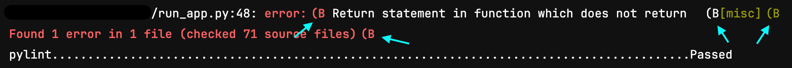

<a id="syntax-is-incorrect-in-scripts-that-use-"></a>

## 使用 `:` 的脚本中出现 `Syntax is incorrect`

如果在脚本中使用冒号（`:`），极狐GitLab 可能会输出：

- `Syntax is incorrect`
- `script config should be a string or a nested array of strings up to 10 levels deep`

例如，如果您在 cURL 命令中使用 `"PRIVATE-TOKEN: ${PRIVATE_TOKEN}"`：

```yaml
pages-job:
  stage: deploy
  script:
    - curl --header 'PRIVATE-TOKEN: ${PRIVATE_TOKEN}' "https://gitlab.example.com/api/v4/projects"
  environment: production
```

YAML 解析器会认为 `:` 定义了一个 YAML 关键字，并输出 `Syntax is incorrect` 错误。

要使用包含冒号的命令，您应该将整个命令用单引号括起来。您可能需要将现有的单引号（`'`）改为双引号（`"`）：

```yaml
pages-job:
  stage: deploy
  script:
    - 'curl --header "PRIVATE-TOKEN: ${PRIVATE_TOKEN}" "https://gitlab.example.com/api/v4/projects"'
  environment: production
```

<a id="job-does-not-fail-when-using--in-a-script"></a>

## 在脚本中使用 `&&` 时作业不会失败

如果您在单个脚本行中使用 `&&` 将两个命令组合在一起，即使其中一个命令失败，作业也可能返回成功。例如：

```yaml
job-does-not-fail:
  script:
    - invalid-command xyz && invalid-command abc
    - echo $?
    - echo "The job should have failed already, but this is executed unexpectedly."
```

即使这两个命令都失败了，`&&` 运算符仍会返回退出码 `0`，作业会继续运行。要在任一命令失败时强制脚本退出，请将整行括在括号中：

```yaml
job-fails:
  script:
    - (invalid-command xyz && invalid-command abc)
    - echo "The job failed already, and this is not executed."
```

<a id="multiline-commands-not-preserved-by-folded-yaml-multiline-block-scalar"></a>

## 折叠式 YAML 多行块标量不会保留多行命令

如果您使用 `- >` 折叠式 YAML 多行块标量来拆分长命令，额外的缩进会导致这些行被当作单独的命令处理。

例如：

```yaml
script:
  - >
    RESULT=$(curl --silent
      --header
        "Authorization: Bearer $CI_JOB_TOKEN"
      "${CI_API_V4_URL}/job"
    )
```

这会失败，因为缩进导致换行被保留：

```plaintext
$ RESULT=$(curl --silent # collapsed multi-line command
curl: no URL specified!
curl: try 'curl --help' or 'curl --manual' for more information
/bin/bash: line 149: --header: command not found
/bin/bash: line 150: https://gitlab.example.com/api/v4/job: No such file or directory
```

可通过以下任一方式解决：

- 移除多余的缩进：

  ```yaml
  script:
    - >
      RESULT=$(curl --silent
      --header
      "Authorization: Bearer $CI_JOB_TOKEN"
      "${CI_API_V4_URL}/job"
      )
  ```

- 修改脚本以处理额外的换行，例如使用 shell 行继续符：

  ```yaml
  script:
    - >
      RESULT=$(curl --silent \
        --header \
          "Authorization: Bearer $CI_JOB_TOKEN" \
        "${CI_API_V4_URL}/job")
  ```

<a id="job-log-output-is-not-formatted-as-expected-or-contains-unexpected-characters"></a>

## 作业日志输出未按预期格式化或包含意外字符

有时，对于依赖 `TERM` 环境变量进行着色或格式化的工具，作业日志中的格式会显示不正确。例如，使用 `mypy` 命令时：



极狐GitLab Runner 以非交互模式运行容器的 shell，因此 shell 的 `TERM`
环境变量被设置为 `dumb`。要修复这些工具的格式，您可以：

- 在运行命令之前，添加一行额外的脚本，在 shell 的环境中设置 `TERM=ansi`。
- 添加一个值为 `ansi`的 `TERM` [CI/CD 变量](../variables/_index.md)。
