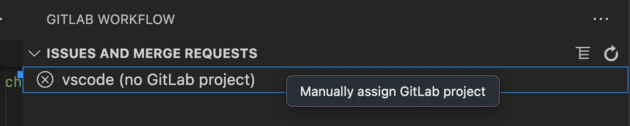

使用 GitLab for VS Code 时，您可能会遇到以下问题。

如果以下内容未涵盖您的问题，请收集[支持所需的信息](#required-information-for-support)，并在 [`gitlab-vscode-extension` 议题跟踪器](https://gitlab.com/gitlab-org/gitlab-vscode-extension/-/issues)中报告错误。

<a id="logs"></a>

## 日志

GitLab for VS Code 扩展以及为其提供支持的 GitLab Language Server 都会提供有助于您进行故障排除的日志。

<a id="enable-debug-logs"></a>

### 启用调试日志

要启用调试日志：

1. 在 VS Code 中，打开设置编辑器：
   - 对于 macOS，选择 **Code** > **首选项** > **设置**。
   - 对于 Windows 或 Linux，选择 **文件** > **首选项** > **设置**。
1. 选择 **扩展** > **GitLab** > **其他**。
1. 在 **GitLab：调试** 下，选中复选框以开启调试模式。
1. 重新加载窗口以重启扩展。
   1. 在 VS Code 中，选择 **查看** > **命令面板**。
   1. 输入 `Developer: Reload Window` 并按 <kbd>Enter</kbd>。

<a id="view-debug-logs"></a>

### 查看调试日志

要查看调试日志：

1. 在 VS Code 中，选择 **查看** > **输出**。
1. 在输出面板的右上角，选择下拉列表以筛选 **GitLab** 或 **GitLab Language Server** 日志。
1. 检查错误、警告、连接问题或认证问题。

<a id="authentication"></a>

## 认证

您可能会遇到以下认证错误。

<a id="error-cant-access-the-os-keychain"></a>

### 错误：`...can't access the OS Keychain`

在 macOS 和 Ubuntu 上，当扩展无法访问操作系统钥匙串进行认证时，您可能会遇到错误。

例如：

```plaintext
The GitLab extension can't access the OS Keychain.
If you use Ubuntu, see this existing issue.
```

```plaintext
Error: Cannot get password
at I.$getPassword (vscode-file://vscode-app/snap/code/97/usr/share/code/resources/app/out/vs/workbench/workbench.desktop.main.js:1712:49592)
```

请按照以下适用于您操作系统的变通方法操作。

有关此错误的更多信息，请参阅：

- [扩展议题 580](https://gitlab.com/gitlab-org/gitlab-vscode-extension/-/issues/580)
- [上游 `microsoft/vscode` 议题 147515](https://github.com/microsoft/vscode/issues/147515)

<a id="macos-workaround"></a>

#### macOS 变通方法

要在 macOS 上解决此错误：

1. 在您的机器上，打开 **钥匙串访问**，并搜索 `vscodegitlab.gitlab-workflow`。
1. 从您的钥匙串中删除 `vscodegitlab.gitlab-workflow`。
1. 在 VS Code 中，选择 **查看** > **命令面板**。
1. 输入 `GitLab: Remove Account from VS Code` 并按 <kbd>Enter</kbd>，以从 VS Code 中移除已损坏的账号。
1. 再次打开命令面板并运行 `GitLab: Authenticate` 以重新添加账号。

<a id="ubuntu-workaround"></a>

#### Ubuntu 变通方法

当您在 Ubuntu 20.04 和 22.04 中使用 `snap` 安装 VS Code 时，VS Code 无法从操作系统钥匙串读取密码。扩展版本 3.44.0 及更高版本使用操作系统钥匙串进行安全的令牌存储。

如果您使用的 VS Code 版本早于 1.68.0，请尝试以下变通方法之一：

- 将 GitLab for VS Code 扩展降级到 3.43.1 版本。
- 从 `.deb` 软件包安装 VS Code，而不是使用 `snap`：
  1. 卸载 `snap` 版 VS Code。
  1. 从 [`.deb` 软件包](https://code.visualstudio.com/Download)安装 VS Code。
  1. 前往 Ubuntu 的 **密码与密钥**，找到 `vscodegitlab.workflow/gitlab-tokens` 条目并将其删除。
  1. 在 VS Code 中，选择 **查看** > **命令面板**。
  1. 输入 `Gitlab: Remove Your Account` 并按 <kbd>Enter</kbd>，以移除凭据缺失的账号。
  1. 再次打开命令面板并运行 `GitLab: Authenticate` 以重新添加账号。

如果您使用的是 VS Code 1.68.0 或更高版本，请尝试重新认证：

1. 前往 Ubuntu 的 **密码与密钥**，找到 `vscodegitlab.workflow/gitlab-tokens` 条目并将其删除。
1. 在 VS Code 中，选择 **查看** > **命令面板**。
1. 输入 `Gitlab: Remove Your Account` 并按 <kbd>Enter</kbd>，以移除凭据缺失的账号。
1. 再次打开命令面板并运行 `GitLab: Authenticate` 以重新添加账号。

<a id="connection-and-authorization-error-when-using-gdk"></a>

### 使用 GDK 时的连接和授权错误

将 VS Code 与 GDK 一起使用时，您可能会遇到错误，提示您的系统无法与运行在 localhost 上的极狐GitLab 实例建立安全的 TLS 连接。

例如，如果您使用 `127.0.0.1:3000` 作为您的极狐GitLab 服务器：

```plaintext
Request to https://127.0.0.1:3000/api/v4/version failed, reason: Client network
socket disconnected before secure TLS connection was established
```

如果您在 `http` 上运行 GDK，而您的极狐GitLab 实例托管在 `https` 上，则会出现此问题。

要解决此问题：

1. 在 VS Code 中，选择 **查看** > **命令面板**。
1. 输入 `GitLab: Authenticate` 并按 <kbd>Enter</kbd>。
1. 选择手动为您的实例输入 `http` URL 的选项，并按 <kbd>Enter</kbd>。
1. 按照剩余提示完成认证。

<a id="project-configuration"></a>

## 项目配置

您可能会遇到以下项目配置错误。

<a id="account-and-project-configuration-errors"></a>

### 账号和项目配置错误

在 VS Code 中打开项目时，您可能会在 **GitLab** () 标签页中项目名称旁边看到错误消息。或者，您可能会在状态栏中看到有关多个账号或项目的警告消息。

当扩展无法确定要使用哪个代码仓库、账号或项目时，就会出现这些消息。

要解决这些错误：

- 如果未定义远程仓库或配置了多个远程仓库，请参阅[连接到您的代码仓库](setup.md#connect-to-your-repository)。
- 如果状态栏中出现 **多个极狐GitLab 账号**，请[切换账号](setup.md#switch-accounts)。
- 如果状态栏中出现 **（多个项目）**，请[选择项目](setup.md#select-a-project)。

如果这是您第一次在 VS Code 中使用 Git，请参阅 [VS Code 中的源代码管理](https://code.visualstudio.com/docs/sourcecontrol/overview)，了解有关初始化代码仓库和 VS Code 工作区的信息，这些操作发生在 GitLab 扩展之外。

<a id="git-remote-with-ssh-custom-alias"></a>

#### 使用 SSH 自定义别名的 Git 远程仓库

如果您的代码仓库远程地址使用了 SSH 自定义别名，扩展可能无法正确将您的代码仓库与极狐GitLab 项目匹配。例如，如果您的远程地址使用 `git@my-work-gitlab:group/project.git` 而不是 `git@gitlab.com:group/project.git`。

要解决此问题，您可以：

- 将远程地址更改为使用 HTTP，或使用不带自定义别名的 SSH。
- 在您的极狐GitLab 用户偏好设置中[设置默认的极狐GitLab Duo 命名空间](../../user/profile/preferences.md#set-a-default-gitlab-duo-namespace)。

<a id="https-project-cloning-works-but-ssh-cloning-fails"></a>

### HTTPS 项目克隆正常但 SSH 克隆失败

您可能会遇到 SSH 克隆错误，而 HTTPS 克隆正常。当您的 SSH URL 主机或路径与 HTTPS 路径不同时，就会出现这种情况。

GitLab for VS Code 扩展使用：

- 主机来匹配您设置的账号。
- 路径来获取命名空间和项目名称。

例如，VS Code 扩展项目的 URL 为：

- SSH：`git@gitlab.com:gitlab-org/gitlab-vscode-extension.git`
- HTTPS：`https://gitlab.com/gitlab-org/gitlab-vscode-extension.git`

两者都具有 `gitlab.com` 主机和 `gitlab-org/gitlab-vscode-extension` 路径。

要解决此错误：

1. 检查您的 SSH URL 是否位于不同的主机上，或者路径中是否包含额外的段。
1. 如果任一情况属实，请手动将 Git 代码仓库分配给极狐GitLab 项目：
   1. 在 VS Code 中，在左侧边栏中选择 **GitLab** ()。
   1. 选择标记为 `(no GitLab project)`的项目，然后选择 **手动分配极狐GitLab 项目**：
   
   1. 从列表中选择正确的项目。

有关简化此过程的更多信息，请参阅 `gitlab-vscode-extension` 项目中的[议题 577](https://gitlab.com/gitlab-org/gitlab-vscode-extension/-/issues/577)。

<a id="network-and-connectivity"></a>

## 网络和连接

您可能会遇到以下网络和连接错误。

<a id="error-407-access-denied-failure-with-a-proxy"></a>

### 错误：代理导致 `407 Access Denied` 失败

如果您使用需要认证的代理，您可能会遇到 `407 Access Denied (authentication_failed)` 错误。

例如：

```plaintext
Request failed: Can't add GitLab account for https://gitlab.com. Check your instance URL and network connection.
Fetching resource from https://jihulab.com/api/v4/personal_access_tokens/self failed
```

要解决此错误，请为 GitLab Language Server [启用代理认证](../language_server/_index.md#enable-proxy-authentication)。

<a id="errors-with-custom-certificates"></a>

### 自定义证书错误

如果您使用自定义证书连接到极狐GitLab 实例（例如自签名证书），您可能会遇到错误。

如果您的证书使用以下设置，则可能会出现这些错误：

| 设置名称 | 信息 |
|----------------------------------|-------------|
| `gitlab.ca` | 受支持。有关如何设置自签名 CA 的更多信息，请参阅 [SSL 设置指南](ssl.md#use-a-self-signed-ssl-certificate)。|
| `gitlab.cert` | 不受支持。请参阅[史诗 6244](https://gitlab.com/groups/gitlab-org/-/work_items/6244)。 |
| `gitlab.certKey` | 不受支持。请参阅[史诗 6244](https://gitlab.com/groups/gitlab-org/-/work_items/6244)。 |
| `gitlab.ignoreCertificateErrors` | 不受支持。请参阅[史诗 6244](https://gitlab.com/groups/gitlab-org/-/work_items/6244)。 |

要解决此问题，请参阅[为自定义证书颁发机构配置扩展](https://gitlab.com/gitlab-org/gitlab-vscode-extension/-/blob/main/docs/user/custom-certificates.md)。

<a id="expired-ssl-certificate"></a>

### SSL 证书过期

您可能会遇到错误的 SSL 证书过期错误。例如：

`API request failed - Error: certificate has expired`。

要解决此错误，请禁用系统证书：

1. 在 VS Code 中，打开设置编辑器：
   - 对于 macOS，选择 **Code** > **首选项** > **设置**。
   - 对于 Windows 或 Linux，选择 **文件** > **首选项** > **设置**
1. 在 **用户** 设置标签页中，选择 **应用程序** > **代理**。
1. 禁用 **代理严格 SSL** 和 **系统证书**的设置。

<a id="unreachable-localhost-port"></a>

### localhost 端口不可达

当您在 VS Code 中使用极狐GitLab Duo Agent Platform 时，无论是在桌面上还是在浏览器中，您都可能会遇到以下错误：

```plaintext
GitLab could not reach a service running on localhost:<unreachable_port> that this view depends on.
```

此问题的原因和解决方法取决于您是在桌面上还是在浏览器中使用 VS Code。

<a id="desktop-environment"></a>

#### 桌面环境

GitLab Language Server 在 localhost 端口上运行 HTTP 服务器，以在 VS Code 中渲染极狐GitLab Duo Agent Platform UI。在以下基于 VS Code 桌面的远程开发环境中，此服务器可能会导致问题：

- Remote-SSH：一项 VS Code 功能，可让您通过 SSH 连接到远程机器（例如云虚拟机或服务器）。
- Dev Containers：一项 VS Code 功能（也是开放标准），可在 Docker 容器内运行您的开发环境。
- Windows Subsystem for Linux (WSL)：一项 Windows 功能，可直接在 Windows 上运行 Linux 环境。

在这些远程开发环境中出现此问题，是因为无法保证 Language Server webview 端口可从 VS Code UI 渲染上下文访问。

要解决此问题：

1. 要打开 **端口** 面板，请选择 **查看** > **打开视图...** > **端口**。
1. 从错误消息中找到该端口并将其打开，或手动输入端口。

   端口旁边的绿点并不能保证连接正常。请重新打开极狐GitLab Duo Agent Platform 视图以确认。
1. 如果您无法打开该端口，则可能是防火墙、VPN 或杀毒软件设置阻止了它。请检查这些设置，然后重新打开视图。

<a id="browser-environment"></a>

#### 浏览器环境

如何解决此问题取决于您基于浏览器的 VS Code 环境是否支持转发此类 localhost 端口。

- 如果您的环境支持转发此类 localhost 端口，并且有 **端口** 面板可用，请选择 **查看** > **打开视图...** > **端口**。从错误消息中找到并打开被阻止的端口。
- 如果您的环境不支持转发此类 localhost 端口，则此 webview 无法工作。请改用连接到同一工作区的 VS Code 桌面应用程序。

<a id="gitlab-duo"></a>

## 极狐GitLab Duo

在 VS Code 中使用极狐GitLab Duo 时，您可能会遇到以下问题。

<a id="gitlab-duo-features-are-unavailable"></a>

### 极狐GitLab Duo 功能不可用

要在 VS Code 中排查极狐GitLab Duo 错误：

1. 确保您满足[先决条件](setup.md#configure-gitlab-duo)，并且必要的设置已开启。
1. 确保[管理员模式已禁用](../../administration/settings/sign_in_restrictions.md#turn-off-admin-mode-for-your-session)。
1. 查看诊断输出：
   1. 在 VS Code 中，选择 **查看** > **命令面板**。
   1. 运行命令 `GitLab: Diagnostics` 并检查输出中是否有任何失败的检查。
1. 如果诊断表明该功能未开启：
   1. 在 VS Code 中，打开设置编辑器：
      - 对于 macOS，选择 **Code** > **首选项** > **设置**。
      - 对于 Windows 或 Linux，选择 **文件** > **首选项** > **设置**
   1. 选择 **扩展** > **GitLab** > **极狐GitLab Duo**。
   1. 找到缺失功能对应的 **GitLab ›** 部分，并选中复选框以将其开启。
1. 如果诊断表明当前项目不支持 Agentic Chat，请设置[默认的极狐GitLab Duo 命名空间](../../user/profile/preferences.md#namespace-resolution-in-your-local-environment)。
1. 如果诊断表明所有 Agentic Chat 检查均已通过，但您仍然看不到面板，则它可能隐藏在您的[自定义 VS Code 布局](https://code.visualstudio.com/docs/configure/custom-layout)中。
   1. 在 VS Code 中，选择 **查看** > **命令面板**。
   1. 运行命令 `View: Show GitLab Duo Agent Platform` 或 `View: Toggle GitLab Duo Agent Platform`。

有关代码建议的支持，请参阅[代码建议故障排除](../../user/project/repository/code_suggestions/troubleshooting.md#vs-code-troubleshooting)。

<a id="gitlab-duo-returns-http11-responses-instead-of-websocket-endpoints"></a>

### 极狐GitLab Duo 返回 `HTTP/1.1` 响应而不是 WebSocket 端点

您可能会在日志中看到来自极狐GitLab Duo 的 `HTTP/1.1` 响应，而不是 `/-/cable` WebSocket 端点。

当您的极狐GitLab 实例阻止 WebSocket 连接时，就会出现这种情况。

要解决此错误，请让您的网络管理员修改极狐GitLab 实例，以[允许来自 IDE 客户端的入站 WebSocket 连接](../../administration/gitlab_duo/configure/_index.md#allow-inbound-connections-from-clients-to-the-gitlab-instance)。

如果与极狐GitLab Duo Agent Platform 的连接失败并出现 WebSocket 错误 `1006` 或 `404`，请参阅[连接失败并出现 WebSocket 错误 `1006` 或 `404`](../../user/duo_agent_platform/troubleshooting.md#connection-fails-with-websocket-error-1006-or-404)。

<a id="gitlab-duo-chat-fails-to-initialize-in-remote-environments"></a>

### 极狐GitLab Duo Chat 在远程环境中初始化失败

在远程开发环境（例如基于浏览器的 VS Code 或远程 SSH 连接）中使用极狐GitLab Duo Chat 时，您可能会遇到初始化失败，例如：

- Chat 面板空白或无法加载。
- 日志中出现错误，例如 `The webview didn't initialize in 10000ms`。
- 扩展尝试连接到无法访问的本地 URL。

要解决这些错误：

1. 在 VS Code 中，打开设置编辑器：
   - 对于 macOS，选择 **Code** > **首选项** > **设置**。
   - 对于 Windows 或 Linux，选择 **文件** > **首选项** > **设置**
1. 在右上角，选择 **打开设置（JSON）** 以编辑您的 `settings.json` 文件。
1. 添加或修改此设置：

   ```json
   "gitlab.featureFlags.languageServerWebviews": false
   ```

1. 保存更改并重新加载窗口：
   1. 在 VS Code 中，选择 **查看** > **命令面板**。
   1. 输入 `Developer: Reload Window` 并按 <kbd>Enter</kbd>。

有关永久解决方案的更新，请参阅[议题 #1944](https://gitlab.com/gitlab-org/gitlab-vscode-extension/-/issues/1944) 和[议题 #1943](https://gitlab.com/gitlab-org/gitlab-vscode-extension/-/issues/1943)

<a id="gitlab-duo-commands-fail-or-run-indefinitely"></a>

### 极狐GitLab Duo 命令失败或无限期运行

当您在 IDE 中使用极狐GitLab Duo Agentic Chat 或软件开发任务流时，极狐GitLab Duo 可能会陷入循环或难以运行命令。

当您使用 shell 主题或集成（例如 `Oh My ZSH!` 或 `powerlevel10k`）时，可能会出现此问题。当极狐GitLab Duo Agent 创建终端时，shell 主题或集成可能会阻止命令正常运行。

作为变通方法，请按照以下说明为 Agent 发送的命令使用更简单的主题。

有关修复的更多信息，请参阅[议题 2116](https://gitlab.com/gitlab-org/gitlab-vscode-extension/-/work_items/2116)。

<a id="edit-your-zshrc-file"></a>

#### 编辑您的 `.zshrc` 文件

在 VS Code 中，将 `Oh My ZSH!` 或 `powerlevel10k` 配置为在运行 Agent 发送的命令时使用更简单的主题。您可以使用 IDE 公开的环境变量来设置这些值。

编辑您的 `~/.zshrc` 文件以包含以下代码：

```shell
# ~/.zshrc

# Path to your oh-my-zsh installation
export ZSH="$HOME/.oh-my-zsh"

# ...

# Decide whether to load a full terminal environment,
# or keep it minimal for agentic AI in IDEs
if [[ "$TERM_PROGRAM" == "vscode" ]]; then
  echo "IDE agentic environment detected, not loading full shell integrations"
else
  # Oh My ZSH
  source $ZSH/oh-my-zsh.sh
  # Theme: Powerlevel10k
  [[ ! -f ~/.p10k.zsh ]] || source ~/.p10k.zsh
  # Other integrations like syntax highlighting
fi

# Other setup, like PATH variables
```

<a id="edit-your-bash-shell"></a>

#### 编辑您的 Bash shell

在 VS Code 中，您可以关闭 Bash 中的高级提示符。

编辑您的 `~/.bashrc` 或 `~/.bash_profile` 文件以包含以下代码：

```shell
# ~/.bashrc or ~/.bash_profile

# Decide whether to load a full terminal environment,
# or keep it minimal for Agentic AI in IDEs
if [[ "$TERM_PROGRAM" == "vscode" ]]; then
  echo "IDE agentic environment detected, not loading full shell integrations"

  # Keep only essential settings for agents
  export PS1='\$ '  # Minimal prompt

else
  # Load full Bash environment

  # Custom prompt (e.g., Starship, custom PS1)
  if command -v starship &> /dev/null; then
    eval "$(starship init bash)"
  else
    # ... Add your own PS1 variable
  fi

  # Load additional integrations
fi

# Always load essential environment variables and aliases
```

<a id="required-information-for-support"></a>

## 支持所需的信息

在联系支持之前，请确保已安装最新的 GitLab for VS Code 扩展。

在 [VS Code Marketplace](https://marketplace.visualstudio.com/items?itemName=GitLab.gitlab-workflow)的 **版本历史** 标签页中查找最新版本。

从受影响的用户那里收集以下信息，并在您的错误报告中提供：

1. 向用户显示的错误消息。
1. **GitLab** 和 **GitLab Language Server** [日志](#logs)。
1. 诊断输出。
   1. 在 VS Code 中，选择 **查看** > **命令面板**。
   1. 输入 `GitLab: Diagnostics` 并按 <kbd>Enter</kbd>。
   1. 记下扩展版本。
1. 系统详细信息：
   - 在 VS Code 中，**操作系统** 详细信息：
     - 对于 macOS，前往 **Code** > **关于 Visual Studio Code** 并找到 **操作系统**。
     - 对于 Windows 或 Linux，前往 **帮助** > **关于** 并找到 **操作系统**。
   - 机器规格（CPU、RAM）：请从您的机器提供这些信息。它们在 IDE 中无法访问。
1. 描述影响范围。有多少用户受到影响？
1. 描述如何重现该错误。如果可能，请附上屏幕录制。
1. 描述其他极狐GitLab Duo 功能如何受到影响：
   - 极狐GitLab Quick Chat 是否正常？
   - 代码建议是否正常？
   - Web IDE 中的极狐GitLab Duo Chat 是否返回响应？
1. 按照 [GitLab for VS Code 扩展隔离指南](https://gitlab.com/gitlab-org/editor-extensions/gitlab-lsp/-/issues/814#step-2-extension-isolation-testing)中所述执行扩展隔离测试。尝试禁用（或卸载）所有其他扩展，以确定是否是其他扩展导致了该问题。
