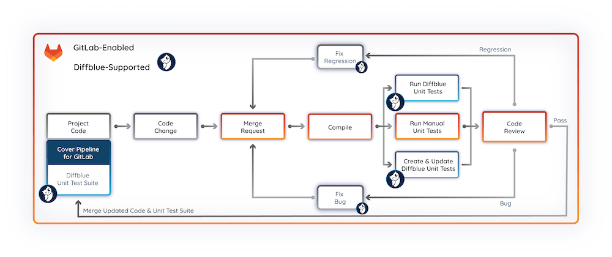
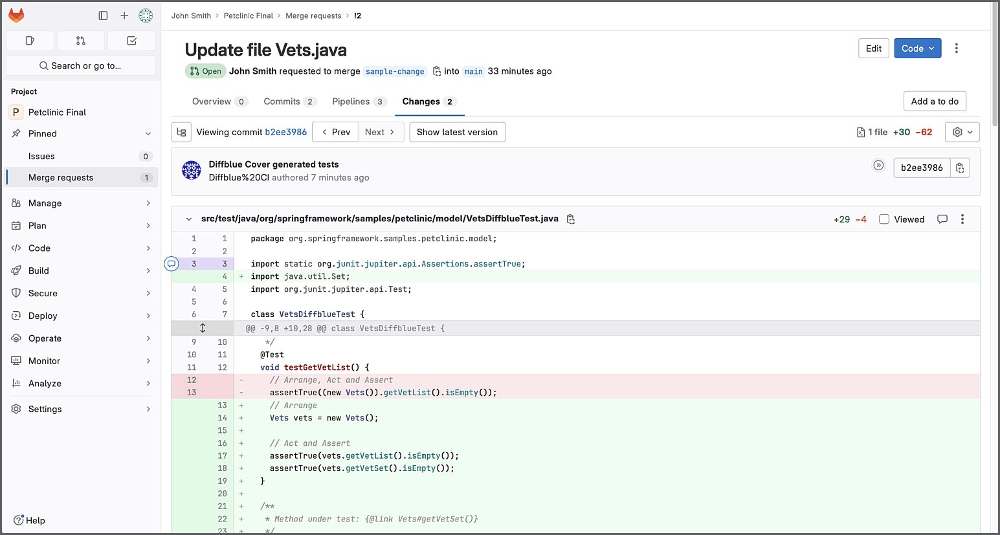



- Tier: 基础版，专业版，旗舰版
- Offering: JihuLab.com，私有化部署



您可以将 [Diffblue Cover](https://www.diffblue.com/) 强化学习 AI 工具集成到您的 CI/CD 流水线中，为您的极狐GitLab 项目自动编写和维护 Java 单元测试。
适用于极狐GitLab 的 Diffblue Cover 流水线集成让您可以自动：

- 为您的项目编写基线单元测试套件。
- 为新代码编写新的单元测试。
- 更新代码中现有的单元测试。
- 当代码中现有的单元测试不再需要时，将其移除。

## 配置集成

要将 Diffblue Cover 集成到您的流水线中：

1. 找到并配置 Diffblue Cover 集成。
1. 使用极狐GitLab 流水线编辑器和 Diffblue Cover 流水线模板，为示例项目配置一条流水线。
1. 为该项目创建完整的基线单元测试套件。

### 配置 Diffblue Cover

1. 在顶部栏中，选择**搜索或跳转到**，然后找到您的项目。
   - 如果您想使用示例项目测试该集成，可以[导入](../user/import/third_party_systems/repo_by_url.md)
     Diffblue 的 [Spring PetClinic 示例项目](https://github.com/diffblue/demo-spring-petclinic)。
1. 选择**设置** > **集成**。
1. 找到 **Diffblue Cover**，然后选择**配置**。
1. 填写以下字段：

   - 选中**活跃**复选框。
   - 输入您的 Diffblue Cover **许可证密钥**，该密钥在欢迎电子邮件中提供，或由您的组织提供。
     如有需要，选择[**试用 Diffblue Cover**](https://www.diffblue.com/try-cover/gitlab/) 链接以注册免费试用。
   - 输入您的极狐GitLab 访问令牌的详细信息（**名称**和**密钥**），以允许 Diffblue Cover 访问您的项目。
     通常，请使用具有 `Developer` 角色以及 `api` 和 `write_repository` 范围的极狐GitLab [项目访问令牌](../user/project/settings/project_access_tokens.md)。
     如有必要，您可以使用[群组访问令牌](../user/group/settings/group_access_tokens.md)或[个人访问令牌](../user/profile/personal_access_tokens.md)，同样需要具有 `Developer` 角色以及 `api` 和 `write_repository` 范围。

     > [!note]
     > 使用权限过大的访问令牌会带来安全风险。
     > 如果您使用个人访问令牌，请考虑创建一个专用用户，将其访问权限限制为仅限该项目，从而将令牌泄露的影响降至最低。

1. 选择**保存更改**。
   您的 Diffblue Cover 集成现在处于 <mark style="color:green;">**活跃**</mark> 状态，并可在您的项目中使用。

### 配置流水线

为项目创建一条合并请求流水线，该流水线会下载最新版本的 Diffblue Cover、构建项目、为项目编写 Java 单元测试，并将更改提交到分支。

1. 在顶部栏中，选择**搜索或跳转到**，然后找到您的项目。
1. 将 [`Diffblue-Cover.gitlab-ci.yml` 模板](https://gitlab.com/gitlab-org/gitlab/-/blob/master/lib/gitlab/ci/templates/Diffblue-Cover.gitlab-ci.yml)
   的内容复制到您项目的 `.gitlab-ci.yml` 文件中。

   > [!note]
   > 在您自己的项目中使用 Diffblue Cover 流水线模板并已有流水线文件时，请将 Diffblue 模板内容添加到您的文件中，并根据需要进行修改。
   > 更多信息，请参阅 Diffblue 文档中的[适用于极狐GitLab 的 Cover 流水线](https://cover-docs.diffblue.com/features/cover-pipeline/cover-pipeline-for-gitlab)。
1. 输入提交信息。
1. 输入新的**分支**名称。例如，`add-diffblue-cover-pipeline`。
1. 选择**使用这些更改启动新的合并请求**。
1. 选择**提交更改**。

### 创建基线单元测试套件

1. 在**新建合并请求**表单中，输入**标题**（例如“添加 Cover 流水线并创建基线单元测试套件”），并填写其他字段。
1. 选择**创建合并请求**。该合并请求流水线会运行 Diffblue Cover，为项目创建基线单元测试套件。
1. 流水线完成后，可以在**更改**选项卡中查看更改。当您满意时，将更新合并到您的代码仓库。转到项目代码仓库中的 `src/test` 文件夹，查看 Diffblue Cover 创建的单元测试（后缀为 `*DiffblueTest.java`）。

## 后续代码更改

对项目进行后续代码更改时，合并请求流水线会运行 Diffblue Cover，但只会更新相关的测试。随后可以分析生成的差异，以检查新行为、捕获回归，并发现代码中任何计划外的行为变更。

## 后续步骤

本主题演示了适用于极狐GitLab 的 Cover 流水线的一些关键功能，以及如何在流水线中使用该集成。通过流水线模板中的 `dcover` 命令提供的更广泛、更深入的功能，可用于进一步扩展您的单元测试能力。更多信息，请参阅 Diffblue 文档中的[适用于极狐GitLab 的 Cover 流水线](https://cover-docs.diffblue.com/features/cover-pipeline/cover-pipeline-for-gitlab)。
