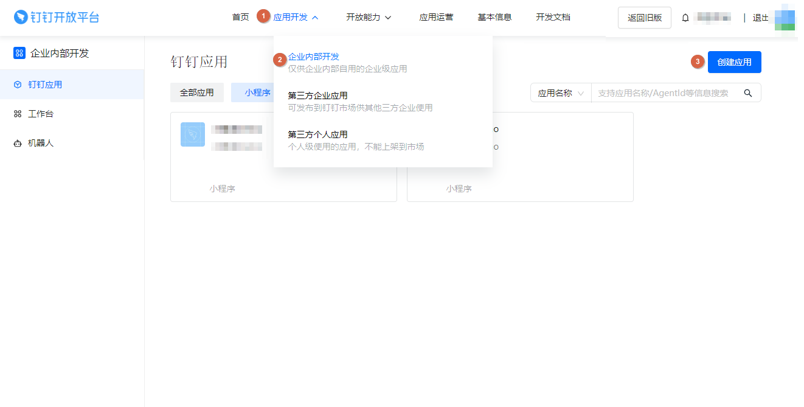
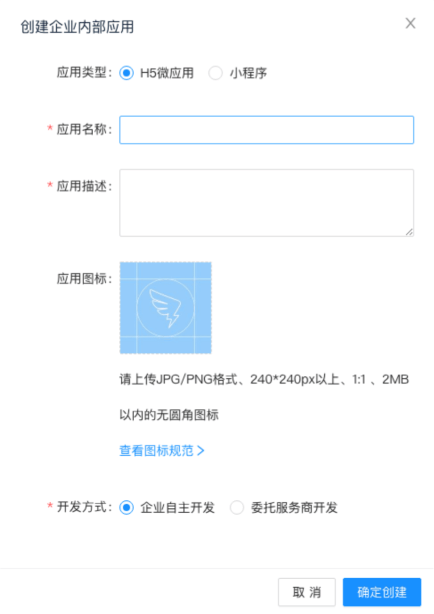
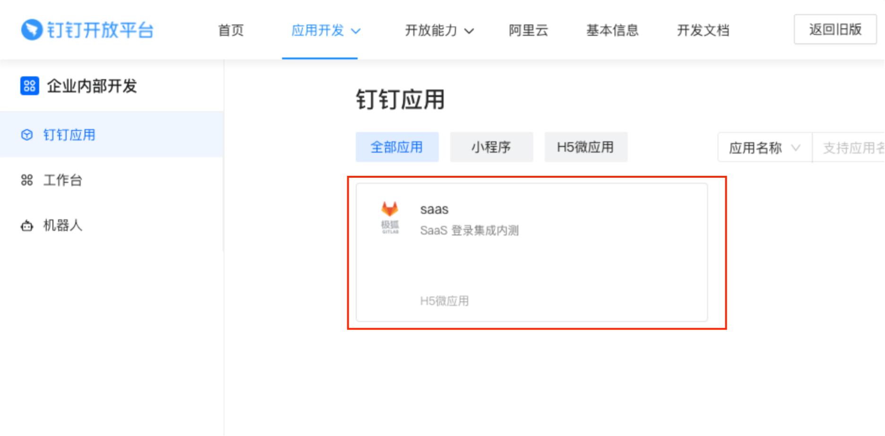
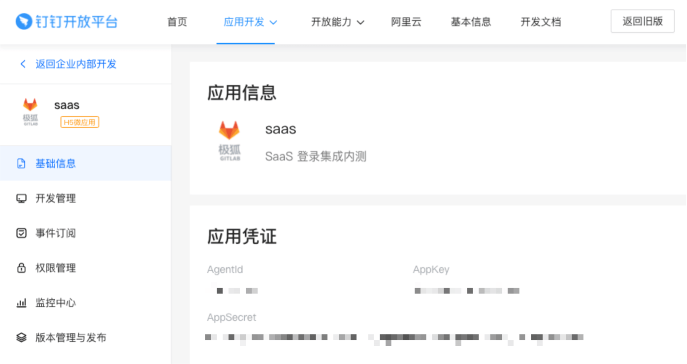



1. Tier: 基础版, 专业版, 旗舰版
1. Offering: 私有化部署



> - 引入于 14.5 版本。

您可以使用您的钉钉账号登录极狐GitLab。
登录钉钉开放平台，创建应用。钉钉会生成一个客户端 ID 和密钥供您使用。

1. 登录[钉钉开放平台](https://open-dev.dingtalk.com/)。

1. 在顶部栏上，选择 **应用程序开发 > 企业内部开发**，然后选择 **创建应用**。

   

1. 填写应用详细信息：

   - **应用名称**：可以是任何名称。考虑诸如`<Organization>'s GitLab` 或`<Your Name>'s GitLab` 之类的内容，或者其它描述性的内容。
   - **应用描述**：创建描述。
   - **应用图标**：如果需要，上传合格的图标。

   

1. 选择 **确定创建**。

1. 在左侧边栏中，选择 **钉钉应用**，找到您的应用。 选择它并转到应用程序信息页面。

   

1. 在 **应用凭证** 部分，应该有一个 AppKey 和 AppSecret（见下图）。继续配置时，请保持此页面打开。

   

1. 在 **分享设置 > 接入登录** 的 **回调域名** 中添加 `https://gitlab.example.com/users/auth/dingtalk/callback`，
   将 `gitlab.example.com` 替换为极狐GitLab 实例的地址，然后发布应用版本。

1. 记录企业 ID（CorpId）和 AgentId。
   登录只需要 AppKey 和 AppSecret。
   [钉钉工作通知](#钉钉工作通知)还需要 CorpId 和 AgentId。

1. 在您的 GitLab 服务器上，打开配置文件。

   对于 Omnibus 安装实例：

   ```shell
   sudo editor /etc/gitlab/gitlab.rb
   ```

   对于源安装实例：

   ```shell
   cd /home/git/gitlab

   sudo -u git -H editor config/gitlab.yml
   ```

1. 初始设置见[初始化配置](omniauth.md#初始化配置)。

1. 添加提供商配置：

   对于 Omnibus 安装实例：

   ```ruby
     gitlab_rails['omniauth_providers'] = [
       {
         name: "dingtalk",
         # label: "Provider name", # optional label for login button, defaults to "Ding Talk"
         app_id: "YOUR_APP_ID",
         app_secret: "YOUR_APP_SECRET",
         args: {
           corp_id: "YOUR_CORP_ID",
           agent_id: "YOUR_AGENT_ID"
         }
       }
     ]
   ```

   对于源安装实例：

   ```yaml
   - { name: 'dingtalk',
       # label: 'Provider name', # optional label for login button, defaults to 'Ding Talk'
       app_id: 'YOUR_APP_ID',
       app_secret: 'YOUR_APP_SECRET',
       args: { corp_id: 'YOUR_CORP_ID', agent_id: 'YOUR_AGENT_ID' } }
   ```

1. 将 `YOUR_APP_ID` 改为来自步骤 6 中应用信息页面的 AppKey。

1. 将 `YOUR_APP_SECRET` 改为来自步骤 6 中应用信息页面的 AppSecret。

1. 将 `YOUR_CORP_ID` 和 `YOUR_AGENT_ID` 改为来自步骤 7 的 CorpId 和 AgentId。
   不使用工作通知时，可以省略 `args`。

1. 保存配置文件。

1. 为使更改生效，对于 Omnibus 安装实例，需要[重新配置极狐GitLab](../administration/restart_gitlab.md#omnibus-gitlab-reconfigure)；对于源安装实例，需要[重启极狐GitLab](../administration/restart_gitlab.md#源安装实例)。

## 钉钉工作通知



- Tier: 基础版，专业版，旗舰版
- Offering: 私有化部署
- Status: 实验性功能





此功能由名为 `jh_dingtalk_app_notification` 的功能标志控制，默认禁用。
私有化部署实例的管理员可以启用此功能。



用户可以把极狐GitLab 通知发送到自己的钉钉工作通知。
通知使用登录提供商中的同一个企业内部应用，不需要配置另一组凭据。
极狐GitLab 使用整体跳转 ActionCard，并异步发送通知。

### 前提条件

- 一个钉钉企业内部应用
- 极狐GitLab 实例可以访问 `api.dingtalk.com` 和 `oapi.dingtalk.com`
- 实例的公网出口 IP 已加入钉钉应用的**服务器出口 IP**
- 钉钉应用已开通**成员信息读权限**（`qyapi_get_member`），极狐GitLab 在登录或绑定时用它获取企业内 `userid`
- 需要接收通知的成员在钉钉应用的**可使用范围**内
- 用户已绑定钉钉账号
- 许可证包含 `dingtalk_app_integration`

钉钉要求调用服务端 API 的来源 IP 在应用白名单中。
对于配置要求，参见钉钉的[开发网页应用服务端](https://open.dingtalk.com/document/orgapp/develop-webapp-backend)。

在钉钉应用详情页的 **部署与发布 > 版本管理与发布** 中配置可使用范围。
范围可以是全部员工、指定部门或员工，或者仅管理员。
对于范围类型，参见钉钉的[设置应用的可使用范围](https://open.dingtalk.com/document/orgapp/application-visible-range)。

### 配置通知凭据

通知使用 OmniAuth `dingtalk` 提供商中的以下配置：

| 配置项 | 钉钉中的值 | 用途 |
| --- | --- | --- |
| `app_id` | Client ID（原 AppKey） | 获取应用 accessToken |
| `app_secret` | Client Secret（原 AppSecret） | 获取应用 accessToken |
| `args.corp_id` | 企业 ID（CorpId） | 限定接收人映射所属企业 |
| `args.agent_id` | AgentId | 发送工作通知 |

四项配置必须齐备。
通知功能仅支持企业内部应用。

极狐GitLab 通过钉钉的[企业内部应用 accessToken](https://open.dingtalk.com/document/orgapp/obtain-the-access_token-of-an-internal-app)
接口取得应用凭证，并按应用独立缓存。
accessToken 的有效期为 7200 秒。
有效期内重复获取会返回相同结果并自动续期，不会使缓存中的相同 accessToken 失效。

通知使用独立的客户端和 accessToken 缓存。
这项配置不会改变钉钉登录的令牌缓存，也不会改变现有钉钉命令集成使用的凭据或客户端。

### 启用功能标志

在 Rails 控制台中启用：

```ruby
Feature.enable(:jh_dingtalk_app_notification)
```

禁用：

```ruby
Feature.disable(:jh_dingtalk_app_notification)
```

功能标志作用于整个实例，并且只控制消息通知：

- 标志关闭时，用户通知设置不显示钉钉选项，也不会向钉钉发送通知
- 标志关闭时，钉钉登录和绑定不受影响
- 重新启用后，已保存的用户选择恢复生效

以下任一条件不满足时，用户通知设置不显示钉钉选项：

| 条件 | 要求 |
| --- | --- |
| 部署类型 | 私有化部署实例 |
| 许可证 | 包含 `dingtalk_app_integration` |
| 功能标志 | `jh_dingtalk_app_notification` 已启用 |
| 应用配置 | `app_id`、`app_secret`、`args.corp_id` 和 `args.agent_id` 均有效 |

### 开启钉钉通知

要接收钉钉通知：

1. 转到 **用户设置 > 通知**。
1. 选择 **同时向我的钉钉账号发送通知**。

该选项默认关闭。
仅绑定钉钉账号不会自动开启通知。

### 推送范围

钉钉通知使用极狐GitLab 现有的通知接收人和通知级别判断。
只有本应收到相应极狐GitLab 通知、已开启钉钉通知，并且具有有效钉钉映射的用户才会收到卡片。

因此：

- 用户的全局、群组和项目通知级别继续生效
- 项目关闭通知后，钉钉也不发送对应通知
- 极狐GitLab 不会仅因启用钉钉通知而增加新的通知事件
- 测试通知时，应当由另一个用户触发会发送给接收人的事件

### 消息内容

卡片包含通知标题、项目名称、通知原因、摘要和一个指向极狐GitLab 的查看按钮。
通知原因包括被指派、被请求评审、被提及和已订阅。

机密内容的卡片只包含标题和链接。
用户必须返回极狐GitLab 查看内容，并通过现有权限检查。

卡片格式遵循钉钉的[工作通知类型](https://open.dingtalk.com/document/orgapp/message-types-and-data-format)：

- `msgtype` 为 `action_card`
- `action_card.markdown` 必填，建议不超过 1000 个字符
- `action_card.single_title` 和 `action_card.single_url` 必须同时设置
- `single_title` 最长 20 个字符，`single_url` 最长 500 个字符
- 整个 `msg` 最长 2048 字节

### 接收人映射

钉钉登录身份和工作通知使用不同的用户标识。
极狐GitLab 在钉钉登录或绑定成功时，从可信授权响应中保存企业内 `userid`，但不修改现有身份的
`extern_uid`。

接收人映射绑定到以下值：

- 当前钉钉身份记录
- 现有身份的 `extern_uid`
- 企业 ID
- Client ID
- AgentId

已有钉钉绑定的用户可能没有工作通知接收人映射。
用户使用钉钉重新登录后，极狐GitLab 会补齐映射，不需要先解除绑定。
重新登录无法补齐时，用户必须转到 **用户设置 > Access > Password and authentication**，
在 **Service sign-in** 中解除钉钉绑定，然后重新连接。

管理员更改企业 ID、Client ID 或 AgentId 后，旧映射自动失效，队列中按旧配置生成的通知也不会发送。
用户必须在新配置下重新登录或重新绑定，防止通知发送到另一个企业或应用中的同名成员。

### 钉钉平台限制

极狐GitLab 调用钉钉的[发送工作通知](https://open.dingtalk.com/document/orgapp/asynchronous-sending-of-enterprise-session-messages)
接口。
钉钉对工作通知实施以下限制：

- `userid_list` 每次最多包含 100 个用户
- 企业内部应用的一次发送任务最多触达 5000 人
- 同一个应用每天只能向同一员工发送一条内容相同的工作通知
- 企业内部应用每天最多向同一员工发送 500 条工作通知
- 每个企业内部应用或第三方企业应用每分钟最多有 5000 人收到工作通知

超出限制时，发送接口可能返回成功，但被限制的用户不会收到通知。
钉钉以错误码 `143105` 表示单人每日推送量超限，以 `143106` 表示重复消息超限。
对于诊断字段和 24 小时查询窗口，参见钉钉的[获取工作通知消息的发送结果](https://open.dingtalk.com/document/orgapp/gets-the-result-of-sending-messages-asynchronously-to-the-enterprise)。

### 真实环境验收

在测试用钉钉企业和非生产极狐GitLab 实例中完成以下验收：

1. 关闭功能标志，确认钉钉登录和绑定可用，通知设置不显示钉钉选项。
1. 启用功能标志，确认已授权许可证和完整应用配置的实例显示钉钉选项。
1. 绑定新用户，开启钉钉通知，由另一个用户触发指派或提及，确认收到卡片且链接正确。
1. 使用功能上线前已经绑定钉钉的用户重新登录，确认无需解除绑定即可开启并接收通知。
1. 触发普通通知，确认卡片显示标题、项目、通知原因和摘要。
1. 触发机密内容通知，确认卡片仅显示标题和链接。
1. 在测试环境更改企业 ID、Client ID 或 AgentId，确认旧映射不再投递。
1. 恢复配置并重新登录或绑定，确认通知恢复。

当前功能发布前仍需完成以上真实环境验收。

## 故障排查

| 现象 | 排查方向 |
| --- | --- |
| 登录页没有 **Ding Talk** 按钮 | 检查 OmniAuth 是否启用，以及提供商列表中是否有 `dingtalk` |
| 钉钉授权失败 | 检查 AppKey、AppSecret 和钉钉应用的回调配置 |
| 服务端 API 提示请求 IP 不在白名单 | 把错误中的请求 IP 加入钉钉应用的**服务器出口 IP** |
| 通知设置没有钉钉选项 | 检查部署类型、许可证、功能标志和四项应用配置 |
| 页面提示重新登录或绑定 | 当前绑定没有通知接收人映射，或者映射与当前应用配置不匹配 |
| 已绑定但无法补齐映射 | 在 **Password and authentication** 中解除钉钉绑定，然后重新连接 |
| 日志出现 `DingTalk sign-in returned no corporate user ID` | 为钉钉应用开通成员信息读权限 `qyapi_get_member`，然后重新连接钉钉 |
| 收到其他通知但没有钉钉卡片 | 检查是否开启钉钉通知、成员是否在应用可使用范围内，以及服务器出口 IP |
| 极狐GitLab 和钉钉都没有通知 | 检查用户的全局、群组和项目通知级别，以及该事件是否会通知当前用户 |
| 一天内相同内容只有第一条送达 | 钉钉重复消息限制，属于预期行为 |
| 高频通知丢失 | 钉钉可能在发送接口返回成功后按每日或每分钟限额过滤接收人 |
