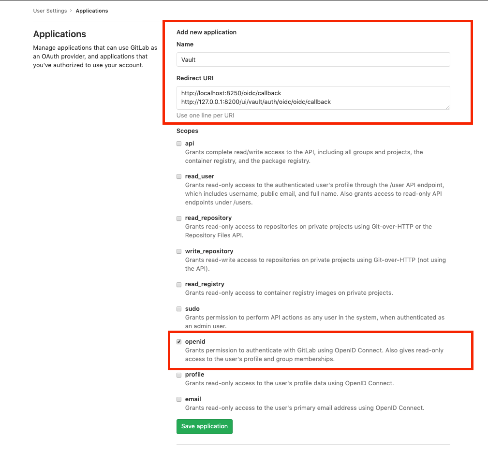
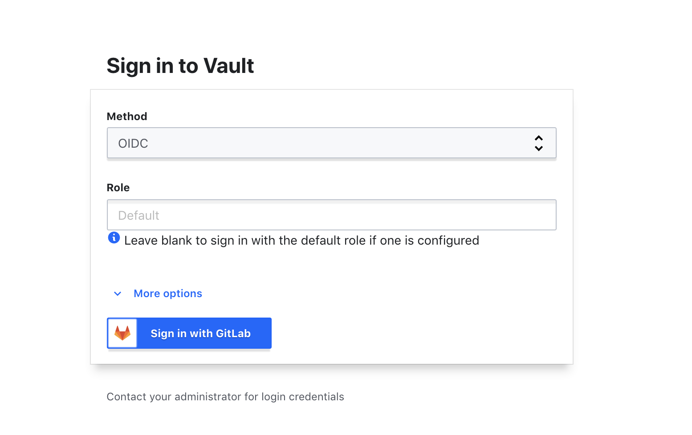
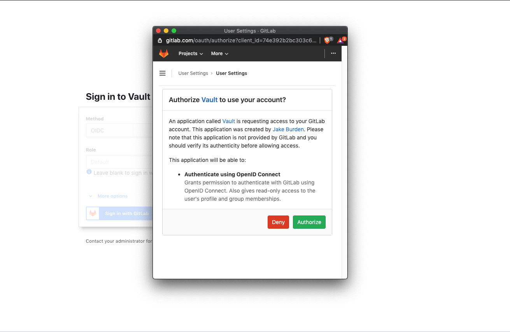
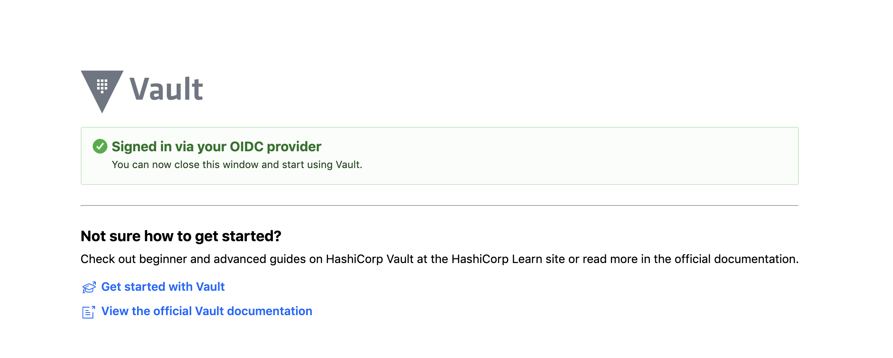



- Tier: 基础版，专业版，旗舰版
- Offering: 私有化部署



[Vault](https://www.vaultproject.io/) 是 HashiCorp 提供的一款密钥管理应用。
它允许您存储和管理敏感信息，例如密钥环境变量、加密密钥和认证令牌。

Vault 提供基于身份的访问，这意味着 Vault 用户可以通过他们首选的多个云服务提供商进行身份验证。

以下内容说明 Vault 用户如何使用极狐GitLab 的 OpenID 功能进行身份验证。

<a id="prerequisites"></a>

## 先决条件

1. [安装 Vault](https://developer.hashicorp.com/vault/install)。
1. 运行 Vault。

<a id="get-the-openid-connect-client-id-and-secret-from-gitlab"></a>

## 从极狐GitLab 获取 OpenID Connect 客户端 ID 和密钥

首先，您必须创建一个极狐GitLab 应用，以获取用于向 Vault 进行身份验证的应用 ID 和密钥。为此，请登录极狐GitLab 并按照以下步骤操作：

1. 在右上角，选择您的头像。
1. 选择**编辑个人资料**。
1. 在左侧边栏中，选择**访问** > **应用**。
1. 填写应用的**名称**和[**重定向 URI**](https://developer.hashicorp.com/vault/docs/auth/jwt#redirect-uris)。
1. 选择 **OpenID** 范围。
1. 选择**保存应用**。
1. 复制**客户端 ID** 和**客户端密钥**，或保持页面打开以供参考。



<a id="enable-openid-connect-on-vault"></a>

## 在 Vault 上启用 OpenID Connect

Vault 默认未启用 OpenID Connect (OIDC)。

要在 Vault 中启用 OIDC 身份验证提供商，请打开终端会话并运行以下命令：

```shell
vault auth enable oidc
```

您应在终端中看到以下输出：

```plaintext
Success! Enabled oidc auth method at: oidc/
```

<a id="write-the-oidc-configuration"></a>

## 编写 OIDC 配置

要将极狐GitLab 生成的应用 ID 和密钥提供给 Vault，并允许 Vault 通过极狐GitLab 进行身份验证，请在终端中运行以下命令：

```shell
vault write auth/oidc/config \
  oidc_discovery_url="https://gitlab.com" \
  oidc_client_id="<your_application_id>" \
  oidc_client_secret="<your_secret>" \
  default_role="demo" \
  bound_issuer="localhost"
```

将 `<your_application_id>` 和 `<your_secret>` 替换为您的应用所生成的应用 ID 和密钥。

您应在终端中看到以下输出：

```shell
Success! Data written to: auth/oidc/config
```

<a id="write-the-oidc-role-configuration"></a>

## 编写 OIDC 角色配置

您必须告知 Vault 在您创建应用时提供给极狐GitLab 的[**重定向 URI**](https://developer.hashicorp.com/vault/docs/auth/jwt#redirect-uris) 和范围。

在终端中运行以下命令：

```shell
vault write auth/oidc/role/demo - <<EOF
{
   "user_claim": "sub",
   "allowed_redirect_uris": "<your_vault_instance_redirect_uris>",
   "bound_audiences": "<your_application_id>",
   "oidc_scopes": "<openid>",
   "role_type": "oidc",
   "policies": "demo",
   "ttl": "1h",
   "bound_claims": { "groups": ["<yourGroup/yourSubgrup>"] }
}
EOF
```

替换：

- `<your_vault_instance_redirect_uris>` 为与您的 Vault 实例运行位置匹配的重定向 URI。
- `<your_application_id>` 为您的应用所生成的应用 ID。

`oidc_scopes` 字段必须包含 `openid`。

此配置以您正在创建的角色名称保存。此示例创建一个 `demo` 角色。

> [!warning]
> 如果您使用的是公共极狐GitLab 实例（例如 JihuLab.com），则必须指定
> `bound_claims`，以仅允许您的群组或项目的成员访问。
> 否则，任何拥有公共账号的人都可以访问您的 Vault 实例。

<a id="sign-in-to-vault"></a>

## 登录 Vault

1. 转到您的 Vault UI。例如：<http://127.0.0.1:8200/ui/vault/auth?with=oidc>。
1. 如果未选择 `OIDC` 方法，请打开下拉列表并选择它。
1. 选择**使用极狐GitLab 登录**，这将打开一个对话框：

   
1. 要允许 Vault 通过极狐GitLab 登录，请选择**授权**。这会将您作为已身份验证的用户重定向回您的 Vault UI。

   

<a id="sign-in-using-the-vault-cli-optional"></a>

## 使用 Vault CLI 登录（可选）

您也可以使用 [Vault CLI](https://developer.hashicorp.com/vault/docs/commands) 登录 Vault。

1. 要使用您在上一个示例中创建的角色配置登录，
   请在终端中运行以下命令：

   ```shell
   vault login -method=oidc port=8250 role=demo
   ```

   此命令设置：

   - `role=demo`，以便 Vault 知道您希望使用哪个配置登录。
   - `-method=oidc`，以将 Vault 设置为使用 `OIDC` 登录方法。
   - `port=8250`，以设置极狐GitLab 应重定向到的端口。此端口
     号必须与列出[重定向 URI](https://developer.hashicorp.com/vault/docs/auth/jwt#redirect-uris) 时提供给极狐GitLab 的端口匹配。

   运行此命令后，您应在终端中看到一个链接。
1. 在 Web 浏览器中打开此链接：

   

   您应在终端中看到：

   ```plaintext
   Success! You are now authenticated. The token information displayed below
   is already stored in the token helper. You do NOT need to run "vault login"
   again. Future Vault requests will automatically use this token.
   ```
